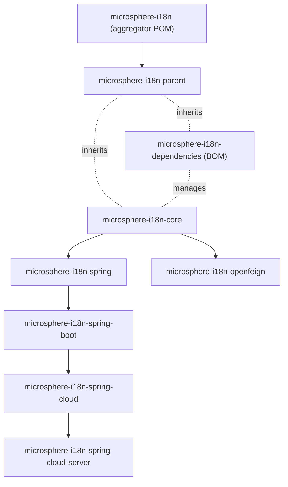

# Microsphere I18n Documentation

Documentation for [microsphere-i18n](https://github.com/microsphere-projects/microsphere-i18n), the
internationalization framework for Java and the Spring ecosystem.

- [中文文档入口](./zh/README.md)

## Documentation structure

Documents are organized by **audience**, then by **release line (branch)**, then by **Maven module**.
English is the default language; Chinese translations live in a parallel `zh/` directory with
identical file names.

```
docs/
├── user-guide/          # Usage-oriented documentation (API, configuration, examples)
│   ├── current/         # 0.2.x line (release branch, Spring Boot 3)
│   │   └── zh/          # Chinese translations
│   └── 1.x/             # 0.1.x line (release-1.x branch, Spring Boot 2)
│       └── zh/
└── developer-guide/     # Architecture, source analysis, design patterns, flows
    ├── current/
    │   └── zh/
    └── 1.x/
        └── zh/
```

## Start here

| **Document** | **Chinese** | **Audience** |
|--------------|-------------|--------------|
| [User Guide](./user-guide/README.md) | [用户文档](./user-guide/zh/README.md) | Application developers consuming the library |
| [Developer Guide](./developer-guide/README.md) | [开发者文档](./developer-guide/zh/README.md) | Contributors and framework integrators |

## Release lines

| **Branch** | **Directory** | **Version line** | **Latest release** | **Namespace** | **Spring Boot** | **Spring Cloud** | **Java** |
|------------|---------------|------------------|--------------------|---------------|-----------------|------------------|----------|
| `release` | [`current/`](./user-guide/current/README.md) | 0.2.x | `0.2.21` | `jakarta.*` | 3.x | 2022.0.x – 2025.0.x | 17+ |
| `release-1.x` | [`1.x/`](./user-guide/1.x/README.md) | 0.1.x | `0.1.21` | `javax.*` | 2.3.x – 2.7.x | Hoxton.SR12 – 2021.0.x | 8+ |

## Maven modules

One dedicated document per module in each guide:

| **Module** | **User Guide** | **Developer Guide** | **Purpose** |
|------------|----------------|---------------------|-------------|
| `microsphere-i18n-parent` | [parent.md](./user-guide/current/parent.md) | [parent.md](./developer-guide/current/parent.md) | Parent POM, imports the microsphere-spring-cloud BOM |
| `microsphere-i18n-dependencies` | [dependencies.md](./user-guide/current/dependencies.md) | [dependencies.md](./developer-guide/current/dependencies.md) | Project BOM managing all module versions |
| `microsphere-i18n-core` | [core.md](./user-guide/current/core.md) | [core.md](./developer-guide/current/core.md) | `ServiceMessageSource` abstraction and classpath implementations |
| `microsphere-i18n-spring` | [spring.md](./user-guide/current/spring.md) | [spring.md](./developer-guide/current/spring.md) | Spring Framework integration (`@EnableI18n`, adapters, events) |
| `microsphere-i18n-spring-boot` | [spring-boot.md](./user-guide/current/spring-boot.md) | [spring-boot.md](./developer-guide/current/spring-boot.md) | Auto-configuration and Actuator endpoint |
| `microsphere-i18n-spring-cloud` | [spring-cloud.md](./user-guide/current/spring-cloud.md) | [spring-cloud.md](./developer-guide/current/spring-cloud.md) | Dynamic message reload on config changes |
| `microsphere-i18n-spring-cloud-server` | [spring-cloud-server.md](./user-guide/current/spring-cloud-server.md) | [spring-cloud-server.md](./developer-guide/current/spring-cloud-server.md) | Centralized i18n server over REST |
| `microsphere-i18n-openfeign` | [openfeign.md](./user-guide/current/openfeign.md) | [openfeign.md](./developer-guide/current/openfeign.md) | `Accept-Language` propagation for Feign clients |

Replace `current/` with `1.x/` in any link above to read the matching document for the 0.1.x line
(append `zh/` to the path for the Chinese version).

## Module dependency overview



Solid arrows are compile-time dependencies; dashed arrows are POM inheritance / BOM management.
See the [Developer Guide](./developer-guide/README.md) for detailed diagrams per module.
