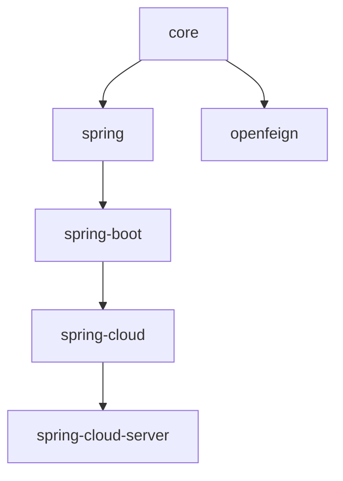

# Developer Guide — 1.x line (0.1.x, release-1.x branch)

Internal design documentation for the legacy 0.1.x release line (`release-1.x` branch).

- [中文](./zh/README.md) · [Current line (0.2.x)](../current/README.md) · [Developer Guide index](../README.md)

## Stack analyzed

Java 8 baseline (inherited from the 0.1.x parent POM chain), Spring Framework 5.x, Spring Boot
2.3.x – 2.7.x, Spring Cloud Hoxton.SR12 – 2021.0.9, `javax.*` namespace, auto-configuration
registered through `META-INF/spring.factories`.

## Module documents

| **Module** | **English** | **中文** | **Key topics** |
|------------|-------------|----------|----------------|
| core | [core.md](./core.md) | [core.md](./zh/core.md) | Class hierarchy, resolution algorithm, locale fallback, design patterns |
| spring | [spring.md](./spring.md) | [spring.md](./zh/spring.md) | Registration pipeline, FactoryBean discovery, Adapter / Observer, javax validation guard |
| spring-boot | [spring-boot.md](./spring-boot.md) | [spring-boot.md](./zh/spring-boot.md) | spring.factories registration, conditional chain, endpoint write path |
| spring-cloud | [spring-cloud.md](./spring-cloud.md) | [spring-cloud.md](./zh/spring-cloud.md) | `EnvironmentChangeEvent` → reload sequence |
| spring-cloud-server | [spring-cloud-server.md](./spring-cloud-server.md) | [spring-cloud-server.md](./zh/spring-cloud-server.md) | Discovery-driven aggregation |
| openfeign | [openfeign.md](./openfeign.md) | [openfeign.md](./zh/openfeign.md) | Header resolution flowchart (javax.servlet) |
| parent | [parent.md](./parent.md) | [parent.md](./zh/parent.md) | 0.1.x POM inheritance chain, microsphere-spring-cloud 0.1.26 pin |
| dependencies | [dependencies.md](./dependencies.md) | [dependencies.md](./zh/dependencies.md) | 0.1.x BOM structure |

## Module dependency graph

## Differences from the 0.2.x line

The source layout, class hierarchy and APIs are identical to the current line except:

- `javax.servlet` / `javax.validation` replace `jakarta.*` (verified by `git diff release release-1.x`).
- Spring Boot modules register auto-configuration in `META-INF/spring.factories` instead of
  `AutoConfiguration.imports`.
- `I18nLocalValidatorFactoryBeanPostProcessor` checks `javax.validation.ValidatorFactory`.

Every document contains a "Differences from the 0.2.x line" section with the full list.
