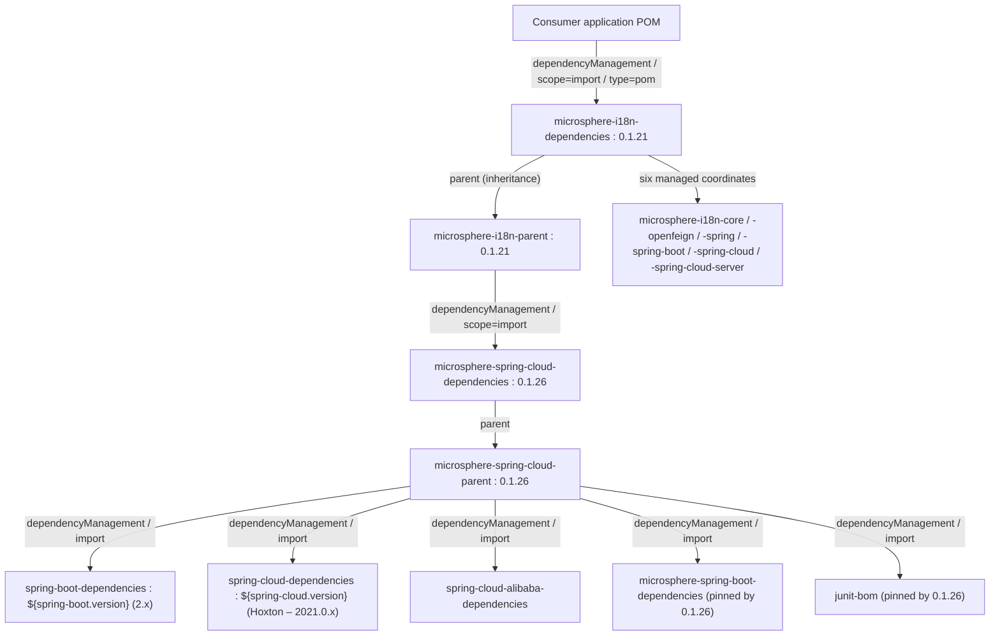

# Dependencies BOM Module — Developer Guide (1.x)

Module: `microsphere-i18n-dependencies`
Packaging: `pom`
Sources: none — the module is `microsphere-i18n-dependencies/pom.xml` and nothing else.

This document describes the **`1.x` (`0.1.x`) line**, the Spring Boot 2.x / `javax.*` generation.
For the `0.2.x` line see
[docs/developer-guide/current/dependencies.md](../current/dependencies.md).

## 1. Structure of the BOM

The POM has exactly four meaningful sections:

```xml

<parent>
    <groupId>io.github.microsphere-projects</groupId>
    <artifactId>microsphere-i18n-parent</artifactId>
    <version>${revision}</version>
    <relativePath>../microsphere-i18n-parent/pom.xml</relativePath>
</parent>

<artifactId>microsphere-i18n-dependencies</artifactId>
<version>${revision}</version>
<packaging>pom</packaging>

<dependencyManagement>
    <!-- six entries, all with <version>${revision}</version> and no <scope>, no <type> -->
</dependencyManagement>
```

There is no `<dependencies>`, no `<properties>`, no `<build>`, no `<profiles>` and no `<import>` of
another BOM inside the `<dependencyManagement>` block. Every entry is a plain managed coordinate.
This POM is byte-for-byte identical to the `0.2.x` version, because all coordinates use
`${revision}` rather than literal versions.

### Managed Entries (verbatim from the POM)

| # | `groupId`                        | `artifactId`                       | Version     |
|---|----------------------------------|------------------------------------|-------------|
| 1 | `io.github.microsphere-projects` | `microsphere-i18n-core`            | `${revision}` |
| 2 | `io.github.microsphere-projects` | `microsphere-i18n-openfeign`       | `${revision}` |
| 3 | `io.github.microsphere-projects` | `microsphere-i18n-spring`          | `${revision}` |
| 4 | `io.github.microsphere-projects` | `microsphere-i18n-spring-boot`     | `${revision}` |
| 5 | `io.github.microsphere-projects` | `microsphere-i18n-spring-cloud`    | `${revision}` |
| 6 | `io.github.microsphere-projects` | `microsphere-i18n-spring-cloud-server` | `${revision}` |

Order matches the reactor's build order for the JAR modules, which makes diffs easy to read. The two
POM modules of the reactor are excluded on purpose: a consumer must never depend on
`microsphere-i18n-parent` transitively through a BOM entry, and the BOM cannot manage itself.

`${revision}` currently resolves to `0.1.22-SNAPSHOT` in the working tree and to the release version
(for example `0.1.21`) in the deployed POM.

## 2. Import Chain



Two distinct mechanisms are at work and it is worth naming them precisely:

- **Inheritance** (`<parent>`) supplies build configuration and merges the parent's
  `dependencyManagement` into the child's effective model.
- **Import** (`<scope>import</scope>` + `<type>pom</type>`) splices another POM's managed coordinates
  into the current `dependencyManagement` without inheriting anything else.

Because of inheritance, `microsphere-i18n-dependencies` is itself a child of the parent that imports
`microsphere-spring-cloud-dependencies:0.1.26`. A consumer that imports the i18n BOM therefore sees
the i18n coordinates from the BOM's own `<dependencyManagement>`, plus (as part of the resolved
model) the Spring Boot 2.x third-party management inherited from the parent chain. If your build
requires the third-party BOMs to be unambiguously present, import `spring-boot-dependencies` /
`spring-cloud-dependencies` explicitly in the consumer POM as well — that is the standard,
self-documenting way to pin a Spring Boot version.

## 3. Import versus Extend

| Approach                       | POM shape                                                            | What you get                                              | Risks                                                       |
|--------------------------------|----------------------------------------------------------------------|-------------------------------------------------------------|---------------------------------------------------------------|
| **Import** (recommended)       | `dependencyManagement` entry with `<type>pom</type><scope>import</scope>` | Only managed coordinates; your own parent stays yours       | Nothing else; ordering with other imported BOMs matters       |
| **Extend** (use as `<parent>`) | `<parent>microsphere-i18n-dependencies</parent>`                    | The same management by inheritance, no import needed        | Couples your build to the Microsphere parent chain; you cannot import a second BOM version as parent |
| **Nothing**                    | explicit `<version>` on every dependency                            | Fully deterministic                                          | Version drift between i18n modules                            |

Note that a POM may be used as a parent only once; if your project already inherits a corporate parent
(which is typical), `import` is the only viable option.

## 4. Version Overrides from the Consumer Side

The deployed BOM lists **literal** versions — the flatten step of the build replaces `${revision}`
before install/deploy. Consequently:

- There is no overridable property such as `${microsphere-i18n.version}` *inside* the BOM; setting it
  only changes which BOM you import, not what it contains.
- To move one module off the managed version, declare that module in your own
  `<dependencyManagement>` **before** the import (first match wins within a section):

  ```xml

  <dependencyManagement>
      <dependencies>
          <dependency>
              <groupId>io.github.microsphere-projects</groupId>
              <artifactId>microsphere-i18n-core</artifactId>
              <version>0.1.20</version>
          </dependency>
          <dependency>
              <groupId>io.github.microsphere-projects</groupId>
              <artifactId>microsphere-i18n-dependencies</artifactId>
              <version>0.1.21</version>
              <type>pom</type>
              <scope>import</scope>
          </dependency>
      </dependencies>
  </dependencyManagement>
  ```

- A `<version>` written directly on a `<dependency>` beats all management.
- Third-party overrides (`spring-webmvc`, `feign-core`, `javax.servlet-api`) follow the same rules;
  remember that the i18n modules declare them as `optional`, so they never arrive transitively and the
  versions in your application are entirely yours to control.

## 5. Release Mechanics

- The BOM is a reactor module listed second in the root `<modules>`, right after
  `microsphere-i18n-parent`, because it inherits that parent and must be built after it.
- It carries the same `${revision}` as the JAR modules, so a release publishes the BOM and the six
  artifacts as one atomic version. There is no independent BOM version line. The release job
  (`.github/workflows/maven-publish.yml`) deploys the whole reactor with an explicit version:

  ```bash
  ./mvnw --batch-mode --update-snapshots --file pom.xml \
        -Drevision=<x.y.z> -Dgpg.skip=true deploy \
        --activate-profiles publish,ci
  ```

  `<x.y.z>` comes from the workflow's `revision` input, which is validated against the
  `major.minor.patch` pattern before the build starts. After a successful publish the workflow
  rewrites `<revision>` in the root POM to the next patch and commits
  `chore: bump version to next patch after publishing <version>`.
- Since the BOM has no dependencies and no plugins, "testing" it means verifying that a fresh
  consumer POM resolves:

  ```bash
  # from the reactor root, after a local install
  ./mvnw install -DskipTests
  # then in a scratch project with only one version-less i18n dependency:
  mvn -o dependency:resolve
  ```

- Verify the published content with `mvn help:effective-pom` inside the module directory, or by
  reading the deployed POM; the entries must show the literal release version, never `${revision}`.

## 6. Adding a New Managed Artifact

Checklist for a new module `microsphere-i18n-example`:

1. Create the module, set `<parent>` to `microsphere-i18n-parent` (see the
   [Parent developer guide](parent.md)).
2. Add `<module>microsphere-i18n-example</module>` to the root POM, in build order.
3. Add the managed entry to this BOM:

   ```xml

   <dependency>
       <groupId>io.github.microsphere-projects</groupId>
       <artifactId>microsphere-i18n-example</artifactId>
       <version>${revision}</version>
   </dependency>
   ```

4. Keep `${revision}` — do not hard-code a version, otherwise the release job will publish a BOM that
   points at the wrong artifact version.
5. Do not add `<scope>` or `<type>`; the managed entries are plain jar coordinates, and adding a scope
   here would silently propagate to consumers.

## 7. Design Notes and Known Boundaries

- **A BOM is not a starter.** Nothing here registers beans, contributes auto-configuration, or pulls
  an artifact onto the classpath. Only coordinates and versions.
- **No `microsphere-i18n-bom` alias.** The published coordinate is
  `microsphere-i18n-dependencies`; the `-dependencies` suffix is the project-wide convention used by
  every Microsphere product (`microsphere-spring-cloud-dependencies`,
  `microsphere-spring-boot-dependencies`, …).
- **The BOM does not manage the framework's own third-party needs.** Because all modules declare
  `feign-core`, `spring-webmvc`, `javax.servlet-api`, `microsphere-java-core` and friends as
  `optional`, consumers must obtain them from their own BOMs. That is a deliberate isolation choice,
  not an omission.
- **Single line per artifact.** If a future module produces a second classifier or a test-jar, it needs
  a separate managed entry with an explicit `<classifier>`/`<type>`, which is why the current entries
  stay minimal.

## Differences from the 0.2.x line

`microsphere-i18n-dependencies/pom.xml` is **identical** between the `1.x` and `0.2.x` lines (verify
with `git diff origin/release origin/release-1.x -- microsphere-i18n-dependencies`, which reports no
change): every managed entry uses `${revision}` rather than a literal version. The differences an
application observes are entirely inherited:

| Aspect                       | `1.x` (`0.1.x`) line                          | `0.2.x` line                          |
|------------------------------|------------------------------------------------|----------------------------------------|
| `${revision}` flatten result | `0.1.21` (published) / `0.1.22-SNAPSHOT`       | `0.2.21` / `0.2.22-SNAPSHOT`          |
| Parent chain BOM import      | `microsphere-spring-cloud-dependencies:0.1.26`| `microsphere-spring-cloud-dependencies:0.2.26` |
| Third-party versions reached | Spring Boot 2.x / Spring Framework 5.x / `javax.*` | Spring Boot 3.x / `jakarta.*`    |
| Managed artifact list        | the same six `microsphere-i18n-*` artifacts    | the same six artifacts                |

The practical implication for consumers is namespace: importing the `0.1.x` BOM gives you modules
compiled against `javax.*`; importing the `0.2.x` BOM gives you `jakarta.*`. Never mix the two BOM
lines in one application.

## Related Documentation

- User guide: [Dependencies BOM](../../user-guide/1.x/dependencies.md)
- Developer guide: [Parent POM](parent.md), [Spring Boot](spring-boot.md)
- 0.2.x counterpart: [current Dependencies developer guide](../current/dependencies.md)
