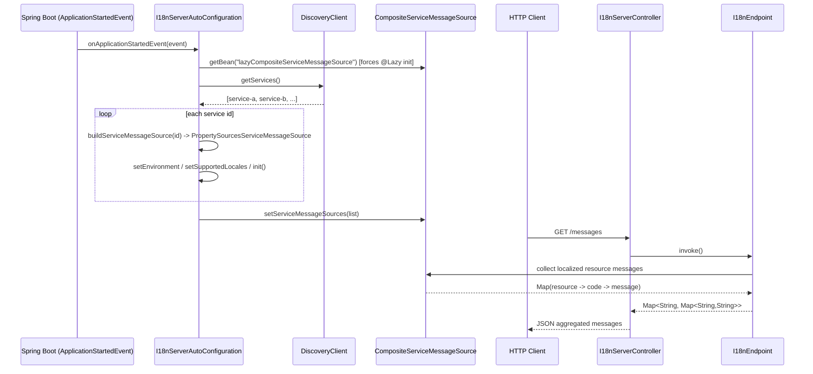
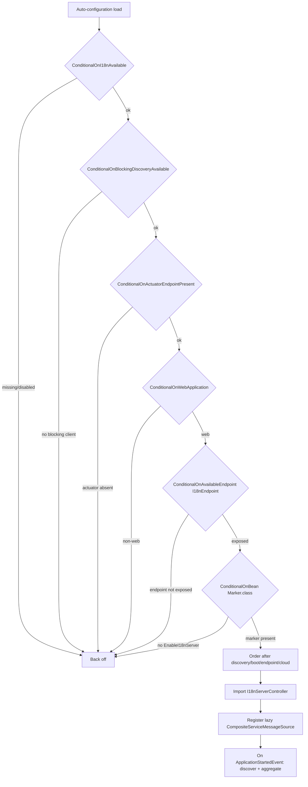
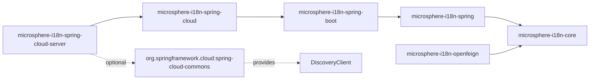

# Spring Cloud i18n Server - Developer Guide (1.x)

> Applies to the `0.1.x` version line (the `release-1.x` / `1.x` branch): Spring Boot 2.3 - 2.7,
> Spring Cloud Hoxton.SR12 - 2021.0.9, `javax.*` namespace, auto-configuration registered through
> `META-INF/spring.factories`. For the Spring Boot 3 / `0.2.x` line see
> [../current/spring-cloud-server.md](../current/spring-cloud-server.md).

## Architecture and Key Classes

`microsphere-i18n-spring-cloud-server` builds on the reload-capable stack (`spring-cloud` -> `spring-boot` ->
`spring` -> `core`) and adds discovery-driven aggregation plus a REST surface. Three production classes carry
all the behavior.

### `@EnableI18nServer` and its `Marker`

`io.microsphere.i18n.spring.cloud.server.annotation.EnableI18nServer` is an annotation with
`@Target(TYPE)`, `@Retention(RUNTIME)`, `@Documented`, `@Inherited` and `@Import(EnableI18nServer.Marker.class)`.
`Marker` is an empty nested class. Registering `Marker` as a bean is the sole side effect of the annotation; it
exists purely to be detected by the auto-configuration's `@ConditionalOnBean(Marker.class)`. This is the standard
`@Enable...` marker pattern: the annotation opts the application in without the auto-configuration having to scan
for the annotation itself.

### `I18nServerAutoConfiguration`

`io.microsphere.i18n.spring.cloud.server.autoconfigure.I18nServerAutoConfiguration` is the core class. Its guard
stack is unusually tall, and each guard maps to a failure mode:

```java
@Configuration(proxyBeanMethods = false)
@ConditionalOnI18nAvailable
@ConditionalOnBlockingDiscoveryAvailable
@ConditionalOnActuatorEndpointPresent
@ConditionalOnWebApplication
@ConditionalOnAvailableEndpoint(endpoint = I18nEndpoint.class)
@ConditionalOnBean(Marker.class)
@Import(I18nServerController.class)
@AutoConfigureAfter(name = { COMMONS_CLIENT_AUTO_CONFIGURATION_CLASS_NAME }, value = {
        I18nAutoConfiguration.class,
        I18nEndpointAutoConfiguration.class,
        I18nCloudAutoConfiguration.class })
public class I18nServerAutoConfiguration { ... }
```

- `@ConditionalOnI18nAvailable` - i18n core/spring present and `microsphere.i18n.enabled` not `false`.
- `@ConditionalOnBlockingDiscoveryAvailable` (microsphere-spring-cloud-commons) - only run with a blocking
  `DiscoveryClient`.
- `@ConditionalOnActuatorEndpointPresent` + `@ConditionalOnAvailableEndpoint(endpoint = I18nEndpoint.class)` -
  the aggregation feeds `I18nEndpoint`, so the endpoint must be on the classpath and actually exposed.
- `@ConditionalOnWebApplication` - the REST controller needs a servlet/reactive web context.
- `@ConditionalOnBean(Marker.class)` - activated only when `@EnableI18nServer` was used.
- `@Import(I18nServerController.class)` - pulls the controller in when the config matches.
- `@AutoConfigureAfter(...)` - ordered after discovery, i18n boot, endpoint and cloud auto-configurations so that
  `DiscoveryClient` and `I18nEndpoint` beans already exist.

Two collaborators are autowired (`ConfigurableEnvironment`, `DiscoveryClient`) and two things happen:

1. A `@Lazy` `CompositeServiceMessageSource` bean named by the constant
   `LAZY_COMPOSITE_SERVICEMESSAGE_SOURCE_BEAN_NAME = "lazyCompositeServiceMessageSource"` is created empty.
   `@Lazy` prevents it from being built during context refresh; it is materialized only when the started event
   resolves it.
2. `@EventListener(ApplicationStartedEvent.class)` populates the composite. It reads
   `discoveryClient.getServices()`, maps each id through `buildServiceMessageSource(service)`, and calls
   `setServiceMessageSources(...)` on the composite. Each `buildServiceMessageSource` creates a
   `PropertySourcesServiceMessageSource(service)`, injects the shared `Environment`, sets the default locale to
   `Locale.getDefault()` and supported locales to `{default, ENGLISH}` (the code carries a `// FIXME Hardcode`
   marker here), then `init()`.

The per-service message source reads its content from `Environment` properties named
`<service>.i18n_messages_<locale>.properties`, so aggregation is really a naming convention applied over the
discovered service list. `ApplicationStartedEvent` exists in every Spring Boot generation this line targets
(2.3 - 2.7), so the event-driven phase behaves identically to the `0.2.x` line.

### `I18nServerController`

`io.microsphere.i18n.spring.cloud.server.controller.I18nServerController` is a `@RestController` autowiring
`I18nEndpoint` and exposing exactly one method, `@GetMapping("/messages")`, which returns
`i18nEndpoint.invoke()` typed as `Map<String, Map<String, String>>`. The controller deliberately reuses the
endpoint's read model instead of duplicating traversal logic, giving the same payload under a friendly path.

Note that the controller imports no servlet type at all (`javax.servlet` is only an optional POM dependency),
which is one reason the class sources are identical across the `javax` and `jakarta` lines.

## Auto-Configuration Registration Mechanism

The server module uses the Spring Boot 2.x registration file, exactly like `microsphere-i18n-spring-cloud`.
`microsphere-i18n-spring-cloud-server/src/main/resources/META-INF/spring.factories` in its entirety:

```properties
org.springframework.boot.autoconfigure.EnableAutoConfiguration=\
io.microsphere.i18n.spring.cloud.server.autoconfigure.I18nServerAutoConfiguration
```

(No trailing newline; the value continues after the backslash line-continuation.)

- `AutoConfigurationImportSelector` collects this entry on Boot 2.0 - 2.6, and the seven `@Conditional*` guards
  decide whether it actually contributes anything.
- The module also ships
  `META-INF/spring/org.springframework.boot.autoconfigure.AutoConfiguration.imports` with the same entry, which
  Boot 2.7 reads additionally; duplicates between the two files are merged away, so registration happens once.
- Auto-configuration ordering comes from `@AutoConfigureAfter`, not from file order. The `name` attribute uses the
  string `COMMONS_CLIENT_AUTO_CONFIGURATION_CLASS_NAME` so the reference survives the absence of the optional
  Spring Cloud commons artifact - a pattern that matters more on this line, where several Boot 2.x generations and
  three Cloud generations are combined.
- Because registration is by class name, `spring-boot-autoconfigure-processor` is not strictly required; note that
  unlike the `spring-cloud` module, this module's POM declares neither `spring-boot-autoconfigure-processor` nor
  `spring-boot-configuration-processor`, only `microsphere-annotation-processor`.

## Design Patterns

- **Marker / enable-annotation** - `@EnableI18nServer` imports `Marker`; the auto-configuration gates on
  `@ConditionalOnBean(Marker.class)`. The annotation and the config stay decoupled.
- **Event-driven initialization** - aggregation runs from `@EventListener(ApplicationStartedEvent.class)` rather
  than `@PostConstruct`, guaranteeing the `DiscoveryClient` has its service registry by the time
  `getServices()` is called.
- **Lazy holder** - the composite is `@Lazy`, so it costs nothing until the started event forces its creation.
- **Composite** - `CompositeServiceMessageSource` (core) merges one `ServiceMessageSource` per discovered service;
  `setServiceMessageSources` also sorts them and clears the previous list.
- **Adapter / reuse** - `I18nServerController` adapts the Actuator `I18nEndpoint` read operation to a plain REST
  path.
- **Strategy (inherited)** - the per-service sources are `PropertySourcesServiceMessageSource`, whose
  `canReload`/`reload` behavior (from the `spring-cloud` layer) still lets a refresh update an individual
  service's messages via `EnvironmentChangeEvent`.
- **Class-name-based registration** - the version split between Boot 2 and Boot 3 lives in the resource files, not
  in the Java sources; the module keeps both registration files so one artifact works on 2.3 through 2.7.

## Sequence: request, discovery, aggregated response

Discovery/aggregation happens once at startup; the `/messages` request reads the already-aggregated composite.



## Flowchart: `I18nServerAutoConfiguration` conditions



## Module Dependency



The server depends on `microsphere-i18n-spring-cloud` (which transitively brings `spring-boot`, `spring`,
`core`); `microsphere-i18n-openfeign` is a sibling that depends only on `microsphere-i18n-core`. Everything else
in the server POM is optional: `microsphere-spring-cloud-commons`, `microsphere-spring-boot-core`,
`microsphere-spring-boot-actuator`, `spring-cloud-commons`, `spring-cloud-context`, `spring-boot-autoconfigure`,
`spring-boot-starter-web`, `spring-boot-actuator-autoconfigure` and `javax.servlet:javax.servlet-api`.

## Testing Strategy

- `I18nServerAutoConfigurationTest` extends `WebAutoConfigurationTest<I18nServerAutoConfiguration>` and boots a
  web context with `Marker`, `I18nEndpointAutoConfiguration` and `CompositeDiscoveryClientAutoConfiguration`,
  exposing the `i18n` endpoint. It asserts the auto-config contributes `I18nServerController` and
  `CompositeServiceMessageSource`, and backs off under every guard:
  - disabled properties tested: `microsphere.i18n.enabled=false`, `spring.cloud.discovery.enabled=false`,
    `spring.cloud.discovery.blocking.enabled=false`, `management.endpoints.web.exposure.include=none`,
    `management.endpoint.i18n.enabled=false` - each corresponds to one of the `@Conditional*` guards.
  - missing classes tested: `ServiceMessageSource`, `EnableI18n`, `DiscoveryClient`, `Endpoint` - covering the
    i18n, discovery and actuator class conditions.
- `application.properties` (test resources) drives a real end-to-end discovery with no external registry: it
  registers a single service through Spring Cloud's simple discovery client
  (`spring.cloud.discovery.client.simple.instances.test-application[0]...`) so
  `discoveryClient.getServices()` returns `test-application`, letting the aggregation path run in a test.
  It also sets `spring.application.name=i18n-server`, exposes all endpoints and enables
  `management.endpoint.env.post.enabled`.
- `META-INF/i18n/common/i18n_messages_en.properties` and `..._zh_CN.properties` (test resources) supply the
  server's own `common` source content that shows up in the aggregated payload.
- `I18nServerBootstrap` is the runnable `@SpringBootApplication @EnableDiscoveryClient @EnableI18nServer` main
  (servlet) used for manual verification against a live registry and `GET /messages`.

Together these give condition-level coverage (`I18nServerAutoConfigurationTest`), an aggregation smoke path via
simple discovery in test config, and a manual bootstrap for real deployments.

## Differences from the 0.2.x line

`git diff origin/release origin/release-1.x -- microsphere-i18n-spring-cloud-server` reduces to the two
servlet-API coordinate lines in `pom.xml` (`jakarta.servlet:jakarta.servlet-api` becomes
`javax.servlet:javax.servlet-api`) and the two added `spring.factories` lines; `EnableI18nServer`,
`I18nServerAutoConfiguration`, `I18nServerController`,
the test class and the test resources are identical on both lines.

| Aspect | `1.x` (`0.1.x`) | `0.2.x` (`current`) |
|--------|-----------------|---------------------|
| Java sources and behavior (marker, guard stack, aggregation, `/messages`) | unchanged | unchanged |
| Registration file | `META-INF/spring.factories` (`EnableAutoConfiguration=...`), the mechanism Boot 2.0 - 2.6 reads; the imports file is additionally shipped for 2.7+ | imports file only |
| Servlet API dependency | `javax.servlet:javax.servlet-api` (optional) | `jakarta.servlet:jakarta.servlet-api` (optional) |
| Boot/Cloud generations | Boot 2.3.12 / 2.4.13 / 2.6.15 with Hoxton.SR12 / 2020.0.5 / 2021.0.9 (default profile `spring-cloud-2021`) | Boot 3.x with Cloud 2022.0.x - 2025.0.x |
| Java target | inherited, no `java.version` override; CI on Java 8 - 25 | Java 17 |
| Version | `0.1.x`, latest published `0.1.21`, working `0.1.22-SNAPSHOT` | `0.2.x`, latest published `0.2.21` |
| Actuator exposure defaults | identical knobs (`management.endpoint.i18n.enabled`, `management.endpoints.web.exposure.include`); on Boot generations that ignore `management.endpoint.env.post.enabled` the env write endpoint stays enabled | same knobs on Boot 3 |
