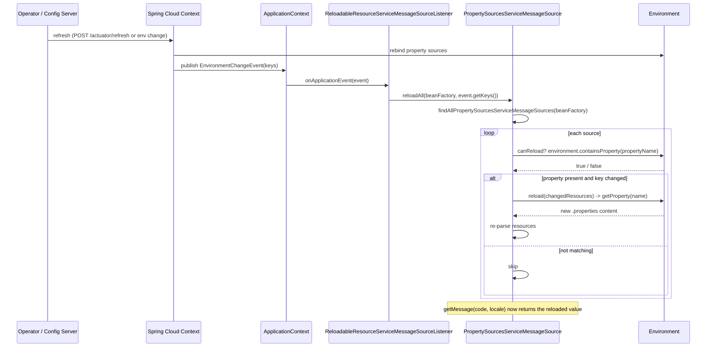
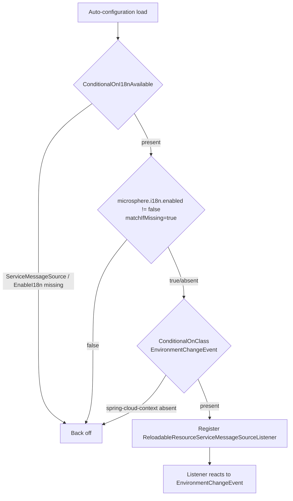
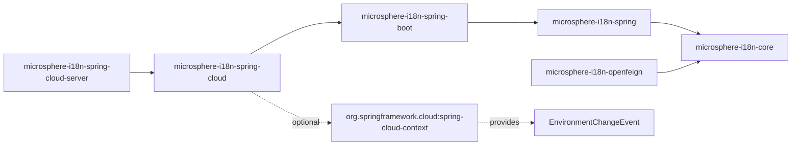

# Spring Cloud Integration - Developer Guide (1.x)

> Applies to the `0.1.x` version line (the `release-1.x` / `1.x` branch): Spring Boot 2.3 - 2.7,
> Spring Cloud Hoxton.SR12 - 2021.0.9, `javax.*` namespace, auto-configuration registered through
> `META-INF/spring.factories`. For the Spring Boot 3 / `0.2.x` line see
> [../current/spring-cloud.md](../current/spring-cloud.md).

## Architecture and Key Classes

`microsphere-i18n-spring-cloud` is a thin, event-driven bridge between Spring Cloud's environment-refresh
machinery and the `PropertySources`-backed message sources defined in `microsphere-i18n-spring`. It has two
production classes.

### `I18nCloudAutoConfiguration`

`io.microsphere.i18n.spring.cloud.autoconfigure.I18nCloudAutoConfiguration` is a
`@Configuration(proxyBeanMethods = false)` class declared in this module's
`META-INF/spring.factories` (see the registration section below). It contributes a single bean and carries
three activation guards:

```java
@Configuration(proxyBeanMethods = false)
@ConditionalOnI18nAvailable
@ConditionalOnClass(name = {
        "org.springframework.cloud.context.environment.EnvironmentChangeEvent",
})
public class I18nCloudAutoConfiguration {
    @Bean
    public ReloadableResourceServiceMessageSourceListener reloadableResourceServiceMessageSourceListener() {
        return new ReloadableResourceServiceMessageSourceListener();
    }
}
```

- `@ConditionalOnI18nAvailable` (from `microsphere-i18n-spring-boot`) expands to
  `@ConditionalOnClass(ServiceMessageSource, EnableI18n)` plus
  `@ConditionalOnProperty(name = "microsphere.i18n.enabled", matchIfMissing = true)`. So `core`/`spring` must
  be present and i18n must not be explicitly disabled.
- `@ConditionalOnClass(EnvironmentChangeEvent)` requires `spring-cloud-context`; without it the whole module is
  inert, which is what keeps it safe to keep Spring Cloud dependencies optional.

### `ReloadableResourceServiceMessageSourceListener`

`io.microsphere.i18n.spring.cloud.event.ReloadableResourceServiceMessageSourceListener` implements
`ApplicationListener<EnvironmentChangeEvent>` and `BeanFactoryAware`. Its entire logic is a two-line delegation:

```java
@Override
public void onApplicationEvent(EnvironmentChangeEvent event) {
    Set<String> changedPropertyNames = event.getKeys();
    reloadAll(this.beanFactory, changedPropertyNames);
}
```

The `BeanFactory` is injected through `setBeanFactory(...)`, because the reload helper is a static method on
`PropertySourcesServiceMessageSource` that needs bean lookup access rather than a live reference to the primary
message source.

### The reload algorithm (`PropertySourcesServiceMessageSource.reloadAll`)

The actual work lives in `microsphere-i18n-spring`. `reloadAll(BeanFactory, Set<String>)`:

1. `findAllPropertySourcesServiceMessageSources(beanFactory)` resolves the primary `serviceMessageSource`
   (`DelegatingServiceMessageSource`) and traverses its composite graph via
   `I18nUtils.findAllServiceMessageSources(...)`, keeping only `PropertySourcesServiceMessageSource` instances.
2. For each source it iterates `getResources()`. In this design a resource string equals the Spring property
   name it is loaded from (`getPropertyName(resource)` is identity), shaped as `<source>.i18n_messages_<locale>.properties`
   (source is joined to the file with `MessageUtils.SOURCE_SEPARATOR`, which is `.`).
3. A resource is kept as "changed" only if `changedPropertyNames.contains(propertyName)`; the source is reloaded
   only if `canReload(changedResources)` returns `true`. `canReload(String)` checks
   `environment.containsProperty(propertyName)`.
4. `reload(changedResources)` -> `initializeResources(...)` re-reads each property's value from the `Environment`
   (the value is the `.properties` file content as a `String`, loaded through a `StringReader` in
   `loadAllPropertiesResources`) and re-parses it.

This is what makes the listener precise rather than "reload everything": a refresh that changes
`server.port` fires an `EnvironmentChangeEvent` whose keys do not match any i18n resource property, so no message
source is rebuilt.

## Auto-Configuration Registration Mechanism

This is the one thing that differs structurally from the `0.2.x` line. On `release-1.x` the module registers
its auto-configuration with the Spring Boot 2.x `spring.factories` mechanism. The file
`microsphere-i18n-spring-cloud/src/main/resources/META-INF/spring.factories` is, in its entirety:

```properties
org.springframework.boot.autoconfigure.EnableAutoConfiguration=\
io.microsphere.i18n.spring.cloud.autoconfigure.I18nCloudAutoConfiguration
```

(The file has no trailing newline; the single value continues after the backslash line-continuation.)

How it is consumed:

- `@EnableAutoConfiguration` (used by `I18nBootstrap` and by `@SpringBootApplication`) triggers
  `AutoConfigurationImportSelector`, which loads every `EnableAutoConfiguration` entry found in
  `META-INF/spring.factories` on the classpath. Spring Boot 2.0 - 2.6 read only this file.
- `@ConditionalOnClass`, `@ConditionalOnProperty` and `@ConditionalOnBean` still do the actual filtering, so an
  entry that is listed but whose conditions fail simply backs off.
- Spring Boot 2.7 additionally reads
  `META-INF/spring/org.springframework.boot.autoconfigure.AutoConfiguration.imports`, which this module also
  ships with the identical entry. On 2.7 both sources are merged and duplicates are removed, so the class is
  registered exactly once; on 2.3 - 2.6 the imports file is inert.
- Ordering relative to other auto-configurations is not decided by the registration file: it comes from
  `@AutoConfigureAfter` / `@AutoConfigureBefore` / `@AutoConfigureOrder`, which is how
  `I18nServerAutoConfiguration` places itself after `I18nCloudAutoConfiguration`.
- The sibling `microsphere-i18n-spring-boot` module follows the same pattern and lists
  `I18nAutoConfiguration` and `I18nEndpointAutoConfiguration` under the same key.

Because the auto-configuration class is registered by name, the annotation processor dependency
(`spring-boot-autoconfigure-processor`) that generates the condition metadata is declared optional in the
module POM, and `microsphere-annotation-processor` is present for the `@ConditionalOnI18nAvailable` aliases.

## Design Patterns

- **Observer** - `ReloadableResourceServiceMessageSourceListener` is a concrete observer registered as a Spring
  `ApplicationListener<EnvironmentChangeEvent>`. Spring Cloud's context refresh is the subject that emits
  `EnvironmentChangeEvent` carrying the changed keys (`event.getKeys()`); the listener reacts without the emitter
  knowing anything about i18n. This decoupling is the reason the module can depend on Spring Cloud as optional.
- **Composite** - the reload target set is discovered through `DelegatingServiceMessageSource`, which extends
  `CompositeServiceMessageSource`. `reloadAll` walks that composite tree to find leaf `PropertySourcesServiceMessageSource`
  beans, so per-source message sources added by `@EnableI18n(sources = ...)` are automatically covered.
- **Template Method** - `canReload` / `reload` / `initializeResources` are defined on the
  `ReloadableResourceServiceMessageSource` interface (core) and specialized by
  `PropertySourcesServiceMessageSource` (spring) to read from the `Environment`.
- **Static helper / service locator** - the listener holds a `BeanFactory` and calls a static
  `reloadAll(...)`, trading injection of collaborators for a stateless listener bean.
- **Version-line fork by packaging only** - the two production classes are identical to the `0.2.x` line; the
  Spring Boot 2 vs 3 difference is absorbed entirely by the registration file and the servlet-API coordinates in
  the POM, which is why no `jakarta`/`javax` import appears in this module's sources.

## Sequence: config change to reload



## Flowchart: `I18nCloudAutoConfiguration` conditions



## Module Dependency



The `microsphere-i18n-spring-cloud` POM depends non-optionally only on `microsphere-i18n-spring-boot`
(versioned by `${revision}`); everything else - `microsphere-spring-cloud-commons`, `spring-cloud-commons`,
`spring-cloud-context`, `spring-boot-autoconfigure`, `spring-boot-starter-web`, the actuator autoconfigure
module, the configuration/autoconfigure processors and `javax.servlet:javax.servlet-api` - is `optional`.

## Testing Strategy

Tests live under `src/test/java` and split into condition coverage and behavioral integration.

- `I18nCloudAutoConfigurationTest` extends `AutoConfigurationTest<I18nCloudAutoConfiguration>`. It asserts the
  auto-configuration contributes `ReloadableResourceServiceMessageSourceListener` and backs off correctly. The
  overrides enumerate the negative cases:
  - `configureGlobalDisabledPropertyValues` adds `microsphere.i18n.enabled=false`.
  - `configureGlobalMissingClasses` adds `ServiceMessageSource`, `EnableI18n`, and `EnvironmentChangeEvent` -
    each individually should disable the module, covering the two `@Conditional*` guards.
- `I18nCloudAutoConfigurationIntegrationTest` boots a real `@EnableAutoConfiguration` context
  (`spring.cloud.service-registry.auto-registration.enabled=false`, the `features` endpoint exposed) and asserts a
  `FeaturesEndpoint` autowires successfully. Its purpose is to prove the module's presence does not break a Spring
  Cloud runtime context.
- `MessageSourceIntegrationTest` is the behavioral test that exercises the reload path end to end. It imports
  `I18nAutoConfiguration`, `I18nEndpointAutoConfiguration`, `PropertyPlaceholderAutoConfiguration` and
  `ReloadableResourceServiceMessageSourceListener`, then:
  1. resolves bean `commonServiceMessageSource` and asserts `getMessage("common.a", ENGLISH)` is `"a"` (from
     `META-INF/i18n/common/i18n_messages_en.properties`),
  2. adds a `MapPropertySource` overriding `common.i18n_messages_en.properties` with `common.a=a.2024`,
  3. publishes `new EnvironmentChangeEvent(ofSet("common.i18n_messages_en.properties"))`,
  4. asserts `getMessage("common.a", ENGLISH)` becomes `"a.2024"`,
  5. reads the `I18nEndpoint` JSON and asserts JSONPath
     `$.['common.i18n_messages_en.properties'].['common.a']` equals `"a.2024"`.
  This is the strongest evidence that the observer wiring, the `reloadAll` filter and the `Environment`-based
  reload all cooperate.
- `I18nBootstrap` is a runnable `main` (servlet web app) that seeds
  `common.i18n_messages_en.properties=common.a = common-a-2024` and loads `i18n-bootstrap.properties`
  (`spring.application.name=i18n-bootstrap`, actuator `i18n` and env-post enabled) for manual
  `/actuator/i18n` and `/actuator/env` verification.
- `META-INF/config/default/features.yaml` is the feature catalogue this module ships for
  `microsphere-spring-cloud-commons`: it lists, per module key, the classes each layer contributes
  (`microsphere-i18n-spring`, `microsphere-i18n-spring-boot`, and for this module
  `io.microsphere.i18n.spring.cloud.event.ReloadableResourceServiceMessageSourceListener`). The catalogue is loaded
  as lowest-priority defaults under `microsphere.spring.cloud.features.abstract.*`. It is separate from
  the `FeaturesEndpoint` assertion above, whose only purpose is to prove that Spring Cloud's own features endpoint
  still resolves when this module is on the classpath.

## Building and Testing This Line

The reactor pins the runtime generation through profiles inherited from `microsphere-spring-cloud-parent`
`0.1.26`, so the same sources are exercised against three Spring Cloud generations:

| Profile | Spring Boot | Spring Cloud |
|---------|-------------|--------------|
| `spring-cloud-hoxton` | 2.3.12.RELEASE | Hoxton.SR12 |
| `spring-cloud-2020` | 2.4.13 | 2020.0.5 |
| `spring-cloud-2021` (default) | 2.6.15 | 2021.0.9 |

CI runs the matrix of those profiles against Java 8, 11, 17, 21 and 25 with
`mvn --activate-profiles test,coverage,<spring-cloud-profile>`; the module has no `java.version` override, so do
not introduce Java-17-only syntax into these sources.

## Differences from the 0.2.x line

`git diff origin/release origin/release-1.x -- microsphere-i18n-spring-cloud` shows the whole difference: the two
servlet-API coordinate lines in `pom.xml` (`jakarta.servlet:jakarta.servlet-api` becomes
`javax.servlet:javax.servlet-api`), plus the two added `spring.factories` lines. Every `.java` file in
`src/main/java` and `src/test/java` is identical.

| Aspect | `1.x` (`0.1.x`) | `0.2.x` (`current`) |
|--------|-----------------|---------------------|
| Java sources (classes, conditions, bean, listener logic) | unchanged | unchanged |
| Registration file | `META-INF/spring.factories` (`EnableAutoConfiguration=...`) is the one Boot 2.x reads; the imports file is kept for 2.7+ | imports file only |
| Servlet API dependency | `javax.servlet:javax.servlet-api` (optional) | `jakarta.servlet:jakarta.servlet-api` (optional) |
| Boot/Cloud generation under test | Boot 2.3.12 / 2.4.13 / 2.6.15 with Hoxton.SR12 / 2020.0.5 / 2021.0.9 | Boot 3.x with Cloud 2022.0.x - 2025.0.x |
| Java target | inherited, no override; CI on Java 8 - 25 | Java 17 |
| Version property | root POM `<revision>0.1.22-SNAPSHOT</revision>`, latest published `0.1.21` | `<revision>0.2.x</revision>` line, latest published `0.2.21` |
