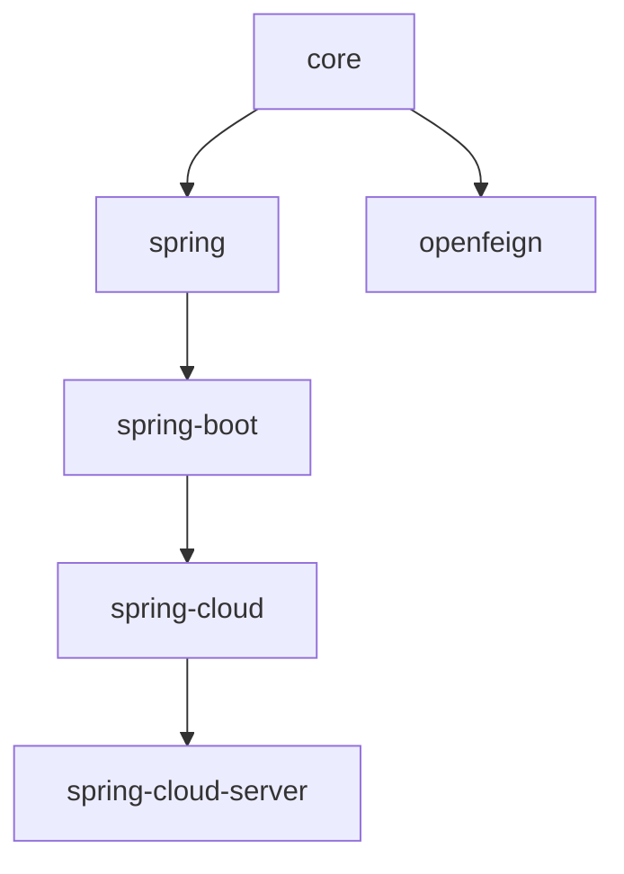

# 开发者文档 — 1.x 发布线（0.1.x，release-1.x 分支）

0.1.x 维护线（`release-1.x` 分支）的内部设计文档。

- [English](../README.md) · [当前线（0.2.x）](../../current/zh/README.md) · [开发者文档总入口](../zh/README.md)

## 技术分析范围

Java 8 基线（继承自 0.1.x 父 POM 链）、Spring Framework 5.x、Spring Boot 2.3.x – 2.7.x、
Spring Cloud Hoxton.SR12 – 2021.0.9、`javax.*` 命名空间，自动装配通过
`META-INF/spring.factories` 注册。

## 模块文档

| **模块** | **英文** | **中文** | **主题** |
|----------|----------|----------|----------|
| core | [core.md](../core.md) | [core.md](./core.md) | 类层次、解析算法、Locale 回退、设计模式 |
| spring | [spring.md](../spring.md) | [spring.md](./spring.md) | 注册管线、FactoryBean 发现、适配器 / 观察者、javax 校验守卫 |
| spring-boot | [spring-boot.md](../spring-boot.md) | [spring-boot.md](./spring-boot.md) | spring.factories 注册、条件链、端点写入路径 |
| spring-cloud | [spring-cloud.md](../spring-cloud.md) | [spring-cloud.md](./spring-cloud.md) | `EnvironmentChangeEvent` → 重载时序 |
| spring-cloud-server | [spring-cloud-server.md](../spring-cloud-server.md) | [spring-cloud-server.md](./spring-cloud-server.md) | 服务发现驱动的聚合 |
| openfeign | [openfeign.md](../openfeign.md) | [openfeign.md](./openfeign.md) | 请求头解析流程图（javax.servlet） |
| parent | [parent.md](../parent.md) | [parent.md](./parent.md) | 0.1.x POM 继承链、microsphere-spring-cloud 0.1.26 固定版本 |
| dependencies | [dependencies.md](../dependencies.md) | [dependencies.md](./dependencies.md) | 0.1.x BOM 结构 |

## 模块依赖关系

## 与 0.2.x 线的差异

源码布局、类层次与 API 同当前线一致，差异仅有：

- `javax.servlet` / `javax.validation` 替代 `jakarta.*`（已通过 `git diff release release-1.x` 核实）。
- Spring Boot 相关模块使用 `META-INF/spring.factories` 注册自动装配，而非 `AutoConfiguration.imports`。
- `I18nLocalValidatorFactoryBeanPostProcessor` 检查的是 `javax.validation.ValidatorFactory`。

每份文档均包含"与 0.2.x 分支的差异"章节，列出完整差异。
