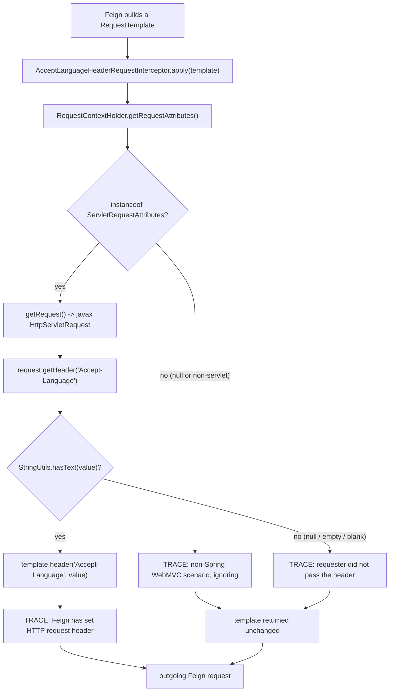
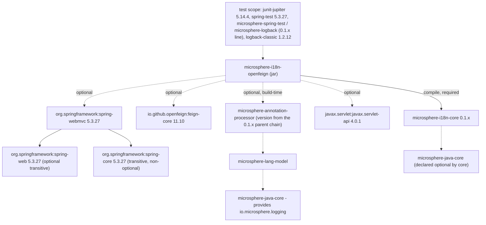

# OpenFeign 模块 —— 开发者指南（1.x 版本线）

模块：位于 **`release-1.x` 分支**上的 `microsphere-i18n-openfeign`
Java 包：`io.microsphere.i18n.feign`
规模：一个生产类 + 一个单元测试。

> 本文档属于 `1.x` 版本线（`0.1.x` 构件、`javax.*` 命名空间、Spring Boot 2.x）。0.2.x 对应文档见
> [这里](../../current/zh/openfeign.md)。

```
microsphere-i18n-openfeign/
├── pom.xml
└── src/
    ├── main/java/io/microsphere/i18n/feign/
    │   └── AcceptLanguageHeaderRequestInterceptor.java
    └── test/java/io/microsphere/i18n/feign/
        └── AcceptLanguageHeaderRequestInterceptorTest.java
```

模块没有 `src/main/resources`：不提供 `spring.factories`，不提供 `AutoConfiguration.imports`，
也不提供元数据文件。注册完全交由应用方完成。两条版本线在这点上相同，但请注意：在 `release-1.x`
上，*同级的* Spring 模块是通过 `META-INF/spring.factories`（Spring Boot 2.x 的机制）注册各自的
自动配置的 —— 因此即便本模块将来加入自动配置，也应当使用
`org.springframework.boot.autoconfigure.EnableAutoConfiguration` 这个 key，而不是只写
`AutoConfiguration.imports`。

## 1. 源码解析

### 类声明

```java
public class AcceptLanguageHeaderRequestInterceptor implements RequestInterceptor {

    private static final Logger logger = getLogger(AcceptLanguageHeaderRequestInterceptor.class);

    public static final String HEADER_NAME = ACCEPT_LANGUAGE;
```

值得注意的细节：

- `RequestInterceptor` 即 `feign.RequestInterceptor`，是 Feign 在构造请求过程中调用的 SPI。在本版本
  线上，解析出的构件是 OpenFeign 10.x/11.x，取决于激活的代际 profile（默认的 `spring-cloud-2021`
  构建为 11.10）；这里用到的接口形态在这些版本之间没有变化。
- `HEADER_NAME` 通过静态导入复用 `org.springframework.http.HttpHeaders.ACCEPT_LANGUAGE`，因此该常量
  必然与 Spring 自身使用的字面量 `Accept-Language` 一致。
- `HttpServletRequest` 从 **`javax.servlet.http`** 导入，这是本分支与 0.2.x 分支之间唯一的一处源码
  差异（后者为 `jakarta.servlet.http`）。
- `Logger` 是 `io.microsphere.logging.Logger`，配合静态导入
  `io.microsphere.logging.LoggerFactory.getLogger(...)`——即 Microsphere 的日志门面，与框架其他模块
  保持一致，而不是直接使用 SLF4J 或 Logback。
- 类是无状态的：除静态 logger 外没有字段，因此单个实例可以被所有 Feign 客户端、所有线程共享。
- 本模块以 Java 8 源码级别编译（继承自 microsphere 父级链），这也是该类不使用 8 之后语言特性的原因。
- Javadoc 标注 `@since 1.0.0` 并 `@see AcceptHeaderLocaleResolver`，那只是文档层面的关联——本类从不
  实例化任何 locale resolver。

### `apply(RequestTemplate)` 逐段解析

```java
RequestAttributes requestAttributes = getRequestAttributes();
if (!(requestAttributes instanceof ServletRequestAttributes)) {
    ... return;
}
ServletRequestAttributes servletRequestAttributes = (ServletRequestAttributes) requestAttributes;
HttpServletRequest request = servletRequestAttributes.getRequest();
String acceptLanguage = request.getHeader(HEADER_NAME);
if (hasText(acceptLanguage)) {
    template.header(HEADER_NAME, acceptLanguage);
    ...
} else {
    ...
}
```

| 步骤 | 代码                                                | 失败情形与行为                                                                        |
|------|-----------------------------------------------------|----------------------------------------------------------------------------------------|
| 1    | `RequestContextHolder.getRequestAttributes()`       | 不在请求线程上（定时任务、MQ 监听、裸线程）时返回 `null`，由下面的 `instanceof` 判断兜住。 |
| 2    | `instanceof ServletRequestAttributes`               | 同时过滤掉非 Servlet 的 `RequestAttributes` 实现以及任何非 Servlet 绑定。输出 TRACE 日志后静默 `return`。 |
| 3    | `servletRequestAttributes.getRequest()`             | 第 2 步不通过时根本不会执行到这里，因此这里不存在 `NullPointerException` 的可能。返回 Spring 5.3 绑定的 `javax.servlet.http.HttpServletRequest`。 |
| 4    | `request.getHeader(HEADER_NAME)`                    | 客户端未发送时返回 `null`；否则返回原始字符串，包含 `q=` 权重。                          |
| 5    | `StringUtils.hasText(acceptLanguage)`               | `null`、`""` 与纯空白值同样处理：不写入任何内容。                                       |
| 6    | `template.header(HEADER_NAME, acceptLanguage)`      | 原样复制值；不解析、不重排序、不做受支持语言环境过滤。                                  |

所有日志语句都包在 `logger.isTraceEnabled()` 判断里，因此在 DEBUG 及以上级别没有任何字符串格式化开销。
任何路径都不会抛异常：该拦截器最多是空操作，永远不会成为 Feign 调用失败的原因。

### 边界情形

- **入站请求没有该头。** 出站 Feign 请求也就不带 `Accept-Language`。接收方服务通过自身的
  `AcceptHeaderLocaleResolver` 解析语言环境，并回退到由 `microsphere-i18n-spring` 的
  `AcceptHeaderLocaleResolverBeanPostProcessor` 配置的默认语言环境。本拦截器**刻意不做**
  `LocaleContextHolder` 回退。
- **`Accept-Language: `（空或纯空白）。** `hasText` 判定不通过，结果与缺失一致。
- **非 MVC 请求线程。** 任何不是 `ServletRequestAttributes` 的 `RequestAttributes` 都会被忽略。这包括
  从未绑定过请求属性的线程上发起的异步 Feign 调用；只有子线程启动前用
  `setRequestAttributes(attributes, true)` 绑定了可继承线程局部变量，才能跨越线程边界。
- **Servlet 3.1/4.0 异步派发。** 拦截器读取的是 `apply` 执行那一刻绑定的请求；若请求已完成、属性已被
  重置，则该头被跳过。
- **多值情形。** `HttpServletRequest.getHeader` 返回第一行头部，因此客户端发送多行
  `Accept-Language` 时只转发第一行。
- **容器命名空间错误。** 在 `jakarta.servlet` 容器（Spring Boot 3 / Servlet 5+）中，
  `ServletRequestAttributes.getRequest()` 返回的是 `jakarta.servlet.http.HttpServletRequest`，本类
  会在链接期失败并抛出 `NoClassDefFoundError: javax/servlet/http/HttpServletRequest`。这是版本线
  选择错误，而非缺陷：那种环境下请使用 0.2.x 构件。

## 2. 请求头解析流程



## 3. 依赖结构

来自 `release-1.x` 上的 `microsphere-i18n-openfeign/pom.xml`，以及默认 `spring-cloud-2021` profile
经父级链解析出的版本：



对维护者而言的含义：

- 只有 `microsphere-i18n-core` 会传递给使用方。其余全部需要应用自己具备；这正是本模块针对
  `feign-core`、`spring-webmvc` 与 `javax.servlet` API 编译却不导出它们的原因。
- 上面的版本号**不写在本 POM 里**。它们来自 parent 链：`microsphere-i18n-parent` 导入
  `microsphere-spring-cloud-dependencies:0.1.26`，而后者自己的 parent 又导入
  `spring-boot-dependencies`，其版本由激活的代际 profile 决定（`spring-cloud-hoxton` →
  Boot 2.3.12.RELEASE，`spring-cloud-2020` → Boot 2.4.13，`spring-cloud-2021` → Boot 2.6.15 且默认
  激活）。切换构建 profile，`spring-webmvc`、`spring-test` 与 `feign-core` 的版本会随之变化 —— 在
  Hoxton 之下 Feign 会回到 10.x。
- `io.microsphere.logging` 之所以进入编译类路径，是通过可选的注解处理器链
  （`microsphere-annotation-processor` -> `microsphere-lang-model` -> `microsphere-java-core`，在本
  版本线上均由 `0.1.x` 父级链做版本管理），在测试期则由 `microsphere-spring-test` 提供。
- `spring-core` 是唯一被拉进来的非可选第三方构件，它作为可选 `spring-webmvc` 的传递依赖出现。

构建图位置：必须先构建 `microsphere-i18n-core`（`-pl microsphere-i18n-openfeign -am`）。

## 4. 设计说明

**拦截器 / 中介者模式。** 该类是一个 Feign `RequestInterceptor`，也就是插在 Feign 请求构建管线中的钩子，
而不是对客户端做装饰。它在两个原本互相看不见的对象之间充当中介：`javax.servlet.http.HttpServletRequest`
（入站，Servlet 世界）与 `RequestTemplate`（出站，Feign 世界）。因此本模块对 Bean 容器零耦合，可以手工
`new` 出来使用。

**复制而不是协商。** 拦截器转发的是一个头，不是一个 `Locale`。这个决定使模块不依赖
`ServiceMessageSource`，也不依赖任何配置属性；协商交由下游服务完成，因为只有下游才知道自己支持哪些语言
环境。同时，这让拦截器对完全不使用 microsphere-i18n 其他部分的应用同样正确。

**静默降级。** 所有不适用场景都是直接返回，既不写头也不抛异常。语言环境传递的失败绝不能演变成业务调用
的失败。

**不做自动配置。** `0.1.x` 与 `0.2.x` 两条版本线都没有为该拦截器注册任何 Bean。自动装配一个全局的请求
头写入者会改变应用中所有 Feign 客户端的行为，这类决定应当留给使用者。（README 中“自动注册”的表述与代码
并不一致——两个分支上本模块都没有发布任何自动配置元数据，`microsphere-i18n-spring-boot` 与
`microsphere-i18n-spring-cloud` 中也没有任何地方引用这个类，而这两个模块在本分支上恰恰是通过
`META-INF/spring.factories` 暴露自己的自动配置的。）

**无状态与线程安全。** 全部状态都从线程绑定的 `RequestContextHolder` 读取，因此单个共享 Bean 即可服务
所有客户端与所有线程。

## 5. 测试策略

`AcceptLanguageHeaderRequestInterceptorTest` 是纯粹的 JUnit 5 测试——不启动任何 Spring 上下文，这恰恰
是重点：该类只依赖 `RequestContextHolder` 就必须能工作。该文件与 `release` 分支上的完全一致。

```java
@SpringLoggingTest
class AcceptLanguageHeaderRequestInterceptorTest {
```

`@SpringLoggingTest`（来自测试作用域依赖 `microsphere-spring-test` `0.1.39`）是项目级的统一约定，用于
需要开启框架日志的测试；`microsphere-i18n-spring` 与 `microsphere-i18n-spring-boot` 的测试同样使用该
注解。

夹具（`@BeforeEach`）把 `MockHttpServletRequest` 绑定到当前线程，并准备一个全新的 `RequestTemplate`；
`@AfterEach` 调用 `resetRequestAttributes()`，保证线程局部变量不会泄漏到下一个测试。

| 测试方法                                | 前置布置                                              | 断言                                                             |
|-----------------------------------------|--------------------------------------------------------|--------------------------------------------------------------------|
| `testApply`                             | `request.addHeader(HEADER_NAME, "en")`                 | 模板头集合初始为空，之后 `Accept-Language` 的值为 `ofList("en")` |
| `testApplyWithoutAcceptLanguageHeader`  | 已绑定 Servlet 属性，但不添加头                        | `requestTemplate.headers()` 保持为空                             |
| `testApplyNoWebMvc`                     | 在 `apply` 之前调用 `resetRequestAttributes()`         | 传入一个**全新**的 `RequestTemplate`，仍然没有任何头              |

这三个用例与上文流程图的三条分支（命中、未命中、守卫）一一对应。运行方式：

```bash
# Linux / macOS
./mvnw -pl microsphere-i18n-openfeign -am test

# Windows
mvnw.cmd -pl microsphere-i18n-openfeign -am test
```

本分支的 CI 会把 JDK 矩阵（8、11、17、21、25）与代际 profile 组合起来跑整个 Reactor，例如
`mvn test --activate-profiles test,coverage,spring-cloud-2021 -Drevision=0.0.1-SNAPSHOT`，因此本模块
会在 2.x 代际中每一对受支持的 Spring Boot / Spring Cloud 组合下被验证。

贡献者可以补齐的测试空白：

- 断言 TRACE 日志内容（项目其他地方使用了 `microsphere-logging-test`）；
- 覆盖纯空白的头（`Accept-Language:   `）；
- 覆盖带权重（`q=`）的入站头，以固化“原样转发”的行为；
- 覆盖非 Servlet 的 `RequestAttributes` 实现，而不仅仅是 `null`。

新增内容必须保持 Java 8 兼容（使用 `io.microsphere.collection.Lists` 的 `ofList` 而非 `List.of`），
因为本分支以源码级别 8 编译。

## 6. 扩展本模块

在本模块开展新工作时的约定：

1. 保持类无状态、不做任何 Spring Bean 查找；当前设计唯一的耦合点是 `RequestContextHolder`。
2. 若新的拦截器需要的是已解析的语言环境而非原始头，请从 `LocaleContextHolder.getLocale()` 或
   `ServiceMessageSource#getLocale()` 获取——并说明其回退链为何与本类不同（本类没有回退链）。
3. 新增的第三方依赖继续声明为 `optional`，让模块对外只导出 `microsphere-i18n-core`。
4. 在本分支上保持 `javax.servlet` 命名空间。任何新的 Web 相关代码必须导入 `javax.servlet.*`，绝不
   使用 `jakarta.servlet.*`；Jakarta 变体属于 `release`（0.2.x）分支。
5. 自动配置一律放在 `microsphere-i18n-spring-boot`——在本分支上该模块通过
   `META-INF/spring.factories` 的 `org.springframework.boot.autoconfigure.EnableAutoConfiguration`
   key 进行注册（它同时也带有面向 Boot 2.7+ 的 `AutoConfiguration.imports` 文件）。此类配置应是有条件的，
   例如 `@ConditionalOnClass(RequestInterceptor.class)`，不要无条件装配。
6. 日志保持 TRACE 级别，并且包在 `isTraceEnabled()` 判断内。
7. 行为层面的修复通常需要在 `release` 分支上同步镜像，因为两个分支刻意保持着除命名空间导入之外完全相同的
   源码。

## 7. 维护者排障表

| 现象                                                          | 可能原因                                                                     |
|----------------------------------------------------------------|-------------------------------------------------------------------------------|
| 下游始终使用默认语言环境                                       | 拦截器 Bean 未声明；或 Feign 调用发生在请求线程之外                          |
| `NoClassDefFoundError: feign/RequestInterceptor`               | 缺少 `feign-core`——该依赖是 optional，不会传递导出                          |
| `NoClassDefFoundError: javax/servlet/http/HttpServletRequest`  | 缺少 `javax.servlet-api`（非 Servlet 应用），或该 jar 被部署进了 `jakarta.*` 容器 —— 那种环境需要 0.2.x 版本线 |
| 启动时找不到拦截器类的 `ClassNotFoundException`                | 版本线与容器不匹配：`0.1.x` 需要 Boot 2.x，`0.2.x` 需要 Boot 3.x            |
| 入站调用带有该头但 Feign 调用没有                              | `RequestContextHolder` 已被重置（异步派发、`@Async`、手工清理）             |
| `spring-webmvc` 版本不符合预期                                 | 构建使用了不同的 `spring-cloud-*` 代际 profile                              |

## 与 0.2.x 版本线的差异

`git diff origin/release origin/release-1.x -- microsphere-i18n-openfeign` 恰好只显示两个文件：

```diff
- import jakarta.servlet.http.HttpServletRequest;
+ import javax.servlet.http.HttpServletRequest;

  <dependency>
-     <groupId>jakarta.servlet</groupId>
-     <artifactId>jakarta.servlet-api</artifactId>
+     <groupId>javax.servlet</groupId>
+     <artifactId>javax.servlet-api</artifactId>
      <optional>true</optional>
  </dependency>
```

差异带来的后果汇总：

| 主题 | 1.x（`release-1.x`） | 0.2.x（`release`） |
|-------|---------------------|-------------------|
| 版本线 | `0.1.x` —— 已发布 `0.1.21`，工作版本 `0.1.22-SNAPSHOT` | `0.2.x` —— 已发布 `0.2.21`，工作版本 `0.2.22-SNAPSHOT` |
| Java 基线 | 8（继承而来；1.x 根 POM 中没有 `java.version` 覆盖值） | 17 |
| Servlet 命名空间 | `javax.servlet`（Servlet 4.x，Tomcat 9） | `jakarta.servlet`（Servlet 6.0，Tomcat 10+） |
| Spring / Cloud 代际 | Boot 2.3–2.7，Cloud Hoxton.SR12–2021.0.x | Boot 3.x，Cloud 2022.0.x–2025.0.x |
| 拦截器逻辑、日志、常量、测试 | 未改变 | 未改变 |
| 同级模块的自动配置风格 | `META-INF/spring.factories`（`EnableAutoConfiguration`）外加 `AutoConfiguration.imports` | 仅 `AutoConfiguration.imports` |
| CI 代际 profile | `spring-cloud-hoxton`、`spring-cloud-2020`、`spring-cloud-2021` | 直至 `spring-cloud-2025` |

其设计本身——一个被动的、无状态的请求头复制器，不做任何容器注册——与版本线无关，这也是该模块在命名空间
迁移中只需改动一处 import 的原因。

## 相关文档

- 用户指南：[OpenFeign](../../../user-guide/1.x/zh/openfeign.md)
- 开发者指南：[Core](core.md)、[Parent POM](parent.md)、[Dependencies BOM](dependencies.md)
- 0.2.x 对应文档：[当前 OpenFeign 开发者指南](../../current/zh/openfeign.md)
