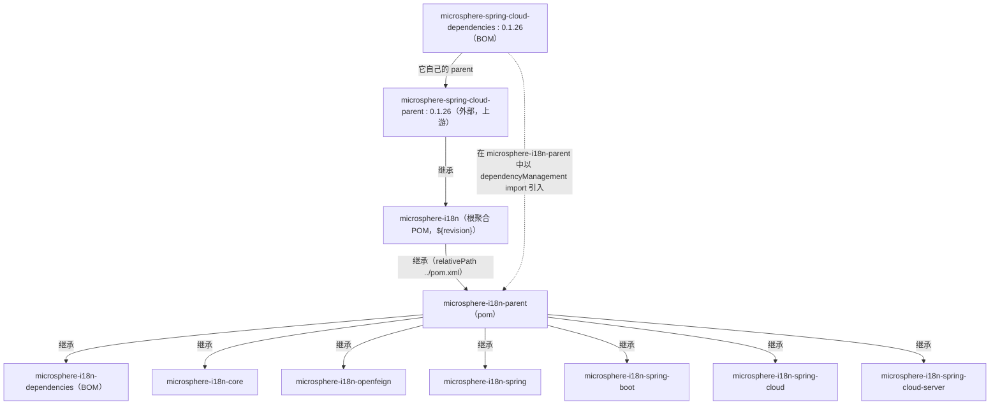
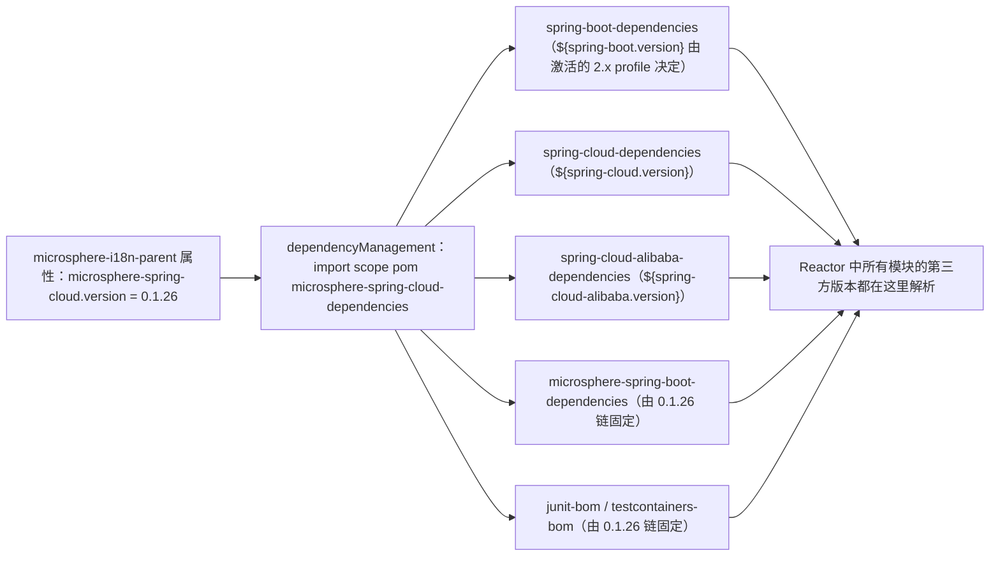

# Parent POM 模块 —— 开发者指南（1.x）

模块：`microsphere-i18n-parent`
打包方式：`pom`
源码：无——该模块就是 `microsphere-i18n-parent/pom.xml`，别无一物。

本文描述的是 **`1.x`（`0.1.x`）版本线**，即 Spring Boot 2.x / `javax.*` 代际。`0.2.x` 版本线见
[docs/developer-guide/current/zh/parent.md](../../current/zh/parent.md)。

## 1. 在 Maven Reactor 中的角色

根 POM（`microsphere-i18n`，`<packaging>pom</packaging>`）列出八个模块，它自身则是
`io.github.microsphere-projects:microsphere-spring-cloud-parent:0.1.26` 的子 POM：

```
<modules>
    <module>microsphere-i18n-parent</module>       <!-- 1：必须最先构建 -->
    <module>microsphere-i18n-dependencies</module>
    <module>microsphere-i18n-core</module>
    <module>microsphere-i18n-openfeign</module>
    <module>microsphere-i18n-spring</module>
    <module>microsphere-i18n-spring-boot</module>
    <module>microsphere-i18n-spring-cloud</module>
    <module>microsphere-i18n-spring-cloud-server</module>
</modules>
```

`microsphere-i18n-parent` 排在第一位，因为其余七个模块——包括 `microsphere-i18n-dependencies` BOM
在内——都把它声明为自己的 `<parent>`，并带有
`<relativePath>../microsphere-i18n-parent/pom.xml</relativePath>`。Maven 必须先构建并安装该 parent，
继承它的模块才能解析到它；因此对单个模块执行 Reactor 构建时需要 `-am`（also-make）把它一并带上。

继承链与管理链是两条不同的边，两者都必须理解：





## 2. Parent 声明了什么

`microsphere-i18n-parent/pom.xml`（1.x 分支）的完整内容：

| 段落                   | 内容                                                                                                                          |
|------------------------|---------------------------------------------------------------------------------------------------------------------------------|
| `<parent>`             | `io.github.microsphere-projects:microsphere-i18n:${revision}`，带 `<relativePath>../pom.xml</relativePath>`                 |
| `<artifactId>`         | `microsphere-i18n-parent`，`<packaging>pom</packaging>`，`<version>${revision}</version>`                                   |
| `<properties>`         | 只有一条：`<microsphere-spring-cloud.version>0.1.26</microsphere-spring-cloud.version>`（注释为 “BOM versions”）          |
| `<dependencyManagement>` | 只有一条 `<scope>import</scope>` + `<type>pom</type>` 条目：`microsphere-spring-cloud-dependencies:${microsphere-spring-cloud.version}` |
| `<dependencies>`       | 无——每个模块各自声明                                                                                                       |
| `<build>` / `<profiles>` | 本仓库内没有定义，全部内容来自继承                                                                                          |

根 POM 提供了塑造构建的版本属性。在 `1.x` 分支上，Reactor POM 声明了
`<revision>0.1.22-SNAPSHOT</revision>`，并且**没有 `java.version` 属性**——Java 级别因此完全来自继承的
`microsphere-spring-cloud-parent:0.1.26` 链（Spring Boot 2.x 代际）。

| 属性          | 取值              | 作用                                                                     |
|---------------|-------------------|---------------------------------------------------------------------------|
| `revision`    | `0.1.22-SNAPSHOT` | 所有模块的 CI 友好版本；由 CI 与发布任务在命令行覆盖                    |
| `java.version`| 未声明            | `1.x` 线的 Java 级别由上游 Spring Boot 2.x parent 继承而来              |

## 3. 版本 Profile 与 Spring Cloud 代际锁定

一个必须说清楚的事实：**本仓库中没有任何 POM 定义 `<profiles>` 块。** 代际锁定是通过根 POM 自身的
`<parent>` 从上游 `microsphere-spring-cloud-parent:0.1.26` 继承而来的。该 POM 导入
`spring-boot-dependencies:${spring-boot.version}`、
`spring-cloud-dependencies:${spring-cloud.version}` 与
`spring-cloud-alibaba-dependencies:${spring-cloud-alibaba.version}`，并为每一代 Spring Boot 2.x
profile 各定义一个 profile。本项目 CI 会激活的是：

| Profile ID              | `spring-boot.version` | `spring-cloud.version` | 激活方式                     |
|-------------------------|-----------------------|------------------------|------------------------------|
| `spring-cloud-hoxton`   | `2.3.12.RELEASE`      | `Hoxton.SR12`          | 需显式 `-P`                  |
| `spring-cloud-2020`     | `2.4.13`              | `2020.0.5`             | 需显式 `-P`                  |
| `spring-cloud-2021`     | `2.6.15`              | `2021.0.9`             | 需显式 `-P`                  |

实际影响：

- 加 `-Pspring-cloud-2021` 构建 Reactor 时，编译目标是 Spring Boot `2.6.15` / Spring Cloud
  `2021.0.9`；加 `-Pspring-cloud-hoxton` 时编译目标是 Spring Boot `2.3.12.RELEASE` / Spring Cloud
  `Hoxton.SR12`。同一份源码在整个 Hoxton – 2021.0.x 范围内都保持兼容，这正是 README 兼容性说法的依据。
- 由于本版本线是 Spring Boot 2.x，通过该链解析到的所有第三方版本都属于 `javax.*` / Spring Framework 5.x
  家族；这里**不存在** `jakarta.*` 命名空间。
- 是否存在某个 `activeByDefault` 的 profile（若有）由上游
  `microsphere-spring-cloud-parent:0.1.26` 决定；本仓库只能激活它继承来的 profile。

构建矩阵位于 `.github/workflows/maven-build.yml`（1.x 分支）：

```yaml
strategy:
  matrix:
    java: [ '8', '11' , '17' , '21' , '25' ]
    maven-profile-spring-cloud: [ 'spring-cloud-hoxton' , 'spring-cloud-2020' , 'spring-cloud-2021' ]
```

它执行的命令：

```bash
mvn --batch-mode --update-snapshots --file pom.xml \
    -Drevision=0.0.1-SNAPSHOT test \
    --activate-profiles test,coverage,${{ matrix.maven-profile-spring-cloud }}
```

其中 `test` 与 `coverage` 这两个 profile 由继承来的构建配置提供，并非本仓库的 POM 所定义。矩阵在 Java 8
到 25 上构建 `1.x` Reactor，印证它并不要求 Java 17。

## 4. `${revision}` 与发布出去的 POM

每个模块的版本都写作 `${revision}`。由于下游项目无法直接使用 `${revision}`，构建在安装与发布时会使用
**flatten 后的** POM：每个模块目录下都会生成 `.flattened-pom.xml`，进入仓库的 POM 携带的是字面量版本。
例如，已发布的 `microsphere-i18n-dependencies:0.1.21` POM 中，六个被管理构件以及它的 parent 都写着
`0.1.21`，不再残留 `${revision}`；消费者看到的 `microsphere-i18n-parent` POM 同样带有字面量
`<microsphere-spring-cloud.version>0.1.26</microsphere-spring-cloud.version>` 与 `0.1.26` 的导入。

这就是为什么调整 `microsphere-spring-cloud.version` 属于源码级变更、必须发版才能生效——消费者无法用
属性把它改掉。

发布时 `revision` 的值究竟从哪里来？不是来自 POM：发布任务在命令行上传入 `-Drevision=<x.y.z>`（见
`.github/workflows/maven-publish.yml`，它会先校验版本是否符合 `major.minor.patch` 形式），紧接着的
步骤会把根 POM 中的 `<revision>` 改写为下一个补丁版本并推送，也就是提交历史里那条
`chore: bump version to next patch after publishing 0.1.21`。因此 POM 里写的 `revision` 永远是
*下一个* 开发版本（当前工作树中为 `0.1.22-SNAPSHOT`），而不是仓库中已发布的那个版本。

## 5. 维护流程

**升级到新的上游 Spring Cloud 版本列车**

1. 修改 `microsphere-i18n-parent/pom.xml` 中的 `<microsphere-spring-cloud.version>`（一行）。
2. 用矩阵支持的所有代际 profile 完整构建一次 Reactor。
3. 修复各模块的 API 适配问题——parent 本身除这一行外不应有其他改动。

**新增一个 Spring Cloud 代际支持**

如果上游缺少所需的 profile，必须先在 `microsphere-spring-cloud-parent` 中添加；本仓库只能激活继承来的
profile。上游发布后，把新的 profile ID 加入 `.github/workflows/maven-build.yml` 的矩阵。

**新增一个模块**

```xml

<project>
    <parent>
        <groupId>io.github.microsphere-projects</groupId>
        <artifactId>microsphere-i18n-parent</artifactId>
        <version>${revision}</version>
        <relativePath>../microsphere-i18n-parent/pom.xml</relativePath>
    </parent>
    <artifactId>microsphere-i18n-example</artifactId>
    <packaging>jar</packaging>
</project>
```

随后必须同时把它登记到根 POM 的 `<modules>` 列表**和** `microsphere-i18n-dependencies` 的
`dependencyManagement` 中，否则该构件会以“无人管理”的状态发布。

**查看生效的版本管理**

```bash
# parent 贡献了什么？
./mvnw -pl microsphere-i18n-parent help:effective-pom

# 针对 Hoxton 代际，某个模块解析到的第三方版本是多少？
./mvnw -Pspring-cloud-hoxton -pl microsphere-i18n-openfeign dependency:tree

# 换成 2021.0.x 代际再看一次
./mvnw -Pspring-cloud-2021 -pl microsphere-i18n-openfeign dependency:tree
```

## 6. 设计说明

- **两个 POM 各司其职。** `microsphere-i18n-parent` 回答“我拿什么编译”（继承：插件、BOM 导入）；
  `microsphere-i18n-dependencies` 回答“我用哪个 i18n 版本”（可导入的版本管理）。二者分离，使应用可以只
  导入 BOM 而不继承构建插件。
- **parent 链通向外部项目。** Reactor 继承自 `microsphere-spring-cloud` 而不是
  `spring-boot-starter-parent`，因此 Microsphere 可以在一个上游 POM 中统一掌控整个矩阵（Boot + Cloud +
  Alibaba + Microsphere 自身构件），让所有 Microsphere 项目保持相互一致。
- **看似环状的结构是有意为之。** 根聚合 POM 是 `microsphere-i18n-parent` 的 parent，而后者又是所有叶子
  模块以及 BOM 的 parent。Maven 允许这样，因为“聚合”与“继承”两种角色是分别解析的；Reactor 构建顺序仍然
  把 `microsphere-i18n-parent` 放在最前。
- **面积最小化。** parent 中只有一个属性和一个 import；写在这里的任何东西都会被放大到八个模块，因此新增的
  版本管理应放到上游 BOM，或者放到 `microsphere-i18n-dependencies` 里。

## 与 0.2.x 版本线的差异

parent 的结构（一个属性、一个 BOM 导入、纯 POM 打包）与 `0.2.x` 完全一致；只有被固定的版本以及它们通向的
代际不同：

| 方面                                | `1.x`（`0.1.x`）线                                             | `0.2.x` 线                                              |
|-------------------------------------|------------------------------------------------------------------|----------------------------------------------------------|
| 根 parent 版本                      | `microsphere-spring-cloud-parent:0.1.26`                         | `microsphere-spring-cloud-parent:0.2.26`                 |
| `microsphere-spring-cloud.version`  | `0.1.26`                                                         | `0.2.26`                                                 |
| BOM 导入                            | `microsphere-spring-cloud-dependencies:0.1.26`                  | `microsphere-spring-cloud-dependencies:0.2.26`          |
| `${revision}` 工作 / 已发布         | `0.1.22-SNAPSHOT` / `0.1.21`                                    | `0.2.22-SNAPSHOT` / `0.2.21`                            |
| Reactor POM 的 `java.version`       | 未声明（Java 级别继承而来）                                      | `17`                                                    |
| 代际 profile                        | `spring-cloud-hoxton`（2.3.12/Hoxton.SR12）、`spring-cloud-2020`（2.4.13/2020.0.5）、`spring-cloud-2021`（2.6.15/2021.0.9） | `spring-cloud-2022` – `spring-cloud-2025`（Boot 3.x） |
| CI 的 `java` 矩阵                   | `8, 11, 17, 21, 25`                                              | `17, 21, 25`                                            |

依据 `git diff origin/release origin/release-1.x -- microsphere-i18n-parent`：两个发布分支之间
`microsphere-i18n-parent/pom.xml` 的唯一改动就是 `microsphere-spring-cloud.version` 的取值
（`0.1.26` 与 `0.2.26`）。

## 相关文档

- 用户指南：[Parent POM](../../../user-guide/1.x/zh/parent.md)
- 开发者指南：[Dependencies BOM](dependencies.md)、[Spring Boot](spring-boot.md)
- 0.2.x 对应文档：[current Parent 开发者指南](../../current/zh/parent.md)
