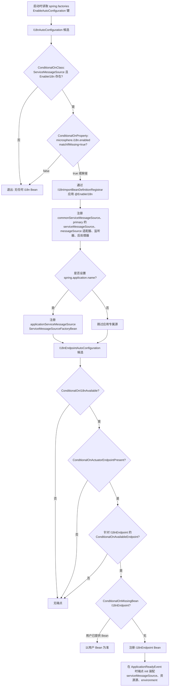
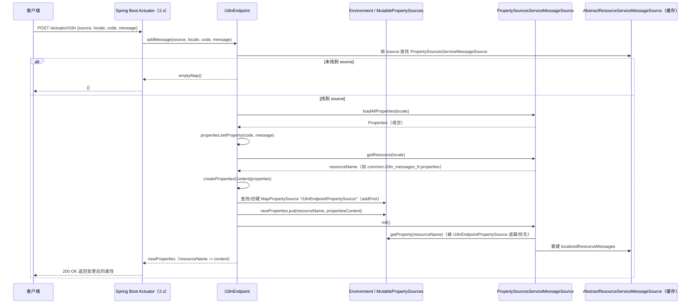
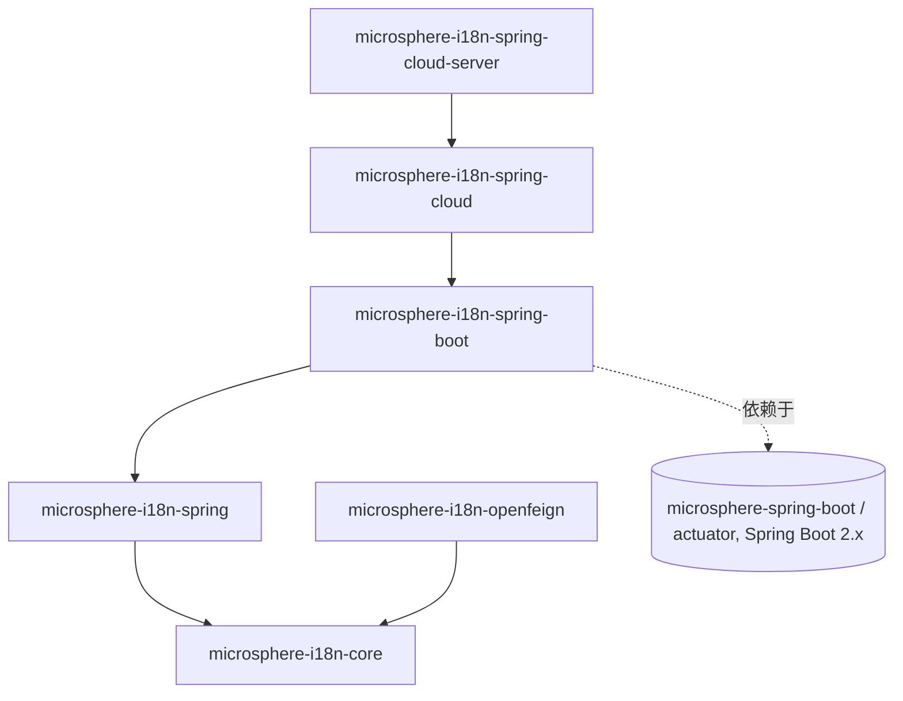

# Spring Boot 集成 —— 开发者指南（1.x）

本指南解释 **`1.x`（`0.1.x`）版本线**上 `microsphere-i18n-spring-boot` 的内部结构：它的自动配置如何
被注册与求值、Actuator 的 `I18nEndpoint` 如何在运行时读取和修改消息、它如何与 `microsphere-i18n-spring`
的 Bean 交互，以及本模块如何被测试。所有结论均来自 `release-1.x` 分支上
`microsphere-i18n-spring-boot/src/main` 与 `src/test` 下的源码。

`0.2.x` 版本线见 [docs/developer-guide/current/zh/spring-boot.md](../../current/zh/spring-boot.md)。

- [TOC]

## 架构

Spring Boot 模块刻意保持轻量。它只包含四个生产代码类：

| 类                                        | 包                               | 职责                                                          |
|-------------------------------------------|----------------------------------|---------------------------------------------------------------|
| `I18nAutoConfiguration`                   | `...spring.boot.autoconfigure`   | 入口：应用 `@EnableI18n` 并注册以应用命名的源。                |
| `ConditionalOnI18nAvailable`              | `...spring.boot.condition`       | 复合 `@Conditional`：类存在性 + `microsphere.i18n.enabled`。   |
| `I18nEndpointAutoConfiguration`           | `...spring.boot.actuate.autoconfigure` | 在可用时注册 Actuator 的 `I18nEndpoint`。                 |
| `I18nEndpoint`                            | `...spring.boot.actuate`         | 针对消息读写的 `@Endpoint(id = "i18n")` 操作。                 |

所有更重的部分 —— `ServiceMessageSource` 继承体系、`@EnableI18n` 的注册器、基于属性源的消息源 —— 都位于
`microsphere-i18n-spring` 与 `microsphere-i18n-core`。本模块只是把这些部件接入 Spring Boot 生命周期：

- `I18nAutoConfiguration` 带有 `@EnableI18n`，因此导入它会传递性地触发 Spring 的
  `I18nImportBeanDefinitionRegistrar`，由它构建消息源 Bean 图。
- `I18nEndpoint` 本身并不持有消息存储。它直接访问 Spring 模块创建好的同一批 Bean（`serviceMessageSource`、
  各 `AbstractResourceServiceMessageSource` 实例、各 `PropertySourcesServiceMessageSource` 实例）以及
  `Environment` 的属性源。

端点把自己的装配推迟到应用就绪之后：

```java
@EventListener(ApplicationReadyEvent.class)
public void onApplicationReadyEvent(ApplicationReadyEvent event) {
    init(event.getApplicationContext());
}

private void init(ConfigurableApplicationContext context) {
    this.primaryServiceMessageSource = getServiceMessageSource(context);
    this.resourceServiceMessageSources =
            findAllServiceMessageSources(this.primaryServiceMessageSource, AbstractResourceServiceMessageSource.class);
    this.environment = context.getEnvironment();
}
```

因此在 `ApplicationReadyEvent` 之前，`resourceServiceMessageSources` 与 `environment` 尚未赋值；只有当上下文
完全启动后，各操作才有意义。

## 自动配置注册机制

这是与 `0.2.x` 线唯一的结构性差异。在 Spring Boot 2.x 代际上，自动配置是通过
`META-INF/spring.factories` 而非 Spring Boot 3 的 `AutoConfiguration.imports` 文件被发现的。`1.x`
分支上本模块内置：

```
src/main/resources/META-INF/spring.factories
```

文件内容恰好如下（逐字，真实的 1.x 文件内容）：

```
org.springframework.boot.autoconfigure.EnableAutoConfiguration=\
io.microsphere.i18n.spring.boot.autoconfigure.I18nAutoConfiguration,\
io.microsphere.i18n.spring.boot.actuate.autoconfigure.I18nEndpointAutoConfiguration
```

两个类都列在同一个 `org.springframework.boot.autoconfigure.EnableAutoConfiguration` 键下（用反斜杠
`\` 把值续到下一行）。二者之间的顺序并非由文件行序决定，而是由 `I18nEndpointAutoConfiguration` 上的
`@AutoConfigureAfter(I18nAutoConfiguration.class)` 强制保证。两个类都带有
`@ConditionalOnI18nAvailable`，因此单个失效条件（`microsphere.i18n.enabled=false` 或 core/spring 类缺失）
会同时关闭两个自动配置。

`1.x` 分支上的模块 POM 把两个 Servlet/Validation 坐标换成了 `javax.*` 家族
（`javax.servlet:javax.servlet-api`、`javax.validation:validation-api`）；除此之外，每个 Java 源文件都与
`0.2.x` 线逐字节相同。

## 条件求值流程

下面的流程图追踪了对加载 `I18nAutoConfiguration`（随后是 `I18nEndpointAutoConfiguration`）的一次请求如何被
接受或拒绝，直到 Bean 被创建。



`ConditionalOnI18nAvailable` 注解逐字组合了源码中的两个类级条件：

```java
@ConditionalOnClass(name = {
        "io.microsphere.i18n.ServiceMessageSource",         // Microsphere i18n Core
        "io.microsphere.i18n.spring.annotation.EnableI18n", // Microsphere i18n Spring
})
@ConditionalOnProperty(name = ENABLED_PROPERTY_NAME, matchIfMissing = true)
public @interface ConditionalOnI18nAvailable {}
```

`ENABLED_PROPERTY_NAME` 解析为 `microsphere.i18n.enabled`
（`I18nConstants.PROPERTY_NAME_PREFIX + "enabled"`），其 `DEFAULT_ENABLED = true`。

## I18nEndpoint 源码分析

端点暴露一个由三个重载组成的读取接口，以及一个写操作。

### 读取：列出全部内容（`@ReadOperation invoke()`）

`invoke()` 遍历 `resourceServiceMessageSources`（在 primary 的 `serviceMessageSource` 下发现的所有
`AbstractResourceServiceMessageSource` 成员），并合并每个源的 `getLocalizedResourceMessages()`。该 Map 以资源
标识符为键（例如 `META-INF/i18n/common/i18n_messages_zh_CN.properties`），保存已解析的 `code -> message`
值，因此端点纯粹是对已加载缓存的投影 —— 它从不直接读取文件。

### 读取：按 code 获取消息（`getMessage(@Selector String code)`）

`getMessage(String)` 以 `null` locale 委托给双参数重载，后者通过
`primaryServiceMessageSource.getSupportedLocales()` 解析所有支持的 locale。对每个资源源与每个 locale，它输出一条
包含五个字段的记录：

```java
Map<String, String> messageMap = ofMap(
        "code", code,
        "locale", supportedLocale.toString(),
        "source", source,
        "resource", resource,
        "message", message
);
```

其中 `resource = resourceServiceMessageSource.getResource(locale)`，
`message = resourceServiceMessageSource.getMessage(code, locale)`（可能为 `null`）。

### 读取：按 code 与 locale 获取消息

`getMessage(@Selector String code, @Selector Locale locale)` 复用同一个循环，但调用
`getSupportedLocales(locale)`；当提供了 locale 时，该方法返回 `Collections.singleton(locale)`。单选择器路径映射到
`/{code}`，双选择器路径映射到 `/{code}/{locale}`。

### 写入：`addMessage(...)` 与 `MapPropertySource` 注入

```java
@WriteOperation
public Map<String, Object> addMessage(String source, Locale locale, String code, String message) throws IOException {
    PropertySourcesServiceMessageSource serviceMessageSource = getPropertySourcesServiceMessageSource(source);
    if (serviceMessageSource == null) {
        return emptyMap();
    }
    Properties properties = loadProperties(serviceMessageSource, locale);
    properties.setProperty(code, message);

    String resourceName = serviceMessageSource.getResource(locale);
    String propertiesContent = createPropertiesContent(properties);

    MapPropertySource propertySource = getPropertySource();
    Map<String, Object> newProperties = propertySource.getSource();
    newProperties.put(resourceName, propertiesContent);

    serviceMessageSource.init();
    return newProperties;
}
```

关键机制：

- **源解析** —— `getPropertySourcesServiceMessageSource(source)` 把资源源过滤为 `getSource()` 等于所请求
  `source` 的 `PropertySourcesServiceMessageSource` 实例，并取第一个。未知的 `source` 返回 `emptyMap()`。
- **已有内容** —— `loadProperties(...)` 调用 `serviceMessageSource.loadAllProperties(locale)`，当尚无任何内容
  被加载时退回到空的 `Properties`。
- **资源名** —— `getResource(locale)` 生成属性源的键，例如 `common.i18n_messages_fr.properties`（由
  `i18n_messages_` + locale + `.properties` 构成，属性源变体再以 source 作前缀）。
- **序列化** —— `createPropertiesContent` 写出以行分隔符连接的 `key=value` 行，生成 `.properties` 正文。
- **属性源注入** —— `getPropertySource()` 查找或创建一个名为 `i18nEndpointPropertySource`（常量
  `PROPERTY_SOURCE_NAME`）的 `MapPropertySource`，并以 `propertySources.addFirst(...)` 添加，使其优先于环境中
  其余部分。整个属性正文以资源名为键被存入。

这一设计与 `PropertySourcesServiceMessageSource` 读取消息的方式相匹配：其
`loadAllPropertiesResources(resource)` 会查找 `environment.getProperty(resourceName)`，并把返回的字符串按
`.properties` 内容解析。由于端点注入的属性其*名称*是资源标识符、其*值*是文件正文，`init()` 会从环境重新加载该
源，新消息随之可见。测试引导类 `I18nEndpointAutoConfigurationBootstrap` 通过
`.properties("test.i18n_messages_en.properties=test.a = test-a-2024")` 在外部演示了同样的约定。

### 重新初始化流程

调用 `serviceMessageSource.init()` 会重新执行 `AbstractResourceServiceMessageSource.initialize()`，它通过加载
每个已配置的资源来重建 `localizedResourceMessages` Map。由于新注入的属性此刻位于环境的最前面，重新加载后的 Map
便包含了新的 `code -> message` 条目，从而在不重启的情况下完成运行时更新。

### 写操作时序图



## 与 Spring 模块 Bean 的交互

端点与自动配置依赖由 `microsphere-i18n-spring` 确立、并可通过 `I18nBeanUtils` 与 `I18nConstants` 访问的命名约定：

| Bean 名称                        | 约定来源                                      | 备注                                                        |
|----------------------------------|-----------------------------------------------|-------------------------------------------------------------|
| `serviceMessageSource`           | `I18nConstants.SERVICE_MESSAGE_SOURCE_BEAN_NAME` | primary 的 `DelegatingServiceMessageSource`；`I18nBeanUtils.getServiceMessageSource(beanFactory)` 解析它。 |
| `<source>ServiceMessageSource`   | `I18nImportBeanDefinitionRegistrar`（`source + "ServiceMessageSource"`） | 每个源的 `ServiceMessageSourceFactoryBean`（如 `commonServiceMessageSource`）。 |
| `applicationServiceMessageSource`| `I18nAutoConfiguration#applicationServiceMessageSource` | 仅当设置了 `spring.application.name` 时存在；source 等于应用名。 |
| `messageSource`                  | `AbstractApplicationContext.MESSAGE_SOURCE_BEAN_NAME` | 当 `@EnableI18n(exposeMessageSource = true)`（默认）时注册的 `MessageSourceAdapter`。 |
| `i18nEndpointPropertySource`     | `I18nEndpoint.PROPERTY_SOURCE_NAME`           | 用于注入运行时写入的合成 `MapPropertySource`。              |

`I18nAutoConfiguration` 自身直接实例化一个 `ServiceMessageSourceFactoryBean` 用于应用命名的源：

```java
@Bean
@ConditionalOnProperty(name = "spring.application.name")
public ServiceMessageSourceFactoryBean applicationServiceMessageSource(
        @Value("${spring.application.name}") String applicationName) {
    return new ServiceMessageSourceFactoryBean(applicationName);
}
```

而 `ServiceMessageSourceFactoryBean` 进而通过 Spring Factories 加载具体的消息源实现
（`loadFactoryNames(AbstractServiceMessageSource.class, classLoader)`），应用 `microsphere.i18n.default-locale`
与 `microsphere.i18n.supported-locales` 属性并将它们组合 —— 这正是 `I18nEndpoint.init()` 能够用
`findAllServiceMessageSources(...)` 遍历组合体而遍历到全部源的原因。

`I18nEndpointAutoConfiguration` 还通过从 `microsphere-spring-boot-actuator`（一个可选依赖）导入
`ConditionalOnActuatorEndpointPresent` 来参与 Spring Boot 的约定，因此当缺少 Actuator 时端点自动配置会干净地退出。

## 模块依赖图



强制依赖边是 `spring-boot -> spring -> core`。`spring-cloud` 构建在 `spring-boot` 之上，`spring-cloud-server`
又构建在 `spring-cloud` 之上；`openfeign` 仅依赖 `core`。`spring-boot` 是被云模块继承的自动配置中枢。

## 测试策略

测试位于 `src/test/java/io/microsphere/i18n/spring/boot/...`，覆盖各条件、自动配置以及端点行为。测试源码在
`1.x` 与 `0.2.x` 分支之间完全相同；只有其下的平台不同。

- `ConditionalOnI18nAvailableTests` —— 唯一直接基于 `ApplicationContextRunner` 构建的测试。一个带
  `@ConditionalOnI18nAvailable` Bean 的最小 `@Configuration` 证明了四种情形：默认启用、
  `microsphere.i18n.enabled=true` 时启用、`=false` 时禁用，以及当 `FilteredClassLoader` 隐藏了
  `ServiceMessageSource` / `EnableI18n` 时禁用。

  ```java
  applicationContextRunner = new ApplicationContextRunner();
  applicationContextRunner.withUserConfiguration(Config.class)
          .withPropertyValues("microsphere.i18n.enabled=false")
          .run(context -> assertThat(context).doesNotHaveBean("a"));
  ```

- `I18nAutoConfigurationTest` —— 一个
  `@SpringBootTest(webEnvironment = NONE, ...)`，设置 `spring.application.name=I18nAutoConfigurationTest`。
  它继承 `AutoConfigurationTest<I18nAutoConfiguration>`（来自 `microsphere-spring-boot-test`），并使用其继承来的
  `runner` 断言：`applicationServiceMessageSource` 存在且 `source = I18nAutoConfigurationTest`；存在一个
  `ServiceMessageSourceFactoryBean`；`serviceMessageSource` 是一个 `DelegatingServiceMessageSource`；
  `messageSource` 是一个 `MessageSourceAdapter`；以及监听器与后处理器 Bean 均为单例。负向路径通过基类钩子
  `configureGlobalDisabledPropertyValues`（`microsphere.i18n.enabled=false`）与
  `configureGlobalMissingClasses`（`ServiceMessageSource`、`EnableI18n`）来验证。

- `I18nEndpointAutoConfigurationTest` —— 继承 `AutoConfigurationTest<I18nEndpointAutoConfiguration>`，将
  `I18nEndpoint.class` 声明为自动配置类，并复用同样的禁用属性与缺失类钩子，确认当 i18n 不可用时端点会退出。

- `I18nEndpointTest` —— 一个 `@SpringBootTest(webEnvironment = NONE)`，作用于一个
  `@ImportAutoConfiguration({ I18nAutoConfiguration, I18nEndpointAutoConfiguration, PropertyPlaceholderAutoConfiguration })`
  配置，且该配置还声明了自己的 `I18nEndpoint` Bean。它直接调用各操作（而非通过 HTTP），并用 JSON Path 校验结构：
  - `testInvoke` 断言诸如 `META-INF/i18n/common/i18n_messages_zh_CN.properties` 的资源键，以及 `common.a = 啊`
    之类的值。
  - `testGetMessageWithCode("a")` 期望 6 条记录（跨各源的所有支持 locale），而
    `testGetMessageWithCodeAndLocale("a", SIMPLIFIED_CHINESE)` 期望 2 条。
  - `testAddMessage` 针对 `Locale.FRANCE` 向 `common` 源写入，断言返回的 Map 含一个条目，并断言未知源返回共享的
    `emptyMap()`。

  默认 locale 在 `@BeforeAll` 中被强制设为 `Locale.SIMPLIFIED_CHINESE`，并在 `@AfterAll` 中恢复，这正是让 locale
  计数保持确定的原因。

- `src/test/resources` 下的测试固件：
  - `application.properties` 设置 `management.endpoint.i18n.enabled=true` 与
    `management.endpoints.web.exposure.include=*`，使 Actuator 装配处于激活状态。
  - `META-INF/i18n/{common,test}/i18n_messages_{en,zh_CN}.properties` 提供端点读取的消息数据（如
    `common.a = a` / `common.a = 啊`、`test.a = test-a`、`test.hello = Hello,{}`）。

- `I18nEndpointAutoConfigurationBootstrap` 是一个手动的 `@EnableAutoConfiguration` 应用（不是 JUnit 测试），用于在
  Servlet 容器中端到端运行端点，并演示 `test.i18n_messages_en.properties=...` 的运行时注入示例。

这些测试共同检验了两层契约：`ApplicationContextRunner` 在隔离环境中校验复合条件，而 `@SpringBootTest` 各类（配合
`AutoConfigurationTest` 基类）针对真实消息固件校验 Bean 装配与端点语义。

## 与 0.2.x 版本线的差异

`1.x` 模块在源码层面与 `0.2.x` 功能完全相同；差异体现在 Spring Boot 如何发现并承载它：

| 方面                       | `1.x`（`0.1.x`）线                                              | `0.2.x` 线                                       |
|----------------------------|------------------------------------------------------------------|----------------------------------------------------|
| 注册文件                   | `META-INF/spring.factories`（`EnableAutoConfiguration=...`）     | `META-INF/spring/...AutoConfiguration.imports`     |
| 注册文件内容               | 一个键下两个类，反斜杠续行                                       | 两行，每行一个类                                   |
| Servlet / Validation 依赖  | `javax.servlet:javax.servlet-api`、`javax.validation:validation-api` | `jakarta.servlet-api`、`jakarta.validation-api` |
| Actuator 承载代际          | Spring Boot 2.x（2.x 形式的 `@Endpoint` / `@ConditionalOnAvailableEndpoint`） | Spring Boot 3.x                     |
| 端点访问属性               | `management.endpoint.i18n.enabled`                              | 额外有 `management.endpoint.i18n.access`（Boot 3.4+） |
| 顺序 / 条件 / Bean / 测试  | 不变 —— 同样四个类、同样 Bean 图、同样测试源码                    | 不变                                               |

依据 `git diff origin/release origin/release-1.x -- microsphere-i18n-spring-boot`：改动的文件仅有
`pom.xml`（两处坐标替换）与新增的 `src/main/resources/META-INF/spring.factories`；没有 Java 源码差异。

## 相关文档

- 用户指南：[Spring Boot 集成](../../../user-guide/1.x/zh/spring-boot.md)
- 开发者指南：[Parent POM](parent.md)、[Dependencies BOM](dependencies.md)
- 0.2.x 对应文档：[current Spring Boot 开发者指南](../../current/zh/spring-boot.md)
