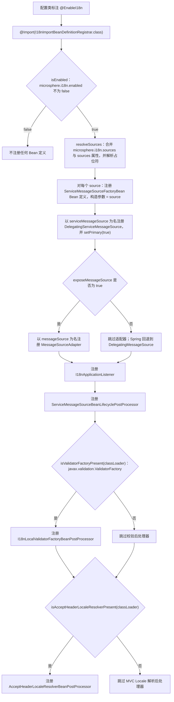
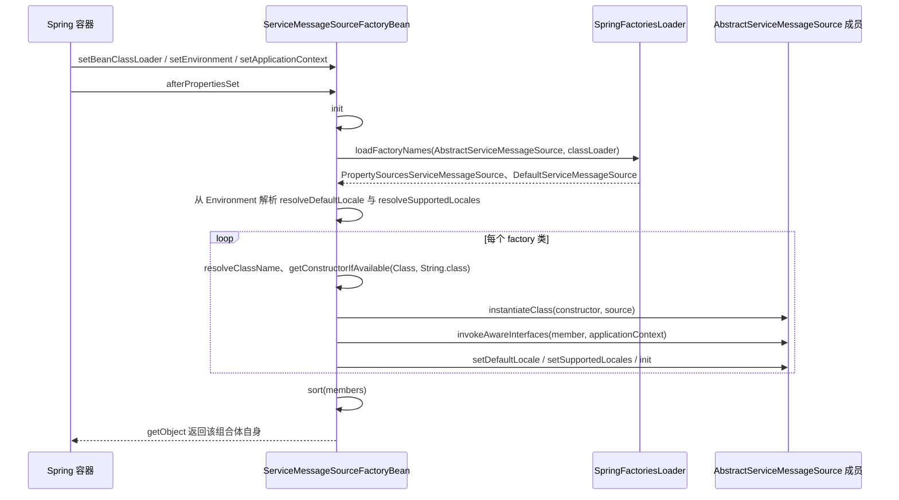
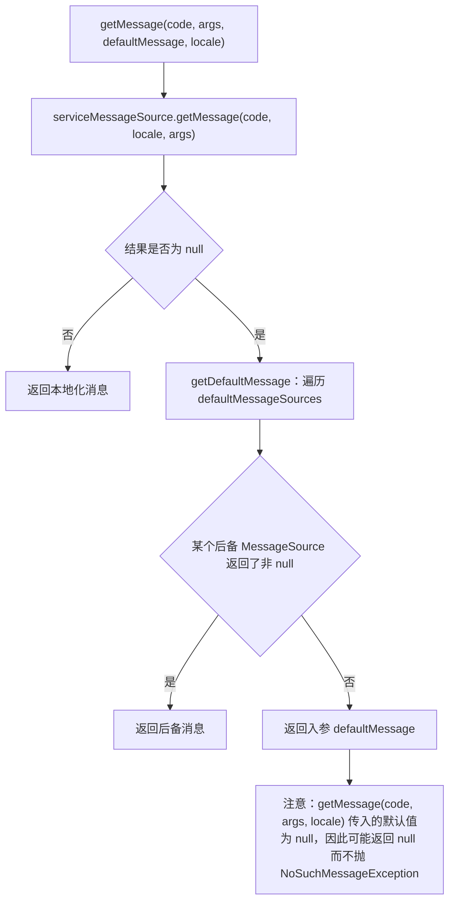
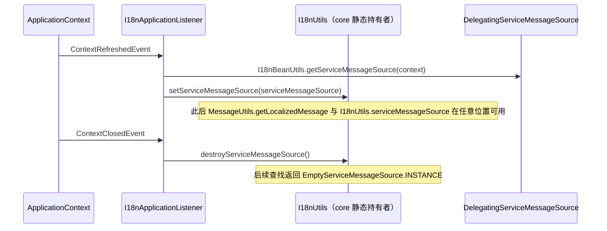
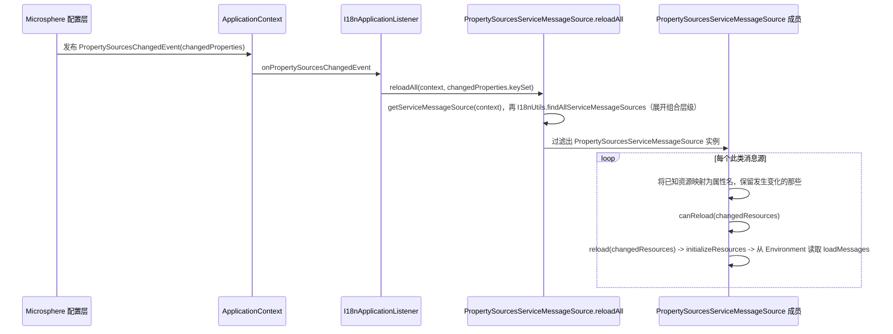
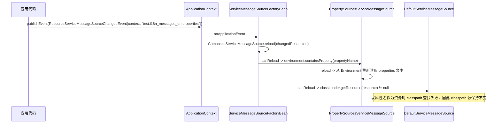
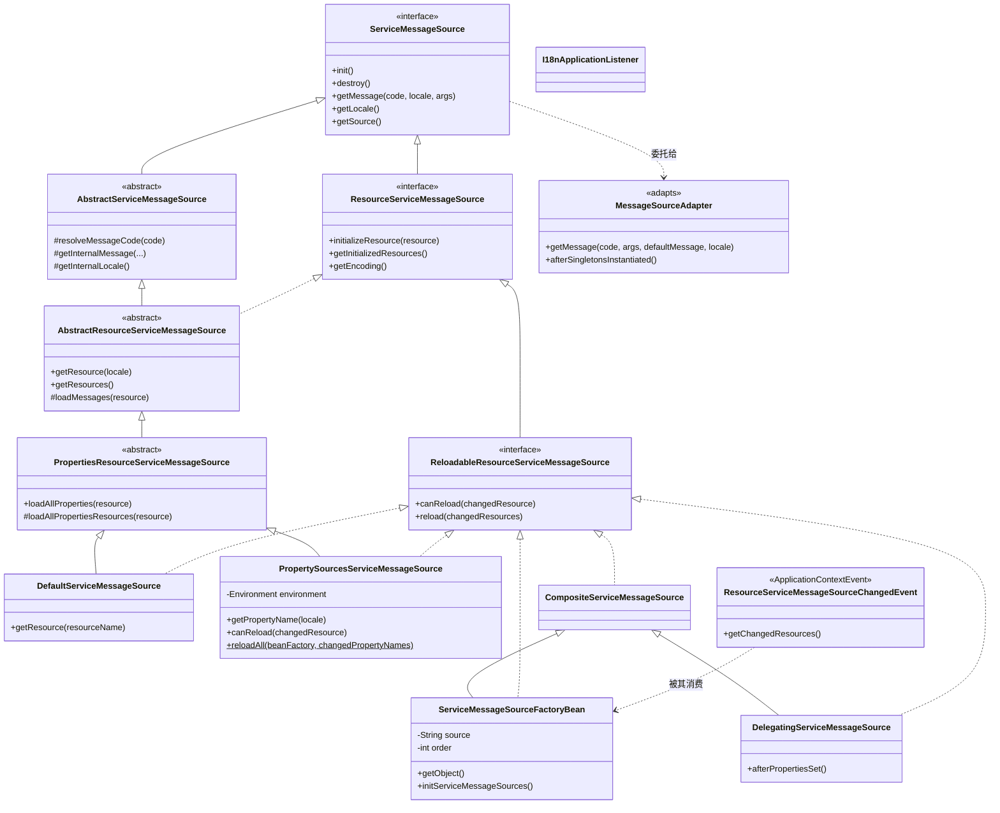
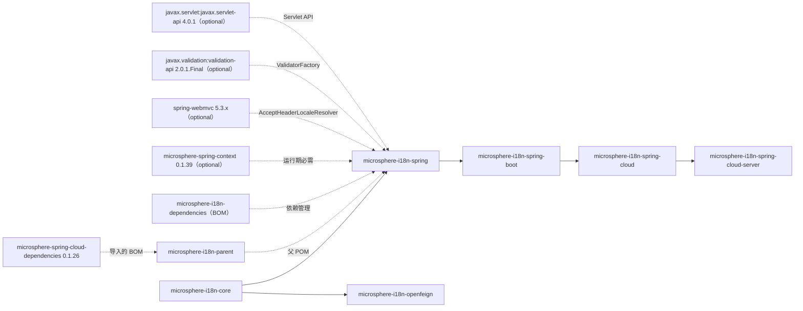

# Spring 模块 —— 开发者指南（1.x / `0.1.x` 版本线）

本文描述 **`0.1.x` 版本线**（`release-1.x` 分支）上 `microsphere-i18n-spring` 的内部设计：
`@EnableI18n` 如何装配容器、消息源实现如何被发现、Spring `MessageSource` 门面如何适配、哪些事件驱动
运行期重载，以及本模块的测试方式。

本版本线运行在 Spring Framework 5 / Spring Boot 2.x 与 `javax.*` 命名空间上。除明确标注之处，下文的
设计与 `0.2.x` 版本线完全一致；完整清单参见
[与 0.2.x 版本线的差异](#与-02x-版本线的差异)。

> 读者对象：本模块的贡献者，以及需要扩展 Bean 图的高级用户。日常使用请参见 `1.x` 章节的 Spring 用户指南。

## 架构与 Bean 装配总览

本模块自身没有任何消息解析逻辑，它是一个**装配层**，把 core 抽象
（`io.microsphere.i18n.ServiceMessageSource`）适配到 Spring 容器。所有解析、Locale 回退与消息格式化行为
均继承自 `microsphere-i18n-core`。

模块使用了四种协作模式：

| 模式                | 本模块中的类型                                                     | 职责                                                                       |
|---------------------|----------------------------------------------------------------------|------------------------------------------------------------------------------|
| 注解驱动注册         | `EnableI18n` + `I18nImportBeanDefinitionRegistrar`                  | 把一个注解展开为完整 Bean 图。                                            |
| Factory + 服务发现   | `ServiceMessageSourceFactoryBean`                                   | 基于 `spring.factories` 为每个 `source` 构建一个组合消息源。             |
| 适配器               | `MessageSourceAdapter`                                              | 通过 Spring `MessageSource` 契约暴露 `ServiceMessageSource`。              |
| 观察者 / 生命周期钩子 | `I18nApplicationListener`、`ResourceServiceMessageSourceChangedEvent`、三个 `BeanPostProcessor` | 发布全局消息源、变化时重载、并与 Validation 和 MVC 集成。            |

最终形成的运行期对象图是一个两级组合结构：

```
DelegatingServiceMessageSource（Bean 名：serviceMessageSource，主 Bean）
└── ServiceMessageSourceFactoryBean("common")   （Bean 名：commonServiceMessageSource）
│   ├── DefaultServiceMessageSource("common")
│   └── PropertySourcesServiceMessageSource("common")
└── ServiceMessageSourceFactoryBean("test")     （Bean 名：testServiceMessageSource）
    ├── DefaultServiceMessageSource("test")
    └── PropertySourcesServiceMessageSource("test")

MessageSourceAdapter（Bean 名：messageSource）──► serviceMessageSource
```

两级都会在使用前对成员排序：`ServiceMessageSourceFactoryBean` 对发现的实现排序，
`DelegatingServiceMessageSource` 对 `BeanFactory` 中找到的 `ServiceMessageSource` Bean 排序（并排除自身）。

## `@EnableI18n` 注册流程

`I18nImportBeanDefinitionRegistrar` 是包级私有类，继承
`io.microsphere.spring.context.annotation.AnnotatedBeanCapableImportBeanDefinitionRegistrar<EnableI18n>`；
父类提供 `Environment` 与 `Logger` 字段，解析支持占位符的注解属性
（`ResolvablePlaceholderAnnotationAttributes<EnableI18n>`），并在 `isEnabled(AnnotationMetadata)` 返回
`false` 时短路整个注册过程。



### 注册器创建的 Bean 定义

| Bean 名                                         | Bean 类                                                | 构造参数 | Role（`BeanDefinition.getRole()`） | 备注                                                             |
|--------------------------------------------------|----------------------------------------------------------|-----------|-------------------------------------|----------------------------------------------------------------------|
| `{source}ServiceMessageSource`（例如 `commonServiceMessageSource`、`testServiceMessageSource`） | `ServiceMessageSourceFactoryBean`                        | `source` 字符串 | `ROLE_APPLICATION` | 每个解析出的 source 一个定义；它是 `FactoryBean`，对外暴露类型为 `ReloadableResourceServiceMessageSource`。 |
| `serviceMessageSource`                            | `DelegatingServiceMessageSource`                          | 无        | `ROLE_APPLICATION` | `setPrimary(true)`；`@Autowired ServiceMessageSource` 实际注入的目标。 |
| `messageSource`                                   | `MessageSourceAdapter`                                    | 定义中无参数；Spring 按类型解析唯一的 `ServiceMessageSource` 构造参数（即主 Bean） | `ROLE_APPLICATION` | 仅当 `exposeMessageSource = true`。名称等于 `AbstractApplicationContext.MESSAGE_SOURCE_BEAN_NAME`。 |
| 生成的名称                                        | `I18nApplicationListener`                                 | 无        | `ROLE_APPLICATION` | 注册时未显式命名；请**按类型**获取。                                  |
| 生成的名称                                        | `ServiceMessageSourceBeanLifecyclePostProcessor`           | 无        | `ROLE_APPLICATION` | `MergedBeanDefinitionPostProcessor`。                                 |
| 生成的名称                                        | `I18nLocalValidatorFactoryBeanPostProcessor`               | `ObjectProvider<MessageSourceAdapter>`（按类型解析） | `ROLE_APPLICATION` | 受 `javax.validation.ValidatorFactory` 条件控制。                       |
| 生成的名称                                        | `AcceptHeaderLocaleResolverBeanPostProcessor`              | 无        | `ROLE_APPLICATION` | 受 `AcceptHeaderLocaleResolver` 条件控制。                             |

标注为“生成的名称”的条目来自
`org.springframework.beans.factory.support.BeanDefinitionReaderUtils#generateBeanName`，因为
`io.microsphere.spring.beans.factory.support.BeanRegistrar` 在该位置传入 `null`。因此这些名字并非模块契约
的一部分，所有测试与内部查找都**按类型**解析这些 Bean（`context.getBean(MessageSourceAdapter.class)`、
`isBeanPresent(context, I18nApplicationListener.class)`）。

`BeanRegistrar` 还拒绝覆盖已存在的定义：它只打印告警并返回 `false`。由此带来两个结果：你自己声明的
`messageSource` Bean 会保留，而重复应用 `@EnableI18n`（例如同时来自代码与 Boot 自动配置）时每个 source 只会被
注册一次。

## FactoryBean 与 `spring.factories` 发现机制

`ServiceMessageSourceFactoryBean` 是一个 `final` 类，同时是 `FactoryBean`、
`CompositeServiceMessageSource`、`Ordered` Bean 和事件监听器。`getObject()` 返回 `this`，
`getObjectType()` 返回 `ReloadableResourceServiceMessageSource.class`，因此容器发布的是组合体自身，而不是
另一个产品对象。

发现机制**基于 Spring Factories，而非 `java.util.ServiceLoader`**：模块通过
`org.springframework.core.io.support.SpringFactoriesLoader#loadFactoryNames` 读取
`META-INF/spring.factories`，因此不需要 `META-INF/services` 目录。随包提供的资源内容与 `0.2.x` 版本线
逐字节相同：

```properties
# microsphere-i18n-spring/src/main/resources/META-INF/spring.factories
io.microsphere.i18n.AbstractServiceMessageSource=\
io.microsphere.i18n.spring.PropertySourcesServiceMessageSource,\
io.microsphere.i18n.DefaultServiceMessageSource
```

key 是抽象类型 `io.microsphere.i18n.AbstractServiceMessageSource`，因此任何库只要用同一个 key 追加一条
`spring.factories` 记录，即可贡献自己的实现。需要说明的是，在本版本线上 `spring.factories` 同时也是
Spring Boot 2.x 的自动配置注册机制，但 `I18nAutoConfiguration` 的注册属于下游的
`microsphere-i18n-spring-boot` 模块；本模块的 `spring.factories` 只承载消息源发现这一个 key。



关于实现要求与行为，值得注意的点：

- 实现类必须提供只接受一个 `String`（source）参数的构造器；否则
  `ClassUtils.getConstructorIfAvailable` 返回 `null`，`instantiateClass` 会失败。
- 成员按其自然的 `Prioritized` 顺序排列（`java.util.Collections.sort`），这决定了组合体内部的查找优先级。
- `Aware` 回调通过 `io.microsphere.spring.beans.BeanUtils#invokeAwareInterfaces(member, context)` 手工推送，
  因此被发现的实现虽然不是容器托管 Bean，同样能获得 `BeanFactory`/`ApplicationContext`/`Environment` 注入。
- 当 `microsphere.i18n.default-locale` 缺失时，`resolveDefaultLocale` 回退到组合体当前默认 Locale；当
  `microsphere.i18n.supported-locales` 缺失时，`resolveSupportedLocales` 回退到 `getSupportedLocales()`
  （默认 Locale 加英文）。两者都在 `TRACE` 级别记录日志。
- `getLocale()` 优先使用 `LocaleUtils.getLocaleFromLocaleContext()`，之后才交给组合体，这正是“全 JVM 单例
  Bean 却能按请求响应”的原因。

## 适配器模式：`MessageSourceAdapter`

`MessageSourceAdapter` 在 `ServiceMessageSource` 之上实现 Spring 的 `MessageSource` 契约，并注册在
`messageSource` Bean 名下，于是所有消费消息的 Spring 机制（校验、`MessageSourceResolvable`、视图层）都会透明地
走 i18n 链路。



关键实现事实：

- `defaultMessageSources` 列表在 `afterSingletonsInstantiated()` 中由
  `getSortedBeans(beanFactory, MessageSource.class)` 填充，并跳过 `this`。之所以推迟到该阶段填充：适配器自身
  创建时，其他 `MessageSource` Bean（例如 `ResourceBundleMessageSource`）可能还不存在。
- 构造器按类型接收主 `DelegatingServiceMessageSource`。
- `getMessage(MessageSourceResolvable, Locale)` 遍历 `resolvable.getCodes()` 并返回第一个非 `null` 结果，因此
  空 code 数组（`() -> new String[0]`）会得到 `null`。
- 由于适配器使用 Spring 预留的同名 Bean 定义，用户提供的 `messageSource` Bean 会阻止它注册（见上文注册拒绝
  说明）。

## 观察者与事件流

### 容器生命周期：发布全局消息源

`I18nApplicationListener` 使用 `@EventListener` 方法，而非实现 `ApplicationListener` 接口；只要启用 i18n，
它就会被无条件注册。



### 由 `Environment` 驱动的重载：`PropertySourcesChangedEvent`



`reloadAll` 特意在过滤之前，把*属性名*逐个源翻译回*资源名*，因此无关的配置变更不会触发重载
（`canReload` 要求该属性确实存在于 `Environment` 中）。`I18nApplicationListenerTest` 断言了该行为的两侧：不携带
变化属性的事件不会改动消息；而携带 `test.i18n_messages_zh_CN.properties` 的事件会把 `test.a` 替换为新值。

### 资源重载事件：`ResourceServiceMessageSourceChangedEvent`

`ServiceMessageSourceFactoryBean` 实现了
`ApplicationListener<ResourceServiceMessageSourceChangedEvent>`，并把
`event.getChangedResources()` 转发给 `CompositeServiceMessageSource.reload`；后者会先询问每个
`ReloadableResourceServiceMessageSource` 成员是否 `canReload`，再对其执行重载。



这正是 `ServiceMessageSourceFactoryBeanTest#testGetMessage` 覆盖的流程：先向 `Environment` 首位加入一个
`MockPropertySource` 并提供 `test.i18n_messages_en.properties = test.a=1`，随后发布事件，`getMessage("a")` 返回
`"1"`。事件载荷类型是 `Iterable<String>`，测试中使用
`io.microsphere.collection.Lists#ofList(...)` 来构造它，而不是 `List.of(...)` —— 因为本版本线的目标是
Java 8。

Spring Cloud 模块从另一个触发点复用同一入口：其 `ReloadableResourceServiceMessageSourceListener` 在收到
`EnvironmentChangeEvent` 时调用
`PropertySourcesServiceMessageSource.reloadAll(beanFactory, event.getKeys())`。

## Bean 后处理器及其激活条件

| 后处理器                                           | 种类                                  | 守卫条件                                                                                                       | 命中时的效果                                                       |
|----------------------------------------------------|----------------------------------------|-------------------------------------------------------------------------------------------------------------------|----------------------------------------------------------------------|
| `ServiceMessageSourceBeanLifecyclePostProcessor`     | `MergedBeanDefinitionPostProcessor`     | `io.microsphere.util.ClassUtils.isAssignableFrom(ServiceMessageSource.class, beanType)`                             | 把 `initMethodName` 默认为 `init`，`destroyMethodName` 默认为 `destroy`。 |
| `I18nLocalValidatorFactoryBeanPostProcessor`         | `GenericBeanPostProcessorAdapter<LocalValidatorFactoryBean>` | classpath：`ClassUtils.isPresent("javax.validation.ValidatorFactory", classLoader)`；按 Bean：泛型类型匹配；按调用：`ObjectProvider.ifAvailable` | 初始化之前调用 `setValidationMessageSource(messageSourceAdapter)`。       |
| `AcceptHeaderLocaleResolverBeanPostProcessor`        | `GenericBeanPostProcessorAdapter<AcceptHeaderLocaleResolver>` | classpath：`ClassUtils.isPresent("org.springframework.web.servlet.i18n.AcceptHeaderLocaleResolver", classLoader)`；按 Bean：泛型类型匹配 | 初始化之后调用 `setDefaultLocale` 与 `setSupportedLocales`。              |

生命周期默认值的写入采用了防御式规则：

- 已实现 `InitializingBean` 或 `DisposableBean` 的 Bean 会被跳过，否则回调会执行两次（一次通过接口，一次通过
  Bean 定义）。这正是 `DelegatingServiceMessageSource` 的 Bean 定义保持 init/destroy 方法为 `null` 的原因。
- 显式声明的方法名优先（仅当当前值为空白时才写入 `init`/`destroy`）。
- destroy 值为 `AbstractBeanDefinition.INFER_METHOD`（即 `"(inferred)"`）时保持不变，因此 Boot 风格的推断关闭
  方法不会被替换掉。

classpath 守卫在注册期使用 `ClassLoaderUtils.getDefaultClassLoader()`，并且两个守卫都以 public static 方法暴露，
使注册器无需提前加载这些可选类型。这正是本模块在没有 Spring MVC 或 Bean Validation 时仍可工作的原因：
`I18nImportBeanDefinitionRegistrarTest#testOnBeanClassAbsent` 用例把线程上下文类加载器换成平台类加载器，断言两个
可选后处理器消失，而核心的 `ServiceMessageSourceFactoryBean`、`MessageSourceAdapter`、`ServiceMessageSource` 与
`I18nApplicationListener` Bean 依然存在。

### `0.1.x` 版本线上的校验集成

`I18nLocalValidatorFactoryBeanPostProcessor` 是本模块中**唯一与 `0.2.x` 版本线存在源码差异的文件**，
而差异只有一个常量：

```java
// io.microsphere.i18n.spring.validation.beanvalidation.I18nLocalValidatorFactoryBeanPostProcessor
private static final String VALIDATOR_FACTORY_CLASS_NAME = "javax.validation.ValidatorFactory";
```

在 `release-1.x` 上该值是 `javax.validation.ValidatorFactory`；在 `release`（`0.2.x` 线）上是
`jakarta.validation.ValidatorFactory`。该类其余部分 —— 基类
`GenericBeanPostProcessorAdapter<LocalValidatorFactoryBean>`、
`ObjectProvider<MessageSourceAdapter>` 构造器、`processBeforeInitialization` 中调用
`setValidationMessageSource` 的逻辑、`TRACE` 日志，以及 public 的
`isValidatorFactoryPresent(ClassLoader)` 守卫 —— 全部相同。

为何只有守卫发生变化：`LocalValidatorFactoryBean` 是 Spring 的类型
（`org.springframework.validation.beanvalidation.LocalValidatorFactoryBean`），其全限定名在 Spring 5 与
Spring 6 中一致。守卫的存在仅仅是为了在 classpath 上没有 Bean Validation 提供方时避免触碰该 Bean，
因此它必须指名*面向提供方*的 API 类 —— 在 Bean Validation 2.2（Spring Boot 2 世代）下是
`javax.validation.ValidatorFactory`，在 Bean Validation 3.0（Spring Boot 3 世代）下是
`jakarta.validation.ValidatorFactory`。

在本版本线上工作的两个推论：

- 该守卫永远不会命中 `jakarta.validation` 的 jar。如果应用在 Boot 2 的 classpath 上混入了 Spring Boot 3
  的校验依赖，由于后处理器根本不会被注册，i18n 的校验装配会静默丢失。
- 类级 Javadoc 仍在提及 "Jakarta Validation API"；请把它当作 Bean Validation API 的历史称呼，真正生效的
  检查是上文那个常量。

## 类层次结构



各 Spring 面向容器类所实现的 Spring 生命周期接口：

| 类                                              | Spring 契约                                                                                                                          |
|-------------------------------------------------|----------------------------------------------------------------------------------------------------------------------------------------|
| `ServiceMessageSourceFactoryBean`                | `FactoryBean`、`InitializingBean`、`DisposableBean`、`EnvironmentAware`、`BeanClassLoaderAware`、`ApplicationContextAware`、`Ordered`、`ApplicationListener` |
| `DelegatingServiceMessageSource`                 | `InitializingBean`、`DisposableBean`、`BeanFactoryAware`                                                                                 |
| `PropertySourcesServiceMessageSource`            | `EnvironmentAware`                                                                                                                     |
| `MessageSourceAdapter`                           | `MessageSource`、`SmartInitializingSingleton`、`BeanFactoryAware`                                                                      |
| `AcceptHeaderLocaleResolverBeanPostProcessor`    | `BeanPostProcessor`（经由 `GenericBeanPostProcessorAdapter`）、`ApplicationContextAware`                                                 |
| `I18nLocalValidatorFactoryBeanPostProcessor`     | `BeanPostProcessor`（经由 `GenericBeanPostProcessorAdapter`）                                                                            |
| `ServiceMessageSourceBeanLifecyclePostProcessor` | `MergedBeanDefinitionPostProcessor`                                                                                                    |
| `I18nApplicationListener`                        | 仅 `@EventListener` 方法                                                                                                                 |

## 模块依赖



`microsphere-i18n-spring` 以 `${revision}` 依赖 `microsphere-i18n-core`，同时又是
`microsphere-i18n-spring-boot` 的必需依赖，后者的 `I18nAutoConfiguration` 上标注了 `@EnableI18n`。本模块没有任何
内容依赖 Spring Boot，这也是它可以在纯 `AnnotationConfigApplicationContext` 中使用的原因。

版本坐标并不写在模块 POM 里：`microsphere-i18n-parent` 导入
`microsphere-spring-cloud-dependencies` `0.1.26`，其后自身的父级链
（`microsphere-spring-cloud-parent` → `microsphere-spring-boot-dependencies` `0.1.34` →
`microsphere-spring-dependencies` `0.1.39` → `spring-boot-dependencies`）提供了 Microsphere、
Spring Framework 与 `javax.*` API 的版本。切换激活的 Maven profile
（`spring-cloud-hoxton`、`spring-cloud-2020`、`spring-cloud-2021`）就是让 Spring Boot 在
`2.3.12.RELEASE` 与 `2.6.15` 之间、Spring Framework 在 `5.2.15.RELEASE` 与 `5.3.27` 之间移动的原因。

## 测试策略

测试运行在原生 Spring 测试上下文（`spring-test` + JUnit 5）上；本模块的测试依赖中没有 Boot。
测试源码与测试资源与 `0.2.x` 版本线**完全相同** —— 相同的类名、相同的夹具、相同的断言 ——
因此测试作用域唯一的差异是传递而来的：从父级链解析出的 Bean Validation 提供方是
Hibernate Validator `6.2.x`（配合 `javax.validation` 与
`org.apache.tomcat.embed:tomcat-embed-el`），而不是基于 `jakarta` 的 8.x 系列。

### 共享夹具：`io.microsphere.i18n.AbstractSpringTest`

位于测试根包，被所有消息解析测试复用：

- `TEST_SOURCE = "test"`，对应 `src/test/resources/META-INF/i18n/test/` 下的资源。
- `@BeforeAll` 固定 `Locale.setDefault(Locale.SIMPLIFIED_CHINESE)`，使 JVM 默认 Locale 成为各处期望的回退值。
- `@BeforeEach` 调用 `resetLocaleContext()`；`@AfterAll` 调用 `destroyServiceMessageSource()` 并再次重置上下文，
  从而在不同测试类之间保持 core 的静态持有者干净。
- `assertGetMessage(ServiceMessageSource)` 集中表达对
  `META-INF/i18n/test/i18n_messages_zh_CN.properties`（`test.a = 测试-a` 与 `test.hello = 您好,{}`）的期望：
  `getMessage("a")` 为 `"测试-a"`，`getMessage("hello", "World")` 是 `"您好,World"`，未知 code 返回 `null`。

### 测试配置类

| 类                                                | 用途                                                                                                                  |
|---------------------------------------------------|--------------------------------------------------------------------------------------------------------------------------|
| `TestSourceEnableI18nConfiguration`                | `@EnableI18n(sources = TEST_SOURCE)`；大多数断言所依赖的基线上下文（`testServiceMessageSource`）。                      |
| `DisabledEnableI18nConfiguration`                  | `@EnableI18n` 加 `@ResourcePropertySource("classpath:META-INF/config/disabled-enable-i18n.properties")`，该文件只有一行 `microsphere.i18n.enabled = false`。 |
| `UnexposedMessageSourceEnableI18nConfiguration`    | `@EnableI18n(exposeMessageSource = false)`；证明被抑制的只有适配器这一个 Bean。                                            |

### 测试资源

- `META-INF/i18n/test/i18n_messages_{en,zh_CN}.properties` —— 正常路径消息包，既从 classpath 也从
  `Environment` 两条路径被验证。
- `META-INF/i18n/error/i18n_messages_zh_CN.properties` —— 故意混合的消息包（`error.a`、`test.b`），仅保留在测试
  资源中；本模块没有测试读取它，非法前缀的场景由 core 模块的
  `DefaultServiceMessageSourceTest#testValidateMessageCode` 断言。
- `messages_{en,zh_CN}.properties`（`test.value`）—— 传统 `ResourceBundleMessageSource` 的 basename，作为
  `MessageSourceAdapter` 的后备。
- `META-INF/config/disabled-enable-i18n.properties` —— 总开关。

### 逐类覆盖情况

| 测试                                                   | 锁定的行为                                                                                                                              |
|--------------------------------------------------------|--------------------------------------------------------------------------------------------------------------------------------------------|
| `I18nImportBeanDefinitionRegistrarTest`                 | 四种场景下的完整 Bean 清单：指定 sources、被禁用、不暴露适配器，以及可选类缺失（通过替换上下文类加载器实现）。                          |
| `EnableI18nTest`                                         | 通过注入的主 `ServiceMessageSource` 做端到端解析，包括与 `I18nUtils.serviceMessageSource()` 的 `assertSame`，以及英文回退。             |
| `ServiceMessageSourceFactoryBeanTest`                   | 用 `@TestPropertySource` 锁定 locale、`LocaleContextHolder` 的优先级、`FRANCE` 返回 `null`、通过 `ResourceServiceMessageSourceChangedEvent` 重载、`setOrder`、`resolveDefaultLocale` / `resolveSupportedLocales` 的回退分支，以及 `toString`。 |
| `PropertySourcesServiceMessageSourceTest`               | 资源到属性名的映射（`META-INF/i18n/test/...` 变为 `test.i18n_messages_zh_CN.properties`）、`canReload` 各分支、空/单个/委托型 Bean 图上的 `findAll...`，以及手工构造的带 `@Primary` `DelegatingServiceMessageSource` 的 `Config`。 |
| `MessageSourceAdapterTest`                              | 有/无后备 `MessageSource` Bean 两种情形下的适配器行为、`MessageSourceResolvable` 处理（含空 code 数组），以及 `toString` 覆盖。         |
| `I18nApplicationListenerTest`                           | 全局发布、空 `PropertySourcesChangedEvent` 时的无重载、mock 属性源报告新增属性后的生效重载，以及清理后回到 `EmptyServiceMessageSource.INSTANCE`。 |
| `DelegatingServiceMessageSourceTest`                    | 基于 `EmptyServiceMessageSource` 的委托组合体返回 `null` 而不报错。                                                                       |
| `ServiceMessageSourceBeanLifecyclePostProcessorTest`     | init/destroy 默认值的每个分支：未设置、`INFER_METHOD`、用户声明的 `start`/`stop`、实现了 `InitializingBean`/`DisposableBean` 的类型（`DelegatingServiceMessageSource`）以及不匹配的类型（`Object`）。 |
| `I18nBeanUtilsTest`                                       | 存在 `messageSource` 与回退为 `DelegatingMessageSource` 的差异、适配器识别，以及无 Bean 定义时 `getServiceMessageSource` 返回 `null`。   |
| `I18NLocalValidatorFactoryBeanPostProcessorTest`          | 无校验器 Bean、无适配器 Bean 两种情形，以及成功装配后插值器仍为 `LocaleContextMessageInterpolator` 的断言。在本版本线上，这些断言只有在测试 classpath 上存在 `javax.validation` 提供方时才成立。 |
| `AcceptHeaderLocaleResolverBeanPostProcessorTest`         | 解析器的 supported locales 与主消息源的 supported locales 相等。                                                                           |

### 测试工具

- `SpringTestUtils.testInSpringContainer(...)`（来自 `microsphere-spring-test`）为每个 lambda 构建匿名上下文，
  可选地带一个 `ConfigurableEnvironment` 参数，从而让每次断言都拥有隔离的 Bean 图。
- `@SpringLoggingTest` 与 `@LoggingLevelsTest`（来自 `microsphere-logback` / `microsphere-spring-test`）负责采集
  trace 日志，并在日志量大的代码路径上临时把级别提升到 `ERROR`，例如 locale 解析的单元测试。
- `MockEnvironment`、`MockPropertySource` 以及 `environment.getPropertySources().addFirst(...)` 用于在不依赖 Boot
  或配置中心的前提下模拟外部配置变更。

## 与 0.2.x 版本线的差异

从贡献者的视角看，两条线是同一份代码。执行
`git diff origin/release origin/release-1.x -- microsphere-i18n-spring` 只会得到两个文件：

| 文件                                          | 变更                                                                                   |
|-----------------------------------------------|------------------------------------------------------------------------------------------|
| `microsphere-i18n-spring/pom.xml`              | `jakarta.servlet:jakarta.servlet-api` → `javax.servlet:javax.servlet-api`；`jakarta.validation:jakarta.validation-api` → `javax.validation:validation-api`。二者依旧保持 `optional`，且测试依赖（`hibernate-validator`、`tomcat-embed-el`、`microsphere-spring-test`、`microsphere-logback`、`logback-classic`、`junit-jupiter`、`spring-test`）的名称与作用域均未变化。 |
| `I18nLocalValidatorFactoryBeanPostProcessor.java` | `VALIDATOR_FACTORY_CLASS_NAME` 变为 `"javax.validation.ValidatorFactory"`。                |

其余内容一律未动：

- **包结构与类清单** —— 同样的 14 个 main 源文件、同样的 15 个 test 源文件，以及同样的
  `META-INF/spring.factories`；发现 key（`io.microsphere.i18n.AbstractServiceMessageSource`）与两个注册值
  完全相同。
- **Bean 图** —— 相同的 Bean 名、相同的 `@Primary` 委托、相同的条件式后处理器注册、相同的
  `BeanRegistrar` 不覆盖语义。
- **事件与重载链路** —— `PropertySourcesChangedEvent` 与 `ResourceServiceMessageSourceChangedEvent` 流程未变。
- **配置 key** —— `I18nConstants` 完全一致，`@ConfigurationProperty` 元数据也一样。
- **Javadoc 标记** —— 每个类型仍然标注 `@since 1.0.0`。

确实会影响开发工作的平台级差异：

- **Java 基线** —— `java.version` 继承自 `microsphere-build` `0.3.14`
  （经由 `microsphere-spring-cloud-parent` `0.1.26` 链），值为 8；本项目从未覆盖它。不要在本版本线引入
  record、文本块、`List.of` / `Map.of` 或 `jakarta` 导入。
- **依赖坐标** —— 由 `microsphere-spring-cloud-dependencies` `0.1.26` 解析
  （Microsphere Spring `0.1.39`、Spring Boot `2.3.12.RELEASE` – `2.6.15`、Spring Framework
  `5.2.15.RELEASE` – `5.3.27`、`javax.validation:validation-api` `2.0.1.Final`、
  `javax.servlet:javax.servlet-api` `4.0.1`），而不是带 Spring 6.2 / Jakarta 6 的 `0.2.26` 链。
- **Spring 5 API** —— 就本模块用到的路径而言，`getSortedBeans`、`ObjectProvider#ifAvailable` 与
  `MergedBeanDefinitionPostProcessor` 的行为与 Spring 6 一致，因此无需代码适配；差异只体现在所处的
  Spring 世代（例如下游模块中 Boot 2 的属性绑定）。
- **下游 Boot 模块** —— 本版本线上的 `microsphere-i18n-spring-boot` 同时通过
  `META-INF/spring.factories`（Boot 2）与
  `META-INF/spring/org.springframework.boot.autoconfigure.AutoConfiguration.imports` 注册
  `I18nAutoConfiguration`，而 `0.2.x` 线只发布后者。
- **需要忽略的过期文字** —— `release-1.x` 根目录的 `README.md` 仍写着 `0.2.x` 的要求
  （Java 17、Spring Framework 6、Spring Boot 3）；请以上文的 POM 链为准。

## 扩展与排障要点

- **新增消息源实现**：在你自己的 `META-INF/spring.factories` 中，以
  `io.microsphere.i18n.AbstractServiceMessageSource` 为 key 注册该类，并提供
  `public MySource(String source)` 构造器。它会被实例化、注入 Aware、配置解析出的 locale、初始化，并为每个声明的
  `source` 参与排序。
- **不改动 `@EnableI18n` 属性也能增加 source**：设置 `microsphere.i18n.sources` 即可；两条来源会被合并、解析占位符
  并去重。
- **完全没有注册任何内容**：先检查 `microsphere.i18n.enabled`；注册器会在 `TRACE` 级别记录该决策，并附上属性名与
  默认值。
- **消息解析为 `null`**：确认 code 前缀（`<source>.`）、supported-locale 裁剪
  （`microsphere.i18n.supported-locales` 会限定加载哪些文件），以及当前 `LocaleContextHolder` 的值。
- **本版本线上没有装配校验集成**：确认 classpath 上存在 `javax.validation` 提供方
  （Bean Validation 2.2，例如 Hibernate Validator 6.x）；`jakarta.validation` 的 jar 无法满足
  `isValidatorFactoryPresent`。
- **链路跟踪**：`AbstractResourceServiceMessageSource`、`CompositeServiceMessageSource`、
  `ServiceMessageSourceFactoryBean`、`DelegatingServiceMessageSource`、`MessageSourceAdapter` 以及两个可选后处理器
  都会在 `TRACE` 级别记录解析出的 code、locale 与消息模板 —— 为 `io.microsphere.i18n` 打开 trace 是定位问题最快的
  方式。
- **属性元数据**：构建过程会依据 `I18nConstants` 上的 `@ConfigurationProperty` 注解生成
  `META-INF/microsphere/configuration-properties.json`，IDE 对四个 `microsphere.i18n.*` key 的补全正来源于此。
