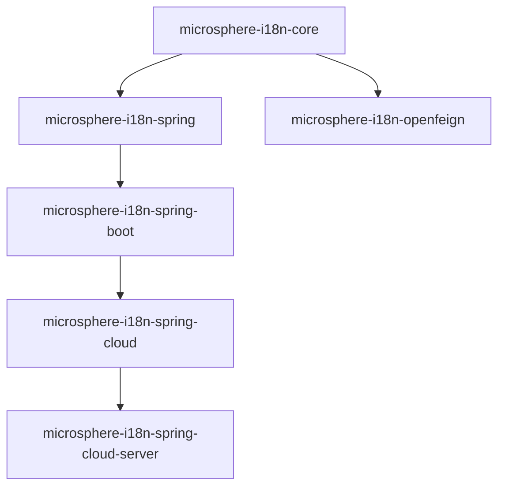

# Developer Guide

Internals documentation for microsphere-i18n: architecture design, source-code analysis, design
patterns, and flow diagrams for the complex paths through the framework.

- [中文版](./zh/README.md) · [Back to docs index](../README.md)

## Choose your release line

| **Release line** | **Directory** | **Versions** | **Key implementation notes** |
|------------------|---------------|--------------|------------------------------|
| Current (`release` branch) | [`current/`](./current/README.md) | 0.2.x | `jakarta.*` namespace; Boot 3 auto-configuration via `AutoConfiguration.imports` |
| Legacy 1.x (`release-1.x` branch) | [`1.x/`](./1.x/README.md) | 0.1.x | `javax.*` namespace; auto-configuration via `META-INF/spring.factories` |

## Documents (per module)

| **Document** | **Covers** |
|--------------|------------|
| [core.md](./current/core.md) | Class hierarchy of `ServiceMessageSource`, resolution algorithm, locale fallback flow, Template Method / Composite / Null Object patterns |
| [spring.md](./current/spring.md) | `@EnableI18n` bean-registration pipeline, FactoryBean + `spring.factories` discovery, Adapter and Observer patterns, validation/locale-resolver post-processors |
| [spring-boot.md](./current/spring-boot.md) | Auto-configuration condition chain, Actuator endpoint internals, runtime message write path |
| [spring-cloud.md](./current/spring-cloud.md) | `EnvironmentChangeEvent` → reload pipeline |
| [spring-cloud-server.md](./current/spring-cloud-server.md) | Service discovery integration, message aggregation flow |
| [openfeign.md](./current/openfeign.md) | Header resolution logic of the Feign interceptor |
| [parent.md](./current/parent.md) | POM inheritance and dependency-management chain |
| [dependencies.md](./current/dependencies.md) | BOM structure and import chain |

Replace `current/` with `1.x/` for the 0.1.x line, or insert `zh/` for Chinese.

## Module dependency graph

Every module inherits `microsphere-i18n-parent`; consumer versions are managed by the
`microsphere-i18n-dependencies` BOM. Each module document repeats this graph with its own
upstream/downstream context highlighted.

## Where to start

- New to the codebase? Read [core.md](./current/core.md) first — every other module builds on its
  abstractions.
- Working on Spring integration? [spring.md](./current/spring.md) explains the full bean lifecycle.
- Debugging dynamic reload? [spring-boot.md](./current/spring-boot.md) and
  [spring-cloud.md](./current/spring-cloud.md) contain the sequence diagrams for those flows.
