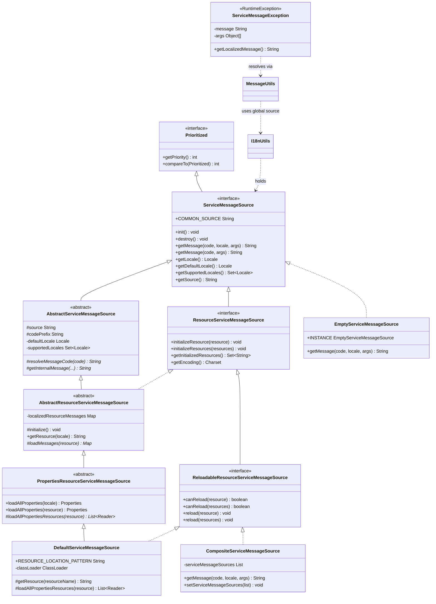
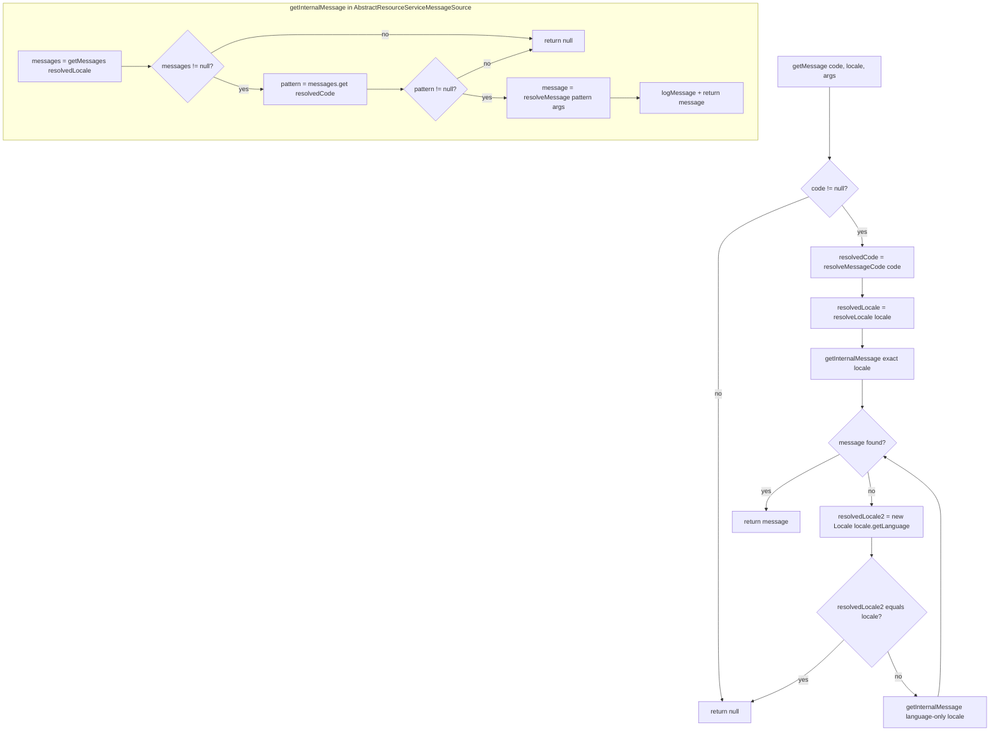
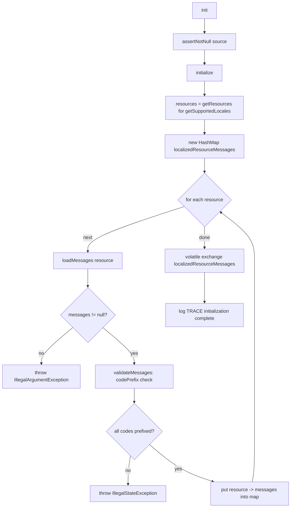
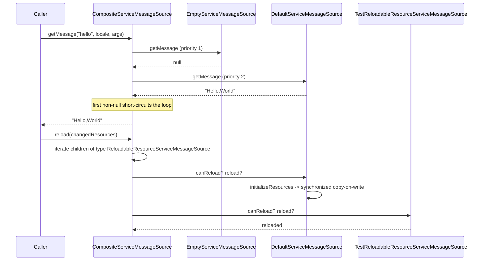
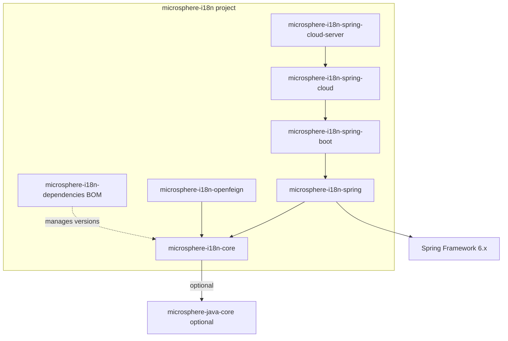

# microsphere-i18n Core — Developer Guide

This guide describes the internal design of the `microsphere-i18n-core` module: its package structure,
class hierarchy, the design patterns it applies, the resolution/loading algorithms in the key classes,
and its testing strategy. Every statement here was verified against the sources under
`microsphere-i18n-core/src/main/java` and the tests under `microsphere-i18n-core/src/test`.

The core module is framework-neutral pure Java 17; it has no Spring dependency and no upstream
microsphere-i18n module. Downstream Spring and OpenFeign integrations build on top of it.

## Architecture and package structure

The module exposes two packages:

| Package | Contents | Responsibility |
|---------|----------|----------------|
| `io.microsphere.i18n` | `ServiceMessageSource`, `ResourceServiceMessageSource`, `ReloadableResourceServiceMessageSource`, `AbstractServiceMessageSource`, `AbstractResourceServiceMessageSource`, `PropertiesResourceServiceMessageSource`, `DefaultServiceMessageSource`, `CompositeServiceMessageSource`, `EmptyServiceMessageSource`, `ServiceMessageException` | Message-source contract, implementations, and the i18n exception. |
| `io.microsphere.i18n.util` | `I18nUtils`, `MessageUtils` | Global source access (holder) and `{code}` message-pattern resolution. |

The design separates a **contract layer** (the interfaces), an **abstract base layer** that owns the
shared algorithms (`AbstractServiceMessageSource`, `AbstractResourceServiceMessageSource`,
`PropertiesResourceServiceMessageSource`), and a **concrete leaf layer** that supplies the only missing
piece — where the bytes come from (`DefaultServiceMessageSource`) — plus two structural collaborators
(`CompositeServiceMessageSource`, `EmptyServiceMessageSource`).

Capability is layered through interface specialization, so consumers depend on the smallest interface they
need: `ServiceMessageSource` → `ResourceServiceMessageSource` → `ReloadableResourceServiceMessageSource`.

The data model of a resource-backed source is a two-level map held in
`AbstractResourceServiceMessageSource`:

```
Map<String /* resource path */, Map<String /* message code */, String /* message pattern */>>
```

For source `test` with English and Simplified-Chinese locales that resolves to:

```
{
  "META-INF/i18n/test/i18n_messages_zh_CN.properties": { "test.a": "测试-a", "test.hello": "您好,{}" },
  "META-INF/i18n/test/i18n_messages_en.properties":     { "test.a": "test-a", "test.hello": "Hello,{}" }
}
```

## Class hierarchy



`ServiceMessageSource` extends `io.microsphere.lang.Prioritized`, which extends `Comparable<Prioritized>`.
This is what lets `CompositeServiceMessageSource.setServiceMessageSources(...)` sort children with
`Collections.sort` — the smallest priority value sorts first and therefore has the highest precedence
during `getMessage` iteration.

## Design patterns

The patterns below are located to the exact class and, where useful, the exact method.

### Template Method — `AbstractServiceMessageSource` and `AbstractResourceServiceMessageSource`

`AbstractServiceMessageSource.getMessage(String, Locale, Object...)` is declared `final` and defines the
skeleton of resolution: resolve code, resolve locale, call the abstract `getInternalMessage(...)`, then
run the language-only fallback. Subclasses never override the algorithm; they fill in the hooks
`resolveMessageCode(String)` and `getInternalMessage(...)` (and `getInternalLocale()` to influence
`getLocale()`).

`AbstractResourceServiceMessageSource` applies the same pattern for initialization: `init()` (final-ish
public entry) calls `initialize()`, which iterates `getResources()` and calls the private per-resource
routine that ultimately delegates to the abstract `loadMessages(String)` supplied by subclasses.
`PropertiesResourceServiceMessageSource` narrows the template further: `loadMessages(...)` is `final` and
calls the abstract `loadAllPropertiesResources(String)`, so a concrete leaf like
`DefaultServiceMessageSource` only decides *where* readers come from (a `ClassLoader`).

### Composite — `CompositeServiceMessageSource`

`CompositeServiceMessageSource implements ReloadableResourceServiceMessageSource` and holds a
`List<? extends ServiceMessageSource>`. `getMessage` iterates children and returns the first non-null
result; `init`/`destroy` fan out to every child; `getSupportedLocales` and `getInitializedResources`
aggregate (union) child results; `reload`/`initializeResources` use the private
`iterate(Class<T>, Consumer<T>)` helper to filter children by capability type and forward the call. The
composite itself answers `getSource() = "common"`, `canReload(...) = true`, and `getEncoding() = UTF-8`.
Its Javadoc states it is **not thread-safe** for mutation.

### Null Object — `EmptyServiceMessageSource`

`EmptyServiceMessageSource` implements the contract with a shared `INSTANCE`; `init`/`destroy` are no-ops
and `getMessage(...)` always returns `null`, while `getSource()` reports `"Empty"`. It is the safe fallback
returned by `I18nUtils.serviceMessageSource()` when nothing has been configured, and a harmless member to
include in a composite (consulting it always yields a miss).

### Global-singleton holder — `I18nUtils`

`I18nUtils` keeps the JVM-wide active source in a `private static volatile ServiceMessageSource` field.
`serviceMessageSource()`, `setServiceMessageSource(...)` and `destroyServiceMessageSource()` form the
accessor trio; `serviceMessageSource()` substitutes `EmptyServiceMessageSource.INSTANCE` (with a WARN log)
when the field is null. The class is an abstract utility with a private constructor.

### Copy-on-Write — `AbstractResourceServiceMessageSource.initializeResources(Iterable)`

Reloads and incremental initialization mutate the message map through a copy-on-write protocol guarded by
`synchronized (this)` — see *Thread-safety of `initializeResources`* below.

### Progressive role interfaces (Interface Segregation)

`ResourceServiceMessageSource` and `ReloadableResourceServiceMessageSource` extend the base contract with
narrow, opt-in capabilities so that `EmptyServiceMessageSource` (base only), `CompositeServiceMessageSource`
(resource + reload without `AbstractServiceMessageSource`), and the classpath chain can each implement only
what they support.

### Facade utilities — `MessageUtils`

`MessageUtils` is a static facade that hides the `{code}` parsing plus the global-source lookup behind
`getLocalizedMessage(...)`, with a documented not-found fallback (strip up to the first `.`).

### Composite tree flattening — `I18nUtils.doFindAllServiceMessageSources`

`initServiceMessageSources(...)` recursively expands nested composites into their leaf sources; a
non-composite is collected as a leaf of itself.

## Key class analysis

### `AbstractServiceMessageSource`

Fields:

```java
protected final Logger logger;                       // per-subclass logger via getLogger(getClass())
protected final String source;                       // immutable source name
protected final String codePrefix;                   // source + MessageUtils.SOURCE_SEPARATOR ("." )
private   Set<Locale> supportedLocales;              // lazily the hierarchical expansion
private   Locale defaultLocale;                      // configured default locale (nullable)
```

The constructor asserts `source != null` (via `io.microsphere.util.Assert.assertNotNull`) and derives
`codePrefix`. The `getMessage` overloads are `final`, funneling all lookups through the same algorithm and
forcing subclasses to implement `getInternalMessage`. `getLocale()` is `final` and is the seam that lets
subclasses influence the runtime locale through the protected `getInternalLocale()` hook (which returns
`null` by default, meaning "use the default locale").

Resolution algorithm (`getMessage(String code, Locale locale, Object... args)`):

```java
String message = null;
if (code != null) {
    String resolvedCode = resolveMessageCode(code);          // add source prefix if missing
    Locale resolvedLocale = resolveLocale(locale);           // normalize language + region
    message = getInternalMessage(code, resolvedCode, locale, resolvedLocale, args);   // exact locale
    if (message == null) {
        resolvedLocale = new Locale(locale.getLanguage());   // language-only fallback
        if (!resolvedLocale.equals(locale)) {
            message = getInternalMessage(code, resolvedCode, locale, resolvedLocale, args);
        }
    }
}
return message;
```

Because the fallback dereferences `locale.getLanguage()`, the `locale` argument must be non-null when
`code` is non-null.

`resolveLocale(Locale)` returns the locale unchanged when it has no country, otherwise it rebuilds
`new Locale(language, region)` — a normalization step. `resolveMessage(String, Object...)` delegates to
`io.microsphere.text.FormatUtils.format`, the `{}`-placeholder formatter.

### `AbstractResourceServiceMessageSource`

Field: `private volatile Map<String,Map<String,String>> localizedResourceMessages` initialized to
`Collections.emptyMap()`. `volatile` + whole-map replacement is what makes concurrent readers see a
consistent snapshot.

Constants: `DEFAULT_RESOURCE_NAME_PREFIX = "i18n_messages_"`, `DEFAULT_RESOURCE_NAME_SUFFIX = ".properties"`.

Locale-keyed lookup: `getMessages(Locale)` computes `getResource(locale)` = `buildResourceName(locale)`
= `"i18n_messages_" + locale.toString() + ".properties"`, then `localizedResourceMessages.get(resource)`.
`getResource(Locale)` is public and prepends the location pattern in the concrete subclass.

Message code prefix validation:

```java
private void validateMessageCodePrefix(String code, String resourceName) {
    if (!code.startsWith(codePrefix)) {
        throw new IllegalStateException(format(
            "Source '{}' Message Resource[name : '{}'] code '{}' must start with '{}'",
            source, resourceName, code, codePrefix));
    }
}
```

`validateMessages(...)` runs this for every entry immediately after `loadMessages` returns, during
`initializeResource`. This is why a properties file that declares a foreign-prefixed key (for example
`test.b` inside the `error` source, whose prefix is `error.`) aborts initialization with an
`IllegalStateException` (asserted by `DefaultServiceMessageSourceTest.testValidateMessageCode`).

Note the two exception types on purpose: `IllegalArgumentException` from `Assert.assertNotNull` when
`loadMessages` returns null (asserted by `AbstractResourceServiceMessageSourceTest.testInitialize`) versus
`IllegalStateException` from the prefix check.

`resolveMessageCode(String)` here implements the abstract hook:

```java
if (code.startsWith(codePrefix)) return code;   // already fully-qualified
return codePrefix + code;                        // "test." + "a" -> "test.a"
```

`destroy()` calls `clearAllMessages()` which clears the map and then nulls the field.

### Locale hierarchical fallback — `resolveHierarchicalLocales`

Two overloads cooperate:

```java
// Per-locale: zh_CN -> {zh_CN, zh}; a language-only locale stays as {locale}
protected Set<Locale> resolveHierarchicalLocales(Locale locale) {
    Locale resolvedLocale = resolveLocale(locale);
    String country = resolvedLocale.getCountry();
    if (isBlank(country)) {
        return ofSet(locale);
    }
    return ofSet(resolvedLocale, new Locale(resolvedLocale.getLanguage()));
}

// Collection: expands each supported locale, preserving order, de-duplicated
protected Set<Locale> resolveHierarchicalLocales(Collection<Locale> supportedLocales) {
    assertSupportedLocales(supportedLocales);                 // non-empty, no null elements
    Set<Locale> hierarchicalLocales = newFixedLinkedHashSet(supportedLocales.size() * 2);
    for (Locale supportedLocale : supportedLocales) {
        addLocale(hierarchicalLocales, supportedLocale);
        for (Locale locale : resolveHierarchicalLocales(supportedLocale)) {
            addLocale(hierarchicalLocales, locale);
        }
    }
    return hierarchicalLocales;
}
```

`setSupportedLocales(...)` stores the expansion of the input, so `getSupportedLocales()` returns the
ordered, de-duplicated hierarchical set. `supports(Locale)` checks membership via the per-locale expansion.

### Thread-safety of `initializeResources`

```java
@Override
public void initializeResources(Iterable<String> resources) {
    synchronized (this) {                                  // guarded mutation
        Map<String, Map<String, String>> copy = new HashMap<>(this.localizedResourceMessages);
        initializeResources(resources, copy);              // load into the private copy
        this.localizedResourceMessages = copy;             // atomic field exchange (volatile write)
    }
}
```

Readers never observe a half-updated map: the incoming resources are loaded into a private copy and only
then is the `volatile` field replaced in one assignment. Because the field is `volatile`, the publish is
visible across threads and readers that grabbed the previous reference keep a consistent snapshot. `init()`
(and the internal `initialize()`) build a fresh map and publish it the same way. Note `initialize()` does
not take the monitor, but it fully constructs the local map before the single volatile write, so the same
"no partial publication" property holds.

The composite's `setServiceMessageSources` is *not* synchronized (matching the class's documented
"not thread-safe" contract), unlike the resource class's copy-on-write path.

### `PropertiesResourceServiceMessageSource` and `DefaultServiceMessageSource`

`loadMessages` is final and turns a `Properties` object into an unmodifiable `Map<String,String>`, wrapping
any `IOException` into a `RuntimeException`. `loadAllProperties(String)` opens every classpath resource at
the same path (multi-JAR scanning) and merges them; it returns `null` only when no reader is available,
which `loadMessages` converts into an empty map.

`DefaultServiceMessageSource` supplies the two remaining abstract hooks: `getResource(resourceName)`
formats `RESOURCE_LOCATION_PATTERN` (the literal value `META-INF/i18n/{}/{}`) with `getSource()`, and
`loadAllPropertiesResources(resource)` enumerates `classLoader.getResources(resource)` and wraps each URL
in an `InputStreamReader` using `getEncoding()` (UTF-8). `canReload(resource)` is simply
`classLoader.getResource(resource) != null` — the classpath leaf can reload only files that still resolve.

## Flowchart — `getMessage` resolution



## Flowchart — `init()` resource loading



## Sequence diagram — composite delegation



## Module dependency

`microsphere-i18n-core` is the leaf of the i18n dependency chain: it depends on no other microsphere-i18n
module. Its `io.microsphere.*` and `io.microsphere.logging.*` references are satisfied by
`microsphere-java-core` (declared `optional`). Within the project, `microsphere-i18n-spring` and
`microsphere-i18n-openfeign` are the direct downstream consumers of core.



Full chain summary: `spring → core`, `spring-boot → spring`, `spring-cloud → spring-boot`,
`spring-cloud-server → spring-cloud`, `openfeign → core`.

## Testing strategy

Tests live under `microsphere-i18n-core/src/test/java` (JUnit 5) with fixtures in
`src/test/resources/META-INF/i18n/`. They are organised to mirror the class hierarchy so shared contract
behaviour is inherited and re-verified per implementation.

### Shared fixtures and base classes

- `AbstractI18nTest` is the base for the i18n tests. A `@BeforeAll` forces `Locale.setDefault(Locale.SIMPLIFIED_CHINESE)`
  so assertions like `"测试-a"` are deterministic, and it `destroyServiceMessageSource()` before and after each
  test to keep the `I18nUtils` global holder from leaking between tests. It exposes the `TEST_SOURCE = "test"` and
  `ERROR_SOURCE = "error"` constants.
- `ServiceMessageSourceTest` establishes the template-method inheritance pattern: a `createServiceMessageSource()`
  factory, a generic `getServiceMessageSource()`, `init()` in `@BeforeEach` and `destroy()` in `@AfterEach`. It
  verifies the contract defaults (`COMMON_SOURCE == "common"`, null lookups, default/supported locales).
- `ResourceServiceMessageSourceTest`, `ReloadableResourceServiceMessageSourceTest` and `DefaultServiceMessageSourceTest`
  form a subclass chain — each overrides `createServiceMessageSource()` and inherits the parent's assertions,
  so the resource and reload contracts are checked against the abstract test doubles and the real classpath
  implementation alike.

### Test doubles

`TestServiceMessageSource`, `TestResourceServiceMessageSource`, `TestReloadableResourceServiceMessageSource` and
`TestPropertiesResourceServiceMessageSource` are minimal implementations that exercise the interface default
methods. Notably `TestReloadableResourceServiceMessageSource.canReload(String)` returns whether a resource was
already initialized, letting `ReloadableResourceServiceMessageSourceTest.testCanReload` assert the false→true
transition after `reload`. `TestPropertiesResourceServiceMessageSource.loadAllPropertiesResources` throws
`IOException`, which `PropertiesResourceServiceMessageSourceTest.testLoadMessages` asserts is wrapped as a
`RuntimeException`.

### Per-implementation coverage

- `DefaultServiceMessageSourceTest` covers real classpath resolution: message lookup
  (`getMessage("a")` → `"测试-a"`), the `getLocalizedResourceMessages()` size being `2` (en + zh_CN),
  `loadAllProperties(Locale.FRANCE)` returning `null`, `supports(...)` for default and English locales,
  `resolveMessageCode` both for short and already-prefixed codes, and the invalid-prefix `error` source throwing
  `IllegalStateException` in `testValidateMessageCode`. It also overrides the inherited reload tests because the
  classpath `canReload` is resource-existence based.
- `CompositeServiceMessageSourceTest` builds a composite of `EmptyServiceMessageSource.INSTANCE`, a
  `DefaultServiceMessageSource`, and a `TestReloadableResourceServiceMessageSource`, then asserts composite lookups
  equal the direct source lookups, empty-composite behaviour, the `"common"` source name, locale union, encoding,
  and that `getServiceMessageSources()` preserves order.
- `EmptyServiceMessageSourceTest` asserts the null object always returns null and reports source `"Empty"`.
- `ServiceMessageExceptionTest` configures a `test` source with default and supported locale `zh_CN`, sets it as
  the global source, and checks `getMessage()` (raw pattern) versus `getLocalizedMessage()` (resolved) versus
  `toString()`.
- `MessageUtilsTest` and `I18nUtilsTest` cover the util layer: `{code}` resolution, the "no braces returns input"
  and "code not found strips to after the first dot" fallbacks, and the global holder defaulting to
  `EmptyServiceMessageSource.INSTANCE` plus recursive composite flattening.

### Logging-sensitive tests

Composite and message-util tests are annotated with `@LoggingLevelsClass` / `@LoggingLevelsTest` from
`microsphere-logging-test`, and `logMessage` / trace branches are exercised at TRACE, INFO and ERROR levels.
`PropertiesResourceServiceMessageSourceTest` runs locale setters at ERROR level to assert no accidental logging
is emitted for those paths.

Together the suite keeps `microsphere-i18n-core` under `src/test` coverage for the contract defaults, the
two-step locale fallback, prefix validation, copy-on-write reload semantics, composite delegation, and the
null-object and global-holder safety guarantees.
