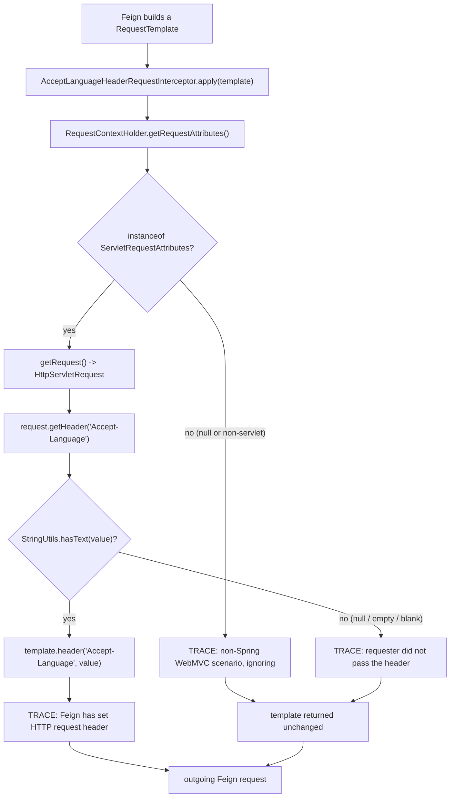
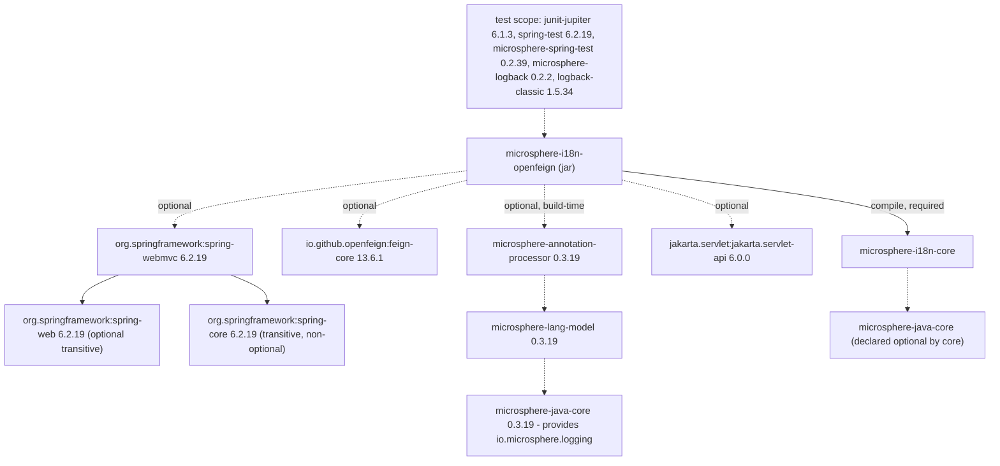

# OpenFeign Module — Developer Guide

Module: `microsphere-i18n-openfeign`
Java package: `io.microsphere.i18n.feign`
Size: one production class and one unit test.

```
microsphere-i18n-openfeign/
├── pom.xml
└── src/
    ├── main/java/io/microsphere/i18n/feign/
    │   └── AcceptLanguageHeaderRequestInterceptor.java
    └── test/java/io/microsphere/i18n/feign/
        └── AcceptLanguageHeaderRequestInterceptorTest.java
```

There is no `src/main/resources`: the module contributes no `spring.factories`, no
`AutoConfiguration.imports`, and no metadata file. Registration is left to the application.

## 1. Source Analysis

### Class Declaration

```java
public class AcceptLanguageHeaderRequestInterceptor implements RequestInterceptor {

    private static final Logger logger = getLogger(AcceptLanguageHeaderRequestInterceptor.class);

    public static final String HEADER_NAME = ACCEPT_LANGUAGE;
```

Notable details:

- `RequestInterceptor` is `feign.RequestInterceptor`, the SPI Feign calls while building a request.
- `HEADER_NAME` reuses `org.springframework.http.HttpHeaders.ACCEPT_LANGUAGE` via a static import,
  so the constant is guaranteed to be the literal `Accept-Language` Spring itself uses.
- `Logger` is `io.microsphere.logging.Logger` with
  `io.microsphere.logging.LoggerFactory.getLogger(...)` — the Microsphere logging facade, consistent
  with the rest of the framework, not SLF4J or Logback directly.
- The class is stateless: no fields besides the static logger, therefore a single instance shared by
  all Feign clients and all threads is safe.
- Javadoc declares `@since 1.0.0` and `@see AcceptHeaderLocaleResolver`, a documentation link only —
  the class never instantiates a locale resolver.

### `apply(RequestTemplate)` Walkthrough

```java
RequestAttributes requestAttributes = getRequestAttributes();
if (!(requestAttributes instanceof ServletRequestAttributes)) {
    ... return;
}
ServletRequestAttributes servletRequestAttributes = (ServletRequestAttributes) requestAttributes;
HttpServletRequest request = servletRequestAttributes.getRequest();
String acceptLanguage = request.getHeader(HEADER_NAME);
if (hasText(acceptLanguage)) {
    template.header(HEADER_NAME, acceptLanguage);
    ...
} else {
    ...
}
```

| Step | Code                                                | Failure mode and behavior                                                                  |
|------|-----------------------------------------------------|---------------------------------------------------------------------------------------------|
| 1    | `RequestContextHolder.getRequestAttributes()`       | Returns `null` outside a request thread (scheduled job, MQ listener, raw thread). Guarded by the `instanceof` check below. |
| 2    | `instanceof ServletRequestAttributes`               | Also filters out `NonServletRequestAttributes`-style contexts and any non-servlet binding. TRACE log, then silent `return`. |
| 3    | `servletRequestAttributes.getRequest()`             | Never reached when step 2 fails, so no `NullPointerException` is possible here.              |
| 4    | `request.getHeader(HEADER_NAME)`                    | `null` when the client sent no header; the raw string otherwise, including `q=` weights.     |
| 5    | `StringUtils.hasText(acceptLanguage)`               | Treats `null`, `""` and whitespace-only values the same way: nothing is written.             |
| 6    | `template.header(HEADER_NAME, acceptLanguage)`      | Copies the value verbatim; no parsing, no re-ordering, no supported-locale filtering.        |

Every log statement is wrapped in `logger.isTraceEnabled()`, so there is no formatting cost at
DEBUG and above. There is no exception thrown on any path: the interceptor can only ever be a
no-op, never a failure source for a Feign call.

### Edge Cases

- **Header absent on the inbound request.** Outbound Feign request has no `Accept-Language`. The
  receiving service resolves the locale through its own `AcceptHeaderLocaleResolver`, which then
  falls back to the default locale configured by `AcceptHeaderLocaleResolverBeanPostProcessor`
  (module `microsphere-i18n-spring`). There is deliberately **no** `LocaleContextHolder` fallback in
  this interceptor.
- **`Accept-Language: ` (empty or whitespace).** `hasText` rejects it; same outcome as absent.
- **Non-MVC request thread.** Any `RequestAttributes` that is not a `ServletRequestAttributes` is
  ignored. This includes async Feign usage where the calling thread never had request attributes, and
  inheritable thread-local setups only work if the attributes were bound with
  `setRequestAttributes(attributes, true)` before the child thread started.
- **Servlet 3.x/async dispatch.** The interceptor reads whatever request is bound at the moment
  `apply` runs; if the request has been completed and attributes reset, the header is skipped.
- **Multiple values.** `HttpServletRequest.getHeader` returns the first header line, so a client
  sending several `Accept-Language` lines forwards only the first one.

## 2. Header Resolution Flow



## 3. Dependency Structure

From `microsphere-i18n-openfeign/pom.xml` and the resolved dependency tree of the module:



Consequences for maintainers:

- Only `microsphere-i18n-core` is transitive to consumers. Everything else must be present in the
  application; that is why the module compiles against `feign-core`, `spring-webmvc` and the Servlet
  API without exporting them.
- The version numbers above are **not** written in this POM. They come from the parent chain:
  `microsphere-i18n-parent` imports `microsphere-spring-cloud-dependencies:0.2.26`, whose own parent
  imports `spring-boot-dependencies` at the version selected by the active generation profile.
  Switching the build profile changes `spring-webmvc` and `feign-core` versions automatically.
- `io.microsphere.logging` reaches the compile classpath through the optional
  annotation-processor chain (`microsphere-annotation-processor` -> `microsphere-lang-model` ->
  `microsphere-java-core`) and through `microsphere-spring-test` at test scope.
- `spring-core` is the only non-optional third-party artifact pulled in, as a transitive dependency
  of the optional `spring-webmvc`.

Build graph position: `microsphere-i18n-core` must be built first (`-pl microsphere-i18n-openfeign
-am`).

## 4. Design Notes

**Interceptor / mediator pattern.** The class is a Feign `RequestInterceptor`, i.e. a hook in
Feign's request-building pipeline rather than a decorator around the client. It mediates between two
objects that never see each other otherwise: `HttpServletRequest` (inbound, servlet world) and
`RequestTemplate` (outbound, Feign world). The module therefore has zero coupling to any bean
container and can be instantiated by hand.

**Copy, do not negotiate.** The interceptor forwards a header, not a `Locale`. That decision keeps
the module independent of `ServiceMessageSource` and of any configuration property: the downstream
service — where the supported locales of that service are known — performs the negotiation. It also
means the interceptor is correct for applications that do not use the rest of microsphere-i18n at
all.

**Silent degradation.** Every non-applicable case returns without writing the header and without
throwing. A locale-propagation failure must never turn into a business-call failure.

**No auto-configuration.** The `0.2.x` line registers no bean for this interceptor. Auto-wiring a
global header writer would change the behavior of every Feign client in an application, which is a
decision left to the user. (The README's wording about automatic registration does not match the
code — the module ships no auto-configuration metadata; nothing in `microsphere-i18n-spring-boot` or
`microsphere-i18n-spring-cloud` references this class.)

**Statelessness and thread-safety.** All state is read from thread-bound `RequestContextHolder`, so
one shared bean instance serves every client and thread.

## 5. Testing Strategy

`AcceptLanguageHeaderRequestInterceptorTest` is a plain JUnit 5 test — no Spring context is started,
which is exactly the point: the class must work with nothing but `RequestContextHolder`.

```java
@SpringLoggingTest
class AcceptLanguageHeaderRequestInterceptorTest {
```

`@SpringLoggingTest` (from `microsphere-spring-test`, a test-scope dependency) is the project-wide
convention for tests that need the framework's logging active; the same annotation is used by the
tests in `microsphere-i18n-spring` and `microsphere-i18n-spring-boot`.

Fixture (`@BeforeEach`) binds a `MockHttpServletRequest` to the current thread and prepares a fresh
`RequestTemplate`; `@AfterEach` calls `resetRequestAttributes()` so the thread-local never leaks into
the next test.

| Test method                             | Arrangement                                          | Assertion                                                        |
|-----------------------------------------|--------------------------------------------------------|-------------------------------------------------------------------|
| `testApply`                             | `request.addHeader(HEADER_NAME, "en")`                 | template headers were empty before, then `ofList("en")` for `Accept-Language` |
| `testApplyWithoutAcceptLanguageHeader`  | servlet attributes bound, no header added              | `requestTemplate.headers()` stays empty                            |
| `testApplyNoWebMvc`                     | `resetRequestAttributes()` before `apply`              | a **new** `RequestTemplate` still has no headers                   |

The three cases map one-to-one onto the branches of the flowchart above (hit, miss, guard). Running
them:

```bash
# Linux / macOS
./mvnw -pl microsphere-i18n-openfeign -am test

# Windows
mvnw.cmd -pl microsphere-i18n-openfeign -am test
```

CI runs the full reactor with a generation profile, for example
`mvn test --activate-profiles test,coverage,spring-cloud-2025 -Drevision=0.0.1-SNAPSHOT`, so this
module is exercised against every supported Spring Boot / Spring Cloud pair.

Gaps a contributor may want to close:

- assert the TRACE log content (the project uses `microsphere-logging-test` elsewhere);
- cover a whitespace-only header (`Accept-Language:   `);
- cover an inbound header with quality values to document verbatim forwarding;
- cover a non-servlet `RequestAttributes` implementation rather than `null`.

## 6. Extending the Module

Guidelines for new work here:

1. Keep the class stateless and free of Spring bean lookups; the current design's only coupling is
   `RequestContextHolder`.
2. If a new interceptor needs the resolved locale rather than the raw header, obtain it from
   `LocaleContextHolder.getLocale()` or `ServiceMessageSource#getLocale()` — and document why the
   fallback chain differs from this class's, which has none.
3. New third-party dependencies stay `optional` so the module keeps exporting only
   `microsphere-i18n-core`.
4. Any auto-configuration belongs in `microsphere-i18n-spring-boot` (which owns
   `META-INF/spring/org.springframework.boot.autoconfigure.AutoConfiguration.imports`) and should be
   conditional, e.g. `@ConditionalOnClass(RequestInterceptor.class)`, rather than unconditional.
5. Keep all logging at TRACE and behind `isTraceEnabled()`.

## 7. Troubleshooting for Maintainers

| Symptom                                                    | Likely cause                                                                |
|-------------------------------------------------------------|------------------------------------------------------------------------------|
| Downstream always uses the default locale                    | Interceptor bean not declared, or Feign call made outside the request thread |
| `NoClassDefFoundError: feign/RequestInterceptor`             | `feign-core` missing — the dependency is optional and not exported           |
| `NoClassDefFoundError: jakarta/servlet/http/HttpServletRequest` | Servlet API absent, or a `javax.*` container (`1.x` line)              |
| Header present on inbound call but not on the Feign call     | `RequestContextHolder` was reset (async dispatch, `@Async`, manual clearing) |
| Version of `spring-webmvc` unexpected                        | Build ran with a different `spring-cloud-*` generation profile               |

## Related Documentation

- User guide: [OpenFeign](../../user-guide/current/openfeign.md)
- Developer guide: [Core](core.md), [Parent POM](parent.md), [Dependencies BOM](dependencies.md)
