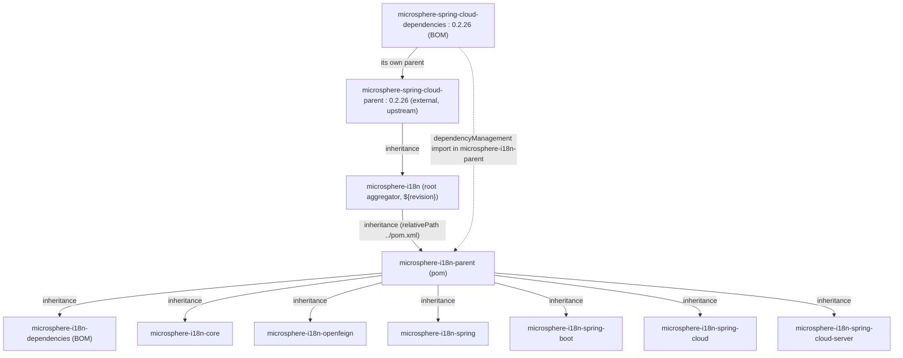
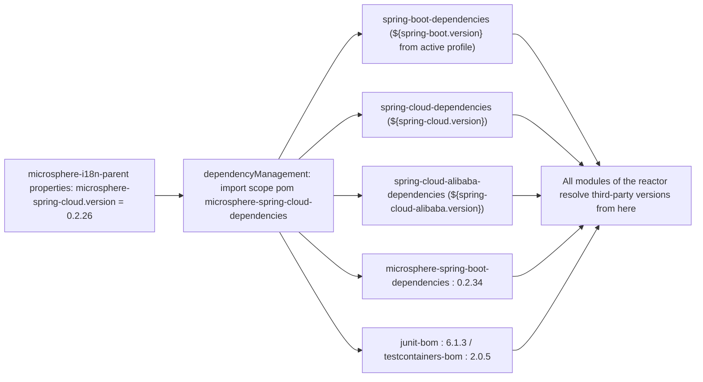

# Parent POM Module — Developer Guide

Module: `microsphere-i18n-parent`
Packaging: `pom`
Sources: none — the module is `microsphere-i18n-parent/pom.xml` and nothing else.

## 1. Role in the Maven Reactor

The root POM (`microsphere-i18n`, `<packaging>pom</packaging>`) lists eight modules and is itself a
child of `io.github.microsphere-projects:microsphere-spring-cloud-parent:0.2.26`:

```
<modules>
    <module>microsphere-i18n-parent</module>       <!-- 1: must be built first -->
    <module>microsphere-i18n-dependencies</module>
    <module>microsphere-i18n-core</module>
    <module>microsphere-i18n-openfeign</module>
    <module>microsphere-i18n-spring</module>
    <module>microsphere-i18n-spring-boot</module>
    <module>microsphere-i18n-spring-cloud</module>
    <module>microsphere-i18n-spring-cloud-server</module>
</modules>
```

`microsphere-i18n-parent` is listed first because all seven other modules — including the
`microsphere-i18n-dependencies` BOM — declare it as their `<parent>` with
`<relativePath>../microsphere-i18n-parent/pom.xml</relativePath>`. Maven therefore has to build and
install the parent before the modules that inherit from it can resolve it, and any reactor build of a
single module pulls the parent along with `-am` (also-make).

The inheritance chain and the management chain are two different edges, and both matter:





## 2. What the Parent Declares

The complete content of `microsphere-i18n-parent/pom.xml`:

| Section                | Content                                                                                                                                   |
|------------------------|----------------------------------------------------------------------------------------------------------------------------------------------|
| `<parent>`             | `io.github.microsphere-projects:microsphere-i18n:${revision}` with `<relativePath>../pom.xml</relativePath>`                              |
| `<artifactId>`         | `microsphere-i18n-parent`, `<packaging>pom</packaging>`, `<version>${revision}</version>`                                            |
| `<properties>`         | exactly one entry: `<microsphere-spring-cloud.version>0.2.26</microsphere-spring-cloud.version>` (comment: "BOM versions")           |
| `<dependencyManagement>` | one `<scope>import</scope>`, `<type>pom</type>` entry: `microsphere-spring-cloud-dependencies:${microsphere-spring-cloud.version}` |
| `<dependencies>`       | none — each module declares its own                                                                                                       |
| `<build>` / `<profiles>` | none in this repository; everything inherited                                                                                          |

The root POM contributes the other two properties that shape the build:

| Property      | Value             | Purpose                                                                       |
|---------------|-------------------|---------------------------------------------------------------------------------|
| `revision`    | `0.2.22-SNAPSHOT` | CI-friendly version for every module; overridden on the command line by CI and by the release job |
| `java.version`| `17`              | Java level of the line; the `0.2.x` line is `jakarta.*` / Spring Boot 3 |

## 3. Version Profiles and Spring Cloud Generation Pinning

An important accuracy point: **no POM inside this repository defines a `<profiles>` block.** The
generation pinning is inherited from the upstream `microsphere-spring-cloud-parent:0.2.26`, reached
through the root POM's own `<parent>`. That POM imports
`spring-boot-dependencies:${spring-boot.version}`,
`spring-cloud-dependencies:${spring-cloud.version}` and
`spring-cloud-alibaba-dependencies:${spring-cloud-alibaba.version}`, and defines one profile per
generation:

| Profile ID            | `spring-boot.version` | `spring-cloud.version` | `spring-cloud-alibaba.version` | Activation                  |
|-----------------------|-----------------------|------------------------|--------------------------------|-----------------------------|
| `spring-cloud-2022`   | `3.0.13`              | `2022.0.5`             | `2022.0.0.2`                   | explicit `-P`                |
| `spring-cloud-2023`   | `3.3.13`              | `2023.0.6`             | `2023.0.3.4`                   | explicit `-P`                |
| `spring-cloud-2024`   | `3.4.13`              | `2024.0.3`             | `2023.0.3.4`                   | explicit `-P`                |
| `spring-cloud-2025`   | `3.5.15`              | `2025.0.3`             | `2025.0.0.0`                   | `activeByDefault` (implicit) |
| `spring-cloud-2025.1` | `4.0.8`               | `2025.1.3`             | `2025.1.0.0`                   | explicit `-P`                |

Practical consequences:

- Building the reactor without `-P` compiles against Spring Boot 3.5.x / Spring Cloud 2025.0.x, and
  `microsphere-i18n-openfeign` then resolves `spring-webmvc:6.2.19` and `feign-core:13.6.1`.
- The same source builds against Boot 3.0 / Spring Cloud 2022 with `-Pspring-cloud-2022`, which is
  what makes the "2022.0.x – 2025.0.x" compatibility statement in the README real.
- `spring-cloud-2025.1` maps to Spring Boot 4.x and is **not** part of this project's CI matrix, so
  it is not a tested combination for microsphere-i18n.

The build matrix lives in `.github/workflows/maven-build.yml`:

```yaml
strategy:
  matrix:
    java: [ '17' , '21' , '25' ]
    maven-profile-spring-cloud: [ 'spring-cloud-2022' , 'spring-cloud-2023' ,
                                  'spring-cloud-2024' , 'spring-cloud-2025' ]
```

and the command it runs:

```bash
mvn --batch-mode --update-snapshots --file pom.xml \
    -Drevision=0.0.1-SNAPSHOT test \
    --activate-profiles test,coverage,${{ matrix.maven-profile-spring-cloud }}
```

`test` and `coverage` are profiles contributed by the inherited build configuration, not by POMs in
this repository.

## 4. `${revision}` and the Published POMs

Every module version is `${revision}`. Because `${revision}` cannot be consumed as-is by downstream
projects, the build installs and deploys **flattened** POMs: each module directory contains a
generated `.flattened-pom.xml`, and the POM stored in the repository carries literal versions. For
example, the published `microsphere-i18n-dependencies:0.2.21` POM lists its six managed artifacts at
`0.2.21` and its parent at `0.2.21`, with no `${revision}` left. The `microsphere-i18n-parent` POM
that consumers see likewise carries `<microsphere-spring-cloud.version>0.2.26</microsphere-spring-cloud.version>`
and the import at literal `0.2.26`.

This is why bumping `microsphere-spring-cloud.version` is a source-level change that must be released;
consumers cannot redirect it with a property.

Where does the release value of `revision` come from? Not from the POM: the publish workflow deploys with
`-Drevision=<x.y.z>` on the command line (see `.github/workflows/maven-publish.yml`, which validates the
`major.minor.patch` shape first), and the very next step rewrites `<revision>` in the root POM to the
following patch and pushes it — the commit you see in history as
`chore: bump version to next patch after publishing 0.2.21`. The POM's own `revision` value is therefore
always the *next* development version (`0.2.22-SNAPSHOT` in the current working tree), never the version
that is in the repository.

## 5. Maintenance Procedures

**Move to a new upstream Spring Cloud release train**

1. Edit `<microsphere-spring-cloud.version>` in `microsphere-i18n-parent/pom.xml` (one line).
2. Build the whole reactor with every generation profile the matrix supports.
3. Fix API fallout in the modules — the parent itself never changes for other reasons.

**Add support for a new Spring Cloud generation**

If the needed profile is missing upstream, it has to be added to `microsphere-spring-cloud-parent`
first; this repository can only activate what it inherits. After the upstream release, add the profile
ID to the matrix in `.github/workflows/maven-build.yml`.

**Add a new module**

```xml

<project>
    <parent>
        <groupId>io.github.microsphere-projects</groupId>
        <artifactId>microsphere-i18n-parent</artifactId>
        <version>${revision}</version>
        <relativePath>../microsphere-i18n-parent/pom.xml</relativePath>
    </parent>
    <artifactId>microsphere-i18n-example</artifactId>
    <packaging>jar</packaging>
</project>
```

Then register it in the root `<modules>` list **and** in `microsphere-i18n-dependencies`'
`dependencyManagement`, otherwise the artifact ships unmanaged.

**Inspect the effective management**

```bash
# What does the parent contribute?
./mvnw -pl microsphere-i18n-parent help:effective-pom

# Which third-party version wins for a module?
./mvnw -pl microsphere-i18n-openfeign dependency:tree

# Same, against an older generation
./mvnw -Pspring-cloud-2022 -pl microsphere-i18n-openfeign dependency:tree
```

## 6. Design Notes

- **Two-POM split.** `microsphere-i18n-parent` answers "what do I compile against" (inheritance:
  plugins, BOM imports); `microsphere-i18n-dependencies` answers "which i18n version do I use"
  (importable management). Keeping them separate lets applications import a BOM without inheriting
  build plugins.
- **The parent chain reaches an external project.** The reactor inherits from `microsphere-spring-cloud`
  rather than from `spring-boot-starter-parent`, so Microsphere controls the full matrix
  (Boot + Cloud + Alibaba + Microsphere artifacts) in one upstream POM and every Microsphere project
  stays mutually consistent.
- **Circular-looking structure is intentional.** The root aggregator is the parent of
  `microsphere-i18n-parent`, which is the parent of all leaf modules and of the BOM. Maven allows this
  because the aggregator role and the parent role are resolved independently; the reactor build order
  still puts `microsphere-i18n-parent` first.
- **Minimal surface.** The parent contains a single property and a single import; anything that grows
  there multiplies across eight modules, so new management belongs in the upstream BOM or in the
  `microsphere-i18n-dependencies` BOM instead.

## Related Documentation

- User guide: [Parent POM](../../user-guide/current/parent.md)
- Developer guide: [Dependencies BOM](dependencies.md), [OpenFeign](openfeign.md)
