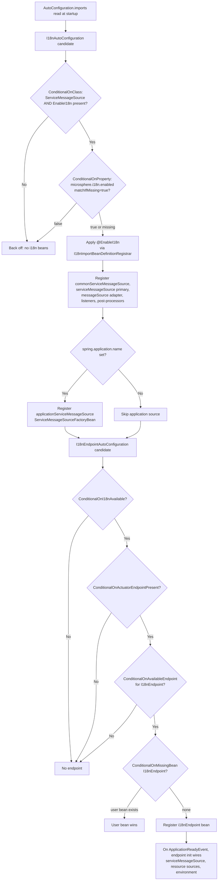
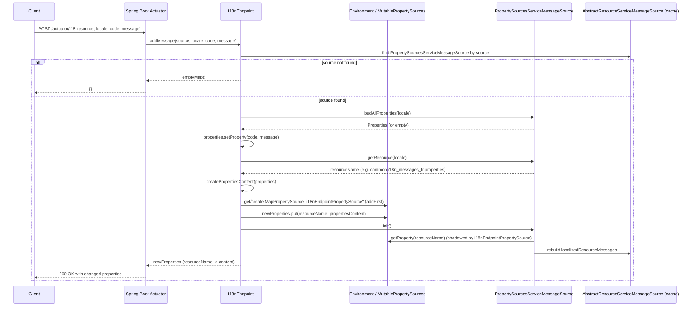
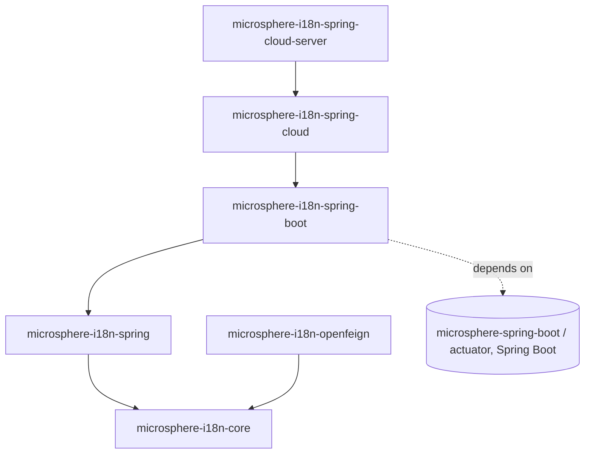

# Spring Boot Integration — Developer Guide

This guide explains how `microsphere-i18n-spring-boot` is internally structured: how its
auto-configurations are registered and evaluated, how the Actuator `I18nEndpoint` reads and mutates
messages at runtime, how it interacts with the `microsphere-i18n-spring` beans, and how the module
is tested. All statements are derived from the sources under
`microsphere-i18n-spring-boot/src/main` and `src/test`.

- [TOC]

## Architecture

The Spring Boot module is intentionally thin. It contains four production classes:

| Class                                     | Package                          | Role                                                          |
|-------------------------------------------|----------------------------------|---------------------------------------------------------------|
| `I18nAutoConfiguration`                   | `...spring.boot.autoconfigure`   | Entry point: applies `@EnableI18n` and registers the application-named source. |
| `ConditionalOnI18nAvailable`              | `...spring.boot.condition`       | Composed `@Conditional`: class presence + `microsphere.i18n.enabled`. |
| `I18nEndpointAutoConfiguration`           | `...spring.boot.actuate.autoconfigure` | Registers the Actuator `I18nEndpoint` when available.    |
| `I18nEndpoint`                            | `...spring.boot.actuate`         | `@Endpoint(id = "i18n")` read/write operations over messages. |

Everything heavier — the `ServiceMessageSource` hierarchy, the `@EnableI18n` registrar, the
property-source-backed message source — lives in `microsphere-i18n-spring` and
`microsphere-i18n-core`. This module only wires those pieces into the Spring Boot lifecycle:

- `I18nAutoConfiguration` is annotated `@EnableI18n`, so importing it transitively triggers
  Spring's `I18nImportBeanDefinitionRegistrar`, which builds the message-source bean graph.
- `I18nEndpoint` does not own message storage. It reaches into the same beans the Spring module
  created (`serviceMessageSource`, the `AbstractResourceServiceMessageSource` instances, the
  `PropertySourcesServiceMessageSource` instances) and into the `Environment` property sources.

The endpoint defers its own wiring until the application is ready:

```java
@EventListener(ApplicationReadyEvent.class)
public void onApplicationReadyEvent(ApplicationReadyEvent event) {
    init(event.getApplicationContext());
}

private void init(ConfigurableApplicationContext context) {
    this.primaryServiceMessageSource = getServiceMessageSource(context);
    this.resourceServiceMessageSources =
            findAllServiceMessageSources(this.primaryServiceMessageSource, AbstractResourceServiceMessageSource.class);
    this.environment = context.getEnvironment();
}
```

So before `ApplicationReadyEvent`, `resourceServiceMessageSources` and `environment` are unset;
operations become meaningful only once the context has fully started.

## Auto-Configuration Registration Mechanism

Spring Boot `3.x` discovers auto-configurations through the
`AutoConfiguration.imports` file rather than `spring.factories`. The module ships:

```
src/main/resources/META-INF/spring/org.springframework.boot.autoconfigure.AutoConfiguration.imports
```

with exactly two lines (verbatim file content):

```
io.microsphere.i18n.spring.boot.autoconfigure.I18nAutoConfiguration
io.microsphere.i18n.spring.boot.actuate.autoconfigure.I18nEndpointAutoConfiguration
```

Ordering between them is not implied by the file order; it is enforced by
`@AutoConfigureAfter(I18nAutoConfiguration.class)` on `I18nEndpointAutoConfiguration`. Both classes
carry `@ConditionalOnI18nAvailable`, so a single disabled condition (`microsphere.i18n.enabled=false`
or a missing core/spring class) turns off both auto-configurations together.

## Conditional Evaluation Flow

The flowchart below traces how a request to load `I18nAutoConfiguration` (and then
`I18nEndpointAutoConfiguration`) is accepted or rejected, ending at bean creation.



The `ConditionalOnI18nAvailable` annotation composes the two class-level conditions verbatim from
source:

```java
@ConditionalOnClass(name = {
        "io.microsphere.i18n.ServiceMessageSource",         // Microsphere i18n Core
        "io.microsphere.i18n.spring.annotation.EnableI18n", // Microsphere i18n Spring
})
@ConditionalOnProperty(name = ENABLED_PROPERTY_NAME, matchIfMissing = true)
public @interface ConditionalOnI18nAvailable {}
```

`ENABLED_PROPERTY_NAME` resolves to `microsphere.i18n.enabled`
(`I18nConstants.PROPERTY_NAME_PREFIX + "enabled"`), with `DEFAULT_ENABLED = true`.

## I18nEndpoint Source Analysis

The endpoint exposes one read surface with three overloads and one write operation.

### Read: list everything (`@ReadOperation invoke()`)

`invoke()` iterates `resourceServiceMessageSources` (all
`AbstractResourceServiceMessageSource` members found under the primary `serviceMessageSource`) and
merges each source's `getLocalizedResourceMessages()`. That map is keyed by the resource identifier
(for example `META-INF/i18n/common/i18n_messages_zh_CN.properties`) and holds the resolved
`code -> message` values, so the endpoint is purely a projection of the already-loaded caches — it
never touches files directly.

### Read: message by code (`getMessage(@Selector String code)`)

`getMessage(String)` delegates to the two-argument overload with a `null` locale, which resolves
every supported locale via `primaryServiceMessageSource.getSupportedLocales()`. For each resource
source and each locale it emits a five-field record:

```java
Map<String, String> messageMap = ofMap(
        "code", code,
        "locale", supportedLocale.toString(),
        "source", source,
        "resource", resource,
        "message", message
);
```

where `resource = resourceServiceMessageSource.getResource(locale)` and
`message = resourceServiceMessageSource.getMessage(code, locale)` (possibly `null`).

### Read: message by code and locale

`getMessage(@Selector String code, @Selector Locale locale)` reuses the same loop but calls
`getSupportedLocales(locale)`, which returns `Collections.singleton(locale)` when a locale is
supplied. A single selector path maps to `/{code}`, and the two-selector path to `/{code}/{locale}`.

### Write: `addMessage(...)` and the `MapPropertySource` injection

```java
@WriteOperation
public Map<String, Object> addMessage(String source, Locale locale, String code, String message) throws IOException {
    PropertySourcesServiceMessageSource serviceMessageSource = getPropertySourcesServiceMessageSource(source);
    if (serviceMessageSource == null) {
        return emptyMap();
    }
    Properties properties = loadProperties(serviceMessageSource, locale);
    properties.setProperty(code, message);

    String resourceName = serviceMessageSource.getResource(locale);
    String propertiesContent = createPropertiesContent(properties);

    MapPropertySource propertySource = getPropertySource();
    Map<String, Object> newProperties = propertySource.getSource();
    newProperties.put(resourceName, propertiesContent);

    serviceMessageSource.init();
    return newProperties;
}
```

Key mechanics:

- **Source resolution** — `getPropertySourcesServiceMessageSource(source)` filters the resource
  sources down to `PropertySourcesServiceMessageSource` instances whose `getSource()` equals the
  requested `source` and takes the first. An unknown `source` yields `emptyMap()`.
- **Existing content** — `loadProperties(...)` calls `serviceMessageSource.loadAllProperties(locale)`
  and falls back to an empty `Properties` when nothing is loaded yet.
- **Resource name** — `getResource(locale)` produces the property-source key, e.g.
  `common.i18n_messages_fr.properties` (built from
  `i18n_messages_` + locale + `.properties`, prefixed by source for the property-source variant).
- **Serialization** — `createPropertiesContent` writes `key=value` lines joined by the line
  separator, producing a `.properties` body.
- **Property source injection** — `getPropertySource()` finds or creates a
  `MapPropertySource` named `i18nEndpointPropertySource` (constant `PROPERTY_SOURCE_NAME`) and adds
  it with `propertySources.addFirst(...)`, so it takes precedence over the rest of the environment.
  The whole properties body is stored under the resource-name key.

This design matches how `PropertySourcesServiceMessageSource` reads messages: its
`loadAllPropertiesResources(resource)` looks up `environment.getProperty(resourceName)` and parses
the returned string as `.properties` content. Because the endpoint injects a property whose *name*
is the resource identifier and whose *value* is the file body, `init()` reloads the source from the
environment and the new message becomes visible. The test bootstrap
`I18nEndpointAutoConfigurationBootstrap` demonstrates the same convention externally through
`.properties("test.i18n_messages_en.properties=test.a = test-a-2024")`.

### Reinit flow

Calling `serviceMessageSource.init()` re-runs `AbstractResourceServiceMessageSource.initialize()`,
which rebuilds the `localizedResourceMessages` map by loading every configured resource. Since the
freshly injected property is now at the head of the environment, the reloaded map contains the new
`code -> message` entry, completing the runtime update without a restart.

### Write sequence diagram



## Interaction with Spring Module Beans

The endpoint and auto-configuration rely on naming conventions established by
`microsphere-i18n-spring`, all reachable through `I18nBeanUtils` and `I18nConstants`:

| Bean name                        | Convention source                          | Notes                                                        |
|----------------------------------|--------------------------------------------|--------------------------------------------------------------|
| `serviceMessageSource`           | `I18nConstants.SERVICE_MESSAGE_SOURCE_BEAN_NAME` | The primary `DelegatingServiceMessageSource`; `I18nBeanUtils.getServiceMessageSource(beanFactory)` resolves it. |
| `<source>ServiceMessageSource`   | `I18nImportBeanDefinitionRegistrar` (`source + "ServiceMessageSource"`) | Per-source `ServiceMessageSourceFactoryBean` (e.g. `commonServiceMessageSource`). |
| `applicationServiceMessageSource`| `I18nAutoConfiguration#applicationServiceMessageSource` | Only when `spring.application.name` is set; source equals the application name. |
| `messageSource`                  | `AbstractApplicationContext.MESSAGE_SOURCE_BEAN_NAME` | The `MessageSourceAdapter` registered when `@EnableI18n(exposeMessageSource = true)` (the default). |
| `i18nEndpointPropertySource`     | `I18nEndpoint.PROPERTY_SOURCE_NAME`        | The synthetic `MapPropertySource` used to inject runtime writes. |

`I18nAutoConfiguration` itself instantiates a `ServiceMessageSourceFactoryBean` directly for the
application-named source:

```java
@Bean
@ConditionalOnProperty(name = "spring.application.name")
public ServiceMessageSourceFactoryBean applicationServiceMessageSource(
        @Value("${spring.application.name}") String applicationName) {
    return new ServiceMessageSourceFactoryBean(applicationName);
}
```

The `ServiceMessageSourceFactoryBean` in turn loads the concrete message-source implementations via
Spring Factories (`loadFactoryNames(AbstractServiceMessageSource.class, classLoader)`), applies the
`microsphere.i18n.default-locale` and `microsphere.i18n.supported-locales` properties, and composes
them — which is why `I18nEndpoint.init()` can walk the composite with
`findAllServiceMessageSources(...)`.

`I18nEndpointAutoConfiguration` also participates in the Spring Boot contract by importing
`ConditionalOnActuatorEndpointPresent` from `microsphere-spring-boot-actuator` (an optional
dependency), so the endpoint auto-configuration backs off cleanly when Actuator is absent.

## Module Dependency Graph



The mandatory edge is `spring-boot -> spring -> core`. `spring-cloud` builds on `spring-boot`, and
`spring-cloud-server` on `spring-cloud`; `openfeign` depends on `core` only. `spring-boot` is the
auto-configuration hub that the cloud modules inherit.

## Testing Strategy

Tests live in `src/test/java/io/microsphere/i18n/spring/boot/...` and cover the conditions, the
auto-configurations, and the endpoint behavior.

- `ConditionalOnI18nAvailableTests` — the only test built directly on
  `ApplicationContextRunner`. A minimal `@Configuration` with a `@ConditionalOnI18nAvailable` bean
  proves the four cases: enabled by default, enabled when `microsphere.i18n.enabled=true`, disabled
  when `=false`, and disabled when a `FilteredClassLoader` hides `ServiceMessageSource` /
  `EnableI18n`.

  ```java
  applicationContextRunner = new ApplicationContextRunner();
  applicationContextRunner.withUserConfiguration(Config.class)
          .withPropertyValues("microsphere.i18n.enabled=false")
          .run(context -> assertThat(context).doesNotHaveBean("a"));
  ```

- `I18nAutoConfigurationTest` — a `@SpringBootTest(webEnvironment = NONE, ...)` with
  `spring.application.name=I18nAutoConfigurationTest`. It extends `AutoConfigurationTest<I18nAutoConfiguration>`
  (from `microsphere-spring-boot-test`) and uses its inherited `runner` to assert that
  `applicationServiceMessageSource` exists with `source = I18nAutoConfigurationTest`, that a
  `ServiceMessageSourceFactoryBean` is present, that `serviceMessageSource` is a
  `DelegatingServiceMessageSource`, that `messageSource` is a `MessageSourceAdapter`, and that the
  listener and post-processor beans are singletons. Negative paths are exercised through the base
  class hooks `configureGlobalDisabledPropertyValues` (`microsphere.i18n.enabled=false`) and
  `configureGlobalMissingClasses` (`ServiceMessageSource`, `EnableI18n`).

- `I18nEndpointAutoConfigurationTest` — extends `AutoConfigurationTest<I18nEndpointAutoConfiguration>`,
  declares `I18nEndpoint.class` as an auto-configured class, and reuses the same disabled-property and
  missing-class hooks to confirm the endpoint backs off when i18n is unavailable.

- `I18nEndpointTest` — a `@SpringBootTest(webEnvironment = NONE)` over an
  `@ImportAutoConfiguration({ I18nAutoConfiguration, I18nEndpointAutoConfiguration, PropertyPlaceholderAutoConfiguration })`
  configuration that also declares its own `I18nEndpoint` bean. It calls the operations directly (not
  over HTTP) and checks shapes with JSON Path:
  - `testInvoke` asserts resource keys such as
    `META-INF/i18n/common/i18n_messages_zh_CN.properties` and values like `common.a = 啊`.
  - `testGetMessageWithCode("a")` expects 6 records (every supported locale across sources), while
    `testGetMessageWithCodeAndLocale("a", SIMPLIFIED_CHINESE)` expects 2.
  - `testAddMessage` writes to the `common` source for `Locale.FRANCE`, asserts the returned map has
    one entry, and asserts an unknown source returns the shared `emptyMap()`.

  Default locale is forced to `Locale.SIMPLIFIED_CHINESE` in `@BeforeAll` and restored in
  `@AfterAll`, which is what makes the locale counts deterministic.

- Test fixtures under `src/test/resources`:
  - `application.properties` sets `management.endpoint.i18n.enabled=true` and
    `management.endpoints.web.exposure.include=*` so the Actuator wiring is active.
  - `META-INF/i18n/{common,test}/i18n_messages_{en,zh_CN}.properties` provide the message data the
    endpoint reads (e.g. `common.a = a` / `common.a = 啊`, `test.a = test-a`, `test.hello = Hello,{}`).

- `I18nEndpointAutoConfigurationBootstrap` is a manual `@EnableAutoConfiguration` application (not a
  JUnit test) used to run the endpoint end-to-end with a servlet container and the
  `test.i18n_messages_en.properties=...` runtime injection example.

Together these exercise the two-layer contract: `ApplicationContextRunner` validates the composed
condition in isolation, while the `@SpringBootTest` classes (and the `AutoConfigurationTest` base)
validate bean wiring and endpoint semantics against the real message fixtures.
