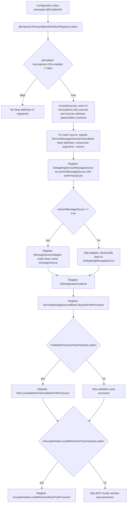
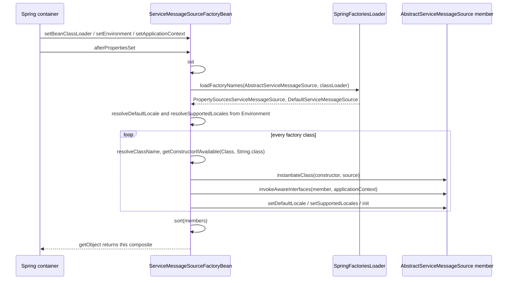
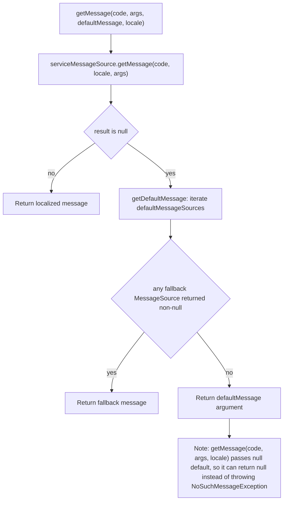
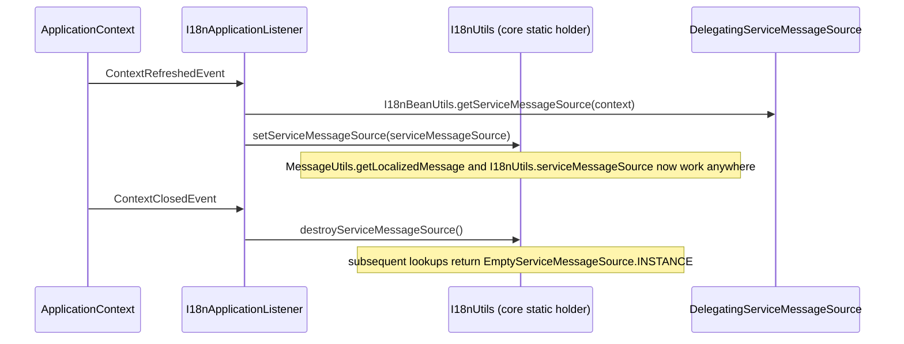
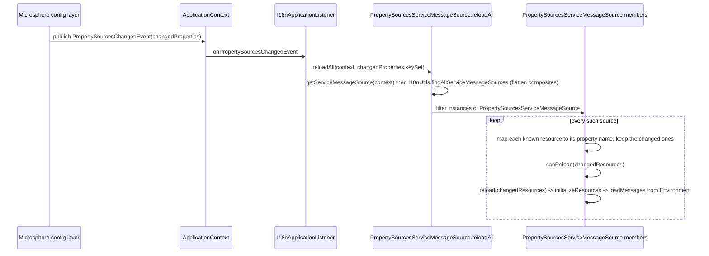
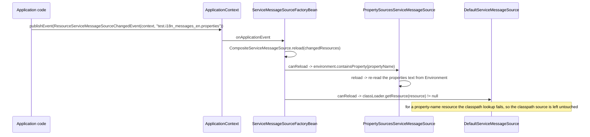
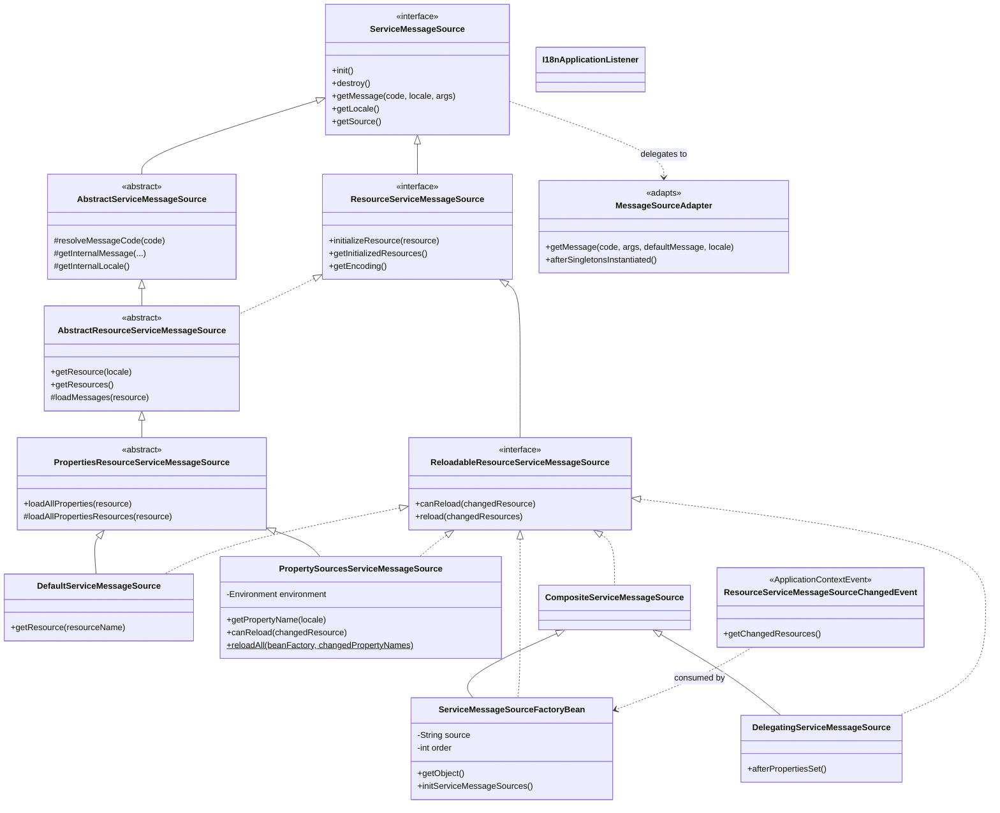
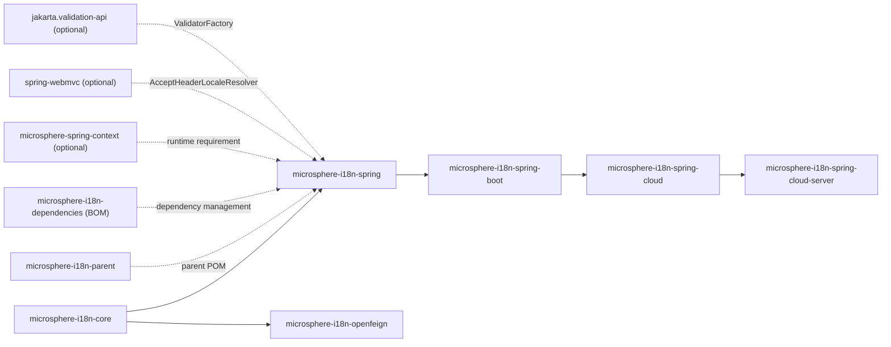

# Spring Module — Developer Guide

This document describes the internal design of `microsphere-i18n-spring`: how `@EnableI18n` wires the
container, how message-source implementations are discovered, how the Spring `MessageSource` façade is
adapted, which events drive runtime reloading, and how the module is tested.

> Audience: contributors to the module and advanced users who need to extend the bean graph. For
> day-to-day usage, see the Spring user guide.

## Architecture and bean wiring overview

The module contains no runtime message-resolution logic of its own; it is a **wiring layer** that
adapts the core abstraction (`io.microsphere.i18n.ServiceMessageSource`) to the Spring container. All
resolution, locale fallback and message-formatting behaviour is inherited from `microsphere-i18n-core`.

Four cooperating patterns are used:

| Pattern                       | Type in this module                                       | Role                                                                        |
|-------------------------------|------------------------------------------------------------|-------------------------------------------------------------------------------|
| Annotation-driven registration | `EnableI18n` + `I18nImportBeanDefinitionRegistrar`        | Turns one annotation into the complete bean graph.                          |
| Factory + service discovery   | `ServiceMessageSourceFactoryBean`                          | Builds one composite message source per `source`, from `spring.factories`.  |
| Adapter                       | `MessageSourceAdapter`                                     | Exposes `ServiceMessageSource` through the Spring `MessageSource` contract.  |
| Observer / lifecycle hooks    | `I18nApplicationListener`, `ResourceServiceMessageSourceChangedEvent`, the three `BeanPostProcessor`s | Publish the global source, reload on change, and integrate with Validation and MVC. |

The resulting runtime object graph is a two-level composite:

```
DelegatingServiceMessageSource (bean name: serviceMessageSource, primary)
└── ServiceMessageSourceFactoryBean("common")   (bean name: commonServiceMessageSource)
│   ├── DefaultServiceMessageSource("common")
│   └── PropertySourcesServiceMessageSource("common")
└── ServiceMessageSourceFactoryBean("test")     (bean name: testServiceMessageSource)
    ├── DefaultServiceMessageSource("test")
    └── PropertySourcesServiceMessageSource("test")

MessageSourceAdapter (bean name: messageSource) ──► serviceMessageSource
```

Both levels sort their members before use: `ServiceMessageSourceFactoryBean` sorts the discovered
implementations, and `DelegatingServiceMessageSource` sorts the `ServiceMessageSource` beans found in
the `BeanFactory` (excluding itself).

## `@EnableI18n` registration flow

`I18nImportBeanDefinitionRegistrar` is package-private and extends
`io.microsphere.spring.context.annotation.AnnotatedBeanCapableImportBeanDefinitionRegistrar<EnableI18n>`,
which supplies the `Environment` and `Logger` fields, resolves the annotation attributes with
placeholder support (`ResolvablePlaceholderAnnotationAttributes<EnableI18n>`), and short-circuits the
whole registration when `isEnabled(AnnotationMetadata)` returns `false`.



### Bean definitions created by the registrar

| Bean name                                    | Bean class                                       | Constructor arguments | Role (`BeanDefinition.getRole()`) | Notes                                                            |
|----------------------------------------------|---------------------------------------------------|------------------------|-----------------------------------|-------------------------------------------------------------------|
| `{source}ServiceMessageSource` (for example `commonServiceMessageSource`, `testServiceMessageSource`) | `ServiceMessageSourceFactoryBean`                | the `source` string    | `ROLE_APPLICATION`                | One definition per resolved source; `FactoryBean`, so the exposed type is `ReloadableResourceServiceMessageSource`. |
| `serviceMessageSource`                        | `DelegatingServiceMessageSource`                  | none                   | `ROLE_APPLICATION`                | `setPrimary(true)`; the type used for `@Autowired ServiceMessageSource`. |
| `messageSource`                               | `MessageSourceAdapter`                            | none in the definition; Spring resolves the single `ServiceMessageSource` constructor argument by type (the primary bean) | `ROLE_APPLICATION` | Only when `exposeMessageSource = true`. Name equals `AbstractApplicationContext.MESSAGE_SOURCE_BEAN_NAME`. |
| generated name                                | `I18nApplicationListener`                         | none                   | `ROLE_APPLICATION`                | Registered without an explicit name; resolve it **by type**.        |
| generated name                                | `ServiceMessageSourceBeanLifecyclePostProcessor`  | none                   | `ROLE_APPLICATION`                | `MergedBeanDefinitionPostProcessor`.                                |
| generated name                                | `I18nLocalValidatorFactoryBeanPostProcessor`       | `ObjectProvider<MessageSourceAdapter>` (resolved by type) | `ROLE_APPLICATION` | Conditional on `jakarta.validation.ValidatorFactory`.               |
| generated name                                | `AcceptHeaderLocaleResolverBeanPostProcessor`      | none                   | `ROLE_APPLICATION`                | Conditional on `AcceptHeaderLocaleResolver`.                        |

Names marked "generated" come from
`org.springframework.beans.factory.support.BeanDefinitionReaderUtils#generateBeanName`, because
`io.microsphere.spring.beans.factory.support.BeanRegistrar` passes `null` for the name. Since the
names are therefore not part of the module contract, every test and internal lookup resolves these
beans **by type** (`context.getBean(MessageSourceAdapter.class)`,
`isBeanPresent(context, I18nApplicationListener.class)`).

`BeanRegistrar` also refuses to overwrite an existing definition: it logs a warning and returns
`false`. Consequences: declaring your own `messageSource` bean keeps yours, and applying `@EnableI18n`
twice (for example directly and through Boot auto-configuration) registers each source only once.

## FactoryBean plus `spring.factories` discovery

`ServiceMessageSourceFactoryBean` is a `final` class that is simultaneously a `FactoryBean`, a
`CompositeServiceMessageSource`, an `Ordered` bean and an event listener. `getObject()` returns `this`,
and `getObjectType()` returns `ReloadableResourceServiceMessageSource.class`, so the container
publishes the composite itself rather than a separate product object.

Discovery is **Spring Factories based, not `java.util.ServiceLoader`**: the module reads
`META-INF/spring.factories` with
`org.springframework.core.io.support.SpringFactoriesLoader#loadFactoryNames` and therefore no
`META-INF/services` directory is needed. The resource shipped with the module is:

```properties
# microsphere-i18n-spring/src/main/resources/META-INF/spring.factories
io.microsphere.i18n.AbstractServiceMessageSource=\
io.microsphere.i18n.spring.PropertySourcesServiceMessageSource,\
io.microsphere.i18n.DefaultServiceMessageSource
```

The key is the abstract type `io.microsphere.i18n.AbstractServiceMessageSource`, so any library can add
its own implementation by contributing a `spring.factories` entry with the same key.



Implementation requirements and behaviours worth noting:

- An implementation must expose a constructor that takes a single `String` (the source);
  `ClassUtils.getConstructorIfAvailable` returns `null` otherwise and `instantiateClass` fails.
- Members are ordered by their natural `Prioritized` ordering (`java.util.Collections.sort`), which
  determines lookup precedence inside the composite.
- `Aware` callbacks are pushed manually through
  `io.microsphere.spring.beans.BeanUtils#invokeAwareInterfaces(member, context)`, so a discovered
  implementation receives `BeanFactory`/`ApplicationContext`/`Environment` treatment even though it is
  not itself a container-managed bean.
- `resolveDefaultLocale` falls back to the composite's current default locale when
  `microsphere.i18n.default-locale` is absent; `resolveSupportedLocales` falls back to
  `getSupportedLocales()` (default locale plus English) when `microsphere.i18n.supported-locales` is
  absent. Both log at `TRACE`.
- `getLocale()` prefers `LocaleUtils.getLocaleFromLocaleContext()` and only then defers to the
  composite, which is what makes a single JVM-wide bean respond per request.

## Adapter pattern: `MessageSourceAdapter`

`MessageSourceAdapter` implements the Spring `MessageSource` contract on top of
`ServiceMessageSource` and is installed under the `messageSource` bean name, so every Spring
mechanism that consumes messages (validation, `MessageSourceResolvable`, view layers) goes through the
i18n stack without knowing about it.



Key implementation facts:

- The list `defaultMessageSources` is filled in `afterSingletonsInstantiated()` from
  `getSortedBeans(beanFactory, MessageSource.class)`, skipping `this`. Populating it that late is
  deliberate: other `MessageSource` beans (for example a `ResourceBundleMessageSource`) may not exist
  when the adapter itself is created.
- The constructor receives the primary `DelegatingServiceMessageSource` by type.
- `getMessage(MessageSourceResolvable, Locale)` loops over `resolvable.getCodes()` and returns the
  first non-`null` answer, so an empty code array (`() -> new String[0]`) yields `null`.
- Because the adapter is registered with the same name Spring reserves, a user-provided `messageSource`
  bean definition blocks it (see the registration refusal above).

## Observer and event flows

### Context lifecycle: publishing the global source

`I18nApplicationListener` uses `@EventListener` methods rather than the `ApplicationListener`
interface, and is registered unconditionally whenever i18n is enabled.



### Environment-driven reload: `PropertySourcesChangedEvent`



`reloadAll` deliberately translates *property names* back into *resource names* per source before
filtering, so an unrelated configuration change never triggers a reload (`canReload` requires the
property to exist in the `Environment`). `I18nApplicationListenerTest` asserts both halves of this
behaviour: an event without changed properties leaves the messages untouched, while an event carrying
`test.i18n_messages_zh_CN.properties` replaces `test.a` with the new value.

### Resource reload event: `ResourceServiceMessageSourceChangedEvent`

`ServiceMessageSourceFactoryBean` implements `ApplicationListener<ResourceServiceMessageSourceChangedEvent>`
and forwards `event.getChangedResources()` to `CompositeServiceMessageSource.reload`, which asks each
member `ReloadableResourceServiceMessageSource` whether it `canReload` before reloading it.



This is the flow exercised by `ServiceMessageSourceFactoryBeanTest#testGetMessage`: a
`MockPropertySource` added first to the `Environment` supplies
`test.i18n_messages_en.properties = test.a=1`, the event is published, and `getMessage("a")` returns
`"1"`.

The Spring Cloud module reuses the same entry point from a different trigger: its
`ReloadableResourceServiceMessageSourceListener` calls
`PropertySourcesServiceMessageSource.reloadAll(beanFactory, event.getKeys())` on
`EnvironmentChangeEvent`.

## Bean post-processors and their activation conditions

| Post-processor                                     | Kind                              | Guarded by                                                                                          | Effect when it matches                                          |
|----------------------------------------------------|-----------------------------------|--------------------------------------------------------------------------------------------------------|--------------------------------------------------------------------|
| `ServiceMessageSourceBeanLifecyclePostProcessor`    | `MergedBeanDefinitionPostProcessor` | `io.microsphere.util.ClassUtils.isAssignableFrom(ServiceMessageSource.class, beanType)`               | Defaults `initMethodName` to `init` and `destroyMethodName` to `destroy`. |
| `I18nLocalValidatorFactoryBeanPostProcessor`        | `GenericBeanPostProcessorAdapter<LocalValidatorFactoryBean>` | class-path: `ClassUtils.isPresent("jakarta.validation.ValidatorFactory", classLoader)`; per-bean: generic type match; per-call: `ObjectProvider.ifAvailable` | `setValidationMessageSource(messageSourceAdapter)` before initialization. |
| `AcceptHeaderLocaleResolverBeanPostProcessor`       | `GenericBeanPostProcessorAdapter<AcceptHeaderLocaleResolver>` | class-path: `ClassUtils.isPresent("org.springframework.web.servlet.i18n.AcceptHeaderLocaleResolver", classLoader)`; per-bean: generic type match | `setDefaultLocale` and `setSupportedLocales` after initialization. |

Lifecycle defaults are applied defensively:

- A bean that already implements `InitializingBean` or `DisposableBean` is left alone, otherwise the
  callback would run twice (once through the interface, once through the bean definition). This is why
  `DelegatingServiceMessageSource` bean definitions keep a `null` init/destroy method.
- An explicitly declared method name wins (`init`/`destroy` are only set when the current value is
  blank).
- The destroy value `AbstractBeanDefinition.INFER_METHOD` (`"(inferred)"`) is preserved, so Boot-style
  inferred shutdown methods are not replaced.

The class-path guards use `ClassLoaderUtils.getDefaultClassLoader()` at registration time, and both
guards are exposed as public static methods so the registrar can call them without loading the
optional types eagerly. That is what keeps the module usable without Spring MVC or Bean Validation: the
`I18nImportBeanDefinitionRegistrarTest#testOnBeanClassAbsent` case swaps the thread context class loader
for the platform loader and asserts that the two optional post-processors are gone while the core
`ServiceMessageSourceFactoryBean`, `MessageSourceAdapter`, `ServiceMessageSource` and
`I18nApplicationListener` beans remain.

## Class hierarchy



Spring lifecycle interfaces implemented by the Spring-facing classes:

| Class                                        | Spring contracts                                                                                                              |
|----------------------------------------------|-------------------------------------------------------------------------------------------------------------------------------|
| `ServiceMessageSourceFactoryBean`             | `FactoryBean`, `InitializingBean`, `DisposableBean`, `EnvironmentAware`, `BeanClassLoaderAware`, `ApplicationContextAware`, `Ordered`, `ApplicationListener` |
| `DelegatingServiceMessageSource`              | `InitializingBean`, `DisposableBean`, `BeanFactoryAware`                                                                        |
| `PropertySourcesServiceMessageSource`         | `EnvironmentAware`                                                                                                              |
| `MessageSourceAdapter`                        | `MessageSource`, `SmartInitializingSingleton`, `BeanFactoryAware`                                                               |
| `AcceptHeaderLocaleResolverBeanPostProcessor` | `BeanPostProcessor` (through `GenericBeanPostProcessorAdapter`), `ApplicationContextAware`                                       |
| `I18nLocalValidatorFactoryBeanPostProcessor`  | `BeanPostProcessor` (through `GenericBeanPostProcessorAdapter`)                                                                  |
| `ServiceMessageSourceBeanLifecyclePostProcessor` | `MergedBeanDefinitionPostProcessor`                                                                                          |
| `I18nApplicationListener`                     | `@EventListener` methods only                                                                                                    |

## Module dependencies



`microsphere-i18n-spring` depends on `microsphere-i18n-core` with `${revision}` and is in turn a
required dependency of `microsphere-i18n-spring-boot`, whose `I18nAutoConfiguration` is annotated with
`@EnableI18n`. Nothing in this module depends on Spring Boot, which is why it can be used in a plain
`AnnotationConfigApplicationContext`.

## Testing strategy

The tests run against a plain Spring test context (`spring-test`, JUnit 5); there is no Boot
dependency in this module's test scope.

### Shared fixture: `io.microsphere.i18n.AbstractSpringTest`

Located in the test root package and reused by every message-resolution test:

- `TEST_SOURCE = "test"`, matching the resources under
  `src/test/resources/META-INF/i18n/test/`.
- `@BeforeAll` pins `Locale.setDefault(Locale.SIMPLIFIED_CHINESE)`, so the JVM default locale is the
  expected fallback everywhere.
- `@BeforeEach` calls `resetLocaleContext()`; `@AfterAll` calls `destroyServiceMessageSource()` and
  resets the context again, keeping the core static holder clean between test classes.
- `assertGetMessage(ServiceMessageSource)` centralizes the expectations against
  `META-INF/i18n/test/i18n_messages_zh_CN.properties` (`test.a = 测试-a`, `test.hello = 您好,{}`):
  `getMessage("a")` is `"测试-a"`, `getMessage("hello", "World")` is `"您好,World"`, and an unknown code
  returns `null`.

### Test configurations

| Class                                            | Purpose                                                                                                 |
|--------------------------------------------------|-----------------------------------------------------------------------------------------------------------|
| `TestSourceEnableI18nConfiguration`               | `@EnableI18n(sources = TEST_SOURCE)`; the baseline context for most assertions (`testServiceMessageSource`). |
| `DisabledEnableI18nConfiguration`                 | `@EnableI18n` plus `@ResourcePropertySource("classpath:META-INF/config/disabled-enable-i18n.properties")`, whose single line sets `microsphere.i18n.enabled = false`. |
| `UnexposedMessageSourceEnableI18nConfiguration`   | `@EnableI18n(exposeMessageSource = false)`; proves the adapter is the only bean suppressed.                 |

### Test resources

- `META-INF/i18n/test/i18n_messages_{en,zh_CN}.properties` — the happy-path bundles, exercised both from
  the classpath and through the `Environment`.
- `META-INF/i18n/error/i18n_messages_zh_CN.properties` — a deliberately mixed bundle (`error.a`, `test.b`)
  kept in the test resources; no test in this module reads it, the invalid-prefix case is asserted in
  the core module (`DefaultServiceMessageSourceTest#testValidateMessageCode`).
- `messages_{en,zh_CN}.properties` (`test.value`) — the classic `ResourceBundleMessageSource` basename
  that acts as the `MessageSourceAdapter` fallback.
- `META-INF/config/disabled-enable-i18n.properties` — the kill switch.

### Per-class coverage

| Test                                                  | What it pins down                                                                                                              |
|--------------------------------------------------------|-----------------------------------------------------------------------------------------------------------------------------------|
| `I18nImportBeanDefinitionRegistrarTest`                | The full bean inventory for four scenarios: sources specified, disabled, adapter unexposed, and optional classes absent (via a swapped context class loader). |
| `EnableI18nTest`                                        | End-to-end resolution through the injected primary `ServiceMessageSource`, including `assertSame` against `I18nUtils.serviceMessageSource()` and the English fallback. |
| `ServiceMessageSourceFactoryBeanTest`                 | `@TestPropertySource` locale pinning, `LocaleContextHolder` precedence, `FRANCE` returning `null`, reload through `ResourceServiceMessageSourceChangedEvent`, `setOrder`, `resolveDefaultLocale` / `resolveSupportedLocales` fallbacks, `toString`. |
| `PropertySourcesServiceMessageSourceTest`             | Resource-to-property naming (`META-INF/i18n/test/...` becomes `test.i18n_messages_zh_CN.properties`), `canReload` variants, `findAll...` over empty/single/delegating bean graphs, and a hand-built `Config` with a `@Primary` `DelegatingServiceMessageSource`. |
| `MessageSourceAdapterTest`                             | Adapter with and without fallback `MessageSource` beans, `MessageSourceResolvable` handling including the empty-codes case, and `toString` coverage. |
| `I18nApplicationListenerTest`                          | Global publication, no-op reload on an empty `PropertySourcesChangedEvent`, effective reload when the mock property source reports an added property, and cleanup back to `EmptyServiceMessageSource.INSTANCE`. |
| `DelegatingServiceMessageSourceTest`                   | A delegating composite over `EmptyServiceMessageSource` returns `null` rather than failing.                                          |
| `ServiceMessageSourceBeanLifecyclePostProcessorTest`  | Every branch of the init/destroy defaults: unset, `INFER_METHOD`, user-declared `start`/`stop`, an `InitializingBean`/`DisposableBean` type (`DelegatingServiceMessageSource`) and a non-matching type (`Object`). |
| `I18nBeanUtilsTest`                                    | `messageSource` present versus `DelegatingMessageSource`, adapter detection, and `getServiceMessageSource` returning `null` when no definition exists. |
| `I18NLocalValidatorFactoryBeanPostProcessorTest`       | Behaviour with no validator bean, with no adapter bean, and the successful wiring that leaves `LocaleContextMessageInterpolator` as the interpolator. |
| `AcceptHeaderLocaleResolverBeanPostProcessorTest`      | The resolver's supported locales equal the primary source's supported locales.                                                       |

### Test utilities

- `SpringTestUtils.testInSpringContainer(...)` (from `microsphere-spring-test`) builds an anonymous
  context per lambda, optionally with a `ConfigurableEnvironment` argument, so each assertion gets an
  isolated bean graph.
- `@SpringLoggingTest` and `@LoggingLevelsTest` (from `microsphere-logback` / `microsphere-spring-test`)
  capture trace logs and temporarily raise levels to `ERROR` where the code path logs a lot, for
  instance the locale-resolution unit tests.
- `MockEnvironment`, `MockPropertySource` and `environment.getPropertySources().addFirst(...)` are used
  to simulate external configuration changes without Boot or a config server.

## Extension and troubleshooting notes

- **Adding a message-source implementation**: register the class under the
  `io.microsphere.i18n.AbstractServiceMessageSource` key in your own `META-INF/spring.factories`, and
  provide a `public MySource(String source)` constructor. It will be instantiated, Aware-injected,
  configured with the resolved locales, initialized and sorted for every declared `source`.
- **Adding a source without `@EnableI18n` attributes**: set `microsphere.i18n.sources`; both routes are
  merged, placeholder-resolved and deduplicated.
- **Nothing is registered**: check `microsphere.i18n.enabled` first; the registrar logs the decision at
  `TRACE` along with the property name and default value.
- **Messages resolve to `null`**: confirm the code prefix (`<source>.`), the supported-locale pruning
  (`microsphere.i18n.supported-locales` narrows which files are loaded), and the current
  `LocaleContextHolder` value.
- **Tracing**: `AbstractResourceServiceMessageSource`, `CompositeServiceMessageSource`,
  `ServiceMessageSourceFactoryBean`, `DelegatingServiceMessageSource`, `MessageSourceAdapter` and both
  optional post-processors log the resolved code, locale and pattern at `TRACE` — enabling trace for
  `io.microsphere.i18n` is the fastest way to diagnose a miss.
- **Property metadata**: the build generates
  `META-INF/microsphere/configuration-properties.json` from the `@ConfigurationProperty` annotations on
  `I18nConstants`, which is what IDEs read for completion of the four `microsphere.i18n.*` keys.
