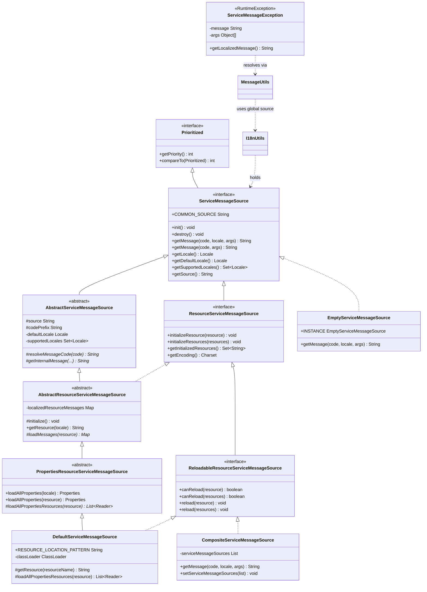
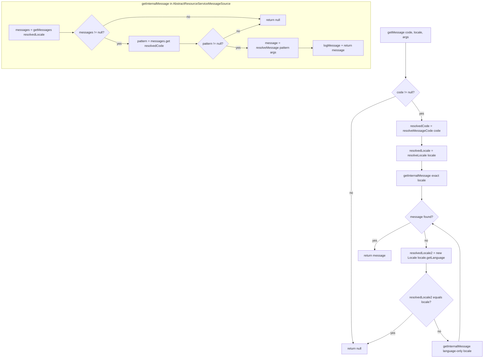
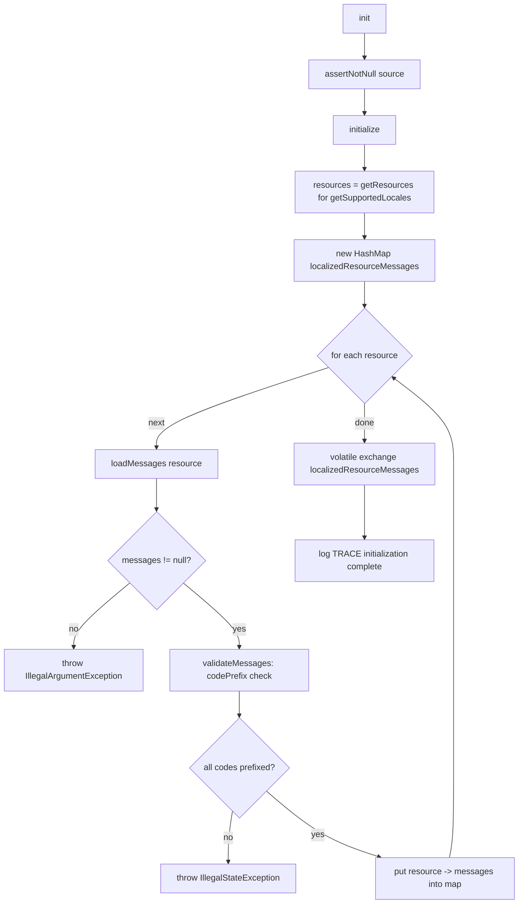
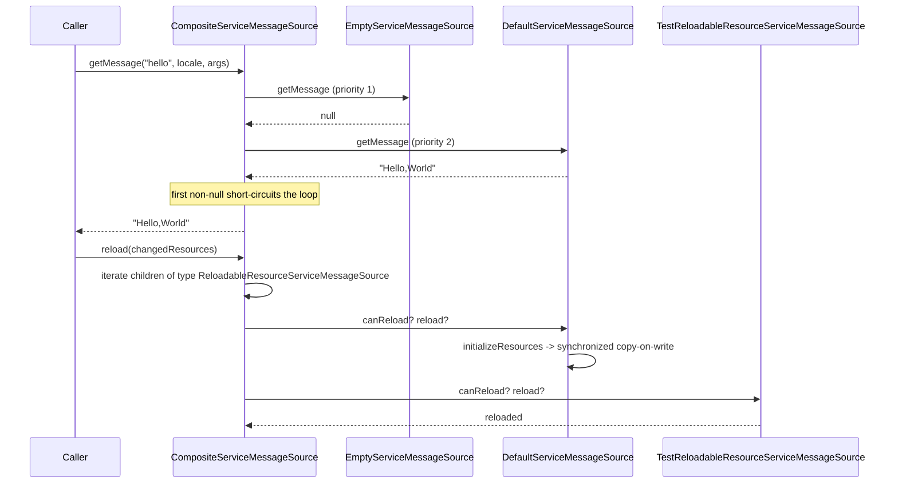
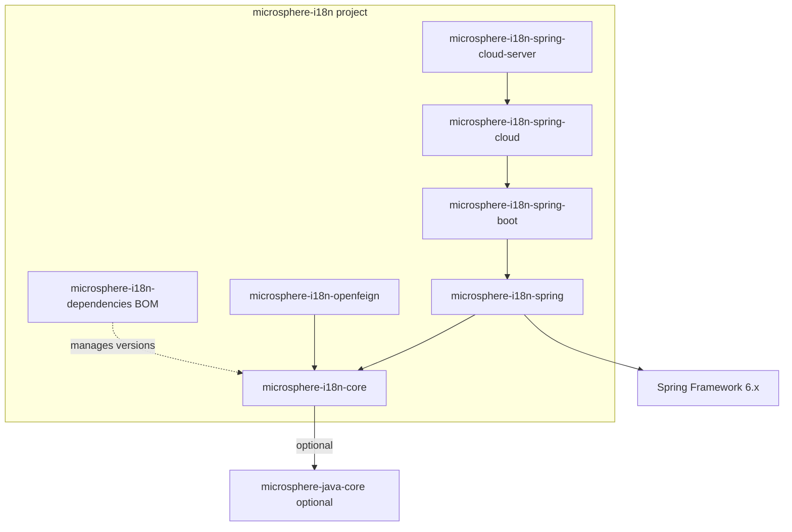

# microsphere-i18n 核心 — 开发者指南

本指南描述 `microsphere-i18n-core` 模块的内部设计：它的包结构、类继承体系、所运用的设计模式、关键类
中的解析/加载算法，以及它的测试策略。此处每一条论断都已对照 `microsphere-i18n-core/src/main/java` 下的
源码与 `microsphere-i18n-core/src/test` 下的测试进行核实。

core 模块是与框架无关的纯 Java 17；它不依赖 Spring，也没有任何上游的 microsphere-i18n 模块。下游的
Spring 与 OpenFeign 集成构建在它之上。

## 架构与包结构

该模块暴露两个包：

| 包 | 内容 | 职责 |
|---------|----------|----------------|
| `io.microsphere.i18n` | `ServiceMessageSource`、`ResourceServiceMessageSource`、`ReloadableResourceServiceMessageSource`、`AbstractServiceMessageSource`、`AbstractResourceServiceMessageSource`、`PropertiesResourceServiceMessageSource`、`DefaultServiceMessageSource`、`CompositeServiceMessageSource`、`EmptyServiceMessageSource`、`ServiceMessageException` | 消息源契约、实现，以及 i18n 异常。 |
| `io.microsphere.i18n.util` | `I18nUtils`、`MessageUtils` | 全局消息源访问（持有者）与 `{code}` 消息模式解析。 |

该设计分离出一个**契约层**（接口）、一个拥有共享算法的**抽象基类层**（`AbstractServiceMessageSource`、
`AbstractResourceServiceMessageSource`、`PropertiesResourceServiceMessageSource`），以及一个**具体叶子层**，
它只补上唯一缺失的一环 —— 字节从哪里来（`DefaultServiceMessageSource`）—— 外加两个结构性协作者
（`CompositeServiceMessageSource`、`EmptyServiceMessageSource`）。

能力通过接口特化进行分层，因此消费者只依赖它们所需的最小接口：`ServiceMessageSource` →
`ResourceServiceMessageSource` → `ReloadableResourceServiceMessageSource`。

资源型消息源的数据模型是保存在 `AbstractResourceServiceMessageSource` 中的一张两级 map：

```
Map<String /* resource path */, Map<String /* message code */, String /* message pattern */>>
```

对于带有英文与简体中文 locale 的 source `test`，它解析为：

```
{
  "META-INF/i18n/test/i18n_messages_zh_CN.properties": { "test.a": "测试-a", "test.hello": "您好,{}" },
  "META-INF/i18n/test/i18n_messages_en.properties":     { "test.a": "test-a", "test.hello": "Hello,{}" }
}
```

## 类继承体系



`ServiceMessageSource` 继承 `io.microsphere.lang.Prioritized`，而 `Prioritized` 继承
`Comparable<Prioritized>`。正是这一点让 `CompositeServiceMessageSource.setServiceMessageSources(...)`
能够用 `Collections.sort` 对子源排序 —— 优先级数值最小的排在最前，因而在 `getMessage` 迭代期间具有
最高优先权。

## 设计模式

以下模式都定位到确切的类，并在有用之处定位到确切的方法。

### 模板方法 —— `AbstractServiceMessageSource` 与 `AbstractResourceServiceMessageSource`

`AbstractServiceMessageSource.getMessage(String, Locale, Object...)` 声明为 `final`，并定义了解析的骨架：
解析码、解析 locale、调用抽象的 `getInternalMessage(...)`，然后执行“仅语言”回退。子类从不重写该算法；
它们只需实现钩子 `resolveMessageCode(String)` 与 `getInternalMessage(...)`（以及影响 `getLocale()` 的
`getInternalLocale()`）。

`AbstractResourceServiceMessageSource` 在初始化上运用同一模式：`init()`（近似 final 的公共入口）调用
`initialize()`，后者遍历 `getResources()` 并调用私有的逐资源流程，最终委托给由子类提供的抽象
`loadMessages(String)`。`PropertiesResourceServiceMessageSource` 进一步收窄该模板：`loadMessages(...)` 为
`final` 并调用抽象的 `loadAllPropertiesResources(String)`，因此像 `DefaultServiceMessageSource` 这样的
具体叶子只需决定 reader *从哪里*来（一个 `ClassLoader`）。

### 组合 —— `CompositeServiceMessageSource`

`CompositeServiceMessageSource implements ReloadableResourceServiceMessageSource`，并持有一个
`List<? extends ServiceMessageSource>`。`getMessage` 遍历子源并返回第一个非 null 结果；`init`/`destroy`
向每个子源扇出；`getSupportedLocales` 与 `getInitializedResources` 聚合（并集）子源结果；
`reload`/`initializeResources` 使用私有的 `iterate(Class<T>, Consumer<T>)` 辅助方法按能力类型筛选子源并
转发调用。组合体自身回答 `getSource() = "common"`、`canReload(...) = true` 与 `getEncoding() = UTF-8`。
其 Javadoc 声明它对变更操作**非线程安全**。

### 空对象 —— `EmptyServiceMessageSource`

`EmptyServiceMessageSource` 以一个共享的 `INSTANCE` 实现该契约；`init`/`destroy` 是空操作，
`getMessage(...)` 始终返回 `null`，而 `getSource()` 报告 `"Empty"`。它是当尚未配置任何东西时
`I18nUtils.serviceMessageSource()` 返回的安全回退，也是可安全纳入组合体的一个成员（查询它总是未命中）。

### 全局单例持有者 —— `I18nUtils`

`I18nUtils` 把 JVM 级的活动消息源保存在一个 `private static volatile ServiceMessageSource` 字段中。
`serviceMessageSource()`、`setServiceMessageSource(...)` 与 `destroyServiceMessageSource()` 构成访问器三件套；
当字段为 null 时，`serviceMessageSource()` 会替换为 `EmptyServiceMessageSource.INSTANCE`（并记录一条 WARN
日志）。该类是一个带私有构造函数的抽象工具类。

### 写时复制 —— `AbstractResourceServiceMessageSource.initializeResources(Iterable)`

重载与增量初始化通过一个由 `synchronized (this)` 保护的写时复制（copy-on-write）协议变更消息 map ——
见下文的*`initializeResources` 的线程安全性*。

### 渐进式角色接口（接口隔离）

`ResourceServiceMessageSource` 与 `ReloadableResourceServiceMessageSource` 用狭窄、可选择启用的能力扩展
基础契约，从而让 `EmptyServiceMessageSource`（仅基础）、`CompositeServiceMessageSource`（资源 + 重载，
但不继承 `AbstractServiceMessageSource`），以及 classpath 实现链各自只实现它们所支持的部分。

### 门面工具 —— `MessageUtils`

`MessageUtils` 是一个静态门面，把 `{code}` 解析加上全局消息源查找隐藏在 `getLocalizedMessage(...)` 之后，
并带有一个有文档记载的“未找到”回退（截取到第一个 `.` 之后）。

### 组合树展平 —— `I18nUtils.doFindAllServiceMessageSources`

`initServiceMessageSources(...)` 递归地把嵌套的组合体展开为其叶子消息源；一个非组合体会作为它自身的叶子
被收集。

## 关键类分析

### `AbstractServiceMessageSource`

字段：

```java
protected final Logger logger;                       // per-subclass logger via getLogger(getClass())
protected final String source;                       // immutable source name
protected final String codePrefix;                   // source + MessageUtils.SOURCE_SEPARATOR ("." )
private   Set<Locale> supportedLocales;              // lazily the hierarchical expansion
private   Locale defaultLocale;                      // configured default locale (nullable)
```

构造函数断言 `source != null`（通过 `io.microsphere.util.Assert.assertNotNull`）并派生 `codePrefix`。
`getMessage` 各重载为 `final`，把所有查找都汇聚到同一算法，并强制子类实现 `getInternalMessage`。
`getLocale()` 为 `final`，它是让子类通过受保护的 `getInternalLocale()` 钩子（默认返回 `null`，意为“使用
默认 locale”）来影响运行时 locale 的接缝。

解析算法（`getMessage(String code, Locale locale, Object... args)`）：

```java
String message = null;
if (code != null) {
    String resolvedCode = resolveMessageCode(code);          // add source prefix if missing
    Locale resolvedLocale = resolveLocale(locale);           // normalize language + region
    message = getInternalMessage(code, resolvedCode, locale, resolvedLocale, args);   // exact locale
    if (message == null) {
        resolvedLocale = new Locale(locale.getLanguage());   // language-only fallback
        if (!resolvedLocale.equals(locale)) {
            message = getInternalMessage(code, resolvedCode, locale, resolvedLocale, args);
        }
    }
}
return message;
```

由于回退会解引用 `locale.getLanguage()`，因此当 `code` 非 null 时，`locale` 参数必须非 null。

`resolveLocale(Locale)` 在 locale 没有国家时原样返回它，否则重建 `new Locale(language, region)` —— 这是一步
规范化。`resolveMessage(String, Object...)` 委托给 `io.microsphere.text.FormatUtils.format`，即那个 `{}`
占位符格式化器。

### `AbstractResourceServiceMessageSource`

字段：`private volatile Map<String,Map<String,String>> localizedResourceMessages`，初始化为
`Collections.emptyMap()`。`volatile` 加上整 map 替换，正是让并发读者看到一致快照的原因。

常量：`DEFAULT_RESOURCE_NAME_PREFIX = "i18n_messages_"`、`DEFAULT_RESOURCE_NAME_SUFFIX = ".properties"`。

以 locale 为键的查找：`getMessages(Locale)` 计算 `getResource(locale)` = `buildResourceName(locale)`
= `"i18n_messages_" + locale.toString() + ".properties"`，然后 `localizedResourceMessages.get(resource)`。
`getResource(Locale)` 是 public 的，并在具体子类中前置 location 模式。

消息码前缀校验：

```java
private void validateMessageCodePrefix(String code, String resourceName) {
    if (!code.startsWith(codePrefix)) {
        throw new IllegalStateException(format(
            "Source '{}' Message Resource[name : '{}'] code '{}' must start with '{}'",
            source, resourceName, code, codePrefix));
    }
}
```

`validateMessages(...)` 会在 `initializeResource` 期间，于每次 `loadMessages` 返回后对每个条目运行此校验。
这就是为什么一个声明了带外前缀键的 properties 文件（例如 `test.b`，它位于前缀为 `error.` 的 `error` source
中）会以 `IllegalStateException` 中止初始化（由 `DefaultServiceMessageSourceTest.testValidateMessageCode` 断言）。

注意这里是有意区分两种异常类型的：当 `loadMessages` 返回 null 时来自 `Assert.assertNotNull` 的
`IllegalArgumentException`（由 `AbstractResourceServiceMessageSourceTest.testInitialize` 断言），对比来自
前缀检查的 `IllegalStateException`。

`resolveMessageCode(String)` 在此实现了那个抽象钩子：

```java
if (code.startsWith(codePrefix)) return code;   // already fully-qualified
return codePrefix + code;                        // "test." + "a" -> "test.a"
```

`destroy()` 调用 `clearAllMessages()`，后者清空 map 随后把字段置为 null。

### Locale 层级回退 —— `resolveHierarchicalLocales`

两个重载协同工作：

```java
// Per-locale: zh_CN -> {zh_CN, zh}; a language-only locale stays as {locale}
protected Set<Locale> resolveHierarchicalLocales(Locale locale) {
    Locale resolvedLocale = resolveLocale(locale);
    String country = resolvedLocale.getCountry();
    if (isBlank(country)) {
        return ofSet(locale);
    }
    return ofSet(resolvedLocale, new Locale(resolvedLocale.getLanguage()));
}

// Collection: expands each supported locale, preserving order, de-duplicated
protected Set<Locale> resolveHierarchicalLocales(Collection<Locale> supportedLocales) {
    assertSupportedLocales(supportedLocales);                 // non-empty, no null elements
    Set<Locale> hierarchicalLocales = newFixedLinkedHashSet(supportedLocales.size() * 2);
    for (Locale supportedLocale : supportedLocales) {
        addLocale(hierarchicalLocales, supportedLocale);
        for (Locale locale : resolveHierarchicalLocales(supportedLocale)) {
            addLocale(hierarchicalLocales, locale);
        }
    }
    return hierarchicalLocales;
}
```

`setSupportedLocales(...)` 存储输入的扩展结果，因此 `getSupportedLocales()` 返回有序、去重的层级集合。
`supports(Locale)` 通过逐 locale 的扩展来检查成员资格。

### `initializeResources` 的线程安全性

```java
@Override
public void initializeResources(Iterable<String> resources) {
    synchronized (this) {                                  // guarded mutation
        Map<String, Map<String, String>> copy = new HashMap<>(this.localizedResourceMessages);
        initializeResources(resources, copy);              // load into the private copy
        this.localizedResourceMessages = copy;             // atomic field exchange (volatile write)
    }
}
```

读者绝不会观察到被更新到一半的 map：传入的资源被加载进一个私有副本，之后才在一次赋值中替换该 `volatile`
字段。由于字段是 `volatile`，这次发布在跨线程间可见，而抓取了前一个引用的读者会保持一致的快照。`init()`
（以及内部的 `initialize()`）构建一张全新的 map 并以同样的方式发布它。注意 `initialize()` 并不获取监视器锁，
但它在那次单一的 volatile 写之前就已把本地 map 完全构建好，因此同样的“不会部分发布”性质依然成立。

组合体的 `setServiceMessageSources` *没有*加同步（与该类所记载的“非线程安全”契约一致），这不同于资源类的
写时复制路径。

### `PropertiesResourceServiceMessageSource` 与 `DefaultServiceMessageSource`

`loadMessages` 为 final，把一个 `Properties` 对象转为一个不可修改的 `Map<String,String>`，并把任何
`IOException` 包装成 `RuntimeException`。`loadAllProperties(String)` 会打开共享同一路径的所有 classpath 资源
（多 JAR 扫描）并合并它们；只有当没有任何 reader 可用时它才返回 `null`，而 `loadMessages` 会把 `null` 转为
一个空 map。

`DefaultServiceMessageSource` 补上剩余的两个抽象钩子：`getResource(resourceName)` 用 `getSource()` 格式化
`RESOURCE_LOCATION_PATTERN`（字面值 `META-INF/i18n/{}/{}`），而 `loadAllPropertiesResources(resource)` 枚举
`classLoader.getResources(resource)`，并把每个 URL 用 `getEncoding()`（UTF-8）包装为一个 `InputStreamReader`。
`canReload(resource)` 其实就是 `classLoader.getResource(resource) != null` —— classpath 叶子只能重载那些仍然
可解析的文件。

## 流程图 —— `getMessage` 解析



## 流程图 —— `init()` 资源加载



## 时序图 —— 组合体委托



## 模块依赖

`microsphere-i18n-core` 是 i18n 依赖链的叶子：它不依赖任何其他 microsphere-i18n 模块。它的
`io.microsphere.*` 与 `io.microsphere.logging.*` 引用由 `microsphere-java-core`（声明为 `optional`）提供。
在项目内部，`microsphere-i18n-spring` 与 `microsphere-i18n-openfeign` 是 core 的直接下游消费者。



完整链概览：`spring → core`、`spring-boot → spring`、`spring-cloud → spring-boot`、
`spring-cloud-server → spring-cloud`、`openfeign → core`。

## 测试策略

测试位于 `microsphere-i18n-core/src/test/java`（JUnit 5），固定数据在 `src/test/resources/META-INF/i18n/`。
它们的组织方式与类继承体系相呼应，从而使共享的契约行为被继承并按实现逐一复核。

### 共享固定数据与基类

- `AbstractI18nTest` 是各 i18n 测试的基类。一个 `@BeforeAll` 强制 `Locale.setDefault(Locale.SIMPLIFIED_CHINESE)`，
  以便诸如 `"测试-a"` 的断言具有确定性；它在每个测试前后调用 `destroyServiceMessageSource()`，以避免
  `I18nUtils` 全局持有者在测试间泄漏。它暴露 `TEST_SOURCE = "test"` 与 `ERROR_SOURCE = "error"` 常量。
- `ServiceMessageSourceTest` 建立了模板方法式的继承范式：一个 `createServiceMessageSource()` 工厂、一个泛型的
  `getServiceMessageSource()`、`@BeforeEach` 中的 `init()` 与 `@AfterEach` 中的 `destroy()`。它验证契约默认值
  （`COMMON_SOURCE == "common"`、返回 null 的查找、默认/受支持的 locale）。
- `ResourceServiceMessageSourceTest`、`ReloadableResourceServiceMessageSourceTest` 与 `DefaultServiceMessageSourceTest`
  构成一条子类链 —— 每个都重写 `createServiceMessageSource()` 并继承父类的断言，因此资源与重载契约既能针对
  抽象测试替身、也能针对真实的 classpath 实现进行检查。

### 测试替身

`TestServiceMessageSource`、`TestResourceServiceMessageSource`、`TestReloadableResourceServiceMessageSource` 与
`TestPropertiesResourceServiceMessageSource` 是最小实现，用于演练接口的默认方法。值得注意的是
`TestReloadableResourceServiceMessageSource.canReload(String)` 返回某资源是否已被初始化过，这使
`ReloadableResourceServiceMessageSourceTest.testCanReload` 能够断言 `reload` 之后 false→true 的转变。
`TestPropertiesResourceServiceMessageSource.loadAllPropertiesResources` 抛出 `IOException`，而
`PropertiesResourceServiceMessageSourceTest.testLoadMessages` 断言它被包装为 `RuntimeException`。

### 逐实现覆盖

- `DefaultServiceMessageSourceTest` 覆盖真实的 classpath 解析：消息查找（`getMessage("a")` → `"测试-a"`）、
  `getLocalizedResourceMessages()` 的大小为 `2`（en + zh_CN）、`loadAllProperties(Locale.FRANCE)` 返回 `null`、
  针对默认与英文 locale 的 `supports(...)`、对短码与已带前缀码两者的 `resolveMessageCode`，以及在
  `testValidateMessageCode` 中带外前缀的 `error` source 抛出 `IllegalStateException`。它还重写了继承来的重载
  测试，因为 classpath 的 `canReload` 是基于资源存在性的。
- `CompositeServiceMessageSourceTest` 构建一个由 `EmptyServiceMessageSource.INSTANCE`、一个
  `DefaultServiceMessageSource` 与一个 `TestReloadableResourceServiceMessageSource` 组成的组合体，随后断言组合体
  的查找等于直接消息源的查找、空组合体的行为、`"common"` source 名称、locale 并集、编码，以及
  `getServiceMessageSources()` 保持顺序。
- `EmptyServiceMessageSourceTest` 断言空对象始终返回 null，并报告 source `"Empty"`。
- `ServiceMessageExceptionTest` 配置一个默认与受支持 locale 均为 `zh_CN` 的 `test` source，把它设为全局消息源，
  并检查 `getMessage()`（原始模式）与 `getLocalizedMessage()`（已解析）与 `toString()`。
- `MessageUtilsTest` 与 `I18nUtilsTest` 覆盖工具层：`{code}` 解析、“无花括号则返回输入”与“码未找到时截取到
  第一个点之后”两种回退，以及全局持有者默认为 `EmptyServiceMessageSource.INSTANCE`，还有递归的组合体展平。

### 涉及日志的测试

组合体与消息工具的测试用 `microsphere-logging-test` 的 `@LoggingLevelsClass` / `@LoggingLevelsTest` 注解，
且 `logMessage` / trace 分支会在 TRACE、INFO 与 ERROR 级别下被演练。`PropertiesResourceServiceMessageSourceTest`
在 ERROR 级别下运行 locale 设置方法，以断言这些路径不会意外发出日志。

总而言之，这套测试套件让 `microsphere-i18n-core` 在 `src/test` 下覆盖了契约默认值、两步 locale 回退、前缀
校验、写时复制的重载语义、组合体委托，以及空对象与全局持有者的安全性保证。
