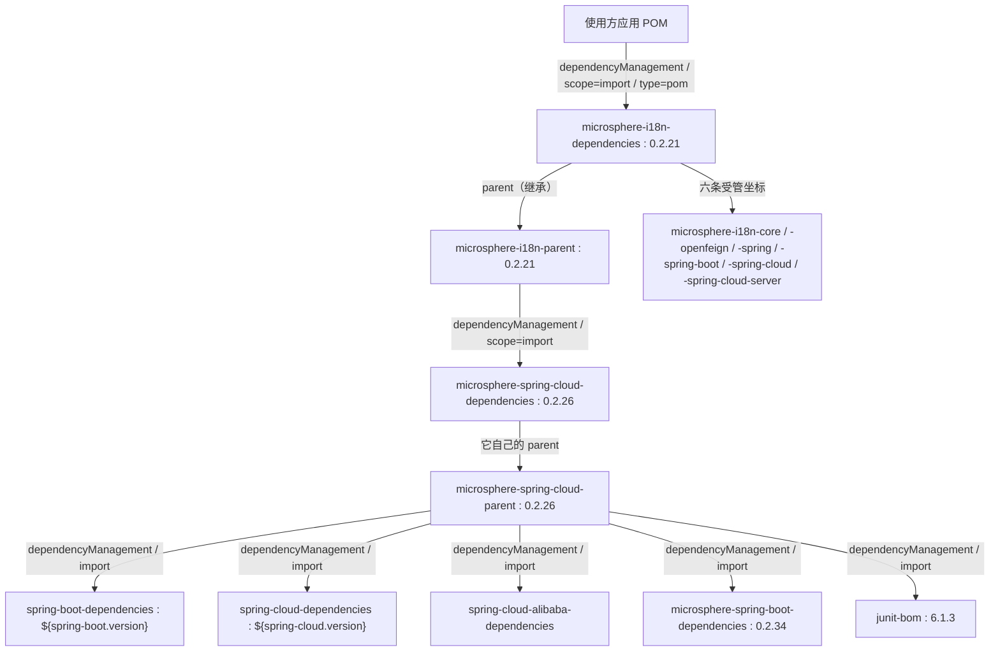

# Dependencies BOM 模块 —— 开发者指南

模块：`microsphere-i18n-dependencies`
打包方式：`pom`
源码：无——该模块就是 `microsphere-i18n-dependencies/pom.xml`，别无一物。

## 1. BOM 的结构

该 POM 只有四个有意义的部分：

```xml

<parent>
    <groupId>io.github.microsphere-projects</groupId>
    <artifactId>microsphere-i18n-parent</artifactId>
    <version>${revision}</version>
    <relativePath>../microsphere-i18n-parent/pom.xml</relativePath>
</parent>

<artifactId>microsphere-i18n-dependencies</artifactId>
<version>${revision}</version>
<packaging>pom</packaging>

<dependencyManagement>
    <!-- 六条条目，全部使用 <version>${revision}</version>，既无 <scope> 也无 <type> -->
</dependencyManagement>
```

没有 `<dependencies>`、没有 `<properties>`、没有 `<build>`、没有 `<profiles>`，`<dependencyManagement>`
块内部也没有对别的 BOM 的 `<import>`。每一条都是一个纯粹的受管坐标。

### 被管理的条目（与 POM 完全一致）

| # | `groupId`                        | `artifactId`                       | 版本          |
|---|----------------------------------|-------------------------------------|---------------|
| 1 | `io.github.microsphere-projects` | `microsphere-i18n-core`            | `${revision}` |
| 2 | `io.github.microsphere-projects` | `microsphere-i18n-openfeign`       | `${revision}` |
| 3 | `io.github.microsphere-projects` | `microsphere-i18n-spring`          | `${revision}` |
| 4 | `io.github.microsphere-projects` | `microsphere-i18n-spring-boot`     | `${revision}` |
| 5 | `io.github.microsphere-projects` | `microsphere-i18n-spring-cloud`    | `${revision}` |
| 6 | `io.github.microsphere-projects` | `microsphere-i18n-spring-cloud-server` | `${revision}` |

条目顺序与 JAR 模块的 Reactor 构建顺序一致，这样 diff 更易读。Reactor 中的两个 POM 模块被有意排除：
使用方绝不能通过 BOM 条目间接依赖 `microsphere-i18n-parent`，而 BOM 也不应管理自己。

`${revision}` 在当前工作树中解析为 `0.2.22-SNAPSHOT`，在发布到仓库的 POM 中则是具体发布版本（例如
`0.2.21`）。

## 2. 导入链



这里同时存在两种机制，有必要把它们区分清楚：

- **继承（`<parent>`）**：提供构建配置，并把 parent 的 `dependencyManagement` 合并进子 POM 的有效模型。
- **导入（`<scope>import</scope>` + `<type>pom</type>`）**：把另一个 POM 的受管坐标拼接到当前的
  `dependencyManagement` 中，除此之外不继承任何东西。

由于继承关系，`microsphere-i18n-dependencies` 本身就是“导入了
`microsphere-spring-cloud-dependencies` 的那个 parent”的子 POM。因此导入 i18n BOM 的使用方，会从 BOM
自身的 `<dependencyManagement>` 中得到 i18n 坐标，并且（作为解析后模型的一部分）得到 parent 链继承来的
第三方版本管理。若你的构建要求第三方 BOM 明确可见，请在使用方 POM 中同样显式导入
`spring-boot-dependencies` / `spring-cloud-dependencies`——这才是锁定 Spring Boot 版本的标准、自文档化
做法。

## 3. 导入与继承的对比

| 方式                           | POM 写法                                                                 | 得到什么                                                  | 风险                                                     |
|--------------------------------|---------------------------------------------------------------------------|-------------------------------------------------------------|------------------------------------------------------------|
| **导入**（推荐）              | `dependencyManagement` 条目 + `<type>pom</type><scope>import</scope>`   | 只有受管坐标；你自己的 parent 不受影响                    | 无；与同时导入的其他 BOM 之间的先后顺序需要注意         |
| **继承**（把它当 parent）      | `<parent>microsphere-i18n-dependencies</parent>`                         | 通过继承获得同样的版本管理，无需 import                    | 构建与 Microsphere parent 链耦合；无法再导入第二个 BOM 版本作为 parent |
| **什么都不做**                 | 每个依赖都写显式 `<version>`                                              | 完全确定                                                    | i18n 各模块之间出现版本漂移                                |

注意：一个 POM 只能有一个 parent；如果你的项目已经继承了公司统一 parent（这是常态），`import` 就是唯一
可行方案。

## 4. 使用方覆盖版本

部署出去的 BOM 写的是**字面量**版本——构建的 flatten 步骤会在安装/发布前替换掉 `${revision}`。因此：

- BOM 内部并不存在可供覆盖的 `${microsphere-i18n.version}` 之类的属性；设置该属性只决定你导入哪个 BOM，
  不改变 BOM 的内容。
- 若要把某个模块从受管版本上挪开，在你自己的 `<dependencyManagement>` 中**先于**导入声明该模块（同一段内
  先匹配者生效）：

  ```xml

  <dependencyManagement>
      <dependencies>
          <dependency>
              <groupId>io.github.microsphere-projects</groupId>
              <artifactId>microsphere-i18n-core</artifactId>
              <version>0.2.20</version>
          </dependency>
          <dependency>
              <groupId>io.github.microsphere-projects</groupId>
              <artifactId>microsphere-i18n-dependencies</artifactId>
              <version>0.2.21</version>
              <type>pom</type>
              <scope>import</scope>
          </dependency>
      </dependencies>
  </dependencyManagement>
  ```

- 直接写在 `<dependency>` 上的 `<version>` 优于一切版本管理。
- 第三方构件（`spring-webmvc`、`feign-core`、`jakarta.servlet-api`）的覆盖规则相同；请记住 i18n 模块把
  它们都声明为 `optional`，因此它们永远不会传递进来，应用里的版本完全由你自己掌控。

## 5. 发布机制

- BOM 在根 `<modules>` 中排第二位，紧跟在 `microsphere-i18n-parent` 之后，因为它继承该 parent，必须在其
  之后构建。
- 它与 JAR 模块共用同一个 `${revision}`，因此一次发布会把 BOM 与六个构件作为同一版本原子发布，不存在独立的
  BOM 版本线。发布任务（`.github/workflows/maven-publish.yml`）用显式版本部署整个 Reactor：

  ```bash
  ./mvnw --batch-mode --update-snapshots --file pom.xml \
        -Drevision=<x.y.z> -Dgpg.skip=true deploy \
        --activate-profiles publish,ci
  ```

  `<x.y.z>` 来自工作流的 `revision` 输入，构建开始前会先校验它是否符合 `major.minor.patch` 形式。发布成功后，
  工作流会把根 POM 中的 `<revision>` 改写为下一个补丁版本并提交，提交信息形如
  `chore: bump version to next patch after publishing <version>`。
- 由于 BOM 既无依赖也无插件，对它最合适的“测试”就是验证一个全新的使用方 POM 能否解析：

  ```bash
  # 在 Reactor 根目录完成本地安装之后
  ./mvnw install -DskipTests
  # 然后在一个只声明了一个无版本号 i18n 依赖的临时工程中：
  mvn -o dependency:resolve
  ```

- 可以用模块目录下的 `mvn help:effective-pom`，或直接阅读部署出去的 POM 来核对内容：条目必须是字面量发布
  版本，绝不能是 `${revision}`。

## 6. 新增受管构件

为 `microsphere-i18n-example` 这类新模块的清单：

1. 创建模块，`<parent>` 指向 `microsphere-i18n-parent`（参见 [Parent POM 开发者指南](parent.md)）。
2. 在根 POM 的 `<modules>` 中按构建顺序加入 `<module>microsphere-i18n-example</module>`。
3. 在本 BOM 中追加受管条目：

   ```xml

   <dependency>
       <groupId>io.github.microsphere-projects</groupId>
       <artifactId>microsphere-i18n-example</artifactId>
       <version>${revision}</version>
   </dependency>
   ```

4. 保持 `${revision}` 写法——不要硬编码版本，否则发布出去的 BOM 会指向错误的构件版本。
5. 不要添加 `<scope>` 或 `<type>`；这里的条目都是普通的 jar 坐标，加了 scope 会静默传播给使用方。

## 7. 设计说明与边界

- **BOM 不是 starter。** 这里的内容既不注册 Bean，也不提供自动配置，更不会把任何构件拉进类路径，只有坐标
  与版本。
- **不存在 `microsphere-i18n-bom` 别名。** 发布的坐标是 `microsphere-i18n-dependencies`；`-dependencies`
  后缀是 Microsphere 全项目的统一命名（`microsphere-spring-cloud-dependencies`、
  `microsphere-spring-boot-dependencies` 等）。
- **BOM 不管理框架自身的第三方需求。** 因为所有模块都把 `feign-core`、`spring-webmvc`、
  `jakarta.servlet-api`、`microsphere-java-core` 等声明为 `optional`，使用方必须从自己的 BOM 中获得它们。
  这是刻意的隔离策略而非疏漏——由此产生的依赖树见 [OpenFeign 开发者指南](openfeign.md)。
- **每个构件一行。** 如果将来某个模块产出第二个 classifier 或 test-jar，就需要额外的带
  `<classifier>`/`<type>` 的受管条目，这也是当前条目保持极简的原因。

## 相关文档

- 用户指南：[Dependencies BOM](../../../user-guide/current/zh/dependencies.md)
- 开发者指南：[Parent POM](parent.md)、[OpenFeign](openfeign.md)
