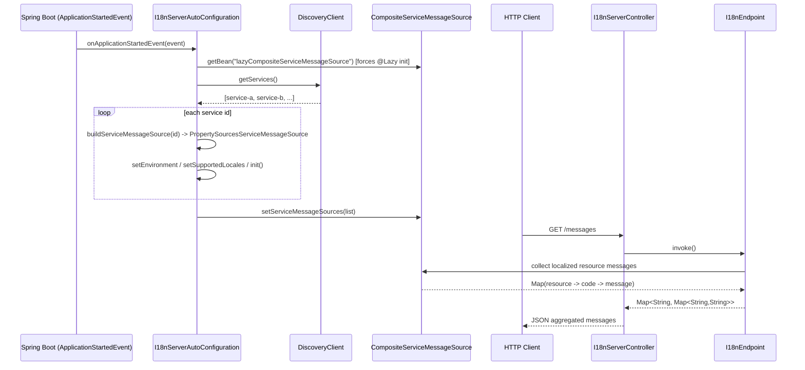
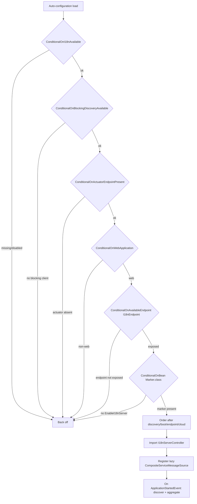
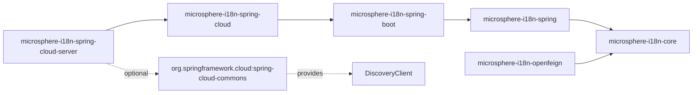

# Spring Cloud i18n 服务端 - 开发者指南

## 架构与关键类

`microsphere-i18n-spring-cloud-server` 构建在具备重新加载能力的技术栈（`spring-cloud` -> `spring-boot` ->
`spring` -> `core`）之上，新增了发现驱动的聚合以及一层 REST 接口。三个生产类承载了全部行为。

### `@EnableI18nServer` 及其 `Marker`

`io.microsphere.i18n.spring.cloud.server.annotation.EnableI18nServer` 是一个带有
`@Target(TYPE)`、`@Retention(RUNTIME)`、`@Documented`、`@Inherited` 以及
`@Import(EnableI18nServer.Marker.class)` 的注解。`Marker` 是一个空的嵌套类。把 `Marker` 注册为 Bean 是该注解唯一的副作用；
它的存在纯粹是为了被自动配置的 `@ConditionalOnBean(Marker.class)` 检测到。这是标准的 `@Enable...` marker 模式：注解为应用
选择加入，而自动配置无需自己去扫描该注解。

### `I18nServerAutoConfiguration`

`io.microsphere.i18n.spring.cloud.server.autoconfigure.I18nServerAutoConfiguration` 是核心类。它的守卫栈异常地高，
且每个守卫都对应一种失败模式：

```java
@Configuration(proxyBeanMethods = false)
@ConditionalOnI18nAvailable
@ConditionalOnBlockingDiscoveryAvailable
@ConditionalOnActuatorEndpointPresent
@ConditionalOnWebApplication
@ConditionalOnAvailableEndpoint(endpoint = I18nEndpoint.class)
@ConditionalOnBean(Marker.class)
@Import(I18nServerController.class)
@AutoConfigureAfter(name = { COMMONS_CLIENT_AUTO_CONFIGURATION_CLASS_NAME }, value = {
        I18nAutoConfiguration.class,
        I18nEndpointAutoConfiguration.class,
        I18nCloudAutoConfiguration.class })
public class I18nServerAutoConfiguration { ... }
```

- `@ConditionalOnI18nAvailable` - i18n core/spring 在场，且 `microsphere.i18n.enabled` 不为 `false`。
- `@ConditionalOnBlockingDiscoveryAvailable`（microsphere-spring-cloud-commons）- 仅在存在阻塞式 `DiscoveryClient` 时运行。
- `@ConditionalOnActuatorEndpointPresent` + `@ConditionalOnAvailableEndpoint(endpoint = I18nEndpoint.class)` - 聚合结果要喂给
  `I18nEndpoint`，因此端点必须在 classpath 上且确实被暴露。
- `@ConditionalOnWebApplication` - REST 控制器需要一个 servlet/reactive 的 web 上下文。
- `@ConditionalOnBean(Marker.class)` - 仅当使用了 `@EnableI18nServer` 时才激活。
- `@Import(I18nServerController.class)` - 条件满足时拉入控制器。
- `@AutoConfigureAfter(...)` - 排在 discovery、i18n boot、endpoint 与 cloud 自动配置之后，以保证 `DiscoveryClient` 和
  `I18nEndpoint` Bean 已经存在。

有两个协作者被自动注入（`ConfigurableEnvironment`、`DiscoveryClient`），并发生两件事：

1. 一个以常量 `LAZY_COMPOSITE_SERVICEMESSAGE_SOURCE_BEAN_NAME = "lazyCompositeServiceMessageSource"` 命名、带 `@Lazy` 的
   `CompositeServiceMessageSource` Bean 被创建为空。`@Lazy` 使其在上下文刷新期间不被构建；只有当 started 事件解析它时才被物化。
2. `@EventListener(ApplicationStartedEvent.class)` 负责填充组合体。它读取 `discoveryClient.getServices()`，把每个 id 经
   `buildServiceMessageSource(service)` 映射，并对组合体调用 `setServiceMessageSources(...)`。每个
   `buildServiceMessageSource` 会创建一个 `PropertySourcesServiceMessageSource(service)`，注入共享的 `Environment`，把默认
   locale 设为 `Locale.getDefault()`、支持语言设为 `{default, ENGLISH}`（此处代码带有 `// FIXME Hardcode` 标记），然后
   `init()`。

每个按服务的消息源从形如 `<service>.i18n_messages_<locale>.properties` 的 `Environment` 属性读取其内容，所以聚合本质上就是把
一套命名约定套用到发现到的服务列表上。

### `I18nServerController`

`io.microsphere.i18n.spring.cloud.server.controller.I18nServerController` 是一个 `@RestController`，自动注入
`I18nEndpoint` 并只暴露一个方法 `@GetMapping("/messages")`，返回以 `Map<String, Map<String, String>>` 类型的
`i18nEndpoint.invoke()`。控制器有意复用端点的读模型，而不是重复遍历逻辑，从而在一个友好的路径下给出同样的载荷。

## 设计模式

- **Marker / enable 注解** - `@EnableI18nServer` 导入 `Marker`；自动配置以 `@ConditionalOnBean(Marker.class)` 设闸。注解与配置
  保持解耦。
- **事件驱动初始化** - 聚合从 `@EventListener(ApplicationStartedEvent.class)` 触发，而非 `@PostConstruct`，从而保证在调用
  `getServices()` 时 `DiscoveryClient` 已拿到其服务注册表。
- **Lazy holder** - 组合体带 `@Lazy`，在 started 事件强制其创建之前分文不花。
- **组合（Composite）** - `CompositeServiceMessageSource`（core）合并每个发现到的服务的一个 `ServiceMessageSource`；
  `setServiceMessageSources` 还会对其排序并清空旧列表。
- **适配器 / 复用** - `I18nServerController` 把 Actuator `I18nEndpoint` 的读操作适配到一个普通 REST 路径。
- **策略（继承而来）** - 每个服务的源都是 `PropertySourcesServiceMessageSource`，其来自 `spring-cloud` 层的
  `canReload`/`reload` 行为仍能通过 `EnvironmentChangeEvent` 更新单个服务的消息。

## 序列：请求、发现、聚合响应

发现/聚合在启动时发生一次；`/messages` 请求读取的是已经聚合好的组合体。



## 流程图：`I18nServerAutoConfiguration` 条件



## 模块依赖



服务端依赖 `microsphere-i18n-spring-cloud`（其传递引入 `spring-boot`、`spring`、`core`）；`microsphere-i18n-openfeign` 是一个
仅依赖 `microsphere-i18n-core` 的同级模块。

## 测试策略

- `I18nServerAutoConfigurationTest` 继承 `WebAutoConfigurationTest<I18nServerAutoConfiguration>`，用一个带 `Marker`、
  `I18nEndpointAutoConfiguration` 与 `CompositeDiscoveryClientAutoConfiguration` 的配置启动 web 上下文，并暴露 `i18n` 端点。它
  断言该自动配置会贡献 `I18nServerController` 与 `CompositeServiceMessageSource`，并在每个守卫下退避：
  - 被测的禁用属性：`microsphere.i18n.enabled=false`、`spring.cloud.discovery.enabled=false`、
    `spring.cloud.discovery.blocking.enabled=false`、`management.endpoints.web.exposure.include=none`、
    `management.endpoint.i18n.enabled=false` —— 每个都对应一个 `@Conditional*` 守卫。
  - 被测的缺失类：`ServiceMessageSource`、`EnableI18n`、`DiscoveryClient`、`Endpoint` —— 覆盖 i18n、discovery 与 actuator 的
    类条件。
- `application.properties`（测试资源）在无需外部注册中心的情况下驱动一次真实的端到端发现：它通过 Spring Cloud 的 simple
  discovery client 注册单个服务（`spring.cloud.discovery.client.simple.instances.test-application[0]...`），使
  `discoveryClient.getServices()` 返回 `test-application`，从而让聚合路径能在测试中跑起来。它还设置了
  `spring.application.name=i18n-server`、暴露所有端点并启用 `management.endpoint.env.post.enabled`。
- `I18nServerBootstrap` 是可运行的
  `@SpringBootApplication @EnableDiscoveryClient @EnableI18nServer` 主类（servlet），用于针对真实注册中心及 `GET /messages`
  做手动验证。

综上，这些测试提供了条件级覆盖（`I18nServerAutoConfigurationTest`）、经由测试配置中 simple discovery 走通的聚合冒烟路径，以及
一个用于真实部署的手动 bootstrap。
