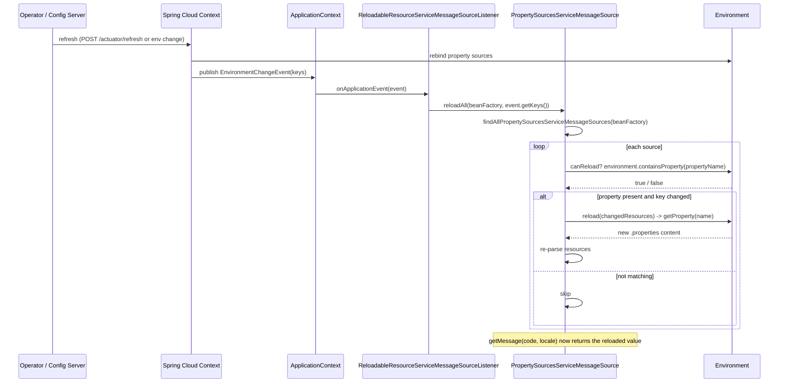
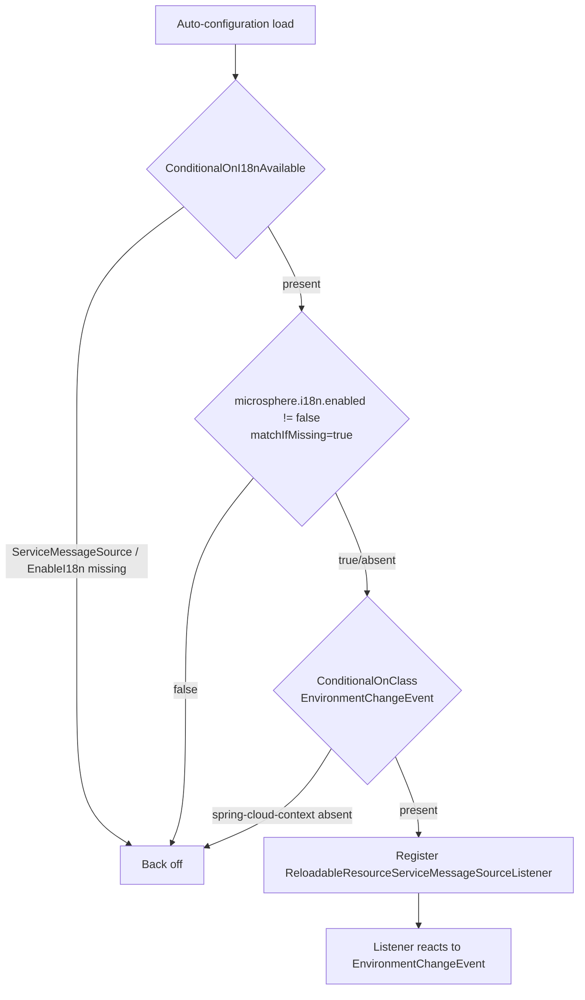
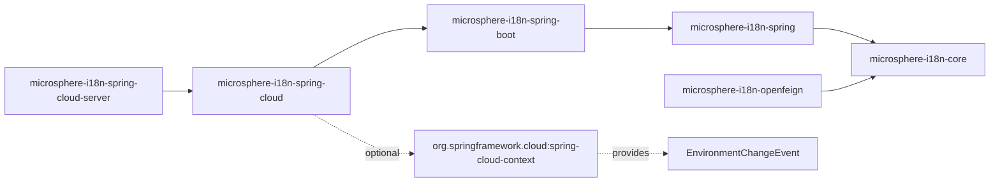

# Spring Cloud 集成 - 开发者指南

## 架构与关键类

`microsphere-i18n-spring-cloud` 是 Spring Cloud 环境刷新机制与 `microsphere-i18n-spring` 中定义的、由
`PropertySources` 支撑的消息源之间的一个轻量、事件驱动的桥接层。它包含两个生产类。

### `I18nCloudAutoConfiguration`

`io.microsphere.i18n.spring.cloud.autoconfigure.I18nCloudAutoConfiguration` 是一个
`@Configuration(proxyBeanMethods = false)` 类，声明在
`META-INF/spring/org.springframework.boot.autoconfigure.AutoConfiguration.imports` 中。它只贡献一个 Bean，并带有
三个激活守卫：

```java
@Configuration(proxyBeanMethods = false)
@ConditionalOnI18nAvailable
@ConditionalOnClass(name = {
        "org.springframework.cloud.context.environment.EnvironmentChangeEvent",
})
public class I18nCloudAutoConfiguration {
    @Bean
    public ReloadableResourceServiceMessageSourceListener reloadableResourceServiceMessageSourceListener() {
        return new ReloadableResourceServiceMessageSourceListener();
    }
}
```

- `@ConditionalOnI18nAvailable`（来自 `microsphere-i18n-spring-boot`）展开为
  `@ConditionalOnClass(ServiceMessageSource, EnableI18n)` 加上
  `@ConditionalOnProperty(name = "microsphere.i18n.enabled", matchIfMissing = true)`。因此 `core`/`spring` 必须在场，
  且 i18n 没有被显式禁用。
- `@ConditionalOnClass(EnvironmentChangeEvent)` 要求 `spring-cloud-context`；没有它整个模块就是惰性的，这正是能够把
  Spring Cloud 依赖安全地设为 optional 的原因。

### `ReloadableResourceServiceMessageSourceListener`

`io.microsphere.i18n.spring.cloud.event.ReloadableResourceServiceMessageSourceListener` 实现了
`ApplicationListener<EnvironmentChangeEvent>` 与 `BeanFactoryAware`。它的全部逻辑就是一行两语句的委托：

```java
@Override
public void onApplicationEvent(EnvironmentChangeEvent event) {
    Set<String> changedPropertyNames = event.getKeys();
    reloadAll(this.beanFactory, changedPropertyNames);
}
```

`BeanFactory` 通过 `setBeanFactory(...)` 注入，因为 reload 辅助方法是 `PropertySourcesServiceMessageSource` 上的一个静态
方法，它需要的是 Bean 查找能力，而不是对主消息源的实时引用。

### 重新加载算法（`PropertySourcesServiceMessageSource.reloadAll`）

真正的逻辑位于 `microsphere-i18n-spring`。`reloadAll(BeanFactory, Set<String>)`：

1. `findAllPropertySourcesServiceMessageSources(beanFactory)` 解析出主 `serviceMessageSource`
   （`DelegatingServiceMessageSource`），并通过 `I18nUtils.findAllServiceMessageSources(...)` 遍历其组合体图，只保留
   `PropertySourcesServiceMessageSource` 实例。
2. 对每个源遍历 `getResources()`。在此设计中，一个资源字符串就等于它所加载的 Spring 属性名
   （`getPropertyName(resource)` 是恒等映射），形如 `<source>.i18n_messages_<locale>.properties`（source 与文件用
   `MessageUtils.SOURCE_SEPARATOR` 连接，而该分隔符是 `.`）。
3. 只有当 `changedPropertyNames.contains(propertyName)` 时资源才被记为“已变化”；只有当 `canReload(changedResources)`
   返回 `true` 时源才被重新加载。`canReload(String)` 检查 `environment.containsProperty(propertyName)`。
4. `reload(changedResources)` -> `initializeResources(...)` 会从 `Environment` 重新读取每个属性的值（该值是作为
   `String` 保存的 `.properties` 文件内容，经由 `loadAllPropertiesResources` 中的 `StringReader` 加载）并重新解析。

正是这一点让监听器做到精确，而不是“全量重载”：一次改变 `server.port` 的刷新所发布的 `EnvironmentChangeEvent`，其键与任何
i18n 资源属性都不匹配，因此没有任何消息源会被重建。

## 设计模式

- **观察者（Observer）** - `ReloadableResourceServiceMessageSourceListener` 是一个具体的观察者，注册为 Spring 的
  `ApplicationListener<EnvironmentChangeEvent>`。Spring Cloud 的上下文刷新是被通知方，它发出携带变化键的
  `EnvironmentChangeEvent`（`event.getKeys()`）；监听器作出响应，而发出方对 i18n 一无所知。这种解耦正是本模块可以把 Spring
  Cloud 依赖设为 optional 的原因。
- **组合（Composite）** - 重新加载的目标集合是通过 `DelegatingServiceMessageSource` 发现的，后者继承自
  `CompositeServiceMessageSource`。`reloadAll` 遍历那棵组合体树以找到叶子级的 `PropertySourcesServiceMessageSource`
  Bean，因此由 `@EnableI18n(sources = ...)` 添加的、按 source 划分的消息源会被自动覆盖。
- **模板方法（Template Method）** - `canReload` / `reload` / `initializeResources` 在
  `ReloadableResourceServiceMessageSource` 接口（core）上定义，并由 `PropertySourcesServiceMessageSource`（spring）特化为
  从 `Environment` 读取。
- **静态辅助 / 服务定位** - 监听器持有一个 `BeanFactory` 并调用静态的 `reloadAll(...)`，以无状态监听器 Bean 换取对协作者的
  注入。

## 序列：配置变更到重新加载



## 流程图：`I18nCloudAutoConfiguration` 条件



## 模块依赖



## 测试策略

测试位于 `src/test/java` 之下，分为条件覆盖与行为集成两类。

- `I18nCloudAutoConfigurationTest` 继承 `AutoConfigurationTest<I18nCloudAutoConfiguration>`。它断言该自动配置会贡献
  `ReloadableResourceServiceMessageSourceListener`，并在负例下正确退避。各 override 枚举了负例：
  - `configureGlobalDisabledPropertyValues` 添加 `microsphere.i18n.enabled=false`。
  - `configureGlobalMissingClasses` 添加 `ServiceMessageSource`、`EnableI18n` 与 `EnvironmentChangeEvent` —— 每一个单独都应
    禁用本模块，覆盖两个 `@Conditional*` 守卫。
- `I18nCloudAutoConfigurationIntegrationTest` 启动一个真实的 `@EnableAutoConfiguration` 上下文（关闭服务自动注册），并断言
  `FeaturesEndpoint` 能成功自动注入。其目的在于证明本模块的存在不会破坏一个 Spring Cloud 运行时上下文。
- `MessageSourceIntegrationTest` 是端到端跑通重新加载路径的行为测试。它导入
  `I18nAutoConfiguration`、`I18nEndpointAutoConfiguration`、`PropertyPlaceholderAutoConfiguration` 与
  `ReloadableResourceServiceMessageSourceListener`，随后：
  1. 解析 Bean `commonServiceMessageSource` 并断言 `getMessage("common.a", ENGLISH)` 为 `"a"`（来自
     `META-INF/i18n/common/i18n_messages_en.properties`），
  2. 添加一个用 `common.a=a.2024` 覆盖 `common.i18n_messages_en.properties` 的 `MapPropertySource`，
  3. 发布 `new EnvironmentChangeEvent(ofSet("common.i18n_messages_en.properties"))`，
  4. 断言 `getMessage("common.a", ENGLISH)` 变为 `"a.2024"`，
  5. 读取 `I18nEndpoint` 的 JSON 并断言 JSONPath
     `$.['common.i18n_messages_en.properties'].['common.a']` 等于 `"a.2024"`。
  这是最能说明观察者装配、`reloadAll` 过滤与基于 `Environment` 的重新加载三者协同的证据。
- `I18nBootstrap` 是一个可运行的 `main`（servlet web 应用），它预置
  `common.i18n_messages_en.properties=common.a = common-a-2024`，并加载 `i18n-bootstrap.properties`
  （`spring.application.name=i18n-bootstrap`，启用 actuator `i18n` 与 env-post），用于手动验证
  `/actuator/i18n` 与 `/actuator/env`。

模块 target 目录下的 surefire 报告确认 `I18nCloudAutoConfigurationTest` 与 `MessageSourceIntegrationTest` 会在构建期间执行。
