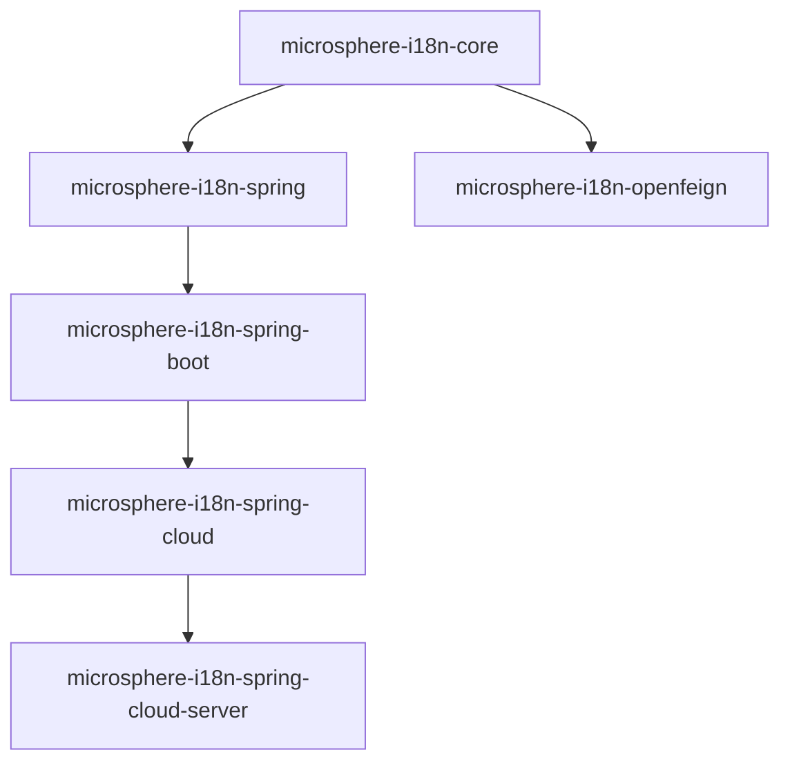

# 开发者文档

microsphere-i18n 内部机制文档：架构设计、源码分析、设计模式，以及关键复杂路径的流程图。

- [English](./README.md) · [返回文档总入口](../zh/README.md)

## 选择发布线

| **发布线** | **目录** | **版本** | **实现要点** |
|------------|----------|----------|--------------|
| 当前线（`release` 分支） | [`current/`](../current/zh/README.md) | 0.2.x | `jakarta.*` 命名空间；Boot 3 通过 `AutoConfiguration.imports` 注册 |
| 1.x 维护线（`release-1.x` 分支） | [`1.x/`](../1.x/zh/README.md) | 0.1.x | `javax.*` 命名空间；通过 `META-INF/spring.factories` 注册自动装配 |

## 文档列表（按 Maven 模块）

| **文档** | **内容** |
|----------|----------|
| core.md | `ServiceMessageSource` 类层次、消息解析算法、Locale 回退流程、模板方法 / 组合 / 空对象模式 |
| spring.md | `@EnableI18n` 的 Bean 注册管线、FactoryBean + `spring.factories` 发现机制、适配器与观察者模式、校验/语言解析器后置处理器 |
| spring-boot.md | 自动装配条件链、Actuator 端点内部实现、运行时写入消息路径 |
| spring-cloud.md | `EnvironmentChangeEvent` → 消息重载管线 |
| spring-cloud-server.md | 服务发现集成、消息聚合流程 |
| openfeign.md | Feign 拦截器的请求头解析逻辑 |
| parent.md | POM 继承与依赖管理链 |
| dependencies.md | BOM 结构与导入链 |

中文版路径在对应英文路径中加入 `zh/`，例如 `current/zh/core.md`、`1.x/zh/spring-boot.md`。

## 模块依赖关系

所有模块均继承 `microsphere-i18n-parent`；对外版本由 `microsphere-i18n-dependencies` BOM 统一管理。
各模块文档中会重复此图并高亮自身的上下游位置。

## 建议阅读顺序

- 初识代码库：先读 [core.md](../current/zh/core.md)，其余模块都构建在其抽象之上。
- 涉及 Spring 集成：[spring.md](../current/zh/spring.md) 讲解完整 Bean 生命周期。
- 排查动态刷新问题：[spring-boot.md](../current/zh/spring-boot.md) 与
  [spring-cloud.md](../current/zh/spring-cloud.md) 中含有对应时序图。
