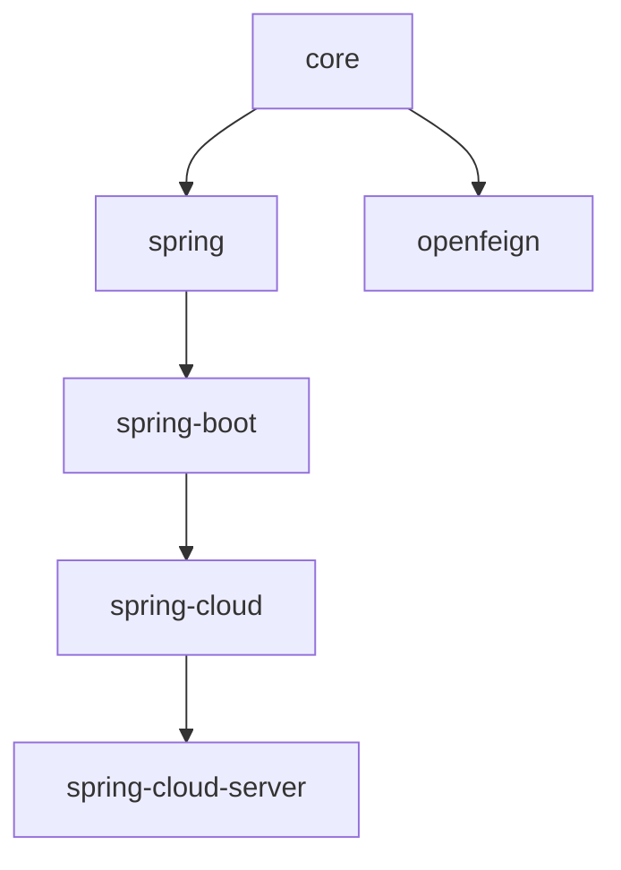

# User Guide — 1.x line (0.1.x, release-1.x branch)

User documentation for the legacy 0.1.x release line (`release-1.x` branch, working version
`0.1.22-SNAPSHOT`, latest published `0.1.21`).

- [中文](./zh/README.md) · [Current line (0.2.x)](../current/README.md) · [User Guide index](../README.md)

## Compatibility

| **Item** | **Requirement** |
|----------|-----------------|
| Java | 8+ (baseline inherited from the 0.1.x parent POM chain) |
| Spring Framework | 5.x |
| Spring Boot | 2.3.x – 2.7.x (profiles pin 2.3.12 / 2.4.13 / 2.6.15) |
| Spring Cloud | Hoxton.SR12 – 2021.0.9 |
| Namespace | `javax.*` |
| BOM | `microsphere-i18n-dependencies:0.1.21` |

## Module documents

| **Module** | **English** | **中文** |
|------------|-------------|----------|
| microsphere-i18n-dependencies (BOM) | [dependencies.md](./dependencies.md) | [dependencies.md](./zh/dependencies.md) |
| microsphere-i18n-parent | [parent.md](./parent.md) | [parent.md](./zh/parent.md) |
| microsphere-i18n-core | [core.md](./core.md) | [core.md](./zh/core.md) |
| microsphere-i18n-spring | [spring.md](./spring.md) | [spring.md](./zh/spring.md) |
| microsphere-i18n-spring-boot | [spring-boot.md](./spring-boot.md) | [spring-boot.md](./zh/spring-boot.md) |
| microsphere-i18n-spring-cloud | [spring-cloud.md](./spring-cloud.md) | [spring-cloud.md](./zh/spring-cloud.md) |
| microsphere-i18n-spring-cloud-server | [spring-cloud-server.md](./spring-cloud-server.md) | [spring-cloud-server.md](./zh/spring-cloud-server.md) |
| microsphere-i18n-openfeign | [openfeign.md](./openfeign.md) | [openfeign.md](./zh/openfeign.md) |

## Module dependencies

The 1.x line shares its architecture and APIs with the 0.2.x line; the main differences are the
`javax.*` namespace and auto-configuration registration through `META-INF/spring.factories`. Each
document contains a "Differences from the 0.2.x line" section.
