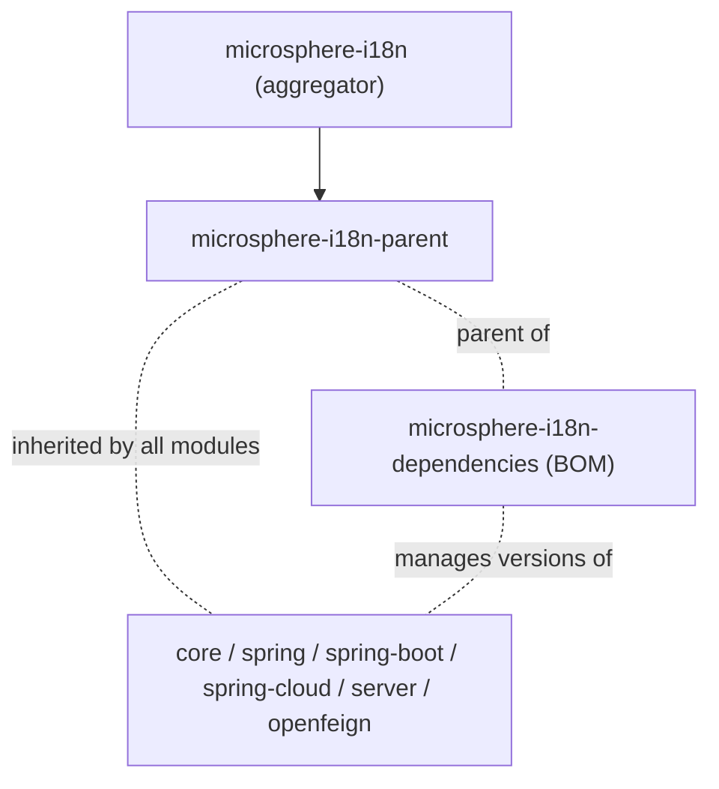

# Dependencies BOM (`microsphere-i18n-dependencies`) — 1.x

`microsphere-i18n-dependencies` is the Bill of Materials of the project. It is a POM-only module
(`<packaging>pom</packaging>`) whose only content is a `<dependencyManagement>` block listing every
`microsphere-i18n-*` artifact at the reactor version. This is the artifact applications should use;
the [Parent POM](parent.md) is for building the project itself.

This document describes the **`1.x` line** (`0.1.x` version series) — the Spring Boot 2.x /
`javax.*` generation. For the current `0.2.x` line see
[docs/user-guide/current/dependencies.md](../current/dependencies.md).

## Purpose

- Keep all microsphere-i18n modules on one version, so a project never mixes, for example,
  `microsphere-i18n-core:0.1.20` with `microsphere-i18n-spring-boot:0.1.21`.
- Let you omit `<version>` on every i18n dependency in your POM.
- Publish one coordinate to bump: the whole i18n line moves when the BOM version changes.

The POM has no `<dependencies>`, no plugins and no properties of its own. Its parent is
`microsphere-i18n-parent`, which is where the third-party BOM import lives.

## Managed Artifacts

As declared in `microsphere-i18n-dependencies/pom.xml` (all at `${revision}`, which the build
flattens to the concrete release version, e.g. `0.1.21`):

| Artifact                                 | Packaging | What it gives you                                              |
|------------------------------------------|-----------|------------------------------------------------------------------|
| `microsphere-i18n-core`                  | jar       | `ServiceMessageSource` abstractions and classpath loading        |
| `microsphere-i18n-openfeign`             | jar       | `AcceptLanguageHeaderRequestInterceptor` for Feign calls          |
| `microsphere-i18n-spring`                | jar       | Spring Framework integration (`@EnableI18n`, adapters)            |
| `microsphere-i18n-spring-boot`           | jar       | Spring Boot auto-configuration and Actuator endpoint              |
| `microsphere-i18n-spring-cloud`          | jar       | Dynamic refresh through Spring Cloud configuration                |
| `microsphere-i18n-spring-cloud-server`   | jar       | Centralized i18n server (`GET /messages`, `@EnableI18nServer`)    |

The two POM-only modules of the reactor (`microsphere-i18n-parent` and
`microsphere-i18n-dependencies` itself) are deliberately not managed entries — they are build
configuration, not libraries.

## Importing the BOM (recommended)

```xml

<properties>
    <microsphere-i18n.version>0.1.21</microsphere-i18n.version>
</properties>

<dependencyManagement>
    <dependencies>
        <dependency>
            <groupId>io.github.microsphere-projects</groupId>
            <artifactId>microsphere-i18n-dependencies</artifactId>
            <version>${microsphere-i18n.version}</version>
            <type>pom</type>
            <scope>import</scope>
        </dependency>
    </dependencies>
</dependencyManagement>

<dependencies>
    <dependency>
        <groupId>io.github.microsphere-projects</groupId>
        <artifactId>microsphere-i18n-spring-boot</artifactId>
    </dependency>
    <dependency>
        <groupId>io.github.microsphere-projects</groupId>
        <artifactId>microsphere-i18n-openfeign</artifactId>
    </dependency>
</dependencies>
```

Import order matters: within one `<dependencyManagement>` section, the **first** entry that matches
a `groupId:artifactId` wins. If you also import `spring-boot-dependencies` or another BOM that
mentions these artifacts, put the more authoritative one first.

## Extending the BOM (alternative)

Declaring the BOM as your project's parent also inherits its management, without an `import`:

```xml

<parent>
    <groupId>io.github.microsphere-projects</groupId>
    <artifactId>microsphere-i18n-dependencies</artifactId>
    <version>0.1.21</version>
    <relativePath/>
</parent>
```

This is convenient for a small internal project but it couples your POM to the Microsphere parent
chain (the BOM's own parent, `microsphere-i18n-parent`, imports
`microsphere-spring-cloud-dependencies:0.1.26`, which in turn brings the Spring Boot 2.x and Spring
Cloud BOMs). For application projects, prefer `import` and keep your own parent free for your
company's build conventions.

## Overriding Versions

Because the published BOM contains literal versions (the build replaces `${revision}`), you cannot
change an i18n module version by setting a property. Override by re-declaring the entry yourself,
before the import or in place of it:

```xml

<dependencyManagement>
    <dependencies>
        <!-- Pinned module: wins over the imported BOM because it is declared first -->
        <dependency>
            <groupId>io.github.microsphere-projects</groupId>
            <artifactId>microsphere-i18n-core</artifactId>
            <version>0.1.20</version>
        </dependency>
        <dependency>
            <groupId>io.github.microsphere-projects</groupId>
            <artifactId>microsphere-i18n-dependencies</artifactId>
            <version>0.1.21</version>
            <type>pom</type>
            <scope>import</scope>
        </dependency>
    </dependencies>
</dependencyManagement>
```

A version written directly on a `<dependency>` always wins over management. Pinning a single module
to a different release is supported but rarely wise: the modules are compiled together and share the
`io.microsphere.i18n` SPI, so mixed lines can break binary compatibility.

Third-party overrides follow standard Maven rules — re-declare
`org.springframework:spring-webmvc`, `io.github.openfeign:feign-core`,
`javax.servlet:javax.servlet-api`, and so on in your own `dependencyManagement`, or use the
well-known version properties exported by `spring-boot-dependencies` (`<spring-framework.version>`,
`<feign.version>`, …) when you import that BOM directly.

## Version and Compatibility

| Item                     | Value                                                        |
|--------------------------|--------------------------------------------------------------|
| Coordinate               | `io.github.microsphere-projects:microsphere-i18n-dependencies` |
| Type                     | `pom` (BOM)                                                  |
| Line                     | `0.1.x`, latest published `0.1.21` (working `0.1.22-SNAPSHOT`) |
| Java                     | Spring Boot 2.x generation; no `java.version` override in the reactor |
| Namespace                | `javax.*`                                                    |
| Spring Boot              | 2.x                                                          |
| Spring Cloud             | Hoxton – 2021.0.x                                            |
| `0.2.x` line             | `0.2.x` (latest `0.2.21`), Spring Boot 3.x / Spring Cloud 2022.0.x – 2025.0.x — see the current docs |

The BOM only manages the i18n artifacts; the Spring Boot / Spring Cloud versions your application
resolves from this BOM's parent chain are the ones selected by the Spring Cloud 2.x generation baked
into the build. If you need to align third-party versions explicitly, import
`spring-boot-dependencies` or `spring-cloud-dependencies` in your own POM as well.

## Common Issues

- **`'dependencies.dependency.version' ... is missing`** — the BOM is not in effect: check the
  `<type>pom</type>` + `<scope>import</scope>` pair, and that the artifactId is
  `microsphere-i18n-dependencies` (not `microsphere-i18n`).
- **`jakarta.*` class not found at runtime** — a `0.2.x` module leaked into a `1.x` build. The
  `1.x` line is `javax.*` only; never mix the two lines.
- **Version mismatch between modules** — you declared a `<version>` on one module; remove it and let
  the BOM decide.
- **Modules resolve but interceptor beans are missing** — the BOM manages artifacts, it does not
  register beans; see [OpenFeign](openfeign.md) for the required `@Bean` declaration.

## Differences from the 0.2.x line

The BOM structure is identical between the two lines — same six managed `microsphere-i18n-*`
artifacts, same `${revision}` flattening. Only the version numbers and the platform they target
differ:

| Aspect                    | `1.x` (`0.1.x`) line                          | `0.2.x` line                          |
|---------------------------|------------------------------------------------|----------------------------------------|
| Published / working       | `0.1.21` / `0.1.22-SNAPSHOT`                  | `0.2.21` / `0.2.22-SNAPSHOT`          |
| Namespace managed         | `javax.*` (e.g. `javax.servlet:javax.servlet-api`) | `jakarta.*`                       |
| Spring Boot / Cloud       | 2.x / Hoxton – 2021.0.x                        | 3.x / 2022.0.x – 2025.0.x             |
| Parent chain BOM import   | `microsphere-spring-cloud-dependencies:0.1.26`| `microsphere-spring-cloud-dependencies:0.2.26` |
| Managed artifact list     | same six artifacts                             | same six artifacts                    |

`microsphere-i18n-dependencies/pom.xml` is **unchanged** between the `release` and
`release-1.x` branches (all coordinates are `${revision}`, so no literal version appears there);
what changes across the line is only the parent chain it inherits.

## Related Documentation

- [Parent POM](parent.md) — the build-side counterpart
- [Spring Boot](spring-boot.md)
- Developer Guide: [Dependencies BOM](../../developer-guide/1.x/dependencies.md)
- 0.2.x counterpart: [current Dependencies guide](../current/dependencies.md)

## Module dependencies

POM structure:


