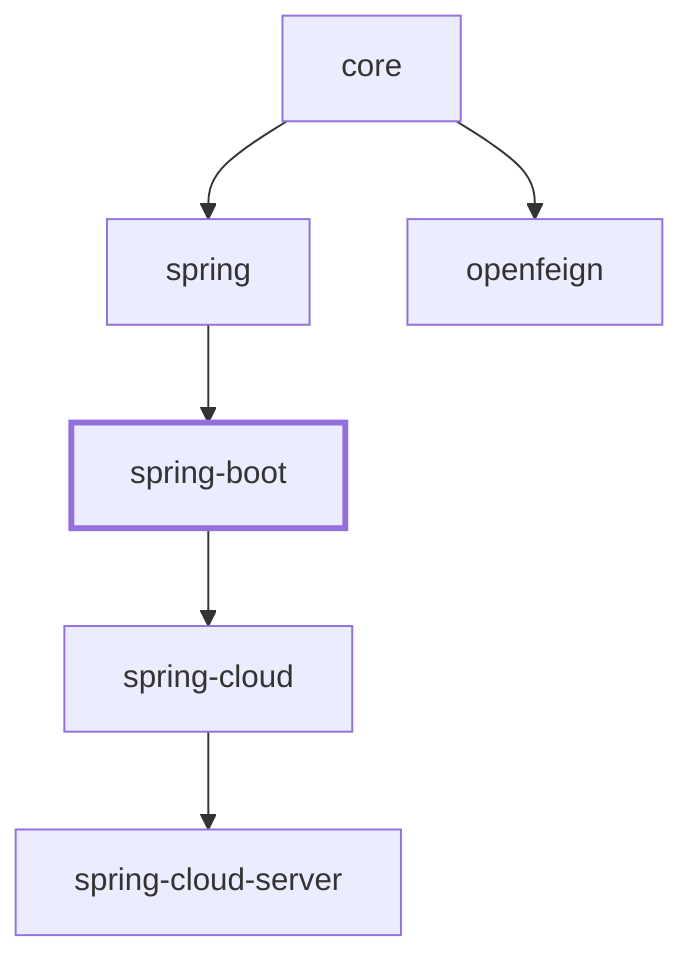

# Spring Boot Integration (1.x)

The `microsphere-i18n-spring-boot` module provides Spring Boot auto-configuration for the
Microsphere Internationalisation framework. Adding it to a Spring Boot application turns on i18n
support without any `@EnableI18n` annotation, registers the message sources as Spring beans, and —
when Spring Boot Actuator is present — exposes a management endpoint for reading and writing
messages at runtime.

This document describes the **`1.x` line** (`0.1.x` version series), which targets the Spring Boot
2.x generation and the `javax.*` namespace. For the current `0.2.x` line see
[docs/user-guide/current/spring-boot.md](../current/spring-boot.md).

- [TOC]

## Overview

This module sits between the plain Spring integration (`microsphere-i18n-spring`) and the
Spring Cloud modules. It depends on `microsphere-i18n-spring`, which in turn depends on
`microsphere-i18n-core`:

```
microsphere-i18n-spring-boot  ->  microsphere-i18n-spring  ->  microsphere-i18n-core
```

Compared with the Spring module (which requires you to annotate a configuration class with
`@EnableI18n`), the Spring Boot module:

- Auto-registers the i18n infrastructure through `META-INF/spring.factories`
  (the `org.springframework.boot.autoconfigure.EnableAutoConfiguration` key), so `@EnableI18n` is
  applied for you internally.
- Optionally registers an application-specific message source derived from
  `spring.application.name`.
- Provides an Actuator endpoint (`/actuator/i18n`) for inspecting and mutating messages at
  runtime.
- Guards everything behind the `microsphere.i18n.enabled` property and classpath checks so the
  module is completely inert when i18n is disabled or the required classes are absent.

## Maven Coordinates

The `1.x` line is the `0.1.x` series (latest published release `0.1.21`, working tree
`0.1.22-SNAPSHOT`), built for the **Spring Boot 2.x** generation with the `javax.*` namespace.

Add the starter dependency (the version is managed by the Bill of Materials):

```xml
<dependency>
    <groupId>io.github.microsphere-projects</groupId>
    <artifactId>microsphere-i18n-spring-boot</artifactId>
</dependency>
```

Import the `microsphere-i18n-dependencies` BOM in your `dependencyManagement` section to align all
Microsphere i18n artifact versions:

```xml
<dependencyManagement>
    <dependencies>
        <dependency>
            <groupId>io.github.microsphere-projects</groupId>
            <artifactId>microsphere-i18n-dependencies</artifactId>
            <version>0.1.21</version>
            <type>pom</type>
            <scope>import</scope>
        </dependency>
    </dependencies>
</dependencyManagement>
```

The following collaborators are declared `optional` by this module, so you must add them yourself
only when the related feature is used:

| Artifact                                  | Needed for                                              |
|-------------------------------------------|---------------------------------------------------------|
| `microsphere-i18n-spring`                 | Core Spring integration (transitively required)         |
| `spring-boot-starter`                     | Spring Boot runtime                                     |
| `spring-boot-starter-web`                 | Web/MVC applications                                    |
| `spring-boot-starter-actuator`            | The `/actuator/i18n` endpoint                           |
| `microsphere-spring-boot-core`            | Microsphere Spring Boot core support                    |
| `microsphere-spring-boot-actuator`        | Endpoint presence condition (`ConditionalOnActuatorEndpointPresent`) |
| `javax.servlet:javax.servlet-api`         | Servlet-based locale resolution                         |
| `javax.validation:validation-api`         | Bean Validation locale integration                      |

## Version & Compatibility

| Concern                       | Value for the `1.x` (`0.1.x`) line                                       |
|-------------------------------|--------------------------------------------------------------------------|
| Library line                  | `0.1.x` (latest published release `0.1.21`, working `0.1.22-SNAPSHOT`)   |
| Namespace                     | `javax.*` (`javax.servlet-api`, `javax.validation:validation-api`)       |
| Spring Boot                   | 2.x generation (built against Boot `2.3.12` / `2.4.13` / `2.6.15` per profile) |
| Spring Cloud (siblings)       | `Hoxton` – `2021.0.x` (relevant only for the Spring Cloud modules)       |
| Java baseline                 | Spring Boot 2.x generation; the reactor POM declares **no** `java.version` override |
| Group ID                      | `io.github.microsphere-projects`                                        |
| Root parent                   | `microsphere-spring-cloud-parent:0.1.26`                                 |
| Auto-configuration mechanism  | `META-INF/spring.factories` (`EnableAutoConfiguration`)                 |
| Downstream modules            | depended on by `microsphere-i18n-spring-cloud` and `microsphere-i18n-spring-cloud-server` |

> The `0.2.x` line targets Java 17 with `jakarta.*` and the Spring Boot 3
> `AutoConfiguration.imports` registration mechanism. Those documents live under the `current`
> section of the guide.

## Auto-Configuration Behavior

### When `I18nAutoConfiguration` activates

`I18nAutoConfiguration` is the primary entry point. Its class-level annotations are:

```java
@Configuration(proxyBeanMethods = false)
@ConditionalOnI18nAvailable
@EnableI18n
public class I18nAutoConfiguration { ... }
```

It therefore activates only when the `@ConditionalOnI18nAvailable` meta-condition is satisfied:

- **Class presence** — both
  `io.microsphere.i18n.ServiceMessageSource` (the core module) and
  `io.microsphere.i18n.spring.annotation.EnableI18n` (the Spring module) must be on the
  classpath. If either is missing, the auto-configuration backs off entirely.
- **Property condition** — `microsphere.i18n.enabled` must not be `false`. The annotation uses
  `@ConditionalOnProperty(name = "microsphere.i18n.enabled", matchIfMissing = true)`, which means
  the feature is **enabled by default** and is switched off only by explicitly setting the property
  to `false`.

When the condition matches, the configuration is annotated `@EnableI18n`, which (through the Spring
module's `I18nImportBeanDefinitionRegistrar`) registers the standard i18n bean graph:

| Bean name (default)             | Type                                     | Purpose                                          |
|---------------------------------|------------------------------------------|--------------------------------------------------|
| `commonServiceMessageSource`    | `ServiceMessageSourceFactoryBean`        | Message source for the `common` source           |
| `serviceMessageSource`          | `DelegatingServiceMessageSource` (primary) | Aggregates every registered source              |
| `messageSource`                 | `MessageSourceAdapter`                   | Exposes i18n as Spring's `MessageSource` (`exposeMessageSource` default `true`) |
| `i18nApplicationListener`       | `I18nApplicationListener`                | Lifecycle / change-event wiring                  |
| `serviceMessageSourceBeanLifecyclePostProcessor` | `ServiceMessageSourceBeanLifecyclePostProcessor` | Manages message-source bean lifecycle |
| `i18nLocalValidatorFactoryBeanPostProcessor` | `I18nLocalValidatorFactoryBeanPostProcessor` | Registered only when a Bean Validation `ValidatorFactory` is present |

### How `spring.application.name` interacts with sources

`I18nAutoConfiguration` defines one extra bean that is conditional on `spring.application.name`:

```java
@Bean
@ConditionalOnProperty(name = "spring.application.name")
public ServiceMessageSourceFactoryBean applicationServiceMessageSource(
        @Value("${spring.application.name}") String applicationName) {
    return new ServiceMessageSourceFactoryBean(applicationName);
}
```

Consequences:

- If `spring.application.name` is **not set**, only the default `common` source is registered.
- If `spring.application.name` **is set** (for example `myapp`), an additional
  `ServiceMessageSourceFactoryBean` named `applicationServiceMessageSource` is created with the
  application name as its source. Message files placed under
  `META-INF/i18n/myapp/i18n_messages_<locale>.properties` are then loaded automatically.
- All sources — `common` plus the application-named source plus any listed in
  `microsphere.i18n.sources` — are composed into the primary `serviceMessageSource` bean.

### Enabling and disabling

```properties
# Enabled by default; set to false to turn the whole i18n auto-configuration off
microsphere.i18n.enabled=true

# Setting the application name adds an application-specific message source
spring.application.name=myapp
```

Setting `microsphere.i18n.enabled=false` prevents `I18nAutoConfiguration` (and therefore
`I18nEndpointAutoConfiguration`) from being applied; the message-source beans above are not
registered.

## Configuration Properties

All library properties share the `microsphere.i18n.` prefix (constant
`I18nConstants.PROPERTY_NAME_PREFIX`):

| Property                         | Type       | Default     | Description                                                            |
|----------------------------------|------------|-------------|------------------------------------------------------------------------|
| `microsphere.i18n.enabled`       | `boolean`  | `true`      | Master switch for the i18n framework (`matchIfMissing = true`).        |
| `microsphere.i18n.sources`       | `String[]` | —           | Additional message source names to register beyond the defaults.       |
| `microsphere.i18n.default-locale`| `Locale`   | JVM default | Locale used when no request locale is available.                       |
| `microsphere.i18n.supported-locales` | `String[]` | —         | Comma-separated locales supported by every source (e.g. `zh_CN,en`).   |

Spring application properties that this module reads directly from code:

| Property                 | Where used                                             | Effect                                                            |
|--------------------------|--------------------------------------------------------|-------------------------------------------------------------------|
| `spring.application.name`| `I18nAutoConfiguration#applicationServiceMessageSource`| Registers an application-named message source when present.       |

Actuator management properties for the endpoint, as generated for the Spring Boot 2.x line
(`spring-configuration-metadata.json`):

| Property                                    | Type      | Default | Notes                                                            |
|---------------------------------------------|-----------|---------|------------------------------------------------------------------|
| `management.endpoint.i18n.enabled`          | `Boolean` | `true`  | Enables or disables the `i18n` endpoint.                          |
| `management.endpoint.i18n.cache.time-to-live` | `Duration` | —      | Maximum response cache time when caching is enabled.              |

> On Spring Boot 2.x the endpoint is controlled by `management.endpoint.i18n.enabled`. The
> `management.endpoint.i18n.access` property (`none` / `read-only` / `unrestricted`) was introduced
> only in Spring Boot `3.4.0` and is **not** part of the `1.x` line — see the
> [0.2.x user guide](../current/spring-boot.md).

## API Reference

### `I18nAutoConfiguration`

`io.microsphere.i18n.spring.boot.autoconfigure.I18nAutoConfiguration`

- Annotated `@Configuration(proxyBeanMethods = false)`, `@ConditionalOnI18nAvailable`,
  `@EnableI18n`.
- Declares the `applicationServiceMessageSource` bean (conditional on `spring.application.name`).
- Registered in `META-INF/spring.factories` under the
  `org.springframework.boot.autoconfigure.EnableAutoConfiguration` key.

### `ConditionalOnI18nAvailable`

`io.microsphere.i18n.spring.boot.condition.ConditionalOnI18nAvailable`

A composed `@Conditional` annotation usable on types and methods. Its meta-conditions are:

- `@ConditionalOnClass(name = {"io.microsphere.i18n.ServiceMessageSource", "io.microsphere.i18n.spring.annotation.EnableI18n"})`
  — requires the core and Spring modules on the classpath.
- `@ConditionalOnProperty(name = "microsphere.i18n.enabled", matchIfMissing = true)` — active
  unless explicitly disabled.

You can reuse it on your own configuration classes or beans so they participate in the same
enable/disable and classpath contract.

### `I18nEndpointAutoConfiguration`

`io.microsphere.i18n.spring.boot.actuate.autoconfigure.I18nEndpointAutoConfiguration`

```java
@Configuration(proxyBeanMethods = false)
@ConditionalOnI18nAvailable
@ConditionalOnActuatorEndpointPresent
@AutoConfigureAfter(I18nAutoConfiguration.class)
public class I18nEndpointAutoConfiguration {
    @Bean
    @ConditionalOnMissingBean
    @ConditionalOnAvailableEndpoint(endpoint = I18nEndpoint.class)
    public I18nEndpoint i18nEndpoint() {
        return new I18nEndpoint();
    }
}
```

It registers the `I18nEndpoint` bean only when:

- the i18n feature is available (`@ConditionalOnI18nAvailable`),
- the Spring Boot Actuator endpoint infrastructure is present
  (`@ConditionalOnActuatorEndpointPresent`, from `microsphere-spring-boot-actuator`), and
- the endpoint itself is available/exposed per Spring Boot rules
  (`@ConditionalOnAvailableEndpoint(endpoint = I18nEndpoint.class)`).

`@AutoConfigureAfter(I18nAutoConfiguration.class)` orders it after the core auto-configuration so
the message sources exist before the endpoint is created. A user-defined `I18nEndpoint` bean
suppresses this one (`@ConditionalOnMissingBean`).

### `I18nEndpoint` HTTP semantics

`io.microsphere.i18n.spring.boot.actuate.I18nEndpoint` — declared with `@Endpoint(id = "i18n")`, so
the web base path is `/actuator/i18n` (assuming the default `/actuator` prefix).

Operations are derived from the `@ReadOperation` / `@WriteOperation` / `@Selector` annotations:

| Operation                | HTTP   | Path                         | Source method                                              |
|--------------------------|--------|------------------------------|------------------------------------------------------------|
| List all messages        | `GET`  | `/actuator/i18n`             | `invoke()`                                                 |
| Message by code          | `GET`  | `/actuator/i18n/{code}`      | `getMessage(@Selector String code)`                        |
| Message by code+locale   | `GET`  | `/actuator/i18n/{code}/{locale}` | `getMessage(@Selector String code, @Selector Locale locale)` |
| Add/overwrite a message  | `POST` | `/actuator/i18n`             | `addMessage(String source, Locale locale, String code, String message)` |

**`GET /actuator/i18n`** returns a map keyed by resource file, each holding its `code -> message`
pairs, for example:

```json
{
  "META-INF/i18n/test/i18n_messages_en.properties": {
    "test.a": "test-a",
    "test.hello": "Hello,{}"
  },
  "META-INF/i18n/common/i18n_messages_zh_CN.properties": {
    "common.a": "啊"
  }
}
```

**`GET /actuator/i18n/{code}`** returns one entry per (resource, supported locale) pair. Each entry
is a five-field object: `code`, `locale`, `source`, `resource`, `message` (`message` is `null` when
the code is not present in that resource/locale):

```json
[
  {
    "code": "a",
    "locale": "en",
    "source": "common",
    "resource": "META-INF/i18n/common/i18n_messages_en.properties",
    "message": "a"
  },
  {
    "code": "a",
    "locale": "zh_CN",
    "source": "common",
    "resource": "META-INF/i18n/common/i18n_messages_zh_CN.properties",
    "message": "啊"
  }
]
```

**`GET /actuator/i18n/{code}/{locale}`** behaves the same but restricts the result to the single
requested `locale` (for example `zh_CN`).

**`POST /actuator/i18n`** invokes the `@WriteOperation`. In the Spring Boot 2.x line the operation's
method parameters are bound from the JSON request body by name (`source`, `locale`, `code`,
`message`). The request body shape is:

```json
{
  "source": "common",
  "locale": "fr",
  "code": "a",
  "message": "$a"
}
```

Semantics (from `addMessage`):

- `source` must match the `getSource()` of a registered `PropertySourcesServiceMessageSource`; if
  no such source exists the operation returns an empty object `{}`.
- `locale` is a `java.util.Locale` (for example `fr` or `zh_CN`).
- The message is written into the environment-backed property source and the target source is
  re-initialized (`init()`), so the new value is visible immediately without a restart.
- The response is the map of changed properties (resource name -> serialized `.properties`
  content).

## Actuator Exposure Configuration

The endpoint is registered only when Actuator is available, but it must also be exposed over the
web. By default the `i18n` endpoint is **not** among the web-exposed endpoints, so add it
explicitly:

```properties
# Expose the i18n endpoint over the web (single endpoint)
management.endpoints.web.exposure.include=i18n

# Or expose every endpoint (development use)
management.endpoints.web.exposure.include=*

# Ensure the endpoint itself is enabled (default true)
management.endpoint.i18n.enabled=true
```

Both lines below appear in the module's own
`src/test/resources/application.properties`, which is what the endpoint tests rely on:

```properties
management.endpoint.i18n.enabled=true
management.endpoints.web.exposure.include=*
```

On the `1.x` / Spring Boot 2.x line, `management.endpoint.i18n.enabled` is the switch for the
endpoint. There is no `management.endpoint.i18n.access` property on this line; that is specific to
Spring Boot `3.4.0` and newer (the `0.2.x` docs).

## Code Examples

### Bootstrap application

Adapted from `I18nEndpointAutoConfigurationBootstrap`, a runnable Spring Boot application that
turns on full auto-configuration and registers an extra `test` message source:

```java
@EnableAutoConfiguration
public class I18nEndpointAutoConfigurationBootstrap {

    public static void main(String[] args) {
        new SpringApplicationBuilder(I18nEndpointAutoConfigurationBootstrap.class)
                .web(WebApplicationType.SERVLET)
                .properties("test.i18n_messages_en.properties=test.a = test-a-2024")
                .run(args);
    }

    @Bean
    public static ServiceMessageSourceFactoryBean testServiceMessageSource() {
        return new ServiceMessageSourceFactoryBean("test");
    }
}
```

The `.properties("test.i18n_messages_en.properties=test.a = test-a-2024")` line shows the runtime
injection convention: the **property name is the resource identifier**
(`<source>.i18n_messages_<locale>.properties`) and the **property value is the `.properties` file
content**.

### Minimal configuration

```properties
# application.properties
spring.application.name=myapp
microsphere.i18n.enabled=true
management.endpoints.web.exposure.include=i18n
```

### Using the message source

```java
@Service
public class GreetingService {

    @Autowired
    private ServiceMessageSource messageSource;

    public String greet(String name) {
        // Resolves "test.hello" for the current locale, e.g. "Hello,World"
        return messageSource.getMessage("test.hello", name);
    }
}
```

### Message file layout

Message files are read from the classpath under `META-INF/i18n/<source>/`, using the
`i18n_messages_<locale>.properties` naming convention (the test module ships exactly these files):

```
src/test/resources/META-INF/i18n/
├── common/
│   ├── i18n_messages_en.properties        # common.a = a
│   └── i18n_messages_zh_CN.properties     # common.a = 啊
└── test/
    ├── i18n_messages_en.properties        # test.a = test-a / test.hello = Hello,{}
    └── i18n_messages_zh_CN.properties     # test.a = 测试-a / test.hello = 您好,{}
```

## Differences from the 0.2.x line

The `1.x` line keeps the same public API, bean graph and endpoint semantics as `0.2.x`; the
differences are all at the platform level:

| Aspect                        | `1.x` (`0.1.x`) line                                          | `0.2.x` line                                     |
|-------------------------------|---------------------------------------------------------------|--------------------------------------------------|
| Version series                | `0.1.x` (published `0.1.21`, working `0.1.22-SNAPSHOT`)       | `0.2.x` (published `0.2.21`, working `0.2.22-SNAPSHOT`) |
| Namespace                     | `javax.*` (`javax.servlet:javax.servlet-api`, `javax.validation:validation-api`) | `jakarta.*` (`jakarta.servlet-api`, `jakarta.validation-api`) |
| Spring Boot target            | 2.x generation (`2.3.12` / `2.4.13` / `2.6.15`)               | 3.x (`3.5.x`)                                    |
| Spring Cloud target           | Hoxton – 2021.0.x                                             | 2022.0.x – 2025.0.x                              |
| Java baseline                 | Spring Boot 2.x generation; no `java.version` override in the reactor | Java 17 (`java.version = 17`)                    |
| Root parent                   | `microsphere-spring-cloud-parent:0.1.26`                      | `microsphere-spring-cloud-parent:0.2.26`         |
| Auto-config registration      | `META-INF/spring.factories` (`EnableAutoConfiguration=...`)   | `AutoConfiguration.imports`                      |
| Endpoint access control       | `management.endpoint.i18n.enabled`                            | `management.endpoint.i18n.enabled`, plus `management.endpoint.i18n.access` from Boot `3.4.0` |
| Module source code            | Identical to `0.2.x` except the POM (servlet/validation coordinates) and the added `spring.factories` | — |

The only source-level changes on the `1.x` branch of this module are the two dependency coordinate
swaps (`jakarta.*` -> `javax.*`) in `microsphere-i18n-spring-boot/pom.xml` and the replacement of
`AutoConfiguration.imports` with `META-INF/spring.factories`. Every Java class is byte-for-byte the
same, so the examples, tests and behavior described above apply to both lines.

## Related Documentation

- Developer Guide: [Spring Boot Integration](../../developer-guide/1.x/spring-boot.md)
- User Guide: [Parent POM](parent.md), [Dependencies BOM](dependencies.md)
- 0.2.x counterpart: [current Spring Boot guide](../current/spring-boot.md)

## Module dependencies

Depends on `spring` (→ `core`); `spring-cloud` builds on it.


