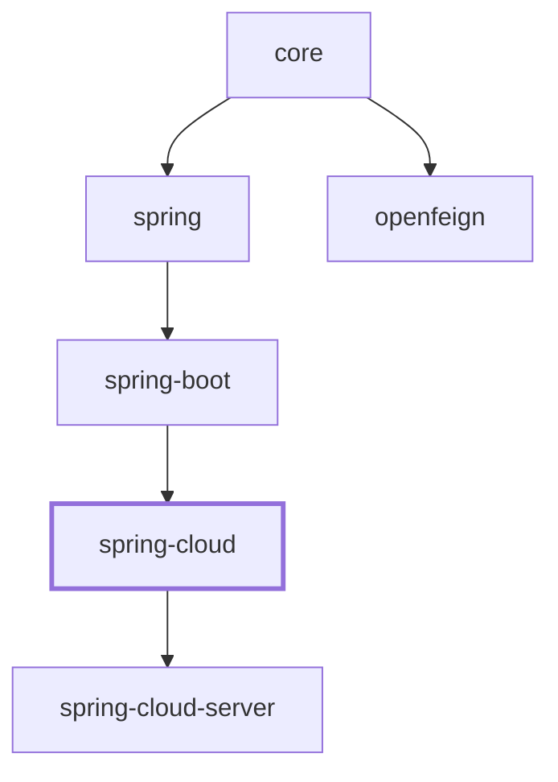

# Spring Cloud Integration (1.x)

> Applies to the `0.1.x` version line (the `release-1.x` / `1.x` branch), the line that targets Spring Boot 2.x
> and the javax.* namespace. For the Spring Boot 3 / `0.2.x` line see [../current/spring-cloud.md](../current/spring-cloud.md).

## Overview

`microsphere-i18n-spring-cloud` connects the i18n framework to Spring Cloud so that internationalized
messages are reloaded at runtime whenever the Spring Cloud `Environment` changes. When a configuration
refresh happens (for example `POST /actuator/refresh`, a Spring Cloud Config update, or a manual
`EnvironmentChangeEvent` publication), the framework re-reads the affected message resources from the
current `Environment` without restarting the application.

The module is intentionally small. It contributes a single auto-configuration class,
`I18nCloudAutoConfiguration`, which registers one bean:

- `ReloadableResourceServiceMessageSourceListener` - an `ApplicationListener<EnvironmentChangeEvent>`
  that triggers the reload of the message sources that are backed by Spring `PropertySources`.

It sits above `microsphere-i18n-spring-boot` and inherits everything that module already wires up
(the `DelegatingServiceMessageSource`, the per-source `PropertySourcesServiceMessageSource` beans and
the `I18nEndpoint` actuator endpoint). See the dependency chain:

```
spring-cloud -> spring-boot -> spring -> core
```

## Maven Coordinates

```xml
<dependency>
    <groupId>io.github.microsphere-projects</groupId>
    <artifactId>microsphere-i18n-spring-cloud</artifactId>
    <version>0.1.21</version>
</dependency>
```

If you manage the version through the project BOM, import `microsphere-i18n-dependencies` (whose
parent is `microsphere-i18n-parent`) and drop the `<version>` element:

```xml
<dependencyManagement>
    <dependencies>
        <dependency>
            <groupId>io.github.microsphere-projects</groupId>
            <artifactId>microsphere-i18n-dependencies</artifactId>
            <version>0.1.21</version>
            <type>pom</type>
            <scope>import</scope>
        </dependency>
    </dependencies>
</dependencyManagement>
```

`spring-cloud-context` (which provides `EnvironmentChangeEvent`) and `spring-cloud-commons` are
declared as optional in the module POM, so you bring them through your own Spring Cloud BOM. Without
`spring-cloud-context` on the classpath the auto-configuration silently backs off.

## Version & Compatibility

| Component                | Value                                                              |
|--------------------------|--------------------------------------------------------------------|
| microsphere-i18n line    | `0.1.x` (latest release `0.1.21`, in-development `0.1.22-SNAPSHOT`)|
| groupId                  | `io.github.microsphere-projects`                                   |
| Java                     | No `java.version` override in this line; the CI matrix builds Java 8, 11, 17, 21 and 25 |
| Namespace                | `javax.*` (e.g. `javax.servlet-api`)                               |
| Spring Boot              | 2.3 - 2.7 generation (parent profiles pin 2.3.12.RELEASE / 2.4.13 / 2.6.15) |
| Spring Cloud             | Hoxton.SR12 - 2021.0.9                                             |
| Requires                 | `spring-cloud-context` (for `EnvironmentChangeEvent`) on classpath |
| Auto-configuration       | `META-INF/spring.factories` under the `EnableAutoConfiguration` key |

The module registers its auto-configuration the Spring Boot 2.x way, through
`META-INF/spring.factories`:

```properties
org.springframework.boot.autoconfigure.EnableAutoConfiguration=\
io.microsphere.i18n.spring.cloud.autoconfigure.I18nCloudAutoConfiguration
```

The same jar also carries the newer `META-INF/spring/org.springframework.boot.autoconfigure.AutoConfiguration.imports`
file with the identical entry, so Spring Boot 2.7 and later can pick the auto-configuration up from there as well.

## Dynamic Reload Behavior

The whole module reacts to one event: Spring Cloud's
`org.springframework.cloud.context.environment.EnvironmentChangeEvent`.

`ReloadableResourceServiceMessageSourceListener` implements
`ApplicationListener<EnvironmentChangeEvent>` and `BeanFactoryAware`. It keeps a reference to the
`BeanFactory` and, when an `EnvironmentChangeEvent` arrives, hands the changed property keys straight
to `PropertySourcesServiceMessageSource.reloadAll(beanFactory, event.getKeys())`.

```java
@Override
public void onApplicationEvent(EnvironmentChangeEvent event) {
    Set<String> changedPropertyNames = event.getKeys();
    reloadAll(this.beanFactory, changedPropertyNames);
}
```

### Which message sources get reloaded

`reloadAll` does not touch every bean in the context. It walks the message-source graph that hangs off
the primary `serviceMessageSource` bean (`DelegatingServiceMessageSource`, a composite) and keeps only
the `PropertySourcesServiceMessageSource` instances - the message sources whose content is read from
Spring `PropertySources` and therefore can change at runtime. Concretely:

1. All `PropertySourcesServiceMessageSource` beans reachable from the primary
   `ServiceMessageSource` are collected
   (`findAllPropertySourcesServiceMessageSources(beanFactory)`).
2. For each source, its resources are inspected. A resource identifier is also the Spring property
   name it is read from, formatted as `<source>.<locale-resource-file>` - for example
   `common.i18n_messages_en.properties` (source `common`, file `i18n_messages_en.properties`).
3. A resource is reloaded only when the changed-key set contains that property name
   (`changedPropertyNames.contains(propertyName)`) **and** the `Environment` actually resolves it
   (`canReload(...)` checks `environment.containsProperty(...)`).
4. Surviving resources are re-initialized: the source re-reads the property value (which holds the
   `.properties` file content as a string) and re-parses it.

Plain classpath-only sources are left untouched by this path - only `Environment`-backed
`PropertySourcesServiceMessageSource` beans participate.

### Config properties read from code

The listener itself reads no configuration property; it only reacts to the event. The properties that
control the module are those the auto-configuration conditions and the surrounding infrastructure
consult:

| Property                               | Read by                                        | Effect |
|----------------------------------------|------------------------------------------------|--------|
| `microsphere.i18n.enabled`             | `@ConditionalOnI18nAvailable` (`@ConditionalOnProperty`, `matchIfMissing = true`) | Set to `false` to disable the auto-configuration entirely. Default `true`. |
| `io.microsphere.i18n.ServiceMessageSource`, `io.microsphere.i18n.spring.annotation.EnableI18n` | `@ConditionalOnI18nAvailable` class check | Auto-configuration backs off if `core`/`spring` classes are absent. |
| `org.springframework.cloud.context.environment.EnvironmentChangeEvent` | `@ConditionalOnClass` on `I18nCloudAutoConfiguration` | Auto-configuration backs off without `spring-cloud-context`. |
| `common.i18n_messages_en.properties` (and any `<source>.<locale-resource-file>`) | `PropertySourcesServiceMessageSource.reloadAll` | A changed key of this shape is what actually triggers a reload of that resource. |

The changed keys come from whatever Spring Cloud refresh mechanism you use, so in a Config-server
setup the reload is driven by the property names you publish there.

### Full Working Example

The following example mirrors `MessageSourceIntegrationTest` and the `I18nBootstrap` demo, using the
test resource `i18n-bootstrap.properties`.

Message resource on the classpath (`META-INF/i18n/common/i18n_messages_en.properties`):

```properties
common.a = a
```

Bootstrap properties (`i18n-bootstrap.properties`), which enable the management endpoints and the
environment-write endpoint that publishes `EnvironmentChangeEvent`:

```properties
spring.application.name=i18n-bootstrap
management.endpoint.i18n.enabled=true
management.endpoints.web.exposure.include=*
management.endpoint.env.post.enabled=true
```

Bootstrap application:

```java
@EnableAutoConfiguration
@PropertySource(value = "classpath:/i18n-bootstrap.properties")
public class I18nBootstrap {
    public static void main(String[] args) {
        new SpringApplicationBuilder(I18nBootstrap.class)
                .web(SERVLET)
                // Seed the override that turns common.a into "common-a-2024"
                .properties("common.i18n_messages_en.properties=common.a = common-a-2024")
                .run(args);
    }
}
```

At runtime, injecting a new value for the property `common.i18n_messages_en.properties` and publishing
an `EnvironmentChangeEvent` for that key swaps the message live. This is exactly what the integration
test asserts:

```java
ServiceMessageSource serviceMessageSource =
        applicationContext.getBean("commonServiceMessageSource", ServiceMessageSource.class);

assertThat(serviceMessageSource.getMessage("common.a", ENGLISH)).isEqualTo("a");

// Put a new PropertySource that overrides common.i18n_messages_en.properties
environment.getPropertySources().addLast(
        new MapPropertySource("test", Maps.newHashMap(
                "common.i18n_messages_en.properties", "common.a=a.2024")));

// Fire the Spring Cloud event the listener is subscribed to
applicationContext.publishEvent(
        new EnvironmentChangeEvent(ofSet("common.i18n_messages_en.properties")));

// The message source was reloaded from the Environment
assertThat(serviceMessageSource.getMessage("common.a", ENGLISH)).isEqualTo("a.2024");
```

The same effect is reachable over HTTP: `POST /actuator/env` with the resource property name and new
content publishes an `EnvironmentChangeEvent`, after which `GET /actuator/i18n` reflects the updated
messages - no restart required.

## Differences from the 0.2.x line

The Java sources of this module are byte-for-byte identical on the `0.2.x` and `1.x` lines: the behavior,
the bean it registers, its condition stack and the reload semantics described above are the same. The
differences are all packaging and runtime-target differences.

| Topic | `1.x` (`0.1.x`) | `0.2.x` (`current`) |
|-------|-----------------|---------------------|
| Version line | `0.1.x`, latest release `0.1.21` | `0.2.x`, latest release `0.2.21` |
| Spring Boot / Cloud | Boot 2.3 - 2.7, Cloud Hoxton.SR12 - 2021.0.9 | Boot 3.x, Cloud 2022.0.x - 2025.0.x |
| Namespace | `javax.*`; the POM depends on `javax.servlet:javax.servlet-api` | `jakarta.*`; the POM depends on `jakarta.servlet:jakarta.servlet-api` |
| Auto-configuration registration | `META-INF/spring.factories` with the `org.springframework.boot.autoconfigure.EnableAutoConfiguration` key (the imports file is shipped too, for Boot 2.7+) | `META-INF/spring/org.springframework.boot.autoconfigure.AutoConfiguration.imports` only |
| Java baseline | no `java.version` override in the reactor; the parent chain and the CI matrix (Java 8/11/17/21/25) decide | the 0.2.x line targets Java 17 |
| Parent chain | root POM inherits `microsphere-spring-cloud-parent` `0.1.26`, whose `spring-cloud-hoxton` / `spring-cloud-2020` / `spring-cloud-2021` profiles pin the Boot and Cloud BOMs (`2021` is the default, i.e. Boot 2.6.15) | the 0.2.x parent chain pins the Boot 3 / Cloud 2022+ generations |

Practical notes for this line:

- Nothing in the module uses `jakarta.*`, so no source-level migration is needed when you move a Spring
  Boot 2.x application onto it.
- `POST /actuator/env` is what the demo uses to publish the event. On Boot 2.x generations that do not
  know `management.endpoint.env.post.enabled`, that property is simply ignored and the write operation
  stays enabled; if you disable the env write endpoint, publish the change with
  `ApplicationContext.publishEvent(new EnvironmentChangeEvent(ofSet(...)))` as the integration test does.
- If you drive the reload from a Spring Cloud Config server on Boot 2.4+, remember that the bootstrap
  context needs `spring-cloud-starter-bootstrap` or `spring.cloud.bootstrap.enabled=true` in that
  generation - this is a Spring Cloud requirement, not a behavior of this module.

## Module dependencies

Depends on `spring-boot` (→ `spring` → `core`); `spring-cloud-server` builds on it.


