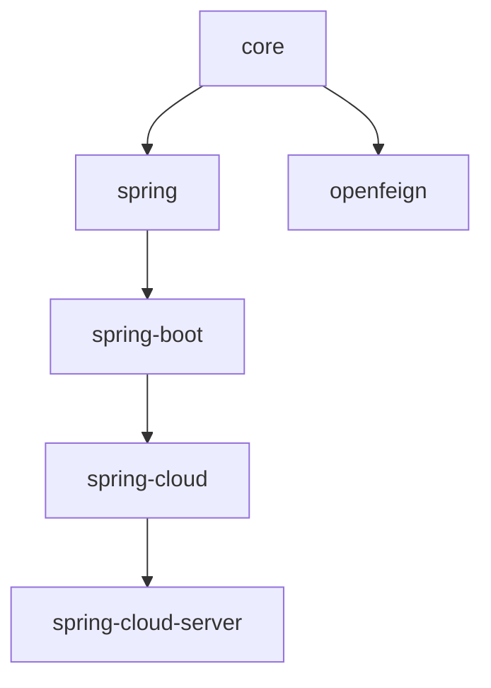

# 用户文档 — 1.x 发布线（0.1.x，release-1.x 分支）

0.1.x 维护线（`release-1.x` 分支，开发版本 `0.1.22-SNAPSHOT`，最新发布 `0.1.21`）的用户文档。

- [English](../README.md) · [当前线（0.2.x）](../../current/zh/README.md) · [用户文档总入口](../zh/README.md)

## 兼容性

| **项目** | **要求** |
|----------|----------|
| Java | 8+（基线继承自 0.1.x 父 POM 链） |
| Spring Framework | 5.x |
| Spring Boot | 2.3.x – 2.7.x（profile 固定 2.3.12 / 2.4.13 / 2.6.15） |
| Spring Cloud | Hoxton.SR12 – 2021.0.9 |
| 命名空间 | `javax.*` |
| BOM | `microsphere-i18n-dependencies:0.1.21` |

## 模块文档

| **模块** | **英文** | **中文** |
|----------|----------|----------|
| microsphere-i18n-dependencies（BOM） | [dependencies.md](../dependencies.md) | [dependencies.md](./dependencies.md) |
| microsphere-i18n-parent | [parent.md](../parent.md) | [parent.md](./parent.md) |
| microsphere-i18n-core | [core.md](../core.md) | [core.md](./core.md) |
| microsphere-i18n-spring | [spring.md](../spring.md) | [spring.md](./spring.md) |
| microsphere-i18n-spring-boot | [spring-boot.md](../spring-boot.md) | [spring-boot.md](./spring-boot.md) |
| microsphere-i18n-spring-cloud | [spring-cloud.md](../spring-cloud.md) | [spring-cloud.md](./spring-cloud.md) |
| microsphere-i18n-spring-cloud-server | [spring-cloud-server.md](../spring-cloud-server.md) | [spring-cloud-server.md](./spring-cloud-server.md) |
| microsphere-i18n-openfeign | [openfeign.md](../openfeign.md) | [openfeign.md](./openfeign.md) |

## 模块依赖关系

1.x 线与 0.2.x 线共享架构与 API，主要差异是 `javax.*` 命名空间以及通过
`META-INF/spring.factories` 注册自动装配。每份文档均包含"与 0.2.x 分支的差异"章节。
