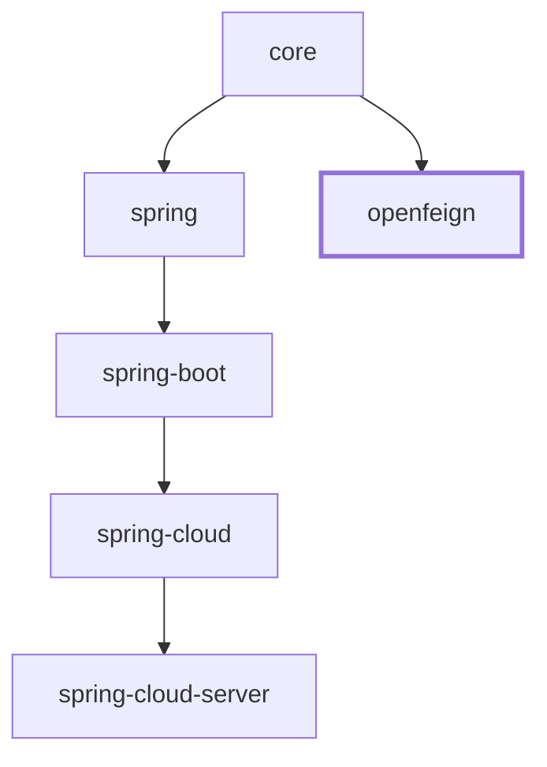

# OpenFeign 集成（`microsphere-i18n-openfeign`，1.x 版本线）

`microsphere-i18n-openfeign` 模块在 OpenFeign 的服务间调用中传递调用方的语言偏好，使得下游微服务
能够使用终端用户在入口服务上请求的同一语言环境（Locale）来解析消息。

> 本文是 `1.x` 版本线（`0.1.x` 构件、`javax.*` 命名空间、Spring Boot 2.x / Spring Cloud
> Hoxton–2021.0.x）的文档。基于 Spring Boot 3.x / `jakarta.*` 的应用请改读
> [当前（0.2.x）OpenFeign 用户指南](../../current/zh/openfeign.md)。

## 概述

在微服务拓扑中，浏览器或移动端只会向第一个服务发送 `Accept-Language` 请求头。此后的每一跳都是
Feign 客户端重新构造的 HTTP 请求，而 Feign 默认不会复制请求头。如果没有额外处理，下游服务收不到
`Accept-Language`，只能退回到自身默认的语言环境。

本模块只提供一个类：`io.microsphere.i18n.feign.AcceptLanguageHeaderRequestInterceptor`，它实现了
Feign 的 `feign.RequestInterceptor` SPI。对于每一个出站 Feign 请求，它会查看当前线程正在处理的
HTTP 请求，并把该请求的 `Accept-Language` 头原样复制到 Feign 的 `RequestTemplate` 上。在本分支上，
它所读取的请求类型是 `javax.servlet.http.HttpServletRequest`。

该模块刻意保持极小且被动：

- 它依赖 `microsphere-i18n-core`，但并不调用 `ServiceMessageSource`；
- 它不解析、不协商、不过滤语言环境，只转发原始请求头；
- 语言环境协商仍然发生在**接收方**服务，由 Spring MVC 的 `AcceptHeaderLocaleResolver` 完成
  （Spring 集成模块会用 i18n 的默认语言环境和受支持语言环境重新配置它，参见 [Spring](spring.md)）。

```
客户端（Accept-Language: zh_CN）
   |
   v
服务 A  -- Feign 调用 -->  服务 B
   AcceptLanguageHeaderRequestInterceptor 在当前请求线程上复制该头     服务 B 使用 zh_CN 解析消息
```

## Maven 坐标

```xml

<dependency>
    <groupId>io.github.microsphere-projects</groupId>
    <artifactId>microsphere-i18n-openfeign</artifactId>
</dependency>
```

如果已导入 `microsphere-i18n-dependencies` BOM（本版本线为 `0.1.21`），则无需书写 `<version>`；
参见 [Dependencies BOM](dependencies.md)。

该模块只把 `microsphere-i18n-core` 声明为必需依赖。`feign-core`、`spring-webmvc` 与
`javax.servlet:javax.servlet-api` 都被声明为**可选（optional）**，它们只用于编译本模块，不会传递
导出给使用方：你的应用必须自己提供它们。Boot 2.x 上典型的 Spring Cloud Web 应用本来就有，分别来自
`spring-cloud-starter-openfeign` 与 `spring-boot-starter-web`（后者通过 Tomcat 带入 Servlet 4.x 的
`javax.*` API）。

## 版本与兼容性

| 项目                  | 取值                                                                        |
|-----------------------|------------------------------------------------------------------------------|
| 构件                  | `io.github.microsphere-projects:microsphere-i18n-openfeign`                 |
| 版本线                | `0.1.x`（最新已发布 `0.1.21`；`release-1.x` 分支工作版本 `0.1.22-SNAPSHOT`） |
| 最低 Java 版本        | 8（源码级别继承自 microsphere 父级链）                                       |
| 命名空间              | `javax.*`（不是 `jakarta.*`）                                               |
| Spring Boot           | 2.x —— 代际 profile 固定为 2.3.12.RELEASE / 2.4.13 / 2.6.15                 |
| Spring Cloud          | Hoxton.SR12 – 2021.0.x                                                      |
| 编译期 Feign          | `io.github.openfeign:feign-core`（可选；默认 `spring-cloud-2021` profile 下为 `11.10`） |
| 编译期 Web MVC        | `org.springframework:spring-webmvc`（可选；同一默认构建下为 `5.3.27`）       |
| Servlet API           | `javax.servlet:javax.servlet-api`（可选；同一默认构建下为 `4.0.1`）          |
| 类的 `@since`         | `1.0.0`                                                                     |

上述三方库的精确版本来自构建时所选的 Spring Cloud 代际 profile，而不是本模块 POM 中的硬编码：
`spring-cloud-hoxton`（Boot 2.3.12.RELEASE / Hoxton.SR12）、`spring-cloud-2020`（Boot 2.4.13 /
2020.0.5）与 `spring-cloud-2021`（Boot 2.6.15 / 2021.0.9，默认激活）。在 Hoxton 代际下 Feign 是
10.x 系列；本模块的代码对两者都能编译。代际与版本的对应关系见 [Parent POM](parent.md)。

基于 Spring Boot 3.x / Spring Cloud 2022.0.x 及更高版本（`jakarta.*` 命名空间）的应用，请使用
`current`（0.2.x）文档集。

## API：`AcceptLanguageHeaderRequestInterceptor`

| 元素                           | 说明                                                                                     |
|--------------------------------|-------------------------------------------------------------------------------------------|
| 类                             | `io.microsphere.i18n.feign.AcceptLanguageHeaderRequestInterceptor`                       |
| 实现接口                       | `feign.RequestInterceptor`                                                                |
| `HEADER_NAME`                  | `public static final String`，值为 `Accept-Language`（来自 `org.springframework.http.HttpHeaders.ACCEPT_LANGUAGE`） |
| `apply(RequestTemplate)`        | 唯一的行为方法：把入站请求的 `Accept-Language` 头复制到模板上                            |
| 构造器                          | 仅有一个公共无参构造器                                                                     |

### `Accept-Language` 取值来自哪里

`apply(RequestTemplate)` 解析该请求头依据的是**当前 HTTP 请求**，而**不是** `LocaleContextHolder`：

1. 读取当前线程上的 `RequestContextHolder.getRequestAttributes()`。
2. 若结果不是 `ServletRequestAttributes`——线程没有绑定请求、非 Servlet 上下文、或后台线程——拦截器
   输出一条 TRACE 日志并直接返回，不修改模板。
3. 否则通过 `ServletRequestAttributes.getRequest()` 取得 `javax.servlet.http.HttpServletRequest`，
   再调用 `request.getHeader("Accept-Language")`。
4. 若值有文本（`StringUtils.hasText`），则用 `template.header("Accept-Language", value)` 写入模板。
5. 若值为 `null` 或空白，则什么都不写入，并输出 TRACE 日志说明请求方没有传递该头。

关键结论：

- **不会回退到 JVM 默认语言环境、`LocaleContextHolder` 或 `ServiceMessageSource.getLocale()`。**
  如果入站请求没有携带 `Accept-Language`，出站 Feign 请求同样不会携带，由下游服务使用其自身默认值。
- 头值是**原样转发**的，包含权重表达式，例如 `zh-CN,zh;q=0.9,en;q=0.8` 会被整体传递；协商交由下游的
  `AcceptHeaderLocaleResolver` 完成。
- 在非 Servlet 请求线程（定时任务、消息监听器等无法继承请求属性的场景）发起的调用不会被增强。

## 注册拦截器

本模块没有 `META-INF/spring.factories`，也没有 `AutoConfiguration.imports` 条目——它根本不存在
`src/main/resources` 目录——并且本分支上的 Spring Boot / Spring Cloud 自动配置类均未引用该类。
必须自行声明 Bean：

```java

@Configuration
public class I18nFeignConfig {

    @Bean
    public AcceptLanguageHeaderRequestInterceptor acceptLanguageHeaderRequestInterceptor() {
        return new AcceptLanguageHeaderRequestInterceptor();
    }
}
```

位于根应用上下文中的 `RequestInterceptor` Bean 会作用于所有 Feign 客户端。若只想作用于单个客户端，
可在 `@FeignClient` 上通过 `configuration` 引用该配置类：

```java

@FeignClient(name = "user-service", configuration = I18nFeignConfig.class)
public interface UserClient {

    @GetMapping("/users/{id}")
    User getUser(@PathVariable("id") Long id);
}
```

当配置类被用作某个客户端专属的 `configuration` 时，请把它放在组件扫描范围之外，否则它会同时变成全局
配置。

本模块的单元测试展示了同样的注册方式，以及拦截器所依赖的线程绑定
（`microsphere-i18n-openfeign/src/test/java/io/microsphere/i18n/feign/AcceptLanguageHeaderRequestInterceptorTest.java`）：

```java

@SpringLoggingTest
class AcceptLanguageHeaderRequestInterceptorTest {

    private AcceptLanguageHeaderRequestInterceptor requestInterceptor;
    private RequestTemplate requestTemplate;
    private MockHttpServletRequest request;

    @BeforeEach
    void before() {
        this.request = new MockHttpServletRequest();
        this.requestInterceptor = new AcceptLanguageHeaderRequestInterceptor();
        this.requestTemplate = new RequestTemplate();
        // 把模拟请求绑定到当前线程
        setRequestAttributes(new ServletRequestAttributes(request));
    }

    @AfterEach
    void after() {
        resetRequestAttributes();
    }

    @Test
    void testApply() {
        this.request.addHeader(HEADER_NAME, "en");
        requestInterceptor.apply(requestTemplate);
        assertEquals(ofList("en"), requestTemplate.headers().get("Accept-Language"));
    }
}
```

`MockHttpServletRequest` 与 `ServletRequestAttributes` 来自本版本线的 `spring-test` / `spring-web`
5.3.x，`ofList` 则是 `io.microsphere.collection.Lists.ofList` —— 在本分支上测试同样按 Java 8 语言
级别编写。

## 端到端用法

与 Spring Boot 集成配合使用的典型 Spring Cloud 场景：

`pom.xml`：

```xml

<dependencyManagement>
    <dependencies>
        <dependency>
            <groupId>io.github.microsphere-projects</groupId>
            <artifactId>microsphere-i18n-dependencies</artifactId>
            <version>${microsphere-i18n.version}</version>
            <type>pom</type>
            <scope>import</scope>
        </dependency>
    </dependencies>
</dependencyManagement>

<dependencies>
    <dependency>
        <groupId>io.github.microsphere-projects</groupId>
        <artifactId>microsphere-i18n-spring-boot</artifactId>
    </dependency>
    <dependency>
        <groupId>io.github.microsphere-projects</groupId>
        <artifactId>microsphere-i18n-openfeign</artifactId>
    </dependency>
</dependencies>
```

入口服务（`order-service`）：

```java

@Configuration
public class I18nFeignConfig {

    @Bean
    public AcceptLanguageHeaderRequestInterceptor acceptLanguageHeaderRequestInterceptor() {
        return new AcceptLanguageHeaderRequestInterceptor();
    }
}

@FeignClient(name = "user-service")
public interface UserClient {

    @GetMapping("/users/profile")
    Profile profile();
}

@RestController
public class OrderController {

    private final UserClient userClient;
    private final ServiceMessageSource messageSource;

    public OrderController(UserClient userClient, ServiceMessageSource messageSource) {
        this.userClient = userClient;
        this.messageSource = messageSource;
    }

    @GetMapping("/orders/summary")
    public String summary() {
        // 使用调用方语言环境解析本地消息
        String title = messageSource.getMessage("order.summary.title");
        // 下游调用会携带同样的 Accept-Language 头
        Profile profile = userClient.profile();
        return title + " - " + profile.greeting();
    }
}
```

下游服务（`user-service`）无需任何额外代码：它的 `AcceptHeaderLocaleResolver` 读取被传递过来的请求头，
Spring 把解析出的语言环境写入 `LocaleContextHolder`，`ServiceMessageSource.getMessage(code, args)`
随即使用它。

消息文件，遵循框架约定：

```
src/main/resources/META-INF/i18n/order-service/
├── i18n_messages_en.properties      # order.summary.title=Order summary
└── i18n_messages_zh_CN.properties   # order.summary.title=订单摘要
```

## 验证行为

除非开启 TRACE，拦截器不会输出任何日志：

```properties
logging.level.io.microsphere.i18n.feign.AcceptLanguageHeaderRequestInterceptor=TRACE
```

你会看到以下三者之一：

- `Feign has set HTTP request header [name : 'Accept-Language' , value : 'zh_CN']`
- `Feign could not set HTTP request header [name : 'Accept-Language'] because the requester did not
  pass: 'null'`
- `Feign calls in non-Spring WebMVC scenarios, ignoring setting request headers:
  'Accept-Language'`

若要确认网络上的请求头，可通过 Feign 的 `Logger.Level`（`FULL`），或使用本代际下 Spring Cloud
OpenFeign 的日志配置（`feign.client.config.default.loggerLevel=FULL`）查看实际请求。

## 说明与限制

- 只传递 `Accept-Language`，其他与语言环境相关的请求头不受影响。
- 在 `0.1.x` 版本线上，同样没有任何 microsphere 自动配置会注册该拦截器，必须像上文那样声明 `@Bean`。
- 由于取值来自线程绑定的 `RequestContextHolder`，在其他线程（例如 `@Async` 方法或响应式链路）中发起的
  Feign 调用需要显式传递上下文，例如使用 `RequestContextHolder.setRequestAttributes(attributes, true)`
  启用可继承的线程局部变量，或在调用时通过 `@RequestHeader` 单独设置该头。
- 在 Spring Cloud OpenFeign 2.x 下，定义于主上下文中的 `RequestInterceptor` Bean 会作用于所有客户端，
  除非把配置按客户端隔离。
- 若有多个拦截器写同一个头，最终结果由 Feign `RequestTemplate` 的语义决定；建议每个请求只保留一个
  `Accept-Language` 写入者，以保证行为可预期。
- 该 jar 只支持 `javax.*`。把它部署到 Servlet 5/6 容器（Boot 3、使用 `jakarta.servlet` 的
  Undertow/Jetty）会抛出 `NoClassDefFoundError: javax/servlet/http/HttpServletRequest`；
  那种环境请使用 0.2.x 版本线。

## 与 0.2.x 版本线的差异

两个分支上的生产类是同一份代码，只差一个 import：

```java
// release-1.x（0.1.x）                          // release（0.2.x）
import javax.servlet.http.HttpServletRequest;   import jakarta.servlet.http.HttpServletRequest;
```

其余一切 —— `apply(RequestTemplate)`、仅 TRACE 的日志、`HEADER_NAME` 常量、构造器集合 —— 完全一致，
单元测试也完全一致。

| 关注点 | 1.x（本文档） | 0.2.x |
|--------|----------------|-------|
| 版本线 | `0.1.x`（已发布 `0.1.21`，工作版本 `0.1.22-SNAPSHOT`） | `0.2.x`（`0.2.21` / `0.2.22-SNAPSHOT`） |
| Java 基线 | 8 | 17 |
| 模块 POM 中的 Servlet 坐标 | `javax.servlet:javax.servlet-api`（optional） | `jakarta.servlet:jakarta.servlet-api`（optional） |
| 面向的 Servlet 容器代际 | Servlet 4.x（`javax.*`）、Tomcat 9 | Servlet 6.0（`jakarta.*`）、Tomcat 10+ |
| Spring Boot / Spring Cloud | 2.3–2.7 / Hoxton.SR12–2021.0.x | 3.x / 2022.0.x–2025.0.x |
| 典型编译期 Feign | 10.x（Hoxton）或 11.x（2020/2021） | 12.x/13.x |
| 同级模块的自动配置机制 | `META-INF/spring.factories`（`EnableAutoConfiguration`）—— Spring Boot 2.x 风格 | `META-INF/spring/org.springframework.boot.autoconfigure.AutoConfiguration.imports` |
| 本拦截器的注册方式 | 手工 `@Bean`（模块不提供任何资源文件） | 手工 `@Bean`（相同） |

迁移说明：

- 把应用从 `0.1.x` 迁到 `0.2.x`（或反向）是一个命名空间层面的决定，而不是 API 变更：类名、包名与行为
  都相同，因此需要改动的只有依赖版本，以及测试中随容器命名空间而变的 `MockHttpServletRequest` 等相关
  import。
- 在本版本线上，为该拦截器添加 `@ConditionalOnClass` 之类的守卫没有意义，因为模块根本不发布任何自动
  配置；既无开关可开，也无开关可关。

## 相关文档

- [Core](core.md) —— `ServiceMessageSource` 与语言环境解析
- [Spring](spring.md) —— `AcceptHeaderLocaleResolver` 的定制
- [Spring Boot](spring-boot.md) —— 自动配置（本版本线通过 `spring.factories` 注册）
- [Parent POM](parent.md)、[Dependencies BOM](dependencies.md)
- 开发者指南：[OpenFeign 模块](../../../developer-guide/1.x/zh/openfeign.md)
- 0.2.x 对照：[当前 OpenFeign 用户指南](../../current/zh/openfeign.md)

## 模块依赖关系

仅依赖 `core`，与 Spring 链无关。


