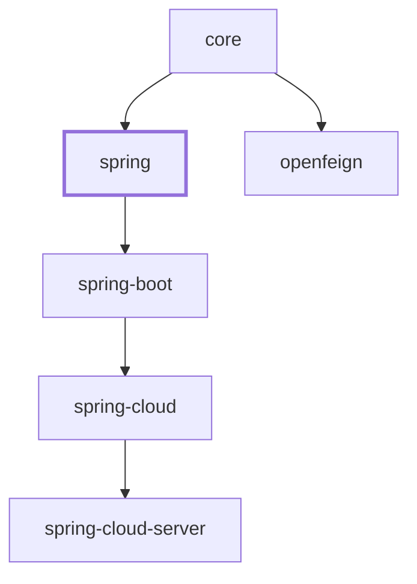

# Spring 集成（1.x / `0.1.x` 版本线）

`microsphere-i18n-spring` 是 Microsphere 国际化框架的纯 Spring Framework 集成模块。它把
`microsphere-i18n-core` 中与框架无关的 `ServiceMessageSource` 抽象绑定到 Spring 容器：将消息源注册为
Spring Bean，把它们作为标准 `org.springframework.context.MessageSource` 对外暴露，从 Spring
`LocaleContextHolder` 解析区域设置，并在 Spring `Environment` 发生变化时重新加载消息。

本文描述的是 **`0.1.x` 版本线**（`release-1.x` 分支），即运行在 Spring Framework 5 / Spring Boot 2.x
与 `javax.*` 命名空间上的那一条线。`0.2.x` 版本线（Spring Framework 6、`jakarta.*`）的文档位于本指南的
*current* 章节。

> 范围说明。本文只覆盖 `microsphere-i18n-spring` 模块中的 `io.microsphere.i18n.spring.*` 包。
> `ServiceMessageSource` 契约本身属于 `microsphere-i18n-core`。Boot 专属的自动配置位于
> `microsphere-i18n-spring-boot`，配置中心集成位于 `microsphere-i18n-spring-cloud`。

## 概述

整个模块由一个注解驱动：`@EnableI18n`，可以标注在任意 `@Configuration` 类上（或作为元注解）。一个注解即
可安装完整的 i18n 技术栈：

- **每个声明的 source** 注册一个 `ServiceMessageSourceFactoryBean` Bean，该 Bean 会组合所有通过
  `META-INF/spring.factories` 发现的 `AbstractServiceMessageSource` 实现。
- 一个名为 `serviceMessageSource` 的主（Primary）`DelegatingServiceMessageSource` Bean，聚合容器中所有
  `ServiceMessageSource` Bean。
- 可选地，以众所周知的 `messageSource` Bean 名称注册 `MessageSourceAdapter`，从而让原生 Spring 基础设施
  （校验消息、`MessageSourceResolvable`、模板渲染）通过 Microsphere 消息源解析文案。
- 一个 `I18nApplicationListener`：容器刷新时通过 `I18nUtils` 把主消息源发布为全局静态实例，容器关闭时销毁
  它，并在 Spring `Environment` 报告属性变化时重新加载消息。
- 一个 `ServiceMessageSourceBeanLifecyclePostProcessor`，为用户自行声明的 `ServiceMessageSource` Bean 自动
  装配 `init()` / `destroy()` 生命周期回调。
- 两个可选的 `BeanPostProcessor`：把 i18n 技术栈接入 Bean Validation
  （`I18nLocalValidatorFactoryBeanPostProcessor`）以及 Spring MVC 的区域设置解析
  （`AcceptHeaderLocaleResolverBeanPostProcessor`）。二者只有在对应类存在于 classpath 上时才会被注册。
  在本版本线上，Bean Validation 的守卫条件查找的是 `javax.validation.ValidatorFactory`。

框架内置两种消息源实现：

| 实现                                        | 消息来源                                                                       |
|---------------------------------------------|----------------------------------------------------------------------------------|
| `io.microsphere.i18n.DefaultServiceMessageSource`（core 模块） | classpath 资源 `META-INF/i18n/{source}/i18n_messages_{locale}.properties`          |
| `io.microsphere.i18n.spring.PropertySourcesServiceMessageSource` | Spring `Environment` 属性，其**值就是整个 `.properties` 文件内容**                    |

## Maven 坐标

groupId 为 `io.github.microsphere-projects`，artifactId 为 `microsphere-i18n-spring`。

```xml
<dependency>
    <groupId>io.github.microsphere-projects</groupId>
    <artifactId>microsphere-i18n-spring</artifactId>
    <version>0.1.21</version>
</dependency>
```

如果你同时使用多个 Microsphere i18n 构件，请导入项目 BOM，而不必逐个锁定版本：

```xml
<dependencyManagement>
    <dependencies>
        <dependency>
            <groupId>io.github.microsphere-projects</groupId>
            <artifactId>microsphere-i18n-dependencies</artifactId>
            <version>0.1.21</version>
            <type>pom</type>
            <scope>import</scope>
        </dependency>
    </dependencies>
</dependencyManagement>

<dependencies>
    <dependency>
        <groupId>io.github.microsphere-projects</groupId>
        <artifactId>microsphere-i18n-spring</artifactId>
    </dependency>
</dependencies>
```

本模块对 `microsphere-i18n-core` 是硬编译依赖；其余协作者在 POM 中均声明为 `optional`：

| optional 构件                             | `0.1.x` 线上观察到的版本 | 使用以下能力时需要                                                  |
|-------------------------------------------|----------------------------|--------------------------------------------------------------------------|
| `microsphere-spring-context`              | `0.1.39`                   | 运行期始终需要 —— `@EnableI18n` 基于其注册器工具类构建                    |
| `spring-webmvc`                           | `5.3.27`（默认构建 profile） | `AcceptHeaderLocaleResolverBeanPostProcessor`                             |
| `javax.validation:validation-api`         | `2.0.1.Final`              | `I18nLocalValidatorFactoryBeanPostProcessor`                              |
| `javax.servlet:javax.servlet-api`         | `4.0.1`                    | 基于 Servlet 的 Web 应用                                                   |
| `microsphere-annotation-processor`        | `0.3.19`                   | 仅构建期 —— 生成 `META-INF/microsphere/configuration-properties.json`       |

由于 `microsphere-spring-context` 被标记为 optional，请确保它在运行期存在（Boot 与 Cloud 模块会传递引入）；
缺少它时 `I18nImportBeanDefinitionRegistrar` 的父类无法加载。

## 版本与兼容性

| 关注点            | 取值                                                                              |
|-------------------|--------------------------------------------------------------------------------------|
| 版本线            | `0.1.x`（最新发布版本 `0.1.21`；开发中为 `0.1.22-SNAPSHOT`）                          |
| Java 基线         | Java 8 —— 继承自 `0.1.x` 父级链；本项目**没有**定义 `java.version` 覆盖值              |
| 包命名空间        | `javax.*`（不存在 `jakarta.*`）                                                     |
| Spring Framework  | 5.x（随激活的构建 profile 不同，取 `5.2.15.RELEASE` – `5.3.27`）                     |
| 容器模型          | **纯 Spring Framework** —— 本模块并非 Boot 专属；只需要 `@EnableI18n` 加一个 `Environment` |
| Spring Boot       | `2.3` – `2.7` 世代，通过下游 `microsphere-i18n-spring-boot` 模块                       |
| Spring Cloud      | `Hoxton.SR12` – `2021.0.9`，通过 `microsphere-i18n-spring-cloud`                      |
| 父 POM            | `microsphere-i18n-parent`（导入 `microsphere-spring-cloud-dependencies` `0.1.26`）    |
| BOM               | `microsphere-i18n-dependencies`                                                     |
| Maven 依赖链      | `spring` → `core`；`spring-boot` → `spring`；`spring-cloud` → `spring-boot`；`spring-cloud-server` → `spring-cloud`；`openfeign` → `core` |

依赖的具体版本由父级链（`microsphere-spring-cloud-parent` `0.1.26`）中激活的 Maven profile 决定：

| Maven profile                | 默认激活          | Spring Boot      | Spring Cloud   | Spring Framework |
|------------------------------|-------------------|------------------|----------------|------------------|
| `spring-cloud-hoxton`        | 否                | `2.3.12.RELEASE` | `Hoxton.SR12`  | `5.2.15.RELEASE` |
| `spring-cloud-2020`          | 否                | `2.4.13`         | `2020.0.5`     | `5.3.13`         |
| `spring-cloud-2021`          | 是                | `2.6.15`         | `2021.0.9`     | `5.3.27`         |

基于 `jakarta.*`、使用 Spring Framework 6 构建的 `0.2.x` 版本线，其文档位于本指南的 *current* 章节，
本文不涉及。

## 与 0.2.x 版本线的差异

两条线上本模块的公开 API **完全一致**：注解、注解属性、配置属性、Bean 名、事件，以及下文 API 参考中列出的
每一个类都没有变化，所有类型依旧标注 `@since 1.0.0`。差异仅限于它所依托的平台：

| 主题                    | `0.1.x` 版本线（本文）                                                                                              | `0.2.x` 版本线                                                             |
|-------------------------|-----------------------------------------------------------------------------------------------------------------------|------------------------------------------------------------------------------|
| 发布版本                | `0.1.21`（开发中 `0.1.22-SNAPSHOT`）                                                                                   | `0.2.21`（开发中 `0.2.22-SNAPSHOT`）                                          |
| Servlet API             | `javax.servlet:javax.servlet-api` `4.0.1`（Servlet 4.0 / Java EE 8）                                                   | `jakarta.servlet:jakarta.servlet-api` `6.0.0`                                 |
| Validation API          | `javax.validation:validation-api` `2.0.1.Final`（Bean Validation 2.2）                                                 | `jakarta.validation:jakarta.validation-api` `3.0.2`                           |
| 校验守卫类名            | `I18nLocalValidatorFactoryBeanPostProcessor.isValidatorFactoryPresent` 检查 `javax.validation.ValidatorFactory`         | 检查 `jakarta.validation.ValidatorFactory`                                    |
| Spring Framework        | 5.x（默认 `5.3.27`）                                                                                                     | 6.x（构建时基于 `6.2.19`）                                                    |
| Spring Boot / Cloud     | Boot `2.3` – `2.7` / Cloud `Hoxton.SR12` – `2021.0.9`                                                                    | Boot 3.x / Cloud 2022.0.x – 2025.0.x                                          |
| Java 基线               | Java 8，经由 `microsphere-spring-cloud-parent` `0.1.26` 从 `microsphere-build` 继承；本项目未覆盖                        | Java 17                                                                        |
| Microsphere BOM         | `microsphere-spring-cloud-dependencies` `0.1.26`（→ `microsphere-spring-context` `0.1.39`）                              | `microsphere-spring-cloud-dependencies` `0.2.26`（→ `microsphere-spring-context` `0.2.39`） |
| 下游 Boot 模块          | 自动配置同时通过 **`META-INF/spring.factories`** 与 `AutoConfiguration.imports` 注册                                       | 仅通过 `META-INF/spring/org.springframework.boot.autoconfigure.AutoConfiguration.imports` |

对代码示例的实际影响：

- 构造 `ResourceServiceMessageSourceChangedEvent` 的变化资源列表时，请使用
  `Arrays.asList(...)` / `Collections.singletonList(...)`，而不要使用 `List.of(...)`。
- 在你自己的约束 / 校验器代码中导入 `javax.validation.*`，而不是 `jakarta.validation.*`。
- i18n 能力本身（`@EnableI18n`、`microsphere.i18n.*` 属性、消息文件布局、重载事件）行为完全相同，因此
  迁移应用主要是命名空间与所处 Spring 世代的问题。

注意：`release-1.x` 分支根目录下的 `README.md` 仍写着 `0.2.x` 的要求（Java 17、Spring Framework 6、
Spring Boot 3）。请以上文引用的 POM 依赖链为准。

## 快速上手：`@EnableI18n`

### 1. 在配置类上加注解

```java
import io.microsphere.i18n.spring.annotation.EnableI18n;
import org.springframework.context.annotation.Configuration;

@EnableI18n(sources = {"common", "myapp"}, exposeMessageSource = true)
@Configuration
public class I18nConfig {
}
```

`@EnableI18n` 的保留策略为 RUNTIME，作用目标是 `TYPE` 与 `ANNOTATION_TYPE`（因此可作为元注解使用），带有
`@Inherited`，并通过 `@Import` 引入 `I18nImportBeanDefinitionRegistrar`。

### 2. 注解属性

该注解只声明了两个属性，二者都由 `I18nImportBeanDefinitionRegistrar` 通过解析后的注解属性读取：

| 属性                | 类型        | 默认值                                       | 作用                                                                                                                                                    |
|---------------------|-------------|----------------------------------------------|--------------------------------------------------------------------------------------------------------------------------------------------------------------|
| `sources`           | `String[]`  | `{ServiceMessageSource.COMMON_SOURCE}` 即 `{"common"}` | 为每个 source 注册一个 `ServiceMessageSourceFactoryBean` Bean，名称为 `<source>ServiceMessageSource`（例如 `commonServiceMessageSource`、`testServiceMessageSource`）。属性值支持 `${...}` 占位符，会针对 `Environment` 解析。 |
| `exposeMessageSource` | `boolean` | `true`                                       | 以 Spring 常量 `AbstractApplicationContext.MESSAGE_SOURCE_BEAN_NAME`（即 `"messageSource"`）为 Bean 名注册 `MessageSourceAdapter`，使 i18n 消息成为容器的 `MessageSource`。 |

声明的 source 会与 `microsphere.i18n.sources` 属性合并进一个 `LinkedHashSet`，因此**属性值先加入**，重复值被
忽略；每个值都会经过 `environment.resolvePlaceholders(...)`。

随后，所有带 source 的 Bean，加上你自行声明的其他 `ServiceMessageSource` Bean，会被聚合进主 Bean
`serviceMessageSource`（`I18nConstants.SERVICE_MESSAGE_SOURCE_BEAN_NAME`）。

### 3. 添加消息文件

消息文件遵循 core 模块约定：

```
src/main/resources/META-INF/i18n/common/i18n_messages_zh_CN.properties
src/main/resources/META-INF/i18n/common/i18n_messages_en.properties
src/main/resources/META-INF/i18n/myapp/i18n_messages_zh_CN.properties
```

key 以 source 名作前缀，value 使用 `{}` 占位符（模块依赖 `io.microsphere.text.FormatUtils`）：

```properties
# i18n_messages_zh_CN.properties
test.a = 测试-a
test.hello = 您好,{}

# i18n_messages_en.properties
test.a = test-a
test.hello = Hello,{}
```

如果某个 key 不以 `<source>.` 开头，初始化阶段会抛出 `IllegalStateException`（详见 core 模块文档）。

### 4. 读取消息

注入主 `ServiceMessageSource`：

```java
@Autowired
private ServiceMessageSource serviceMessageSource;

String message = serviceMessageSource.getMessage("a");              // 使用当前上下文的 Locale
String english = serviceMessageSource.getMessage("a", Locale.ENGLISH);
String greeting = serviceMessageSource.getMessage("hello", "World"); // 英文环境下为 "Hello,World"
```

短 code（`"a"`）与完整 code（`"test.a"`）都支持；找不到的 code 返回 `null`。

当 `exposeMessageSource = true` 时，也可以注入标准 Spring `MessageSource`：

```java
@Autowired
private MessageSource messageSource; // 即 MessageSourceAdapter Bean

String text = messageSource.getMessage("hello", new Object[]{"World"}, Locale.ENGLISH);
```

最后，由于 `I18nApplicationListener` 在 `ContextRefreshedEvent` 时把主 Bean 发布到全局，core 模块的静态访问
入口在任意位置都可用：

```java
import static io.microsphere.i18n.util.I18nUtils.serviceMessageSource;
import static io.microsphere.i18n.util.MessageUtils.getLocalizedMessage;

String a = serviceMessageSource().getMessage("a");
String hello = getLocalizedMessage("{hello}", "World"); // 解析 "{code}" 消息模板
```

### 5. 关闭该特性

设置 `microsphere.i18n.enabled=false`（见 `I18nConstants.ENABLED_PROPERTY_NAME`）。注册器在注册任何内容
**之前**检查该属性，因此根本不会产生任何 i18n Bean：

```properties
microsphere.i18n.enabled = false
```

模块自带的测试用例正是这样覆盖该场景的，它通过一个资源属性源加载开关：

```java
@EnableI18n
@ResourcePropertySource("classpath:META-INF/config/disabled-enable-i18n.properties")
public class DisabledEnableI18nConfiguration {
}
```

其中 `META-INF/config/disabled-enable-i18n.properties` 的内容为 `microsphere.i18n.enabled = false`。

### 6. 不暴露 `MessageSource` Bean

`@EnableI18n(exposeMessageSource = false)` 保留其他所有 Bean，但跳过 `messageSource` 的注册；此时 Spring 的
`AbstractApplicationContext#initMessageSource()` 会安装其默认的 `DelegatingMessageSource`，而
`I18nBeanUtils.getMessageSourceAdapter(beanFactory)` 返回 `null`：

```java
@EnableI18n(exposeMessageSource = false)
public class UnexposedMessageSourceEnableI18nConfiguration {
}
```

## 配置属性

所有 key 都定义在 `io.microsphere.i18n.spring.constants.I18nConstants` 常量接口中，前缀为
`microsphere.i18n.`（`PROPERTY_NAME_PREFIX`）。本模块**没有** `@ConfigurationProperties` 类 —— 所有值都直接
从 Spring `Environment` 读取。

| 属性                               | 常量                             | 类型          | 缺省值（未配置时）                          | 读取方                                                 | 作用                                                                                              |
|------------------------------------|----------------------------------|---------------|----------------------------------------------|---------------------------------------------------------|------------------------------------------------------------------------------------------------------|
| `microsphere.i18n.enabled`         | `ENABLED_PROPERTY_NAME`          | `boolean`     | `true`（`DEFAULT_ENABLED`）                  | `I18nImportBeanDefinitionRegistrar#isEnabled`           | 总开关。为 `false` 时不注册任何内容。                                                                 |
| `microsphere.i18n.sources`         | `SOURCES_PROPERTY_NAME`          | `String[]`    | 空（不额外增加 source）                      | `I18nImportBeanDefinitionRegistrar#resolveSources`      | 在 `@EnableI18n` 的 `sources` 属性之外追加 source。支持占位符。                                       |
| `microsphere.i18n.default-locale`  | `DEFAULT_LOCALE_PROPERTY_NAME`   | `Locale`      | JVM 的 `Locale.getDefault()`                 | `ServiceMessageSourceFactoryBean#resolveDefaultLocale`  | 为该 `source` 下每个被发现的消息源设置的默认 Locale。                                                 |
| `microsphere.i18n.supported-locales` | `SUPPORTED_LOCALES_PROPERTY_NAME` | `List<String>`（解析为 `Set<Locale>`） | `{ defaultLocale, English }`（core 默认值） | `ServiceMessageSourceFactoryBean#resolveSupportedLocales` | 限定加载哪些 locale 文件，并决定 `getSupportedLocales()` 的返回值。                                   |
| `serviceMessageSource`             | `SERVICE_MESSAGE_SOURCE_BEAN_NAME`（这是 Bean 名而非属性名） | — | — | `I18nBeanUtils#getServiceMessageSource` 等方法 | 主（委托型）`ServiceMessageSource` Bean 的名称。                                    |

Locale 取值使用 `org.springframework.util.StringUtils#parseLocale` 支持的 `java.util.Locale` 字符串形式，例如
`en`、`zh_CN`。

一个完全由属性驱动的最小配置：

```properties
microsphere.i18n.enabled = true
microsphere.i18n.sources = common,myapp
microsphere.i18n.default-locale = zh_CN
microsphere.i18n.supported-locales = zh_CN,en
```

YAML 形式：

```yaml
microsphere:
  i18n:
    enabled: true
    sources: common,myapp
    default-locale: zh_CN
    supported-locales: zh_CN,en
```

## 从 Spring `Environment` 读取消息

`PropertySourcesServiceMessageSource` 把 Spring `Environment` 本身当作消息存储。每个 locale 的消息文件被保存在
**一个**属性中：

- 属性名（同时也是内部的 *资源* 名）：`<source>.i18n_messages_<locale>.properties`
- 属性值：该 `.properties` 文件的完整文本

这一格式由模块测试断言验证：资源
`META-INF/i18n/test/i18n_messages_zh_CN.properties` 对应属性 `test.i18n_messages_zh_CN.properties`。

```yaml
# application.yml —— 整个英文文件作为一个属性值
test.i18n_messages_en.properties: |
  test.a = test-a
  test.hello = Hello,{}
```

常用方法：

| 方法                                                       | source 为 `test`、`Locale.SIMPLIFIED_CHINESE` 时的结果                |
|------------------------------------------------------------|--------------------------------------------------------------------------|
| `getResource(Locale)` / `getResource(String)`               | `test.i18n_messages_zh_CN.properties`                                      |
| `getPropertyName(Locale)` / `getPropertyName(String)`       | `test.i18n_messages_zh_CN.properties`（即资源名的恒等映射）                |
| `canReload(String)`                                         | 当 `environment.containsProperty(propertyName)` 为真时返回 `true`          |

由于属性名就是重载键，因此发布一个包含 `test.i18n_messages_zh_CN.properties` 的事件，只会重载该 locale 的消息
包。静态工具方法 `PropertySourcesServiceMessageSource.reloadAll(beanFactory, changedPropertyNames)` 会把变化的
属性名映射回资源，并且只重载受影响的消息源。

编程式用法（对应 `PropertySourcesServiceMessageSourceTest`）：

```java
MockEnvironment environment = new MockEnvironment();
environment.setProperty("test.i18n_messages_zh_CN.properties",
        "test.a = 测试-a" + System.lineSeparator() + "test.hello = 您好,{}" + System.lineSeparator());

PropertySourcesServiceMessageSource source = new PropertySourcesServiceMessageSource("test");
source.setEnvironment(environment);
source.init();

assertEquals("测试-a", source.getMessage("a"));
```

该实现的运行期 Locale 取自 `LocaleContextHolder`（参见 `LocaleUtils`），因此在 Web 应用中天然按请求生效。

## API 参考

以下类型均位于 `microsphere-i18n-spring`，并且全部标注 `@since 1.0.0`。

### `EnableI18n`

`io.microsphere.i18n.spring.annotation.EnableI18n` —— public 注解。

```java
@Retention(RUNTIME)
@Target({TYPE, ANNOTATION_TYPE})
@Documented
@Inherited
@Import(I18nImportBeanDefinitionRegistrar.class)
public @interface EnableI18n {
    String[] sources() default {COMMON_SOURCE}; // "common"
    boolean exposeMessageSource() default true;
}
```

开启该扩展；通过 `microsphere.i18n.enabled=false` 关闭。

### `I18nImportBeanDefinitionRegistrar`

`io.microsphere.i18n.spring.annotation.I18nImportBeanDefinitionRegistrar` —— **包级私有**类
（`class`，而非 `public class`），继承
`io.microsphere.spring.context.annotation.AnnotatedBeanCapableImportBeanDefinitionRegistrar<EnableI18n>`。
它不面向应用代码，请使用 `@EnableI18n`。

职责，按注册顺序：

1. `isEnabled(metadata)` 在注入的 `Environment` 上查询 `microsphere.i18n.enabled`。
2. `registerServiceMessageSourceBeanDefinitions` —— 每个解析出的 source 注册一个
   `ServiceMessageSourceFactoryBean`（Bean 名 `<source>ServiceMessageSource`，构造参数为 `source`），随后以
   `serviceMessageSource` 为名注册主 `DelegatingServiceMessageSource` Bean 定义。
3. `registerMessageSourceAdapterBeanDefinition` —— 当 `exposeMessageSource` 为 `true` 时，以 `messageSource`
   为名注册 `MessageSourceAdapter`。
4. `registerI18nApplicationListenerBeanDefinition` —— 注册 `I18nApplicationListener`。
5. `registerBeanPostProcessorBeanDefinitions` —— 总是注册 `ServiceMessageSourceBeanLifecyclePostProcessor`；
   当 `isValidatorFactoryPresent(classLoader)` 为真时追加 `I18nLocalValidatorFactoryBeanPostProcessor`，当
   `isAcceptHeaderLocaleResolverPresent(classLoader)` 为真时追加
   `AcceptHeaderLocaleResolverBeanPostProcessor`。

### `DelegatingServiceMessageSource`

`io.microsphere.i18n.spring.DelegatingServiceMessageSource` —— public 类，继承 core 的
`CompositeServiceMessageSource`，实现 `ReloadableResourceServiceMessageSource`、`InitializingBean`、
`DisposableBean`、`BeanFactoryAware`。

在 `afterPropertiesSet()` 中先调用 `super.init()`，然后用
`getSortedBeans(beanFactory, ServiceMessageSource.class)`（并剔除自身）填充成员列表。它被注册为**主** Bean
（`setPrimary(true)`），因此 `@Autowired ServiceMessageSource` 的注入始终落在它身上。它同样会把 `destroy()`
转发给成员；并且遵循 core 契约 —— 组合模式实现并非线程安全，因此只应在启动阶段替换其成员。

### `PropertySourcesServiceMessageSource`

`io.microsphere.i18n.spring.PropertySourcesServiceMessageSource` —— public 类，继承 core 的
`PropertiesResourceServiceMessageSource`，实现 `ReloadableResourceServiceMessageSource`、`EnvironmentAware`。

| 成员                                                                     | 说明                                                                       |
|--------------------------------------------------------------------------|--------------------------------------------------------------------------------|
| `PropertySourcesServiceMessageSource(String source)`                      | 构造器；source 同时作为属性名前缀。                                            |
| `setEnvironment(Environment)`                                             | 由容器注入（`EnvironmentAware`）。                                             |
| `getPropertyName(Locale)` / `getPropertyName(String)`                     | 把 locale 或资源映射为 `Environment` 的 key。                                  |
| `getPropertiesContent(String resource)`                                   | 从 `Environment` 读到的原始 properties 文本。                                  |
| `canReload(String)` / `canReload(Iterable<String>)`                       | 属性存在于 `Environment` 时返回 `true`。                                       |
| `getInternalLocale()`                                                     | 返回 `LocaleContextHolder.getLocale()`。                                       |
| `static findAllPropertySourcesServiceMessageSources(BeanFactory)`         | 遍历主 Bean 的层级结构；无 Bean 时返回空列表。                                 |
| `static findAllPropertySourcesServiceMessageSources(Collection, Predicate...)` | 过滤任意集合，可附加额外断言条件。                                        |
| `static reloadAll(BeanFactory, Set<String> changedPropertyNames)`         | 只重载属性名发生变化的消息源。                                                 |

### `MessageSourceAdapter`

`io.microsphere.i18n.spring.context.MessageSourceAdapter` —— public 类，实现 `MessageSource`、
`SmartInitializingSingleton`、`BeanFactoryAware`。

构造器只接受一个 `ServiceMessageSource` 参数（由 Spring 构造器注入解析为主 `serviceMessageSource` Bean）。查找
顺序为：

1. `serviceMessageSource.getMessage(code, locale, args)`。
2. 若为 `null`，依次尝试 `afterSingletonsInstantiated()` 收集的后备 `MessageSource` Bean
   （所有排过序的、除自身之外的 `MessageSource` Bean，例如一个 `ResourceBundleMessageSource`）。
3. 最后返回传入的 `defaultMessage`。

`getMessage(String, Object[], Locale)` 实现为 `getMessage(code, args, null, locale)`；
`getMessage(MessageSourceResolvable, Locale)` 会遍历 `resolvable.getCodes()` 并返回第一个非 `null` 结果 —— 这
意味着当没有任何命中且 resolvable 没有默认消息时，它返回 `null` 而不是抛出 `NoSuchMessageException`。

### `I18nApplicationListener`

`io.microsphere.i18n.spring.context.I18nApplicationListener` —— public 类，使用 `@EventListener` 方法（它自身
并未实现 `ApplicationListener`）。

| 事件                                      | 动作                                                                                              |
|-------------------------------------------|--------------------------------------------------------------------------------------------------------|
| `ContextRefreshedEvent`                   | `I18nUtils.setServiceMessageSource(getServiceMessageSource(context))` —— 建立全局静态访问。            |
| `ContextClosedEvent`                      | `I18nUtils.destroyServiceMessageSource()`。                                                            |
| `PropertySourcesChangedEvent`（来自 `io.microsphere.spring.config.env.event`） | `PropertySourcesServiceMessageSource.reloadAll(context, event.getChangedProperties().keySet())`。 |

### `ServiceMessageSourceFactoryBean`

`io.microsphere.i18n.spring.beans.factory.ServiceMessageSourceFactoryBean` —— **final** public 类；继承
`CompositeServiceMessageSource`，实现 `ReloadableResourceServiceMessageSource`、`InitializingBean`、
`DisposableBean`、`EnvironmentAware`、`BeanClassLoaderAware`、`ApplicationContextAware`、
`FactoryBean<ReloadableResourceServiceMessageSource>`、
`ApplicationListener<ResourceServiceMessageSourceChangedEvent>`、`Ordered`。

| 成员                                                       | 说明                                                              |
|-------------------------------------------------------------|------------------------------------------------------------------------|
| `ServiceMessageSourceFactoryBean(String source)`             | 使用 `Ordered.LOWEST_PRECEDENCE`。                                       |
| `ServiceMessageSourceFactoryBean(String source, int order)`  | 显式指定顺序；顺序很重要，因为成员在委托前会排序。                    |
| `getObject()` / `getObjectType()`                            | 分别返回 `this` / `ReloadableResourceServiceMessageSource.class`。       |
| `initServiceMessageSources()`                                | 发现实现类并实例化。                                                   |
| `getLocale()`                                                | 优先取线程 `LocaleContext`，否则取组合体的值。                          |
| `resolveDefaultLocale(ConfigurableEnvironment)`              | 读取 `microsphere.i18n.default-locale`。                                 |
| `resolveSupportedLocales(ConfigurableEnvironment)`           | 读取 `microsphere.i18n.supported-locales`。                              |
| `onApplicationEvent(ResourceServiceMessageSourceChangedEvent)` | 重载变化的资源。                                                       |
| `toString()`                                                 | 输出 source、支持的 locale、默认 locale、order 与成员列表。             |

### `ServiceMessageSourceBeanLifecyclePostProcessor`

`io.microsphere.i18n.spring.beans.factory.support.ServiceMessageSourceBeanLifecyclePostProcessor` —— public 类，
实现 `MergedBeanDefinitionPostProcessor`。

对每个类型可赋值给 `ServiceMessageSource` 的 Bean，它会把 `initMethodName` 默认为 `"init"`、
`destroyMethodName` 默认为 `"destroy"`，除非出现以下情况：

- Bean 本身已实现 `InitializingBean` / `DisposableBean`（避免回调重复执行）；
- Bean 定义已声明 init/destroy 方法（用户配置优先）；
- destroy 方法是 `AbstractBeanDefinition.INFER_METHOD`（即 `"(inferred)"`）。

这正是手写消息源既可以声明为 `@Bean(initMethod = "init", destroyMethod = "destroy")`、甚至可以完全不写这两个
属性的原因。

### `I18nBeanUtils`

`io.microsphere.i18n.spring.util.I18nBeanUtils` —— public 抽象工具类，构造器为 private。

| 方法                                            | 返回值                                                                                                    |
|-------------------------------------------------|----------------------------------------------------------------------------------------------------------------|
| `getMessageSource(BeanFactory)`                 | `messageSource` Bean；当 i18n 未暴露时是 Spring 的 `DelegatingMessageSource`。                                |
| `getMessageSourceAdapter(BeanFactory)`          | 同一 Bean 转型为 `MessageSourceAdapter`；当 `exposeMessageSource = false` 时返回 `null`。                       |
| `getServiceMessageSource(BeanFactory)`          | `serviceMessageSource` Bean；不存在时返回 `null`（内部使用 `getBeanIfAvailable`）。                             |

### `LocaleUtils`

`io.microsphere.i18n.spring.util.LocaleUtils` —— public 抽象工具类，private 构造器，仅一个方法：

```java
@Nullable
public static Locale getLocaleFromLocaleContext(); // 线程未设置 LocaleContext 时返回 null
```

它是 `ServiceMessageSourceFactoryBean#getLocale()` 使用的桥接方法。

### `I18nConstants`

`io.microsphere.i18n.spring.constants.I18nConstants` —— public 常量接口，集中定义上文列出的配置 key，每个常量都
带有 `io.microsphere.annotation.ConfigurationProperty` 注解，因而 Microsphere 注解处理器会生成 IDE 元数据：

```java
String PROPERTY_NAME_PREFIX = "microsphere.i18n.";
String ENABLED_PROPERTY_NAME = PROPERTY_NAME_PREFIX + "enabled";
boolean DEFAULT_ENABLED = true;
String SOURCES_PROPERTY_NAME = PROPERTY_NAME_PREFIX + "sources";
String DEFAULT_LOCALE_PROPERTY_NAME = PROPERTY_NAME_PREFIX + "default-locale";
String SUPPORTED_LOCALES_PROPERTY_NAME = PROPERTY_NAME_PREFIX + "supported-locales";
String SERVICE_MESSAGE_SOURCE_BEAN_NAME = "serviceMessageSource";
```

### `ResourceServiceMessageSourceChangedEvent`

`io.microsphere.i18n.spring.context.ResourceServiceMessageSourceChangedEvent` —— public 类，继承
`ApplicationContextEvent`，载荷为 `Iterable<String> getChangedResources()`。
`ServiceMessageSourceFactoryBean` 监听该事件并重载匹配的资源：

```java
context.publishEvent(new ResourceServiceMessageSourceChangedEvent(
        context, Arrays.asList("test.i18n_messages_en.properties")));
```

资源名由各成员消息源自行解释；对 `PropertySourcesServiceMessageSource` 而言，资源名恰好就是 `Environment` 的
属性名。

### `I18nLocalValidatorFactoryBeanPostProcessor`

`io.microsphere.i18n.spring.validation.beanvalidation.I18nLocalValidatorFactoryBeanPostProcessor` —— public 类，
继承 `GenericBeanPostProcessorAdapter<LocalValidatorFactoryBean>`，构造器参数为
`ObjectProvider<MessageSourceAdapter>`。

在初始化之前，如果存在 `MessageSourceAdapter` Bean（`ifAvailable`），就调用
`LocalValidatorFactoryBean#setValidationMessageSource(messageSourceAdapter)`，从而让约束违规消息走 i18n 解析链；
配置了校验消息源后，得到的插值器是 Spring 的 `LocaleContextMessageInterpolator`。静态方法
`isValidatorFactoryPresent(ClassLoader)` 在本版本线上检查的是 **`javax.validation.ValidatorFactory`**
（`0.2.x` 线检查 `jakarta.validation.ValidatorFactory`）。该类本身仍然面向 Spring 的
`org.springframework.validation.beanvalidation.LocalValidatorFactoryBean` —— 这个类型名在 Spring 5 与
Spring 6 之间没有变化，变化的只有守卫类名。

### `AcceptHeaderLocaleResolverBeanPostProcessor`

`io.microsphere.i18n.spring.web.servlet.AcceptHeaderLocaleResolverBeanPostProcessor` —— public 类，继承
`GenericBeanPostProcessorAdapter<AcceptHeaderLocaleResolver>` 并实现 `ApplicationContextAware`。

在初始化之后，它把主 `ServiceMessageSource` 的默认 `Locale` 与受支持的 `Locale` 集合通过
`setDefaultLocale(Locale)` 与 `setSupportedLocales(List)` 复制到解析器上，使 HTTP `Accept-Language` 协商与已加载
的消息包保持一致。静态方法 `isAcceptHeaderLocaleResolverPresent(ClassLoader)` 检查
`org.springframework.web.servlet.i18n.AcceptHeaderLocaleResolver` 是否存在。

## 完整示例

### 声明自定义 source，并由容器管理生命周期

改编自 `MessageSourceAdapterTest`：它直接注册一个 core 消息源，并追加一个传统 `ResourceBundleMessageSource`
作为 `MessageSourceAdapter` 的后备：

```java
@EnableI18n(sources = "test")
@Configuration
public class I18nConfig {

    @Bean(initMethod = "init", destroyMethod = "destroy")
    public DefaultServiceMessageSource defaultServiceMessageSource() {
        return new DefaultServiceMessageSource("test");
    }

    @Bean
    public ResourceBundleMessageSource resourceBundleMessageSource() {
        ResourceBundleMessageSource resourceBundleMessageSource = new ResourceBundleMessageSource();
        resourceBundleMessageSource.setBasename("messages");
        resourceBundleMessageSource.setDefaultEncoding("UTF-8");
        return resourceBundleMessageSource;
    }
}
```

设有 `META-INF/i18n/test/i18n_messages_zh_CN.properties`（`test.a = 测试-a`）与
`messages_zh_CN.properties`（`test.value = 测试`），适配器会同时命中两个存储：

```java
MessageSourceAdapter adapter = context.getBean(MessageSourceAdapter.class);
assertEquals("测试-a", adapter.getMessage("a", args, locale));          // 来自 ServiceMessageSource
assertEquals("测试", adapter.getMessage("test.value", args, locale));    // 后备 ResourceBundleMessageSource
assertEquals("default", adapter.getMessage("missing", args, "default", locale));
```

### Bean Validation 消息

```java
@EnableI18n
@Configuration
public class ValidationConfig {

    @Bean
    public LocalValidatorFactoryBean validator() {
        return new LocalValidatorFactoryBean();
    }
}
```

`I18nLocalValidatorFactoryBeanPostProcessor` 会注入 `MessageSourceAdapter`，此时校验器报出的消息插值器为
`LocaleContextMessageInterpolator`。在本版本线上，校验提供方是 Bean Validation 2.2 实现（例如
Hibernate Validator `6.2.x`，即本模块测试作用域的依赖），而你自己的约束注解来自
`javax.validation.constraints`。

### 与区域设置联动的 MVC

```java
@EnableI18n(sources = "test")
@Configuration
public class WebConfig {

    @Bean
    public AcceptHeaderLocaleResolver localeResolver() {
        return new AcceptHeaderLocaleResolver();
    }
}
```

启动后，`localeResolver.getSupportedLocales()` 等于主 `ServiceMessageSource` 的受支持 locale 列表。

### 在测试上下文中用属性锁定 locale

来自 `ServiceMessageSourceFactoryBeanTest`：

```java
@ExtendWith(SpringExtension.class)
@ContextConfiguration(classes = TestSourceEnableI18nConfiguration.class)
@TestPropertySource(properties = {
        "microsphere.i18n.default-locale=en",
        "microsphere.i18n.supported-locales=en",
})
class LocaleConfigurationTest {

    @Autowired
    private ServiceMessageSource serviceMessageSource;

    @Test
    void test() {
        LocaleContextHolder.setLocale(Locale.ENGLISH);
        assertEquals("test-a", serviceMessageSource.getMessage("a"));
        assertEquals("Hello,World", serviceMessageSource.getMessage("hello", "World"));
        assertNull(serviceMessageSource.getMessage("a", Locale.FRANCE)); // FRANCE 不在支持列表中
    }
}
```

注意 `supported-locales = en` 会把组合体裁剪为单一 locale，这正是 `FRANCE` 返回 `null` 的原因。

## 行为说明与限制

- **注册是全有或全无的。** `microsphere.i18n.enabled=false` 会在创建任何 Bean 定义之前终止注册器，因此
  `serviceMessageSource`、`messageSource` 以及各类后处理器都不会存在。
- **可选特性由 classpath 决定。** 校验与 MVC 后处理器只有在 `javax.validation.ValidatorFactory` 与
  `org.springframework.web.servlet.i18n.AcceptHeaderLocaleResolver` 可加载时才注册；检查使用的类加载器是
  `ClassLoaderUtils.getDefaultClassLoader()`。
- **重复注册被拒绝而非覆盖。** 当同名 Bean 定义已存在时，`BeanRegistrar` 只打印告警并跳过，因此用户自定义的
  `messageSource` Bean 可以优先于 `MessageSourceAdapter`。
- **顺序很重要。** `ServiceMessageSourceFactoryBean` 内部的源，以及 `DelegatingServiceMessageSource` 的成员，
  在使用前都会排序；第一个能解析出 code 的源胜出。
- **组合语义不是线程安全的**（`CompositeServiceMessageSource` 的文档已明确说明），因此只在启动阶段替换消息源。
- **Locale 回退分两级**：core 契约先尝试完整 locale，再尝试仅语言的 locale（`zh_CN` 优先于 `zh`）。
- 本模块**不存在** `@ConfigurationProperties` 绑定类；属性名来自 `I18nConstants` 并通过 `Environment` 读取，
  这使本模块在非 Boot 应用中同样可用。
- **保持 `javax` classpath 一致。** 如果应用同时引入了 `jakarta.validation` / `jakarta.servlet` 的 jar
  （例如某个 Spring Boot 3 的依赖），守卫条件不会命中，相应集成会静默关闭。
- Actuator 端点与基于 `spring.factories` 的自动配置由 `microsphere-i18n-spring-boot` 提供，而非本模块。

## 模块依赖关系

依赖 `core`；`spring-boot` 构建于其上。


