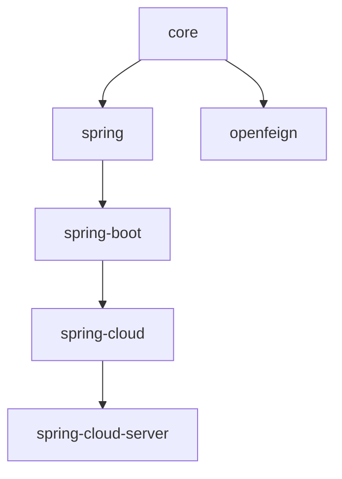

# User Guide — Current (0.2.x, release branch)

User documentation for the 0.2.x release line (`release` branch, working version
`0.2.22-SNAPSHOT`, latest published `0.2.21`).

- [中文](./zh/README.md) · [1.x line](../1.x/README.md) · [User Guide index](../README.md)

## Compatibility

| **Item** | **Requirement** |
|----------|-----------------|
| Java | 17+ |
| Spring Framework | 6.x |
| Spring Boot | 3.x |
| Spring Cloud | 2022.0.x – 2025.0.x |
| Namespace | `jakarta.*` |
| BOM | `microsphere-i18n-dependencies:0.2.21` |

## Module documents

| **Module** | **English** | **中文** |
|------------|-------------|----------|
| microsphere-i18n-dependencies (BOM) | [dependencies.md](./dependencies.md) | [dependencies.md](./zh/dependencies.md) |
| microsphere-i18n-parent | [parent.md](./parent.md) | [parent.md](./zh/parent.md) |
| microsphere-i18n-core | [core.md](./core.md) | [core.md](./zh/core.md) |
| microsphere-i18n-spring | [spring.md](./spring.md) | [spring.md](./zh/spring.md) |
| microsphere-i18n-spring-boot | [spring-boot.md](./spring-boot.md) | [spring-boot.md](./zh/spring-boot.md) |
| microsphere-i18n-spring-cloud | [spring-cloud.md](./spring-cloud.md) | [spring-cloud.md](./zh/spring-cloud.md) |
| microsphere-i18n-spring-cloud-server | [spring-cloud-server.md](./spring-cloud-server.md) | [spring-cloud-server.md](./zh/spring-cloud-server.md) |
| microsphere-i18n-openfeign | [openfeign.md](./openfeign.md) | [openfeign.md](./zh/openfeign.md) |

## Module dependencies

Start with [dependencies.md](./dependencies.md) to import the BOM, then choose your integration
level: [core.md](./core.md) (plain Java), [spring.md](./spring.md),
[spring-boot.md](./spring-boot.md) or [spring-cloud.md](./spring-cloud.md).
