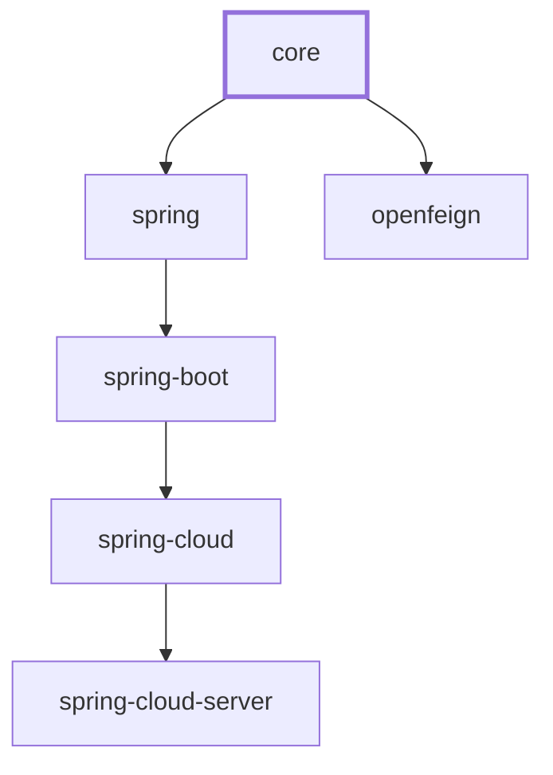

# microsphere-i18n Core — User Guide

This guide documents the `microsphere-i18n-core` module, the framework-neutral foundation of the
microsphere-i18n internationalization (i18n) library. It defines the `ServiceMessageSource`
abstraction and the classpath `Properties` implementation used to resolve localized messages.

> Scope: this document covers `io.microsphere.i18n` and `io.microsphere.i18n.util` only. Spring,
> Spring Boot, Spring Cloud and OpenFeign integrations live in sibling modules and are documented
> separately. The core module has **no Spring dependency**; it is pure Java 17.

## Overview

`microsphere-i18n-core` replaces the JDK's `ResourceBundle` model with an explicit, extensible
message-source contract. A **message source** is identified by a **source** name (a logical group of
messages, typically one per application or service), and resolves a **message code** to a localized
**message** for a requested `java.util.Locale`.

The module provides:

- A single root contract, `ServiceMessageSource`, with lifecycle (`init()` / `destroy()`) and
  lookup (`getMessage(...)`) operations.
- Progressive capability interfaces — `ResourceServiceMessageSource` adds resource loading/tracking,
  and `ReloadableResourceServiceMessageSource` adds runtime reload.
- A classpath `Properties` implementation chain: `AbstractResourceServiceMessageSource` →
  `PropertiesResourceServiceMessageSource` → `DefaultServiceMessageSource`, which loads message files
  from `META-INF/i18n/{source}/`.
- A `CompositeServiceMessageSource` that aggregates several sources behind one entry point.
- A null-object `EmptyServiceMessageSource` used as a safe default.
- Utility helpers `I18nUtils` (global source access) and `MessageUtils` (message-pattern resolution),
  plus the i18n-aware `ServiceMessageException`.

Messages are stored in `.properties` files whose keys are fully-qualified message codes prefixed
with the source name, for example `test.hello = Hello,{}`.

## Maven coordinates

The project uses the `io.github.microsphere-projects` groupId and is published on Maven Central. The
0.2.x line tracks the release branch (latest published `0.2.21`, working `0.2.22-SNAPSHOT`).

Add the core dependency directly:

```xml
<dependency>
    <groupId>io.github.microsphere-projects</groupId>
    <artifactId>microsphere-i18n-core</artifactId>
    <version>0.2.21</version>
</dependency>
```

If you depend on several microsphere-i18n modules, import the project BOM instead of pinning versions
one by one:

```xml
<dependencyManagement>
    <dependencies>
        <dependency>
            <groupId>io.github.microsphere-projects</groupId>
            <artifactId>microsphere-i18n-dependencies</artifactId>
            <version>0.2.21</version>
            <type>pom</type>
            <scope>import</scope>
        </dependency>
    </dependencies>
</dependencyManagement>

<dependencies>
    <dependency>
        <groupId>io.github.microsphere-projects</groupId>
        <artifactId>microsphere-i18n-core</artifactId>
    </dependency>
</dependencies>
```

### Runtime dependency note

The core module declares its `microsphere-java-core` and `microsphere-annotation-processor`
dependencies as `optional`. These libraries supply the helpers used throughout the core
(`io.microsphere.lang.Prioritized`, `io.microsphere.text.FormatUtils`, `io.microsphere.util.Assert`,
`io.microsphere.util.ClassLoaderUtils`, the `io.microsphere.logging` facade, and the
`io.microsphere.annotation` `@Nonnull` / `@Nullable` markers). When you use the core in an
application, `microsphere-java-core` must be present on the runtime classpath (the Spring-based
sibling modules bring it in transitively).

## Version and compatibility

| Aspect | Value |
|--------|-------|
| Artifact | `io.github.microsphere-projects:microsphere-i18n-core` |
| Version line | 0.2.x (latest published `0.2.21`; working `0.2.22-SNAPSHOT` on the `release` branch) |
| Java baseline | 17 |
| API namespace | `jakarta.*` (no `javax.*`) — relevant to downstream web/Spring modules, not to core itself |
| Spring Framework | 6.x (when combined with the `microsphere-i18n-spring` module) |
| Spring Boot | 3.x (when combined with `microsphere-i18n-spring-boot`) |
| Spring Cloud | 2022.0.x through 2025.0.x (when combined with `microsphere-i18n-spring-cloud`) |
| Root aggregator | `microsphere-i18n` |
| Parent | `microsphere-i18n-parent` (imports BOM `microsphere-spring-cloud-dependencies` `0.2.26`) |
| Project BOM | `microsphere-i18n-dependencies` |

The core module is framework-neutral and does not link against Spring at all. The Spring generation
row applies only when you combine core with its downstream Spring modules. The Maven dependency chain
of the whole project is: `spring` → `core`, `spring-boot` → `spring`, `spring-cloud` → `spring-boot`,
`spring-cloud-server` → `spring-cloud`, `openfeign` → `core`.

## Core concepts

### Source

A **source** is a logical grouping of messages, identified by a `String` name. By convention a source
matches an application or service name; the framework also reserves a `COMMON_SOURCE` constant whose
value is `"common"`.

- `ServiceMessageSource.COMMON_SOURCE` = `"common"` — the default returned by `getSource()`.
- `getSource()` on a configured source returns that source's own name (for example `"test"`).
- The source name becomes the message-code prefix and part of the resource path. `EmptyServiceMessageSource`
  is the one exception: it always reports `"Empty"`.

### Message code

A **message code** is the key used to look up a message. Codes are stored in the properties files in
**fully-qualified form**, prefixed with the source name and a dot separator
(`MessageUtils.SOURCE_SEPARATOR` = `"."`):

```
test.a     = 测试-a
test.hello = 您好,{}
```

At lookup time you may pass the short form (`"a"`) or the full form (`"test.a"`). The prefix is added
by `resolveMessageCode(...)`, which is implemented in `AbstractResourceServiceMessageSource`:

```java
@Override
protected String resolveMessageCode(String code) {
    if (code.startsWith(codePrefix)) { // already fully-qualified
        return code;
    }
    return codePrefix + code;          // e.g. "test." + "a" -> "test.a"
}
```

`codePrefix` is built in the constructor as `source + "."`. Consequently, every message key declared
in a source's resource file **must** start with that prefix; otherwise the load fails with an
`IllegalStateException` (see *Message file layout* below).

### Message pattern and `{}` placeholders

A **message pattern** is the raw string stored against a code. Positional arguments substituted at
resolution time are marked with `{}` placeholders, resolved by `io.microsphere.text.FormatUtils.format`
(`AbstractServiceMessageSource.resolveMessage(...)`). This is the SLF4J-style `{}` token, not
`java.text.MessageFormat`'s `{0}`:

```
test.hello = Hello,{}
```

```java
// test.hello with arg "World" -> "Hello,World"
String message = source.getMessage("hello", Locale.ENGLISH, "World");
```

A separate, higher-level notion of "message pattern" is used by `MessageUtils`: a string of the form
`{code}` (delimited by `MESSAGE_PATTERN_PREFIX` = `"{"` and `MESSAGE_PATTERN_SUFFIX` = `"}"`) is treated
as a reference to a message code. `MessageUtils.getLocalizedMessage("{hello}", "World")` extracts the
inner `hello` code and resolves it through the global source. Plain strings without braces are returned
unchanged.

### Locale fallback

Resolution normalizes the requested locale and, on a miss, falls back from a language+country locale
to its language-only form. The algorithm in `AbstractServiceMessageSource.getMessage` is:

1. Resolve the code (`resolveMessageCode`) and normalize the locale (`resolveLocale`).
2. Look up the message using the exact requested locale.
3. If not found, retry once using `new Locale(locale.getLanguage())` (language only) when that differs
   from the requested locale.

So a request for `zh_CN` first tries the `zh_CN` resource and, on a miss, the `zh` resource.

`setSupportedLocales(Collection<Locale>)` additionally expands the configured locales into a
**hierarchical** set (`resolveHierarchicalLocales`): each `language_country` locale is accompanied by
its `language` locale, while preserving insertion order in a fixed `LinkedHashSet`.

The runtime locale used by `getMessage(code, args)` (the overload without an explicit locale) comes
from `getLocale()`, which returns `getInternalLocale()` when a subclass supplies one, otherwise the
`getDefaultLocale()`. `getDefaultLocale()` returns the value set via `setDefaultLocale(...)`, falling
back to `Locale.getDefault()`.

## API reference

All types below are in `io.microsphere.i18n` unless stated otherwise. Signatures are taken verbatim
from the module source.

### `ServiceMessageSource` (interface)

`public interface ServiceMessageSource extends io.microsphere.lang.Prioritized`

The root contract. Because it extends `Prioritized` (which is `Comparable`), implementations can be
sorted by priority — used by `CompositeServiceMessageSource`.

| Member | Description |
|--------|-------------|
| `String COMMON_SOURCE = "common"` | Default source name. |
| `void init()` | Initializes the lifecycle (loads resources in implementations). |
| `void destroy()` | Tears the lifecycle down (frees resources). |
| `@Nullable String getMessage(String code, Locale locale, Object... args)` | Core lookup; returns `null` when not found. |
| `default @Nullable String getMessage(String code, Object... args)` | Lookup using the runtime locale from `getLocale()`. |
| `@Nonnull Locale getLocale()` | The runtime locale. |
| `default @Nonnull Locale getDefaultLocale()` | Defaults to `Locale.getDefault()`. |
| `default @Nonnull Set<Locale> getSupportedLocales()` | Defaults to `{getDefaultLocale(), ENGLISH}`. |
| `default String getSource()` | Returns `COMMON_SOURCE` by default. |
| `@Nonnull String toString()` | Overridden to be non-null. |

### `AbstractServiceMessageSource` (abstract class)

`public abstract class AbstractServiceMessageSource implements ServiceMessageSource`

Base implementation handling message resolution, locale management and code resolution. It keeps a
per-class `logger`, the immutable `source` and the derived `codePrefix`, plus mutable `supportedLocales`
and `defaultLocale`. The public lookup methods are declared `final` so subclasses plug in behaviour only
through the protected hooks.

Key methods:

```java
public AbstractServiceMessageSource(String source)                 // asserts source != null, codePrefix = source + "."
public final String getMessage(String code, Object... args)        // delegates to the interface default
public final String getMessage(String code, Locale locale, Object... args)
public final Locale getLocale()                                    // getInternalLocale() ?: getDefaultLocale()
public final Locale getDefaultLocale()                             // configured defaultLocale ?: super
public final Set<Locale> getSupportedLocales()                     // configured supportedLocales ?: super
public final String getSource()
public final void setDefaultLocale(Locale defaultLocale)
public final void setSupportedLocales(Collection<Locale> supportedLocales)  // stores the hierarchical expansion
protected Locale getInternalLocale()                               // returns null by default (override point)
protected boolean supports(Locale locale)
protected void assertSupportedLocales(Collection<Locale> supportedLocales) // rejects empty / null elements
protected Set<Locale> resolveHierarchicalLocales(Collection<Locale> supportedLocales)
protected Set<Locale> resolveHierarchicalLocales(Locale locale)
protected void addLocale(Collection<Locale> locales, Locale locale)
protected Locale resolveLocale(Locale locale)                      // normalizes language + region
protected String resolveMessage(String message, Object... args)    // FormatUtils.format
protected abstract String resolveMessageCode(String code)
protected abstract @Nullable String getInternalMessage(String code, String resolvedCode, Locale locale, Locale resolvedLocale, Object... args)
```

`getMessage(code, locale, args)` performs the two-step fallback described under *Locale fallback*. The
`args` are forwarded to `getInternalMessage`. The `locale` argument is required (dereferenced when the
fallback constructs the language-only locale).

### `ResourceServiceMessageSource` (interface)

`public interface ResourceServiceMessageSource extends ServiceMessageSource`

Adds the resource dimension — tracking which backing resources have been loaded.

```java
void initializeResource(String resource)
default void initializeResources(Iterable<String> resources)   // resources.forEach(this::initializeResource)
@Nonnull Set<String> getInitializedResources()
default @Nonnull Charset getEncoding()                          // UTF-8 by default
```

### `ReloadableResourceServiceMessageSource` (interface)

`public interface ReloadableResourceServiceMessageSource extends ResourceServiceMessageSource`

Adds runtime reload. Defaults make the source reloadable and route `reload(...)` back to
`initializeResource(s)(...)`:

```java
boolean canReload(String changedResource)                          // "supported by default" in implementations
default boolean canReload(Iterable<String> changedResources)       // true if any single resource is reloadable
default void reload(String changedResource)                        // initializeResource(changedResource)
default void reload(Iterable<String> changedResources)             // initializeResources(changedResources)
```

### `AbstractResourceServiceMessageSource` (abstract class)

`public abstract class AbstractResourceServiceMessageSource extends AbstractServiceMessageSource implements ResourceServiceMessageSource`

The workhorse. It maintains `private volatile Map<String, Map<String, String>> localizedResourceMessages`
— outer key = resource path, inner key = message code, value = message pattern — and implements the
`Properties`-agnostic loading, validation and lookup logic.

Constants:

```java
public static final String DEFAULT_RESOURCE_NAME_PREFIX = "i18n_messages_";
public static final String DEFAULT_RESOURCE_NAME_SUFFIX = ".properties";
```

Key methods:

```java
public AbstractResourceServiceMessageSource(String source)
public void init()                                   // asserts source, then initialize()
public void destroy()                                // clearAllMessages()
public void initializeResource(String resource)      // delegates to initializeResources(singleton(resource))
public void initializeResources(Iterable<String> resources)  // copy-on-write inside synchronized(this), see developer guide
protected String resolveMessageCode(String code)     // adds codePrefix unless already present
protected String getInternalMessage(...)             // map lookup by resolvedLocale + FormatUtils.format
protected final void initialize()                    // loads resources for all supported locales
protected final void clearAllMessages()
public String getResource(Locale locale)             // e.g. META-INF/i18n/test/i18n_messages_en.properties
protected String buildResourceName(Locale locale)    // i18n_messages_<locale>.properties
public final @Nullable Map<String,String> getMessages(Locale locale)
public Map<String,Map<String,String>> getLocalizedResourceMessages()   // unmodifiable view
public Set<String> getInitializedResources()                          // keySet of the map
public final @Nonnull Set<String> getResources()                       // resource paths for supported locales
protected void validateMessageCode(String code, String resourceName)   // throws IllegalStateException on bad prefix
protected abstract String getResource(String resourceName)
protected abstract @Nonnull Map<String,String> loadMessages(String resource)
```

`loadMessages(String)` is the single abstract load primitive each concrete subclass supplies (from
properties files, a remote store, and so on). After each load, every code is validated against the
`codePrefix`; a violation aborts initialization.

### `PropertiesResourceServiceMessageSource` (abstract class)

`public abstract class PropertiesResourceServiceMessageSource extends AbstractResourceServiceMessageSource`

Adapts the loading logic to Java `Properties` files.

```java
public PropertiesResourceServiceMessageSource(String source)
protected final Map<String,String> loadMessages(String resource)  // Properties -> Map<String,String>; wraps IOException as RuntimeException
public @Nullable Properties loadAllProperties(Locale locale) throws IOException
public @Nullable Properties loadAllProperties(String resource) throws IOException  // merges all readers; null if none
protected abstract String getResource(String resourceName)
protected abstract List<Reader> loadAllPropertiesResources(String resource) throws IOException
```

`loadAllProperties(String)` opens **all** resources that share the same path (classpath scanning across
multiple JARs) and merges their `Properties` into one object; `loadMessages` then copies it into an
unmodifiable `Map<String,String>` (empty map when nothing is found, so a missing file is not an error).

### `DefaultServiceMessageSource` (concrete class)

`public class DefaultServiceMessageSource extends PropertiesResourceServiceMessageSource implements ReloadableResourceServiceMessageSource`

The ready-to-use classpath implementation, loading from `META-INF/i18n/{source}/`.

```java
public static final String RESOURCE_LOCATION_PATTERN = "META-INF/i18n/{}/{}";
public DefaultServiceMessageSource(String source)
public DefaultServiceMessageSource(String source, @Nullable ClassLoader classLoader)  // null -> default classloader
public boolean canReload(String changedResource)        // true when the classloader still sees the resource
protected String getResource(String resourceName)       // formats RESOURCE_LOCATION_PATTERN with getSource() and name
protected List<Reader> loadAllPropertiesResources(String resource) throws IOException  // InputStreamReader per URL, using getEncoding()
protected Enumeration<URL> getResources(String resource) throws IOException
```

The `classLoader` is stored in a final, non-null field. `getResource(Locale)` therefore maps a locale to
a full path such as `META-INF/i18n/test/i18n_messages_zh_CN.properties`.

### `CompositeServiceMessageSource` (concrete class)

`public class CompositeServiceMessageSource implements ReloadableResourceServiceMessageSource`

Aggregates child sources behind one interface and is **not thread-safe** for mutation (as documented).
Delegation returns the first non-null message.

```java
public CompositeServiceMessageSource()                                   // empty list
public CompositeServiceMessageSource(List<? extends ServiceMessageSource> serviceMessageSources)
public void init()                                                        // init() each child
public String getMessage(String code, Locale locale, Object... args)      // first non-null from children
public @Nonnull Locale getLocale()                                        // first child, else getDefaultLocale()
public @Nonnull Locale getDefaultLocale()                                 // first child's locale, else super
public @Nonnull Set<Locale> getSupportedLocales()                         // union; default set when empty
public Set<Locale> getDefaultSupportedLocales()
public String getSource()                                                 // always COMMON_SOURCE
public void setServiceMessageSources(List<? extends ServiceMessageSource> serviceMessageSources)  // sorts by priority
public void reload(Iterable<String> changedResources)                     // reloads children that canReload
public void reload(String changedResource)
public boolean canReload(String changedResource)                          // always true
public boolean canReload(Iterable<String> changedResources)               // always true
public void initializeResource(String resource)
public void initializeResources(Iterable<String> resources)               // forwarded to ResourceServiceMessageSource children
public Set<String> getInitializedResources()                              // union over children
public Charset getEncoding()
public @Nonnull List<ServiceMessageSource> getServiceMessageSources()      // unmodifiable view
public void destroy()
```

`getSource()` always returns `"common"` — the composite itself is not bound to a single source name.
`getSupportedLocales()` returns an immutable union of every child's locales, falling back to
`getDefaultSupportedLocales()` when there are no children.

### `EmptyServiceMessageSource` (concrete class)

`public class EmptyServiceMessageSource implements ServiceMessageSource`

Null object that always returns `null`. Used as a safe fallback when no real source is configured.

```java
public static final EmptyServiceMessageSource INSTANCE;   // shared singleton
public EmptyServiceMessageSource()
public void init()                                         // no-op
public void destroy()                                      // no-op
public String getMessage(String code, Locale locale, Object... args)   // null
public @Nonnull Locale getLocale()                          // getDefaultLocale()
public String getSource()                                   // "Empty"
```

### `ServiceMessageException` (concrete class)

`public class ServiceMessageException extends RuntimeException`

A runtime exception carrying a message pattern and arguments; the localized text is produced lazily
through `MessageUtils`.

```java
public ServiceMessageException(String message, Object... args)
public String getMessage()             // the raw pattern, e.g. "{hello}"
public String getLocalizedMessage()    // MessageUtils.getLocalizedMessage(message, args)
public String toString()               // ServiceMessageException[message='...', args=[...], localized message='...']
```

### `io.microsphere.i18n.util.I18nUtils`

`public abstract class I18nUtils` (private constructor; static holder)

Global, JVM-wide access to the active `ServiceMessageSource`, held in a `volatile` field. When no source
has been set, `serviceMessageSource()` logs a warning and returns `EmptyServiceMessageSource.INSTANCE`.

```java
public static @Nonnull ServiceMessageSource serviceMessageSource()
public static void setServiceMessageSource(ServiceMessageSource serviceMessageSource)
public static void destroyServiceMessageSource()               // nulls the holder
public static List<ServiceMessageSource> findAllServiceMessageSources(ServiceMessageSource serviceMessageSource)
public static <S extends ServiceMessageSource> List<S> findAllServiceMessageSources(ServiceMessageSource serviceMessageSource, Class<S> serviceMessageSourceType)
```

`findAllServiceMessageSources(...)` recursively flattens a `CompositeServiceMessageSource` tree into its
leaf sources (a non-composite source is a leaf of itself).

### `io.microsphere.i18n.util.MessageUtils`

`public abstract class MessageUtils` (private constructor)

Resolves `{code}` message patterns against the global source.

```java
public static final String MESSAGE_PATTERN_PREFIX = "{";
public static final String MESSAGE_PATTERN_SUFFIX = "}";
public static final String SOURCE_SEPARATOR = ".";
public static String getLocalizedMessage(String messagePattern, Object... args)
public static String getLocalizedMessage(String messagePattern, Locale locale, Object... args)
public static String resolveMessageCode(String messagePattern)   // substringBetween(pattern, "{", "}")
```

`getLocalizedMessage` behaviour (as asserted by the module tests):

- `null` returns `null`.
- A string with no `{...}` is returned unchanged (no code to resolve).
- `{code}` resolves against the global source; on a hit the localized message is returned.
- On a miss, if the code contains a `.` the text after the first dot is returned, otherwise the original
  pattern is returned. For example `{microsphere-test.code-not-found}` → `code-not-found`, while
  `{code-not-found}` (no dot) → `{code-not-found}`.

## Message file layout

For `DefaultServiceMessageSource`, message files are placed on the classpath under:

```
META-INF/i18n/{source}/i18n_messages_{locale}.properties
```

- `{source}` — the source name passed to the constructor (for example `test`).
- `{locale}` — `java.util.Locale.toString()`, for example `en`, `zh_CN`, `fr_FR`.
- The file name is produced by `buildResourceName(locale)` = `i18n_messages_` + locale + `.properties`.
- The directory prefix is produced by `RESOURCE_LOCATION_PATTERN` (the literal value `META-INF/i18n/{}/{}`).

Every key in a file must be prefixed with `{source}.` (the `codePrefix`); a key that is not — such as
declaring `test.b` inside the `error` source — causes `validateMessageCode` to throw `IllegalStateException`
during initialization.

The core test resources exercise exactly this layout:

```
src/test/resources/META-INF/i18n/test/i18n_messages_en.properties
    test.a = test-a
    test.hello = Hello,{}

src/test/resources/META-INF/i18n/test/i18n_messages_zh_CN.properties
    test.a = 测试-a
    test.hello = 您好,{}

src/test/resources/META-INF/i18n/error/i18n_messages_zh_CN.properties   (deliberately invalid)
    error.a = a
    test.b = b          <-- wrong prefix: makes source "error" fail to load
```

## Code examples

The examples below are adapted faithfully from the module's `src/test` classes.

### Basic classpath usage

Adapted from `ServiceMessageSource`/`DefaultServiceMessageSource` and `DefaultServiceMessageSourceTest.testGetMessage`:

```java
DefaultServiceMessageSource source = new DefaultServiceMessageSource("test");
source.init();

// Default runtime locale (tests force Locale.setDefault(Locale.SIMPLIFIED_CHINESE))
assertEquals("测试-a",     source.getMessage("a"));
assertEquals("您好,World", source.getMessage("hello", "World"));

// Explicit English locale against test/i18n_messages_en.properties
assertEquals("Hello,World", source.getMessage("hello", Locale.ENGLISH, "World"));

source.destroy();
```

### Configuring default and supported locales

From `AbstractServiceMessageSource` and `ServiceMessageExceptionTest.before`:

```java
DefaultServiceMessageSource source = new DefaultServiceMessageSource("test");
source.setDefaultLocale(Locale.SIMPLIFIED_CHINESE);
source.setSupportedLocales(List.of(Locale.SIMPLIFIED_CHINESE));
source.init();
```

`setSupportedLocales` stores the hierarchical expansion, so `getSupportedLocales()` for `List.of(Locale.CHINESE)`
yields `{zh}` (no country to expand), while a `zh_CN` entry would be accompanied by `zh`.

### Loading the raw properties per locale

From `DefaultServiceMessageSourceTest.testLoadAllProperties`:

```java
DefaultServiceMessageSource source = new DefaultServiceMessageSource("test");
source.init();

for (Locale locale : source.getSupportedLocales()) {
    assertNotNull(source.loadAllProperties(locale));   // en and zh_CN both resolve
}
assertNull(source.loadAllProperties(Locale.FRANCE));    // no i18n_messages_fr.properties exists
```

### Composite delegation

Adapted from `CompositeServiceMessageSourceTest.setUp` and `testGetMessage`:

```java
DefaultServiceMessageSource real = new DefaultServiceMessageSource("test");

CompositeServiceMessageSource composite = new CompositeServiceMessageSource(
        List.of(EmptyServiceMessageSource.INSTANCE, real));
composite.init();

// The empty source yields null, so the composite falls through to the real source.
// The test asserts composite.getMessage(code, args) equals real.getMessage(code, args).
assertEquals(real.getMessage("a"),     composite.getMessage("a"));
assertEquals(real.getMessage("hello", "world"), composite.getMessage("hello", "world"));
assertEquals("Hello,World", composite.getMessage("hello", Locale.ENGLISH, "World"));

composite.destroy();
```

`getSource()` on a composite is always `"common"`, and `getInitializedResources()` is the union of its
`ResourceServiceMessageSource` children's resources.

### Global source access and message-pattern resolution

Adapted from `I18nUtilsTest` and `MessageUtilsTest`:

```java
// Before any source is configured, the holder is the null object.
assertSame(EmptyServiceMessageSource.INSTANCE, I18nUtils.serviceMessageSource());

DefaultServiceMessageSource source = new DefaultServiceMessageSource("test");
source.init();
I18nUtils.setServiceMessageSource(source);

// MessageUtils resolves {code} patterns through the global source.
assertEquals(null,          MessageUtils.getLocalizedMessage(null));
assertEquals("a",           MessageUtils.getLocalizedMessage("a"));            // no braces -> unchanged
assertEquals("测试-a",       MessageUtils.getLocalizedMessage("{a}"));
assertEquals("您好,World",   MessageUtils.getLocalizedMessage("{hello}", "World"));
assertEquals("Hello,World", MessageUtils.getLocalizedMessage("{hello}", Locale.ENGLISH, "World"));

// Code-not-found fallbacks:
assertEquals("{code-not-found}",        MessageUtils.getLocalizedMessage("{code-not-found}"));
assertEquals("code-not-found",          MessageUtils.getLocalizedMessage("{microsphere-test.code-not-found}"));

I18nUtils.destroyServiceMessageSource();
```

### Flattening a composite hierarchy

Adapted from `I18nUtilsTest.testFindAllServiceMessageSources`:

```java
CompositeServiceMessageSource composite =
        new CompositeServiceMessageSource(List.of(EmptyServiceMessageSource.INSTANCE));

assertEquals(List.of(EmptyServiceMessageSource.INSTANCE),
             I18nUtils.findAllServiceMessageSources(composite));
assertEquals(List.of(EmptyServiceMessageSource.INSTANCE),
             I18nUtils.findAllServiceMessageSources(composite, EmptyServiceMessageSource.class));
```

### Localized exceptions

Adapted from `ServiceMessageExceptionTest`:

```java
// With the global source configured for source "test" and default locale zh_CN:
ServiceMessageException e = new ServiceMessageException("{hello}", "World");
assertEquals("{hello}",      e.getMessage());          // raw pattern
assertEquals("您好,World",   e.getLocalizedMessage());  // resolved via MessageUtils
```

### Detecting invalid message codes

Adapted from `DefaultServiceMessageSourceTest.testValidateMessageCode` — loading the `error` source
throws because its file contains the foreign-prefixed key `test.b`:

```java
assertThrows(IllegalStateException.class, () -> {
    DefaultServiceMessageSource bad = new DefaultServiceMessageSource("error");
    bad.initialize();
});
```

## Module dependencies

`core` has no upstream i18n module; `spring` and `openfeign` build on it.


