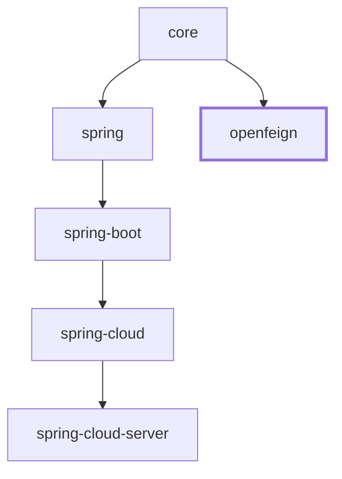

# OpenFeign Integration (`microsphere-i18n-openfeign`)

The `microsphere-i18n-openfeign` module propagates the caller's language preference across
OpenFeign service-to-service calls, so that a downstream microservice resolves its messages in the
same locale the end user requested from the entry-point service.

## Overview

In a microservice topology, the browser or mobile client sends an `Accept-Language` header to the
first service only. Every subsequent hop is a new HTTP request built by a Feign client, and Feign
does not copy headers by default. Without help, the downstream service sees no `Accept-Language`
and falls back to its own default locale.

This module contributes a single class,
`io.microsphere.i18n.feign.AcceptLanguageHeaderRequestInterceptor`, which implements Feign's
`feign.RequestInterceptor` SPI. For every outgoing Feign request, it looks at the HTTP request the
current thread is serving and copies its `Accept-Language` header value verbatim onto the Feign
`RequestTemplate`.

The module is deliberately small and passive:

- it depends on `microsphere-i18n-core`, but does not call `ServiceMessageSource` itself;
- it does not parse, negotiate, or filter the locale — it forwards the raw header;
- locale negotiation still happens in the **receiving** service, through Spring MVC's
  `AcceptHeaderLocaleResolver` (which the Spring integration module reconfigures with the i18n
  default and supported locales, see [Spring](spring.md)).

```
client (Accept-Language: zh_CN)
   |
   v
service A  -- Feign call -->  service B
   AcceptLanguageHeaderRequestInterceptor copies the header      service B resolves
   on the current request thread                                 messages in zh_CN
```

## Maven Coordinates

```xml

<dependency>
    <groupId>io.github.microsphere-projects</groupId>
    <artifactId>microsphere-i18n-openfeign</artifactId>
</dependency>
```

No `<version>` is needed when the `microsphere-i18n-dependencies` BOM is imported (see
[Dependencies BOM](dependencies.md)).

The module declares only `microsphere-i18n-core` as a required dependency. `feign-core`,
`spring-webmvc` and `jakarta.servlet-api` are declared **optional**, so they are used to compile
the module but are not exported: your application must already provide them. A Spring Cloud web
application normally does, through `spring-cloud-starter-openfeign` and `spring-boot-starter-web`.

## Version and Compatibility

| Item                  | Value                                                                     |
|-----------------------|---------------------------------------------------------------------------|
| Artifact              | `io.github.microsphere-projects:microsphere-i18n-openfeign`               |
| Version line          | `0.2.x` (latest published release `0.2.21`)                               |
| Minimum Java          | 17                                                                        |
| Namespace             | `jakarta.*` (not `javax.*`)                                               |
| Spring Boot           | 3.x                                                                       |
| Spring Cloud          | 2022.0.x – 2025.0.x                                                       |
| Compile-time Feign    | `io.github.openfeign:feign-core` (optional; `13.6.1` in the default build) |
| Compile-time Web MVC  | `org.springframework:spring-webmvc` (optional; `6.2.19` in the default build) |
| Servlet API           | `jakarta.servlet:jakarta.servlet-api` (optional; `6.0.0` in the default build) |
| Class `@since`        | `1.0.0`                                                                   |

The exact third-party versions come from the Spring Cloud generation selected for the build, not
from this module's POM. See [Parent POM](parent.md) for the generation-to-version mapping.

For applications on Spring Boot 2.x / Spring Cloud Hoxton–2021.0.x (`javax.*` namespace), use the
`1.x` documentation set instead.

## API: `AcceptLanguageHeaderRequestInterceptor`

| Element                        | Description                                                                                     |
|--------------------------------|-------------------------------------------------------------------------------------------------|
| Class                          | `io.microsphere.i18n.feign.AcceptLanguageHeaderRequestInterceptor`                              |
| Implements                     | `feign.RequestInterceptor`                                                                      |
| `HEADER_NAME`                  | `public static final String`, value `Accept-Language` (from `org.springframework.http.HttpHeaders.ACCEPT_LANGUAGE`) |
| `apply(RequestTemplate)`        | The only behavior method: copies the incoming request's `Accept-Language` header onto the template |
| Constructors                   | public no-argument constructor only                                                              |

### Where the `Accept-Language` value comes from

`apply(RequestTemplate)` resolves the header from the **current HTTP request**, not from
`LocaleContextHolder`:

1. `RequestContextHolder.getRequestAttributes()` is read for the current thread.
2. If the result is not a `ServletRequestAttributes` — no request bound to the thread, a
   non-servlet context, or a background thread — the interceptor logs a TRACE message and returns
   without touching the template.
3. Otherwise `ServletRequestAttributes.getRequest()` gives the `HttpServletRequest`, and
   `request.getHeader("Accept-Language")` is read.
4. If the value has text (`StringUtils.hasText`), it is written to the template with
   `template.header("Accept-Language", value)`.
5. If the value is `null` or blank, nothing is written; a TRACE message records that the requester
   did not pass the header.

Key consequences:

- **There is no fallback to the JVM default locale, to `LocaleContextHolder`, or to
  `ServiceMessageSource.getLocale()`.** If the incoming request carried no `Accept-Language`, the
  Feign request carries none either, and the downstream service applies its own default.
- The header value is forwarded **verbatim**, including quality values, e.g.
  `zh-CN,zh;q=0.9,en;q=0.8`. Negotiation is left to the downstream `AcceptHeaderLocaleResolver`.
- Requests issued outside a servlet request thread (scheduled tasks, message listeners, async work
  that does not inherit request attributes) are not enriched.

## Registering the Interceptor

The module ships no `META-INF/spring.factories` and no
`AutoConfiguration.imports` entry, and none of the Spring Boot / Spring Cloud auto-configurations
reference this class. You must declare the bean yourself:

```java

@Configuration
public class I18nFeignConfig {

    @Bean
    public AcceptLanguageHeaderRequestInterceptor acceptLanguageHeaderRequestInterceptor() {
        return new AcceptLanguageHeaderRequestInterceptor();
    }
}
```

A `RequestInterceptor` bean in the root application context is applied to all Feign clients. To
scope it to one client, reference the configuration class from `@FeignClient`:

```java

@FeignClient(name = "user-service", configuration = I18nFeignConfig.class)
public interface UserClient {

    @GetMapping("/users/{id}")
    User getUser(@PathVariable("id") Long id);
}
```

When the configuration class is used as a per-client `configuration`, keep it out of component
scanning so it does not also become global.

The unit test of the module shows the same registration plus the thread-binding the interceptor
relies on:

```java

class AcceptLanguageHeaderRequestInterceptorTest {

    private AcceptLanguageHeaderRequestInterceptor requestInterceptor;
    private RequestTemplate requestTemplate;
    private MockHttpServletRequest request;

    @BeforeEach
    void before() {
        this.request = new MockHttpServletRequest();
        this.requestInterceptor = new AcceptLanguageHeaderRequestInterceptor();
        this.requestTemplate = new RequestTemplate();
        // bind the simulated request to the current thread
        setRequestAttributes(new ServletRequestAttributes(request));
    }

    @AfterEach
    void after() {
        resetRequestAttributes();
    }

    @Test
    void testApply() {
        this.request.addHeader(HEADER_NAME, "en");
        requestInterceptor.apply(requestTemplate);
        assertEquals(ofList("en"), requestTemplate.headers().get("Accept-Language"));
    }
}
```

## End-to-End Usage

A typical Spring Cloud setup, combining this module with the Spring Boot integration:

`pom.xml`:

```xml

<dependencyManagement>
    <dependencies>
        <dependency>
            <groupId>io.github.microsphere-projects</groupId>
            <artifactId>microsphere-i18n-dependencies</artifactId>
            <version>${microsphere-i18n.version}</version>
            <type>pom</type>
            <scope>import</scope>
        </dependency>
    </dependencies>
</dependencyManagement>

<dependencies>
    <dependency>
        <groupId>io.github.microsphere-projects</groupId>
        <artifactId>microsphere-i18n-spring-boot</artifactId>
    </dependency>
    <dependency>
        <groupId>io.github.microsphere-projects</groupId>
        <artifactId>microsphere-i18n-openfeign</artifactId>
    </dependency>
</dependencies>
```

Entry-point service (`order-service`):

```java

@Configuration
public class I18nFeignConfig {

    @Bean
    public AcceptLanguageHeaderRequestInterceptor acceptLanguageHeaderRequestInterceptor() {
        return new AcceptLanguageHeaderRequestInterceptor();
    }
}

@FeignClient(name = "user-service")
public interface UserClient {

    @GetMapping("/users/profile")
    Profile profile();
}

@RestController
public class OrderController {

    private final UserClient userClient;
    private final ServiceMessageSource messageSource;

    public OrderController(UserClient userClient, ServiceMessageSource messageSource) {
        this.userClient = userClient;
        this.messageSource = messageSource;
    }

    @GetMapping("/orders/summary")
    public String summary() {
        // Local message in the caller's locale
        String title = messageSource.getMessage("order.summary.title");
        // The downstream call carries the same Accept-Language header
        Profile profile = userClient.profile();
        return title + " - " + profile.greeting();
    }
}
```

Downstream service (`user-service`) needs no extra code: its `AcceptHeaderLocaleResolver` reads the
propagated header, Spring stores the resolved locale in `LocaleContextHolder`, and
`ServiceMessageSource.getMessage(code, args)` picks it up.

Message files, per the framework convention:

```
src/main/resources/META-INF/i18n/order-service/
├── i18n_messages_en.properties      # order.summary.title=Order summary
└── i18n_messages_zh_CN.properties   # order.summary.title=订单摘要
```

## Verifying the Behavior

The interceptor is silent unless TRACE is enabled for its logger:

```properties
logging.level.io.microsphere.i18n.feign.AcceptLanguageHeaderRequestInterceptor=TRACE
```

You will see one of:

- `Feign has set HTTP request header [name : 'Accept-Language' , value : 'zh_CN']`
- `Feign could not set HTTP request header [name : 'Accept-Language'] because the requester did not
  pass: 'null'`
- `Feign calls in non-Spring WebMVC scenarios, ignoring setting request headers:
  'Accept-Language'`

To confirm the header on the wire, inspect the request with a Feign `Logger.Level` (`FULL`) or a
`spring-cloud.openfeign` logging configuration.

## Notes and Limitations

- Only `Accept-Language` is propagated. Other locale-related headers are untouched.
- The interceptor is not registered automatically by any microsphere auto-configuration in the
  `0.2.x` line; the bean declaration above is required.
- Because the lookup is a thread-local `RequestContextHolder` read, Feign calls made from other
  threads (for example `@Async` methods or reactive pipelines) need explicit propagation, such as
  `RequestContextHolder.setRequestAttributes(attributes, true)` for inheritable thread locals, or
  setting the header per call with `@RequestHeader`.
- If several interceptors write the same header, Feign's `RequestTemplate` semantics govern the
  result; keep one `Accept-Language` writer per request to stay deterministic.

## Related Documentation

- [Core](core.md) — `ServiceMessageSource` and locale resolution
- [Spring](spring.md) — `AcceptHeaderLocaleResolver` customization
- [Spring Boot](spring-boot.md) — auto-configuration
- [Parent POM](parent.md), [Dependencies BOM](dependencies.md)
- Developer guide: [OpenFeign module](../../developer-guide/current/openfeign.md)

## Module dependencies

Depends on `core` only; independent of the Spring chain.


