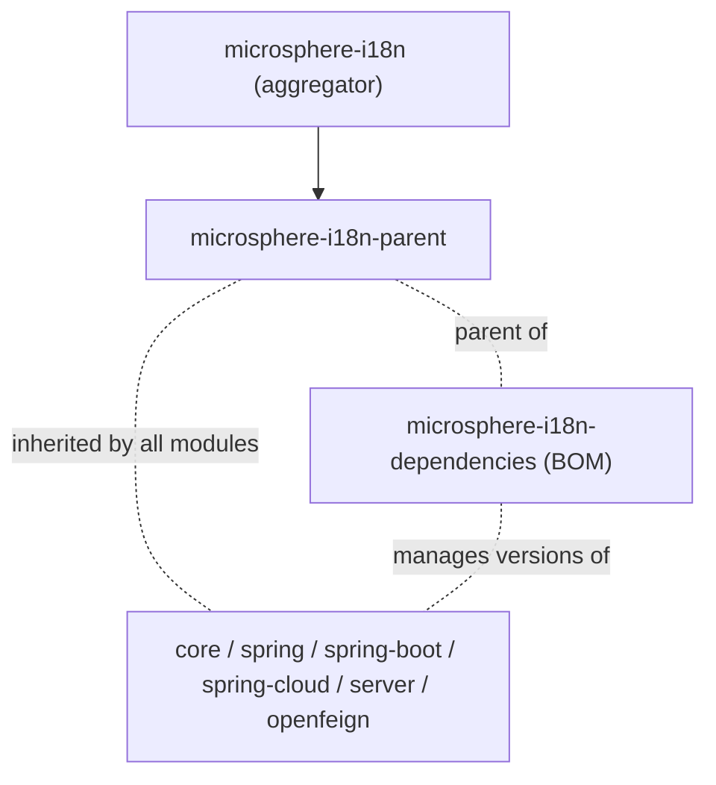

# Parent POM (`microsphere-i18n-parent`)

`microsphere-i18n-parent` is a POM-only module (`<packaging>pom</packaging>`). It publishes no
classes and no artifacts beyond its POM; its job is to give every other module of the project the
same set of managed third-party versions.

## Purpose

The POM does exactly three things (see `microsphere-i18n-parent/pom.xml`):

1. It inherits from the project's root aggregator POM `microsphere-i18n`
   (`<relativePath>../pom.xml</relativePath>`), which in turn inherits from
   `io.github.microsphere-projects:microsphere-spring-cloud-parent:0.2.26`.
2. It declares one property:

   ```xml
   <microsphere-spring-cloud.version>0.2.26</microsphere-spring-cloud.version>
   ```

3. It imports one BOM in `dependencyManagement`:

   ```xml

   <dependency>
       <groupId>io.github.microsphere-projects</groupId>
       <artifactId>microsphere-spring-cloud-dependencies</artifactId>
       <version>${microsphere-spring-cloud.version}</version>
       <type>pom</type>
       <scope>import</scope>
   </dependency>
   ```

That single import is what pins Spring Boot, Spring Cloud, Spring Cloud Alibaba, JUnit,
Testcontainers and the Microsphere Spring Boot artifacts to a coherent set of versions for the
whole reactor. It defines no plugins, no profiles, and no dependencies of its own.

## When to Use It

| Situation                                             | Use                                                       |
|-------------------------------------------------------|-------------------------------------------------------------|
| Consuming microsphere-i18n from an application        | Import the [`microsphere-i18n-dependencies` BOM](dependencies.md) — not this parent |
| Building or contributing to microsphere-i18n          | This parent is already wired in; nothing to add in your POM |
| Adding a new module to the microsphere-i18n reactor   | Set `microsphere-i18n-parent` as the module's `<parent>`    |
| Building a private extension module alongside         | You may set it as `<parent>`, but you must then also align `${revision}` and the source repository |

The framework modules all follow the same pattern — `core`, `openfeign`, `spring`, `spring-boot`,
`spring-cloud`, `spring-cloud-server` and even the `dependencies` BOM declare
`microsphere-i18n-parent` as their `<parent>`, with `<version>${revision}</version>`.

## Using It as a Parent

```xml

<parent>
    <groupId>io.github.microsphere-projects</groupId>
    <artifactId>microsphere-i18n-parent</artifactId>
    <version>0.2.21</version>
    <relativePath/>
</parent>

<groupId>com.example</groupId>
<artifactId>my-i18n-extension</artifactId>
<version>1.0.0-SNAPSHOT</version>
```

An empty `<relativePath/>` forces resolution from the repository instead of the file system. After
this, dependencies from the managed set can be declared without a version, for example:

```xml

<dependency>
    <groupId>org.springframework</groupId>
    <artifactId>spring-webmvc</artifactId>
</dependency>
```

Do not confuse this with the consumer-facing BOM: `microsphere-i18n-parent` does **not** manage the
versions of the `microsphere-i18n-*` artifacts themselves. That is the role of
`microsphere-i18n-dependencies`.

## What Gets Managed

`microsphere-i18n-parent` contributes one entry to `dependencyManagement` — the import of
`microsphere-spring-cloud-dependencies:0.2.26`. Through that chain, the reactor resolves versions
for:

| Managed group                                                        | Provided by                                             |
|----------------------------------------------------------------------|-----------------------------------------------------------|
| `org.springframework.boot:*` (and everything `spring-boot-dependencies` manages, including `spring-*`, `jakarta.servlet-api`, Logback, Tomcat) | `spring-boot-dependencies`, version selected by the active generation |
| `org.springframework.cloud:*`                                        | `spring-cloud-dependencies`                               |
| `com.alibaba.cloud:*`                                                | `spring-cloud-alibaba-dependencies`                       |
| `io.github.microsphere-projects:*` (Microsphere Spring Boot line)    | `microsphere-spring-boot-dependencies:0.2.34`             |
| `io.github.microsphere-projects:microsphere-spring-cloud-commons`, `microsphere-spring-cloud-openfeign` | `microsphere-spring-cloud-dependencies:0.2.26`            |
| `org.junit:*`, `org.junit.jupiter:*`                                 | `junit-bom:6.1.3`                                         |
| `org.testcontainers:*`                                               | `testcontainers-bom:2.0.5`                                |

Concrete evidence from the built reactor (module `microsphere-i18n-openfeign`):
`spring-webmvc:6.2.19`, `spring-core:6.2.19`, `feign-core:13.6.1`,
`jakarta.servlet-api:6.0.0`, `junit-jupiter:6.1.3`, `microsphere-java-core:0.3.19` — none of these
versions appear in the module POM, they all come from this parent chain.

## Version and Compatibility

The parent is published in the same release train as the rest of the project, so it always carries
the version `${revision}` of the reactor (for example `0.2.21`).

| microsphere-i18n line | Parent POM version | Upstream `microsphere-spring-cloud` version | Java | Spring Boot | Spring Cloud |
|-----------------------|--------------------|---------------------------------------------|------|-------------|--------------|
| `0.2.x` (current)     | `0.2.x`, e.g. `0.2.21` | `0.2.26`                                    | 17 (`java.version` property in the reactor POM) | 3.x | 2022.0.x – 2025.0.x |
| `1.x`                 | `0.1.x`, e.g. `0.1.21` | `0.1.26`                                    | not declared in the reactor POM | 2.x | Hoxton – 2021.0.x |

Inside the `0.2.x` line, the Spring Boot / Spring Cloud pair actually used by a build is chosen by
a Maven profile inherited from `microsphere-spring-cloud-parent:0.2.26`
(see the [Developer Guide](../../developer-guide/current/parent.md) for the profile table and how
CI uses it).

## Notes

- Because it is a POM with no code, there is nothing to test at runtime; the "test" of this module
  is that the reactor resolves and compiles.
- Upgrading `microsphere-spring-cloud.version` is the single-lever change that moves every
  third-party dependency of the project; it is the property to touch when adding support for a new
  Spring Cloud generation.
- The published POMs are flattened: `${revision}` is replaced by the concrete release version, so
  a POM that references `microsphere-i18n-parent` never needs `${revision}` itself.

## Related Documentation

- [Dependencies BOM](dependencies.md) — what applications should import
- [OpenFeign](openfeign.md) and the other module guides
- Developer Guide: [Parent POM](../../developer-guide/current/parent.md)

## Module dependencies

POM structure:


