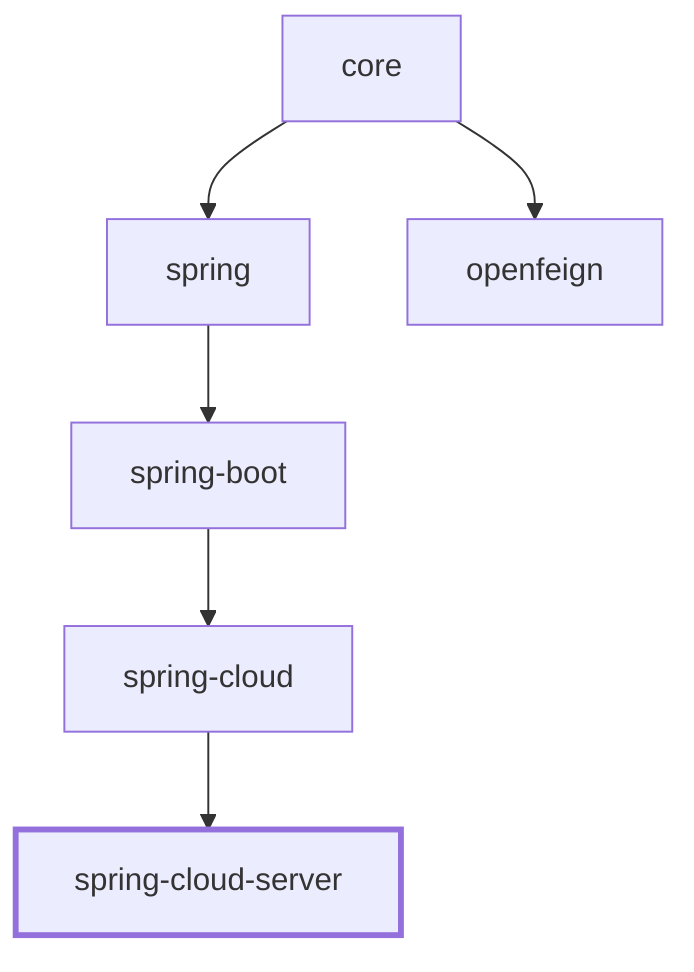

# Spring Cloud i18n Server

## Overview

`microsphere-i18n-spring-cloud-server` turns an application into a centralized i18n server. It discovers
every registered service through Spring Cloud's `DiscoveryClient`, builds a message source per service
from the Spring `Environment`, aggregates them into one `CompositeServiceMessageSource`, and exposes the
combined messages over REST so a client (or gateway) can read all services' translations from a single
place.

The module contains exactly three production classes:

- `@EnableI18nServer` - the activation annotation (imports an internal `Marker` class).
- `I18nServerAutoConfiguration` - the auto-configuration that performs discovery and aggregation.
- `I18nServerController` - the `@RestController` that exposes the aggregated messages.

It also relies on `I18nEndpoint` (the Spring Boot Actuator endpoint from `microsphere-i18n-spring-boot`)
as the data source for the REST response.

> Class-name note: the root-level developer guide historically referred to a class called
> `I18nServerConfiguration`. The real class in the source is `I18nServerAutoConfiguration`
> (`io.microsphere.i18n.spring.cloud.server.autoconfigure.I18nServerAutoConfiguration`). There is no
> `I18nServerConfiguration`.

Dependency chain:

```
spring-cloud-server -> spring-cloud -> spring-boot -> spring -> core
```

## Maven Coordinates

```xml
<dependency>
    <groupId>io.github.microsphere-projects</groupId>
    <artifactId>microsphere-i18n-spring-cloud-server</artifactId>
    <version>0.2.21</version>
</dependency>
```

`spring-cloud-commons` (for `DiscoveryClient`) and `spring-cloud-context`, together with
`microsphere-spring-cloud-commons`, `microsphere-spring-boot-core` and `microsphere-spring-boot-actuator`,
are declared optional in the POM. Bring the Spring Cloud artifacts through your own BOM.

## Version & Compatibility

| Component                | Value                                                              |
|--------------------------|--------------------------------------------------------------------|
| microsphere-i18n line    | `0.2.x` (latest release `0.2.21`)                                  |
| groupId                  | `io.github.microsphere-projects`                                   |
| Java                     | 17                                                                 |
| Namespace                | `jakarta.*`                                                        |
| Spring Boot              | 3.x                                                                |
| Spring Cloud             | 2022.0.x - 2025.0.x                                                |
| Requires                 | a blocking `DiscoveryClient` and Spring Boot Actuator on classpath |
| Auto-configuration       | `META-INF/spring/org.springframework.boot.autoconfigure.AutoConfiguration.imports` |

The auto-configuration is registered through the Spring Boot 3 imports file
`META-INF/spring/org.springframework.boot.autoconfigure.AutoConfiguration.imports`, whose single entry is
`io.microsphere.i18n.spring.cloud.server.autoconfigure.I18nServerAutoConfiguration`.

## Enabling the Server: `@EnableI18nServer`

`@EnableI18nServer` is the on-switch. It is `@Target(TYPE)`, `@Inherited` and `@Import`s the nested
`EnableI18nServer.Marker` class. Registering that marker bean is what `I18nServerAutoConfiguration`
requires through `@ConditionalOnBean(Marker.class)`, so the annotation both documents intent and gates
the auto-configuration.

```java
@SpringBootApplication
@EnableDiscoveryClient
@EnableI18nServer
public class I18nServerApplication {
    public static void main(String[] args) {
        SpringApplication.run(I18nServerApplication.class, args);
    }
}
```

The test bootstrap `I18nServerBootstrap` uses precisely this combination
(`@SpringBootApplication @EnableDiscoveryClient @EnableI18nServer`) and starts as a `SERVLET` application.

If you prefer not to use the annotation, the same beans come from the auto-configuration as long as a
`Marker` bean, a blocking `DiscoveryClient`, Actuator and a web application are all present - but
`@EnableI18nServer` is the supported, declarative entry point.

## REST Endpoints

### `I18nServerController`

`I18nServerController` is a plain `@RestController` that autowires `I18nEndpoint` and exposes a single
method:

| Method | Path        | Returns                                | Delegates to |
|--------|-------------|----------------------------------------|--------------|
| GET    | `/messages` | `Map<String, Map<String, String>>`     | `i18nEndpoint.invoke()` |

```java
@GetMapping("/messages")
public Map<String, Map<String, String>> getMessages() {
    return i18nEndpoint.invoke();
}
```

The response is a map keyed by resource name, each holding the `code -> message` pairs for that resource,
across every discovered service.

### `I18nEndpoint` (Actuator)

Because the server module also depends on the Actuator `I18nEndpoint`, the standard operations are
available alongside `/messages` once the endpoint is exposed:

| Method   | Path                       | Operation (annotation) | Purpose |
|----------|----------------------------|------------------------|---------|
| GET      | `/actuator/i18n`           | `@ReadOperation invoke()` | All messages, same payload as `/messages` |
| GET      | `/actuator/i18n/{code}`    | `@ReadOperation getMessage(@Selector code)` | One code across all supported locales |
| GET      | `/actuator/i18n/{code}/{locale}` | `@ReadOperation getMessage(code, @Selector locale)` | One code in one locale |
| POST     | `/actuator/i18n`           | `@WriteOperation addMessage(...)` | Add/update a message in an `Environment`-backed source |

The controller path `/messages` is intentionally free of the `/actuator` prefix; the endpoint paths sit
under Actuator's base path.

## Aggregating Messages Across Services

`I18nServerAutoConfiguration` performs aggregation in two phases.

Phase 1 - a lazy composite bean. On startup the context has an empty `CompositeServiceMessageSource`
registered as `lazyCompositeServiceMessageSource` (`@Lazy`):

```java
@Lazy
@Bean(name = LAZY_COMPOSITE_SERVICEMESSAGE_SOURCE_BEAN_NAME)
public CompositeServiceMessageSource lazyCompositeServiceMessageSource() {
    return new CompositeServiceMessageSource();
}
```

Phase 2 - populate on `ApplicationStartedEvent`. When Spring Boot fires `ApplicationStartedEvent`, the
listener grabs the lazy composite, asks the `DiscoveryClient` for the service list, builds one message
source per service and installs them into the composite:

```java
@EventListener(ApplicationStartedEvent.class)
public void onApplicationStartedEvent(ApplicationStartedEvent event) {
    ConfigurableApplicationContext context = event.getApplicationContext();
    CompositeServiceMessageSource composite =
            context.getBean(LAZY_COMPOSITE_SERVICEMESSAGE_SOURCE_BEAN_NAME, CompositeServiceMessageSource.class);
    List<String> services = discoveryClient.getServices();
    List<ServiceMessageSource> serviceMessageSources = services.stream()
            .map(this::buildServiceMessageSource)
            .collect(Collectors.toList());
    composite.setServiceMessageSources(serviceMessageSources);
}

private ServiceMessageSource buildServiceMessageSource(String service) {
    PropertySourcesServiceMessageSource serviceMessageSource = new PropertySourcesServiceMessageSource(service);
    serviceMessageSource.setEnvironment(environment);
    serviceMessageSource.setDefaultLocale(getDefault());
    serviceMessageSource.setSupportedLocales(ofList(getDefault(), ENGLISH));
    serviceMessageSource.init();
    return serviceMessageSource;
}
```

So a service registered as `order-service` yields a `PropertySourcesServiceMessageSource` whose messages
are read from `Environment` properties named `order-service.i18n_messages_en.properties`,
`order-service.i18n_messages_zh_CN.properties`, and so on. `CompositeServiceMessageSource` merges them,
and `I18nServerController` returns the merged view.

Example `application.properties` for a simple-discovery setup (mirrors the module's test config):

```properties
spring.application.name=i18n-server
management.endpoint.i18n.enabled=true
management.endpoints.web.exposure.include=*
management.endpoint.env.post.enabled=true

spring.cloud.discovery.client.simple.instances.test-application[0].instanceId=1
spring.cloud.discovery.client.simple.instances.test-application[0].serviceId=test-application
spring.cloud.discovery.client.simple.instances.test-application[0].host=127.0.0.1
spring.cloud.discovery.client.simple.instances.test-application[0].port=8080
```

With that single discovered service, `GET /messages` returns the resources contributed by
`test-application` (plus the server's own `common` source), each keyed by its resource name.

## How `DiscoveryClient` Is Used

Discovery is done through Spring Cloud's `org.springframework.cloud.client.discovery.DiscoveryClient`,
autowired into `I18nServerAutoConfiguration`. The only call is `discoveryClient.getServices()`, invoked
once per `ApplicationStartedEvent`. Each returned service id becomes a source name handed to
`PropertySourcesServiceMessageSource`.

The auto-configuration is guarded by `@ConditionalOnBlockingDiscoveryAvailable` (from
`microsphere-spring-cloud-commons`), so it activates only when a blocking discovery client is available,
and it is ordered after the discovery/actuator/i18n auto-configurations via `@AutoConfigureAfter`
(`COMMONS_CLIENT_AUTO_CONFIGURATION_CLASS_NAME`, `I18nAutoConfiguration`,
`I18nEndpointAutoConfiguration`, `I18nCloudAutoConfiguration`). This guarantees the `DiscoveryClient` and
the `I18nEndpoint` beans exist before the server builds its composite.

Note that the source's locale handling contains a `// FIXME Hardcode` marker: the default locale is the
JVM default and the supported locales are hardcoded to `{default, ENGLISH}` per service.

## Module dependencies

Depends on `spring-cloud` (→ `spring-boot` → `spring` → `core`).


