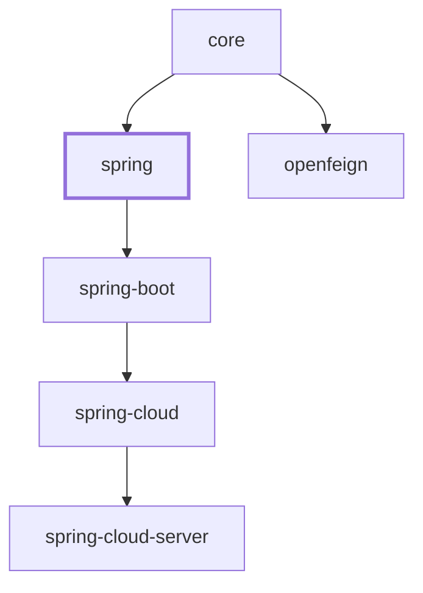

# Spring Integration

`microsphere-i18n-spring` is the plain Spring Framework integration of the Microsphere
Internationalisation framework. It binds the framework-neutral `ServiceMessageSource` abstraction
from `microsphere-i18n-core` to the Spring container: it registers message sources as Spring beans,
publishes them as the standard `org.springframework.context.MessageSource`, resolves locales from
the Spring `LocaleContextHolder`, and reloads messages when the Spring `Environment` changes.

> Scope. This document covers the `io.microsphere.i18n.spring.*` packages of the
> `microsphere-i18n-spring` module only. The `ServiceMessageSource` contract itself belongs to
> `microsphere-i18n-core`. Boot-specific auto-configuration lives in `microsphere-i18n-spring-boot`
> and config-server integration in `microsphere-i18n-spring-cloud`.

## Overview

The module is driven by a single annotation, `@EnableI18n`, placed on any `@Configuration` class
(or on any meta-annotation). One annotation installs the whole i18n stack:

- One `ServiceMessageSourceFactoryBean` bean **per declared source**, each of which composes every
  `AbstractServiceMessageSource` implementation discovered from `META-INF/spring.factories`.
- One primary `DelegatingServiceMessageSource` bean named `serviceMessageSource` that aggregates all
  `ServiceMessageSource` beans found in the container.
- Optionally a `MessageSourceAdapter` registered under the well-known `messageSource` bean name, so
  plain Spring infrastructure (validation messages, `MessageSourceResolvable`, templates) resolves
  text through the Microsphere message sources.
- An `I18nApplicationListener` that publishes the primary message source globally through
  `I18nUtils` on context refresh, destroys it on context close, and reloads messages when the Spring
  `Environment` reports property changes.
- A `ServiceMessageSourceBeanLifecyclePostProcessor` that wires `init()` / `destroy()` as lifecycle
  callbacks for `ServiceMessageSource` beans declared by the user.
- Two optional `BeanPostProcessor`s that connect the i18n stack to Bean Validation
  (`I18nLocalValidatorFactoryBeanPostProcessor`) and to Spring MVC locale resolution
  (`AcceptHeaderLocaleResolverBeanPostProcessor`). Both are registered only when the corresponding
  class is present on the classpath.

Two message source flavours are available out of the box:

| Implementation                        | Where messages come from                                                       |
|---------------------------------------|--------------------------------------------------------------------------------|
| `io.microsphere.i18n.DefaultServiceMessageSource` (core) | Classpath resources under `META-INF/i18n/{source}/i18n_messages_{locale}.properties` |
| `io.microsphere.i18n.spring.PropertySourcesServiceMessageSource` | A Spring `Environment` property whose **value is the whole `.properties` file content** |

## Maven coordinates

GroupId `io.github.microsphere-projects`, artifactId `microsphere-i18n-spring`.

```xml
<dependency>
    <groupId>io.github.microsphere-projects</groupId>
    <artifactId>microsphere-i18n-spring</artifactId>
    <version>0.2.21</version>
</dependency>
```

When you use more than one Microsphere i18n artifact, import the project BOM instead of pinning
versions individually:

```xml
<dependencyManagement>
    <dependencies>
        <dependency>
            <groupId>io.github.microsphere-projects</groupId>
            <artifactId>microsphere-i18n-dependencies</artifactId>
            <version>0.2.21</version>
            <type>pom</type>
            <scope>import</scope>
        </dependency>
    </dependencies>
</dependencyManagement>

<dependencies>
    <dependency>
        <groupId>io.github.microsphere-projects</groupId>
        <artifactId>microsphere-i18n-spring</artifactId>
    </dependency>
</dependencies>
```

The module declares a hard compile dependency on `microsphere-i18n-core`; every other collaborator
is declared `optional` in the POM:

| Optional artifact                       | Version observed on the 0.2.x line | Required when you use                                              |
|-----------------------------------------|------------------------------------|--------------------------------------------------------------------|
| `microsphere-spring-context`            | `0.2.39`                           | Always at runtime — `@EnableI18n` builds on its registrar utilities |
| `spring-webmvc`                         | `6.2.19`                           | `AcceptHeaderLocaleResolverBeanPostProcessor`                       |
| `jakarta.validation-api`                | `3.0.2`                            | `I18nLocalValidatorFactoryBeanPostProcessor`                        |
| `jakarta.servlet-api`                   | `6.0.0`                            | Servlet-based web applications                                       |
| `microsphere-annotation-processor`      | `0.3.19`                           | Build time only — generates `META-INF/microsphere/configuration-properties.json` |

Because `microsphere-spring-context` is marked optional, make sure it is present at runtime
(the Boot and Cloud modules bring it in transitively); without it the `I18nImportBeanDefinitionRegistrar`
superclass cannot be loaded.

## Version and compatibility

| Concern              | Value                                                                            |
|----------------------|----------------------------------------------------------------------------------|
| Version line         | `0.2.x` (latest published release `0.2.21`; `0.2.22-SNAPSHOT` under development)  |
| Java baseline        | Java 17                                                                           |
| Namespace            | `jakarta.*` (no `javax.*`)                                                        |
| Spring Framework     | 6.x (built against `6.2.19`)                                                      |
| Container model      | **Plain Spring Framework** — this module is not Boot-specific; it needs only `@EnableI18n` plus an `Environment` |
| Spring Boot          | 3.x, through the downstream `microsphere-i18n-spring-boot` module                 |
| Spring Cloud         | 2022.0.x – 2025.0.x, through `microsphere-i18n-spring-cloud`                      |
| Parent POM           | `microsphere-i18n-parent` (imports `microsphere-spring-cloud-dependencies` `0.2.26`) |
| BOM                  | `microsphere-i18n-dependencies`                                                   |
| Maven dependency chain | `spring` → `core`; `spring-boot` → `spring`; `spring-cloud` → `spring-boot`; `spring-cloud-server` → `spring-cloud`; `openfeign` → `core` |

The `1.x` line, which is built on the `javax.*` namespace, is documented in the `1.x` section of the
guide and is not covered here.

## Getting started with `@EnableI18n`

### 1. Annotate a configuration class

```java
import io.microsphere.i18n.spring.annotation.EnableI18n;
import org.springframework.context.annotation.Configuration;

@EnableI18n(sources = {"common", "myapp"}, exposeMessageSource = true)
@Configuration
public class I18nConfig {
}
```

`@EnableI18n` is retained at runtime, targets `TYPE` and `ANNOTATION_TYPE` (so it can be used as a
meta-annotation), is `@Inherited`, and imports `I18nImportBeanDefinitionRegistrar`.

### 2. Annotation attributes

The annotation declares exactly two attributes; both are read by
`I18nImportBeanDefinitionRegistrar` through the resolved annotation attributes:

| Attribute            | Type        | Default                              | Effect                                                                                                                                                                                                                                          |
|----------------------|-------------|---------------------------------------|-------------------------------------------------------------------------------------------------------------------------------------------------------------------------------------------------------------------------------------------------|
| `sources`            | `String[]`  | `{ServiceMessageSource.COMMON_SOURCE}` i.e. `{"common"}` | One `ServiceMessageSourceFactoryBean` bean is registered per source, named `<source>ServiceMessageSource` (for example `commonServiceMessageSource`, `testServiceMessageSource`). Values support `${...}` placeholders, resolved against the `Environment`. |
| `exposeMessageSource`| `boolean`   | `true`                                | Registers `MessageSourceAdapter` under the Spring constant `AbstractApplicationContext.MESSAGE_SOURCE_BEAN_NAME` (`"messageSource"`), making the i18n messages the container `MessageSource`.                                               |

Declared sources are merged with the `microsphere.i18n.sources` property into a
`LinkedHashSet`, so the property values are added **first** and duplicates are ignored; every value
is passed through `environment.resolvePlaceholders(...)`.

All sourced beans, plus any other `ServiceMessageSource` bean you declare yourself, are then
aggregated into the primary bean `serviceMessageSource` (`I18nConstants.SERVICE_MESSAGE_SOURCE_BEAN_NAME`).

### 3. Add message files

Message files follow the core module convention:

```
src/main/resources/META-INF/i18n/common/i18n_messages_zh_CN.properties
src/main/resources/META-INF/i18n/common/i18n_messages_en.properties
src/main/resources/META-INF/i18n/myapp/i18n_messages_zh_CN.properties
```

Keys are prefixed with the source name, values use `{}` placeholders (the module relies on
`io.microsphere.text.FormatUtils`):

```properties
# i18n_messages_zh_CN.properties
test.a = 测试-a
test.hello = 您好,{}

# i18n_messages_en.properties
test.a = test-a
test.hello = Hello,{}
```

A code whose key does not start with `<source>.` is rejected during initialization with an
`IllegalStateException`, as documented in the core module.

### 4. Read messages

Inject the primary `ServiceMessageSource`:

```java
@Autowired
private ServiceMessageSource serviceMessageSource;

String message = serviceMessageSource.getMessage("a");              // locale from the current context
String english = serviceMessageSource.getMessage("a", Locale.ENGLISH);
String greeting = serviceMessageSource.getMessage("hello", "World"); // "Hello,World" in English
```

Short codes (`"a"`) and fully qualified codes (`"test.a"`) are both accepted; unknown codes resolve to
`null`.

Or inject the standard Spring `MessageSource` when `exposeMessageSource = true`:

```java
@Autowired
private MessageSource messageSource; // the MessageSourceAdapter bean

String text = messageSource.getMessage("hello", new Object[]{"World"}, Locale.ENGLISH);
```

Finally, the static accessors of the core module work everywhere, because `I18nApplicationListener`
publishes the primary bean globally on `ContextRefreshedEvent`:

```java
import static io.microsphere.i18n.util.I18nUtils.serviceMessageSource;
import static io.microsphere.i18n.util.MessageUtils.getLocalizedMessage;

String a = serviceMessageSource().getMessage("a");
String hello = getLocalizedMessage("{hello}", "World"); // resolves the "{code}" message pattern
```

### 5. Disable the feature

Set `microsphere.i18n.enabled=false` (see `I18nConstants.ENABLED_PROPERTY_NAME`). The registrar
checks this property **before** registering anything, so no i18n bean exists at all:

```properties
microsphere.i18n.enabled = false
```

The module's own test suite uses a dedicated configuration for this case, which loads the flag from
a resource property source:

```java
@EnableI18n
@ResourcePropertySource("classpath:META-INF/config/disabled-enable-i18n.properties")
public class DisabledEnableI18nConfiguration {
}
```

with `META-INF/config/disabled-enable-i18n.properties` containing `microsphere.i18n.enabled = false`.

### 6. Hide the `MessageSource` bean

`@EnableI18n(exposeMessageSource = false)` keeps every other bean but skips the `messageSource`
registration; Spring's `AbstractApplicationContext#initMessageSource()` then installs its default
`DelegatingMessageSource`, and `I18nBeanUtils.getMessageSourceAdapter(beanFactory)` returns `null`:

```java
@EnableI18n(exposeMessageSource = false)
public class UnexposedMessageSourceEnableI18nConfiguration {
}
```

## Configuration properties

All keys are defined as constants in `io.microsphere.i18n.spring.constants.I18nConstants`; the
prefix is `microsphere.i18n.` (`PROPERTY_NAME_PREFIX`). There is **no** `@ConfigurationProperties`
class in this module — every value is read directly from the Spring `Environment`.

| Property                           | Constant                       | Type        | Default when absent                                        | Read by                                             | Effect                                                                                                     |
|------------------------------------|--------------------------------|-------------|------------------------------------------------------------|-----------------------------------------------------|--------------------------------------------------------------------------------------------------------------|
| `microsphere.i18n.enabled`         | `ENABLED_PROPERTY_NAME`        | `boolean`   | `true` (`DEFAULT_ENABLED`)                                 | `I18nImportBeanDefinitionRegistrar#isEnabled`       | Master switch. `false` registers nothing.                                                                     |
| `microsphere.i18n.sources`         | `SOURCES_PROPERTY_NAME`        | `String[]`  | empty (no extra source)                                    | `I18nImportBeanDefinitionRegistrar#resolveSources`  | Adds sources next to the `sources` attribute of `@EnableI18n`. Placeholders are resolved.                     |
| `microsphere.i18n.default-locale`  | `DEFAULT_LOCALE_PROPERTY_NAME` | `Locale`    | `Locale.getDefault()` of the JVM                          | `ServiceMessageSourceFactoryBean#resolveDefaultLocale` | Default locale pushed into every discovered message source of the given `source`.                            |
| `microsphere.i18n.supported-locales` | `SUPPORTED_LOCALES_PROPERTY_NAME` | `List<String>` (parsed into `Set<Locale>`) | `{ defaultLocale, English }` (core default)             | `ServiceMessageSourceFactoryBean#resolveSupportedLocales` | Restricts which locale files are loaded and reported by `getSupportedLocales()`.                             |
| `serviceMessageSource`             | `SERVICE_MESSAGE_SOURCE_BEAN_NAME` (a bean name, not a property) | — | — | `I18nBeanUtils#getServiceMessageSource` and friends | Name of the primary, delegating `ServiceMessageSource` bean. |

Locale values use the `java.util.Locale` string form accepted by
`org.springframework.util.StringUtils#parseLocale`, for example `en`, `zh_CN`.

A minimal, fully property-driven setup:

```properties
microsphere.i18n.enabled = true
microsphere.i18n.sources = common,myapp
microsphere.i18n.default-locale = zh_CN
microsphere.i18n.supported-locales = zh_CN,en
```

or, in YAML:

```yaml
microsphere:
  i18n:
    enabled: true
    sources: common,myapp
    default-locale: zh_CN
    supported-locales: zh_CN,en
```

## Messages from the Spring `Environment`

`PropertySourcesServiceMessageSource` treats the Spring `Environment` itself as a message store. Each
localized message file is held in **one** property:

- Property name (also the internal *resource* name): `<source>.i18n_messages_<locale>.properties`
- Property value: the complete text of that `.properties` file

This format is asserted by the module tests: the resource `META-INF/i18n/test/i18n_messages_zh_CN.properties`
maps to the property `test.i18n_messages_zh_CN.properties`.

```yaml
# application.yml — the whole English file as a single value
test.i18n_messages_en.properties: |
  test.a = test-a
  test.hello = Hello,{}
```

Useful accessors:

| Method                                            | Result for source `test` and `Locale.SIMPLIFIED_CHINESE` |
|---------------------------------------------------|-----------------------------------------------------------|
| `getResource(Locale)` / `getResource(String)`     | `test.i18n_messages_zh_CN.properties`                      |
| `getPropertyName(Locale)` / `getPropertyName(String)` | `test.i18n_messages_zh_CN.properties` (identity mapping of the resource name) |
| `canReload(String)`                               | `true` when `environment.containsProperty(propertyName)`   |

Because the property name is the reload key, publishing an event that mentions
`test.i18n_messages_zh_CN.properties` reloads exactly that locale bundle. The static helper
`PropertySourcesServiceMessageSource.reloadAll(beanFactory, changedPropertyNames)` maps changed
property names back to resources and reloads only the affected sources.

The programmatic form, mirroring `PropertySourcesServiceMessageSourceTest`:

```java
MockEnvironment environment = new MockEnvironment();
environment.setProperty("test.i18n_messages_zh_CN.properties",
        "test.a = 测试-a" + System.lineSeparator() + "test.hello = 您好,{}" + System.lineSeparator());

PropertySourcesServiceMessageSource source = new PropertySourcesServiceMessageSource("test");
source.setEnvironment(environment);
source.init();

assertEquals("测试-a", source.getMessage("a"));
```

The runtime locale of this implementation is taken from `LocaleContextHolder` (see
`LocaleUtils`), which makes it request-scoped in web applications.

## API reference

All types below are in `microsphere-i18n-spring`, and all are tagged `@since 1.0.0`.

### `EnableI18n`

`io.microsphere.i18n.spring.annotation.EnableI18n` — public annotation.

```java
@Retention(RUNTIME)
@Target({TYPE, ANNOTATION_TYPE})
@Documented
@Inherited
@Import(I18nImportBeanDefinitionRegistrar.class)
public @interface EnableI18n {
    String[] sources() default {COMMON_SOURCE}; // "common"
    boolean exposeMessageSource() default true;
}
```

Enables the extension; disabled by `microsphere.i18n.enabled=false`.

### `I18nImportBeanDefinitionRegistrar`

`io.microsphere.i18n.spring.annotation.I18nImportBeanDefinitionRegistrar` — **package-private** class
(`class`, not `public class`) that extends
`io.microsphere.spring.context.annotation.AnnotatedBeanCapableImportBeanDefinitionRegistrar<EnableI18n>`.
It is not meant to be referenced from application code; use `@EnableI18n`.

Responsibilities, in registration order:

1. `isEnabled(metadata)` consults `microsphere.i18n.enabled` on the injected `Environment`.
2. `registerServiceMessageSourceBeanDefinitions` — one `ServiceMessageSourceFactoryBean` per resolved
   source (bean name `<source>ServiceMessageSource`, constructor argument `source`), then the primary
   `DelegatingServiceMessageSource` bean definition under `serviceMessageSource`.
3. `registerMessageSourceAdapterBeanDefinition` — `MessageSourceAdapter` under `messageSource` when
   `exposeMessageSource` is `true`.
4. `registerI18nApplicationListenerBeanDefinition` — `I18nApplicationListener`.
5. `registerBeanPostProcessorBeanDefinitions` — always `ServiceMessageSourceBeanLifecyclePostProcessor`,
   plus `I18nLocalValidatorFactoryBeanPostProcessor` when `isValidatorFactoryPresent(classLoader)` and
   `AcceptHeaderLocaleResolverBeanPostProcessor` when `isAcceptHeaderLocaleResolverPresent(classLoader)`.

### `DelegatingServiceMessageSource`

`io.microsphere.i18n.spring.DelegatingServiceMessageSource` — public class, extends core
`CompositeServiceMessageSource`, implements `ReloadableResourceServiceMessageSource`,
`InitializingBean`, `DisposableBean`, `BeanFactoryAware`.

On `afterPropertiesSet()` it calls `super.init()` and then populates itself with
`getSortedBeans(beanFactory, ServiceMessageSource.class)` minus itself. It is registered as the
**primary** bean (`setPrimary(true)`), so a `@Autowired ServiceMessageSource` injection always lands
on it. It also forwards `destroy()` to its members, and — per the core contract — the composite is
not thread safe, so replace its members only during startup.

### `PropertySourcesServiceMessageSource`

`io.microsphere.i18n.spring.PropertySourcesServiceMessageSource` — public class, extends core
`PropertiesResourceServiceMessageSource`, implements `ReloadableResourceServiceMessageSource`,
`EnvironmentAware`.

| Member                                                                 | Description                                                            |
|-------------------------------------------------------------------------|--------------------------------------------------------------------------|
| `PropertySourcesServiceMessageSource(String source)`                     | Constructor; the source doubles as the property-name prefix.            |
| `setEnvironment(Environment)`                                            | Injected by the container (`EnvironmentAware`).                          |
| `getPropertyName(Locale)` / `getPropertyName(String)`                    | Maps a locale or resource to the `Environment` key.                      |
| `getPropertiesContent(String resource)`                                  | Raw properties text read from the `Environment`.                         |
| `canReload(String)` / `canReload(Iterable<String>)`                      | `true` when the property exists in the `Environment`.                    |
| `getInternalLocale()`                                                    | `LocaleContextHolder.getLocale()`.                                       |
| `static findAllPropertySourcesServiceMessageSources(BeanFactory)`        | Walks the primary bean hierarchy; empty list when no bean exists.        |
| `static findAllPropertySourcesServiceMessageSources(Collection, Predicate...)` | Filters an arbitrary collection, with extra predicates.           |
| `static reloadAll(BeanFactory, Set<String> changedPropertyNames)`        | Reloads only the sources whose property names changed.                  |

### `MessageSourceAdapter`

`io.microsphere.i18n.spring.context.MessageSourceAdapter` — public class implementing
`MessageSource`, `SmartInitializingSingleton`, `BeanFactoryAware`.

Constructed with a single `ServiceMessageSource` argument (resolved by Spring constructor injection
to the primary `serviceMessageSource` bean). Lookup order:

1. `serviceMessageSource.getMessage(code, locale, args)`.
2. On `null`, each fallback `MessageSource` bean collected in `afterSingletonsInstantiated()`
   (all sorted `MessageSource` beans except itself, for instance a `ResourceBundleMessageSource`).
3. Finally the supplied `defaultMessage`.

`getMessage(String, Object[], Locale)` is implemented as
`getMessage(code, args, null, locale)`, and `getMessage(MessageSourceResolvable, Locale)` iterates
`resolvable.getCodes()` and returns the first non-`null` result — which means it can return `null`
instead of throwing `NoSuchMessageException` when nothing matches and the resolvable has no default.

### `I18nApplicationListener`

`io.microsphere.i18n.spring.context.I18nApplicationListener` — public class using `@EventListener`
methods (it does not implement `ApplicationListener` itself).

| Event                       | Action                                                                                     |
|-----------------------------|----------------------------------------------------------------------------------------------|
| `ContextRefreshedEvent`     | `I18nUtils.setServiceMessageSource(getServiceMessageSource(context))` — global static access. |
| `ContextClosedEvent`        | `I18nUtils.destroyServiceMessageSource()`.                                                     |
| `PropertySourcesChangedEvent` (from `io.microsphere.spring.config.env.event`) | `PropertySourcesServiceMessageSource.reloadAll(context, event.getChangedProperties().keySet())`. |

### `ServiceMessageSourceFactoryBean`

`io.microsphere.i18n.spring.beans.factory.ServiceMessageSourceFactoryBean` — **final** public class;
extends `CompositeServiceMessageSource` and implements `ReloadableResourceServiceMessageSource`,
`InitializingBean`, `DisposableBean`, `EnvironmentAware`, `BeanClassLoaderAware`,
`ApplicationContextAware`, `FactoryBean<ReloadableResourceServiceMessageSource>`,
`ApplicationListener<ResourceServiceMessageSourceChangedEvent>`, `Ordered`.

| Member                                                  | Description                                                                                             |
|----------------------------------------------------------|-----------------------------------------------------------------------------------------------------------|
| `ServiceMessageSourceFactoryBean(String source)`         | Uses `Ordered.LOWEST_PRECEDENCE`.                                                                          |
| `ServiceMessageSourceFactoryBean(String source, int order)` | Explicit order; ordering matters because sources are sorted before delegation.                          |
| `getObject()` / `getObjectType()`                        | Returns `this` / `ReloadableResourceServiceMessageSource.class`.                                           |
| `initServiceMessageSources()`                             | Discovers implementation classes and instantiates them.                                                    |
| `getLocale()`                                             | Thread `LocaleContext` first, composite value otherwise.                                                   |
| `resolveDefaultLocale(ConfigurableEnvironment)`           | `microsphere.i18n.default-locale`.                                                                         |
| `resolveSupportedLocales(ConfigurableEnvironment)`        | `microsphere.i18n.supported-locales`.                                                                      |
| `onApplicationEvent(ResourceServiceMessageSourceChangedEvent)` | Reloads the changed resources.                                                                        |
| `toString()`                                              | Reports source, supported locales, default locale, order and members.                                      |

### `ServiceMessageSourceBeanLifecyclePostProcessor`

`io.microsphere.i18n.spring.beans.factory.support.ServiceMessageSourceBeanLifecyclePostProcessor` —
public class implementing `MergedBeanDefinitionPostProcessor`.

For every bean whose type is assignable to `ServiceMessageSource` it defaults
`initMethodName` to `"init"` and `destroyMethodName` to `"destroy"`, unless:

- the bean already implements `InitializingBean` / `DisposableBean` (the callbacks would be doubled);
- the bean definition already declares an init/destroy method (user value wins);
- the destroy method is `AbstractBeanDefinition.INFER_METHOD` (`"(inferred)"`).

This is why a hand-declared source can be registered simply as
`@Bean(initMethod = "init", destroyMethod = "destroy")` — or even without those attributes.

### `I18nBeanUtils`

`io.microsphere.i18n.spring.util.I18nBeanUtils` — public abstract utility class with a private
constructor.

| Method                                        | Result                                                                                                     |
|-----------------------------------------------|--------------------------------------------------------------------------------------------------------------|
| `getMessageSource(BeanFactory)`               | The `messageSource` bean; Spring's `DelegatingMessageSource` when i18n is not exposing one.                  |
| `getMessageSourceAdapter(BeanFactory)`        | The same bean cast to `MessageSourceAdapter`, or `null` when `exposeMessageSource = false`.                   |
| `getServiceMessageSource(BeanFactory)`        | The `serviceMessageSource` bean, or `null` when absent (uses `getBeanIfAvailable`).                           |

### `LocaleUtils`

`io.microsphere.i18n.spring.util.LocaleUtils` — public abstract utility class with a private
constructor and one method:

```java
@Nullable
public static Locale getLocaleFromLocaleContext(); // null when no thread LocaleContext is set
```

It is the bridge used by `ServiceMessageSourceFactoryBean#getLocale()`.

### `I18nConstants`

`io.microsphere.i18n.spring.constants.I18nConstants` — public interface holding the configuration
keys listed earlier, each annotated with `io.microsphere.annotation.ConfigurationProperty` so the
Microsphere annotation processor emits IDE metadata:

```java
String PROPERTY_NAME_PREFIX = "microsphere.i18n.";
String ENABLED_PROPERTY_NAME = PROPERTY_NAME_PREFIX + "enabled";
boolean DEFAULT_ENABLED = true;
String SOURCES_PROPERTY_NAME = PROPERTY_NAME_PREFIX + "sources";
String DEFAULT_LOCALE_PROPERTY_NAME = PROPERTY_NAME_PREFIX + "default-locale";
String SUPPORTED_LOCALES_PROPERTY_NAME = PROPERTY_NAME_PREFIX + "supported-locales";
String SERVICE_MESSAGE_SOURCE_BEAN_NAME = "serviceMessageSource";
```

### `ResourceServiceMessageSourceChangedEvent`

`io.microsphere.i18n.spring.context.ResourceServiceMessageSourceChangedEvent` — public class
extending `ApplicationContextEvent`; the payload is `Iterable<String> getChangedResources()`.
`ServiceMessageSourceFactoryBean` listens for it and reloads the matching resources:

```java
context.publishEvent(new ResourceServiceMessageSourceChangedEvent(
        context, List.of("test.i18n_messages_en.properties")));
```

Resource names are interpreted by each member source; for `PropertySourcesServiceMessageSource` they
are exactly `Environment` property names.

### `I18nLocalValidatorFactoryBeanPostProcessor`

`io.microsphere.i18n.spring.validation.beanvalidation.I18nLocalValidatorFactoryBeanPostProcessor` —
public class extending `GenericBeanPostProcessorAdapter<LocalValidatorFactoryBean>` with a
constructor taking `ObjectProvider<MessageSourceAdapter>`.

Before initialization it calls
`LocalValidatorFactoryBean#setValidationMessageSource(messageSourceAdapter)` when such a bean is
available (`ifAvailable`), so constraint violation messages resolve through the i18n stack; with a
validation message source in place the resulting interpolator is Spring's
`LocaleContextMessageInterpolator`. Static helper `isValidatorFactoryPresent(ClassLoader)` checks
for `jakarta.validation.ValidatorFactory`.

### `AcceptHeaderLocaleResolverBeanPostProcessor`

`io.microsphere.i18n.spring.web.servlet.AcceptHeaderLocaleResolverBeanPostProcessor` — public class
extending `GenericBeanPostProcessorAdapter<AcceptHeaderLocaleResolver>` and implementing
`ApplicationContextAware`.

After initialization it copies the default `Locale` and the supported `Locale` set of the primary
`ServiceMessageSource` into the resolver via `setDefaultLocale(Locale)` and
`setSupportedLocales(List)`, keeping HTTP `Accept-Language` negotiation aligned with the loaded
bundles. Static helper `isAcceptHeaderLocaleResolverPresent(ClassLoader)` checks for
`org.springframework.web.servlet.i18n.AcceptHeaderLocaleResolver`.

## Working examples

### Declaring a custom source, with container-managed lifecycle

Adapted from `MessageSourceAdapterTest`, which registers a core source directly and adds a classic
`ResourceBundleMessageSource` as the fallback used by `MessageSourceAdapter`:

```java
@EnableI18n(sources = "test")
@Configuration
public class I18nConfig {

    @Bean(initMethod = "init", destroyMethod = "destroy")
    public DefaultServiceMessageSource defaultServiceMessageSource() {
        return new DefaultServiceMessageSource("test");
    }

    @Bean
    public ResourceBundleMessageSource resourceBundleMessageSource() {
        ResourceBundleMessageSource resourceBundleMessageSource = new ResourceBundleMessageSource();
        resourceBundleMessageSource.setBasename("messages");
        resourceBundleMessageSource.setDefaultEncoding("UTF-8");
        return resourceBundleMessageSource;
    }
}
```

Given `META-INF/i18n/test/i18n_messages_zh_CN.properties` (`test.a = 测试-a`) and
`messages_zh_CN.properties` (`test.value = 测试`), the adapter resolves from both stores:

```java
MessageSourceAdapter adapter = context.getBean(MessageSourceAdapter.class);
assertEquals("测试-a", adapter.getMessage("a", args, locale));          // ServiceMessageSource
assertEquals("测试", adapter.getMessage("test.value", args, locale));    // fallback ResourceBundleMessageSource
assertEquals("default", adapter.getMessage("missing", args, "default", locale));
```

### Bean Validation messages

```java
@EnableI18n
@Configuration
public class ValidationConfig {

    @Bean
    public LocalValidatorFactoryBean validator() {
        return new LocalValidatorFactoryBean();
    }
}
```

`I18nLocalValidatorFactoryBeanPostProcessor` injects the `MessageSourceAdapter`, and the validator
reports `LocaleContextMessageInterpolator` as its message interpolator.

### Locale-aware MVC

```java
@EnableI18n(sources = "test")
@Configuration
public class WebConfig {

    @Bean
    public AcceptHeaderLocaleResolver localeResolver() {
        return new AcceptHeaderLocaleResolver();
    }
}
```

After startup, `localeResolver.getSupportedLocales()` equals the supported locales of the primary
`ServiceMessageSource`.

### Pinning locales from properties in a test context

From `ServiceMessageSourceFactoryBeanTest`:

```java
@ExtendWith(SpringExtension.class)
@ContextConfiguration(classes = TestSourceEnableI18nConfiguration.class)
@TestPropertySource(properties = {
        "microsphere.i18n.default-locale=en",
        "microsphere.i18n.supported-locales=en",
})
class LocaleConfigurationTest {

    @Autowired
    private ServiceMessageSource serviceMessageSource;

    @Test
    void test() {
        LocaleContextHolder.setLocale(Locale.ENGLISH);
        assertEquals("test-a", serviceMessageSource.getMessage("a"));
        assertEquals("Hello,World", serviceMessageSource.getMessage("hello", "World"));
        assertNull(serviceMessageSource.getMessage("a", Locale.FRANCE)); // France is not supported
    }
}
```

Note that `supported-locales = en` prunes the composite to a single locale, which is why `FRANCE`
resolves to `null`.

## Behaviour notes and limitations

- **Registration is all-or-nothing.** `microsphere.i18n.enabled=false` stops the registrar before it
  creates any bean definition, so `serviceMessageSource`, `messageSource` and the post-processors are
  simply absent.
- **Optional features are classpath-driven.** The validation and MVC post-processors are only
  registered when `jakarta.validation.ValidatorFactory` and
  `org.springframework.web.servlet.i18n.AcceptHeaderLocaleResolver` are loadable; the class loader
  used for the check is `ClassLoaderUtils.getDefaultClassLoader()`.
- **Duplicate registration is refused, not overwritten.** `BeanRegistrar` logs a warning and skips a
  bean definition whose name already exists, so a user-declared `messageSource` bean can win against
  `MessageSourceAdapter`.
- **Ordering matters.** Sources inside a `ServiceMessageSourceFactoryBean`, and the members of
  `DelegatingServiceMessageSource`, are sorted before use; the first source that resolves a code wins.
- **Composite semantics are not thread safe** (`CompositeServiceMessageSource` documents this), so
  swap message sources at startup only.
- **Locale fallback is two-staged** in the core contract: the exact locale is tried first, then the
  language-only locale (`zh_CN` before `zh`).
- **No `@ConfigurationProperties` binding class exists** in this module; property names come from
  `I18nConstants` and are read through `Environment`, which keeps the module usable in non-Boot
  applications.
- The Actuator endpoint and `spring.factories`-based auto-configuration are provided by
  `microsphere-i18n-spring-boot`, not by this module.

## Module dependencies

Depends on `core`; `spring-boot` builds on it.


