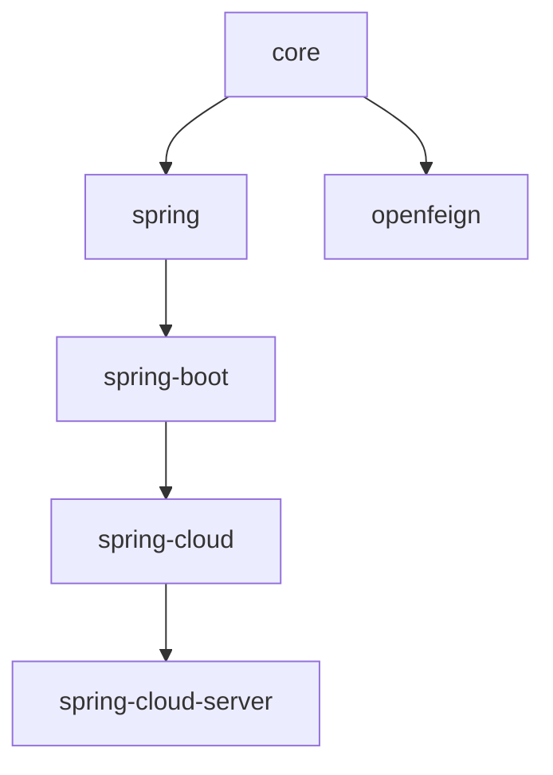

# 用户文档 — 当前线（0.2.x，release 分支）

0.2.x 发布线（`release` 分支，开发版本 `0.2.22-SNAPSHOT`，最新发布 `0.2.21`）的用户文档。

- [English](../README.md) · [1.x 发布线](../../1.x/zh/README.md) · [用户文档总入口](../zh/README.md)

## 兼容性

| **项目** | **要求** |
|----------|----------|
| Java | 17+ |
| Spring Framework | 6.x |
| Spring Boot | 3.x |
| Spring Cloud | 2022.0.x – 2025.0.x |
| 命名空间 | `jakarta.*` |
| BOM | `microsphere-i18n-dependencies:0.2.21` |

## 模块文档

| **模块** | **英文** | **中文** |
|----------|----------|----------|
| microsphere-i18n-dependencies（BOM） | [dependencies.md](../dependencies.md) | [dependencies.md](./dependencies.md) |
| microsphere-i18n-parent | [parent.md](../parent.md) | [parent.md](./parent.md) |
| microsphere-i18n-core | [core.md](../core.md) | [core.md](./core.md) |
| microsphere-i18n-spring | [spring.md](../spring.md) | [spring.md](./spring.md) |
| microsphere-i18n-spring-boot | [spring-boot.md](../spring-boot.md) | [spring-boot.md](./spring-boot.md) |
| microsphere-i18n-spring-cloud | [spring-cloud.md](../spring-cloud.md) | [spring-cloud.md](./spring-cloud.md) |
| microsphere-i18n-spring-cloud-server | [spring-cloud-server.md](../spring-cloud-server.md) | [spring-cloud-server.md](./spring-cloud-server.md) |
| microsphere-i18n-openfeign | [openfeign.md](../openfeign.md) | [openfeign.md](./openfeign.md) |

## 模块依赖关系

先阅读 [dependencies.md](./dependencies.md) 导入 BOM，再按集成层次选择：
[core.md](./core.md)（纯 Java）、[spring.md](./spring.md)、[spring-boot.md](./spring-boot.md)
或 [spring-cloud.md](./spring-cloud.md)。
