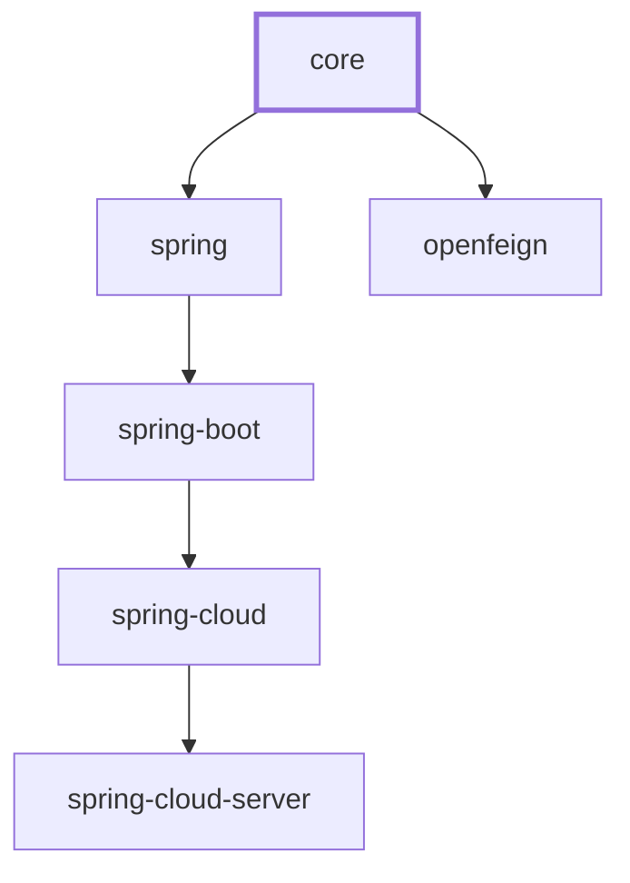

# microsphere-i18n 核心 — 用户指南

本指南介绍 `microsphere-i18n-core` 模块，它是 microsphere-i18n 国际化（i18n）库中与框架无关的基础
模块。它定义了 `ServiceMessageSource` 抽象，以及用于解析本地化消息的 classpath `Properties` 实现。

> 范围：本文仅涵盖 `io.microsphere.i18n` 与 `io.microsphere.i18n.util`。Spring、Spring Boot、
> Spring Cloud 与 OpenFeign 集成位于同级模块中，另有独立文档。core 模块**不依赖 Spring**，它是纯
> Java 17。

## 概述

`microsphere-i18n-core` 用一个显式、可扩展的消息源契约取代了 JDK 的 `ResourceBundle` 模型。一个
**消息源（message source）** 由一个 **source** 名称标识（一组逻辑上归类的消息，通常每个应用或服务
一个），并把一个 **消息码（message code）** 解析为某个所请求的 `java.util.Locale` 对应的本地化
**消息（message）**。

该模块提供：

- 单一根契约 `ServiceMessageSource`，带有生命周期方法（`init()` / `destroy()`）与查找方法
  （`getMessage(...)`）。
- 渐进式能力接口 —— `ResourceServiceMessageSource` 增加了资源加载/跟踪，
  `ReloadableResourceServiceMessageSource` 增加了运行时重载。
- 一条 classpath `Properties` 实现链：`AbstractResourceServiceMessageSource` →
  `PropertiesResourceServiceMessageSource` → `DefaultServiceMessageSource`，它从
  `META-INF/i18n/{source}/` 加载消息文件。
- 一个 `CompositeServiceMessageSource`，把多个消息源聚合到单一入口之后。
- 一个空对象（null-object）实现 `EmptyServiceMessageSource`，用作安全的默认值。
- 工具类 `I18nUtils`（全局消息源访问）与 `MessageUtils`（消息模式解析），以及支持 i18n 的
  `ServiceMessageException`。

消息以 `.properties` 文件存储，其键是带有 source 名称前缀的全限定消息码，例如
`test.hello = Hello,{}`。

## Maven 坐标

项目使用 `io.github.microsphere-projects` 的 groupId，并发布到 Maven Central。0.2.x 版本线跟随
release 分支（最新已发布 `0.2.21`，工作版本 `0.2.22-SNAPSHOT`）。

直接添加 core 依赖：

```xml
<dependency>
    <groupId>io.github.microsphere-projects</groupId>
    <artifactId>microsphere-i18n-core</artifactId>
    <version>0.2.21</version>
</dependency>
```

如果你依赖多个 microsphere-i18n 模块，请导入项目 BOM，而不是逐个固定版本：

```xml
<dependencyManagement>
    <dependencies>
        <dependency>
            <groupId>io.github.microsphere-projects</groupId>
            <artifactId>microsphere-i18n-dependencies</artifactId>
            <version>0.2.21</version>
            <type>pom</type>
            <scope>import</scope>
        </dependency>
    </dependencies>
</dependencyManagement>

<dependencies>
    <dependency>
        <groupId>io.github.microsphere-projects</groupId>
        <artifactId>microsphere-i18n-core</artifactId>
    </dependency>
</dependencies>
```

### 运行时依赖说明

core 模块把它的 `microsphere-java-core` 与 `microsphere-annotation-processor` 依赖声明为 `optional`。
这些库提供了 core 中处处使用的辅助类（`io.microsphere.lang.Prioritized`、`io.microsphere.text.FormatUtils`、
`io.microsphere.util.Assert`、`io.microsphere.util.ClassLoaderUtils`、`io.microsphere.logging` 门面，
以及 `io.microsphere.annotation` 的 `@Nonnull` / `@Nullable` 标记）。当你在应用中使用 core 时，
运行时 classpath 上必须存在 `microsphere-java-core`（基于 Spring 的同级模块会传递性地引入它）。

## 版本与兼容性

| 方面 | 值 |
|--------|-------|
| Artifact | `io.github.microsphere-projects:microsphere-i18n-core` |
| 版本线 | 0.2.x（最新已发布 `0.2.21`；在 `release` 分支上工作版本为 `0.2.22-SNAPSHOT`） |
| Java 基线 | 17 |
| API 命名空间 | `jakarta.*`（不使用 `javax.*`）—— 与下游 web/Spring 模块相关，与 core 本身无关 |
| Spring Framework | 6.x（当与 `microsphere-i18n-spring` 模块组合使用时） |
| Spring Boot | 3.x（当与 `microsphere-i18n-spring-boot` 组合使用时） |
| Spring Cloud | 2022.0.x 到 2025.0.x（当与 `microsphere-i18n-spring-cloud` 组合使用时） |
| 根聚合模块 | `microsphere-i18n` |
| 父模块 | `microsphere-i18n-parent`（导入 BOM `microsphere-spring-cloud-dependencies` `0.2.26`） |
| 项目 BOM | `microsphere-i18n-dependencies` |

core 模块与框架无关，完全不会链接 Spring。上表中的 Spring 代际仅在你把 core 与其下游 Spring 模块
组合使用时才适用。整个项目的 Maven 依赖链为：`spring` → `core`、`spring-boot` → `spring`、
`spring-cloud` → `spring-boot`、`spring-cloud-server` → `spring-cloud`、`openfeign` → `core`。

## 核心概念

### Source（消息源）

**source** 是对消息的一种逻辑分组，用一个 `String` 名称来标识。按惯例 source 与一个应用或服务的
名称一致；框架还保留了一个 `COMMON_SOURCE` 常量，其值为 `"common"`。

- `ServiceMessageSource.COMMON_SOURCE` = `"common"` —— `getSource()` 默认返回的值。
- 对一个已配置的消息源调用 `getSource()` 会返回该 source 自身的名称（例如 `"test"`）。
- source 名称会成为消息码前缀以及资源路径的一部分。`EmptyServiceMessageSource` 是唯一例外：它
  始终报告 `"Empty"`。

### 消息码

**消息码（message code）** 是用于查找消息的键。码在 properties 文件中以**全限定形式**存储，前缀为
source 名称加上点分隔符（`MessageUtils.SOURCE_SEPARATOR` = `"."`）：

```
test.a     = 测试-a
test.hello = 您好,{}
```

在查找时你可以传入短形式（`"a"`）或全形式（`"test.a"`）。前缀由 `resolveMessageCode(...)` 添加，
该方法在 `AbstractResourceServiceMessageSource` 中实现：

```java
@Override
protected String resolveMessageCode(String code) {
    if (code.startsWith(codePrefix)) { // already fully-qualified
        return code;
    }
    return codePrefix + code;          // e.g. "test." + "a" -> "test.a"
}
```

`codePrefix` 在构造函数中以 `source + "."` 构建。因此，在某个 source 的资源文件中声明的每个消息键
都**必须**以该前缀开头；否则加载会失败并抛出 `IllegalStateException`（见下文的*消息文件布局*）。

### 消息模式与 `{}` 占位符

**消息模式（message pattern）** 是与某个码关联存储的原始字符串。在解析时被替换的位置参数以 `{}`
占位符标记，由 `io.microsphere.text.FormatUtils.format` 解析（`AbstractServiceMessageSource.resolveMessage(...)`）。
这是 SLF4J 风格的 `{}` 标记，而不是 `java.text.MessageFormat` 的 `{0}`：

```
test.hello = Hello,{}
```

```java
// test.hello with arg "World" -> "Hello,World"
String message = source.getMessage("hello", Locale.ENGLISH, "World");
```

`MessageUtils` 使用了另一种更高层的“消息模式”概念：形如 `{code}`（由 `MESSAGE_PATTERN_PREFIX` = `"{"`
与 `MESSAGE_PATTERN_SUFFIX` = `"}"` 界定）的字符串被视为对某个消息码的引用。
`MessageUtils.getLocalizedMessage("{hello}", "World")` 会提取内层的 `hello` 码并通过全局消息源解析它。
不含花括号的普通字符串会原样返回。

### Locale 回退

解析会规范化所请求的 locale，并在未命中时从“语言+国家”的 locale 回退到其“仅语言”的形式。
`AbstractServiceMessageSource.getMessage` 中的算法为：

1. 解析码（`resolveMessageCode`）并规范化 locale（`resolveLocale`）。
2. 使用精确的所请求 locale 查找消息。
3. 若未找到，则在 `new Locale(locale.getLanguage())`（仅语言）与所请求 locale 不同*时*，用它重试一次。

因此，对 `zh_CN` 的请求会先尝试 `zh_CN` 资源，未命中时再尝试 `zh` 资源。

`setSupportedLocales(Collection<Locale>)` 还会把所配置的 locale 扩展为一个**层级（hierarchical）** 集合
（`resolveHierarchicalLocales`）：每个 `language_country` 的 locale 都会带上其 `language` 的 locale，并在
一个固定的 `LinkedHashSet` 中保留插入顺序。

`getMessage(code, args)`（不带显式 locale 的重载）所使用的运行时 locale 来自 `getLocale()`，当子类
提供了 `getInternalLocale()` 时返回它，否则返回 `getDefaultLocale()`。`getDefaultLocale()` 返回通过
`setDefaultLocale(...)` 设置的值，回退到 `Locale.getDefault()`。

## API 参考

除另有说明外，以下所有类型都位于 `io.microsphere.i18n`。签名逐字取自模块源码。

### `ServiceMessageSource`（接口）

`public interface ServiceMessageSource extends io.microsphere.lang.Prioritized`

根契约。由于它继承了 `Prioritized`（即 `Comparable`），实现可以按优先级排序 —— 供
`CompositeServiceMessageSource` 使用。

| 成员 | 说明 |
|--------|-------------|
| `String COMMON_SOURCE = "common"` | 默认 source 名称。 |
| `void init()` | 初始化生命周期（在实现中加载资源）。 |
| `void destroy()` | 销毁生命周期（释放资源）。 |
| `@Nullable String getMessage(String code, Locale locale, Object... args)` | 核心查找；未找到时返回 `null`。 |
| `default @Nullable String getMessage(String code, Object... args)` | 使用来自 `getLocale()` 的运行时 locale 进行查找。 |
| `@Nonnull Locale getLocale()` | 运行时 locale。 |
| `default @Nonnull Locale getDefaultLocale()` | 默认为 `Locale.getDefault()`。 |
| `default @Nonnull Set<Locale> getSupportedLocales()` | 默认为 `{getDefaultLocale(), ENGLISH}`。 |
| `default String getSource()` | 默认返回 `COMMON_SOURCE`。 |
| `@Nonnull String toString()` | 被重写为返回非 null。 |

### `AbstractServiceMessageSource`（抽象类）

`public abstract class AbstractServiceMessageSource implements ServiceMessageSource`

处理消息解析、locale 管理与码解析的基础实现。它持有一个按类的 `logger`、不可变的 `source` 与派生的
`codePrefix`，外加可变的 `supportedLocales` 与 `defaultLocale`。公共查找方法被声明为 `final`，因此子类
只能通过受保护的钩子来插入行为。

关键方法：

```java
public AbstractServiceMessageSource(String source)                 // asserts source != null, codePrefix = source + "."
public final String getMessage(String code, Object... args)        // delegates to the interface default
public final String getMessage(String code, Locale locale, Object... args)
public final Locale getLocale()                                    // getInternalLocale() ?: getDefaultLocale()
public final Locale getDefaultLocale()                             // configured defaultLocale ?: super
public final Set<Locale> getSupportedLocales()                     // configured supportedLocales ?: super
public final String getSource()
public final void setDefaultLocale(Locale defaultLocale)
public final void setSupportedLocales(Collection<Locale> supportedLocales)  // stores the hierarchical expansion
protected Locale getInternalLocale()                               // returns null by default (override point)
protected boolean supports(Locale locale)
protected void assertSupportedLocales(Collection<Locale> supportedLocales) // rejects empty / null elements
protected Set<Locale> resolveHierarchicalLocales(Collection<Locale> supportedLocales)
protected Set<Locale> resolveHierarchicalLocales(Locale locale)
protected void addLocale(Collection<Locale> locales, Locale locale)
protected Locale resolveLocale(Locale locale)                      // normalizes language + region
protected String resolveMessage(String message, Object... args)    // FormatUtils.format
protected abstract String resolveMessageCode(String code)
protected abstract @Nullable String getInternalMessage(String code, String resolvedCode, Locale locale, Locale resolvedLocale, Object... args)
```

`getMessage(code, locale, args)` 执行*Locale 回退*一节中描述的两步回退。`args` 会被转发给
`getInternalMessage`。`locale` 参数是必需的（在回退构造“仅语言”locale 时会被解引用）。

### `ResourceServiceMessageSource`（接口）

`public interface ResourceServiceMessageSource extends ServiceMessageSource`

增加了资源维度 —— 跟踪哪些底层资源已被加载。

```java
void initializeResource(String resource)
default void initializeResources(Iterable<String> resources)   // resources.forEach(this::initializeResource)
@Nonnull Set<String> getInitializedResources()
default @Nonnull Charset getEncoding()                          // UTF-8 by default
```

### `ReloadableResourceServiceMessageSource`（接口）

`public interface ReloadableResourceServiceMessageSource extends ResourceServiceMessageSource`

增加了运行时重载。默认方法使消息源可重载，并把 `reload(...)` 路由回 `initializeResource(s)(...)`：

```java
boolean canReload(String changedResource)                          // "supported by default" in implementations
default boolean canReload(Iterable<String> changedResources)       // true if any single resource is reloadable
default void reload(String changedResource)                        // initializeResource(changedResource)
default void reload(Iterable<String> changedResources)             // initializeResources(changedResources)
```

### `AbstractResourceServiceMessageSource`（抽象类）

`public abstract class AbstractResourceServiceMessageSource extends AbstractServiceMessageSource implements ResourceServiceMessageSource`

核心主力类。它维护 `private volatile Map<String, Map<String, String>> localizedResourceMessages`
—— 外层键 = 资源路径，内层键 = 消息码，值 = 消息模式 —— 并实现与 `Properties` 无关的加载、校验与查找
逻辑。

常量：

```java
public static final String DEFAULT_RESOURCE_NAME_PREFIX = "i18n_messages_";
public static final String DEFAULT_RESOURCE_NAME_SUFFIX = ".properties";
```

关键方法：

```java
public AbstractResourceServiceMessageSource(String source)
public void init()                                   // asserts source, then initialize()
public void destroy()                                // clearAllMessages()
public void initializeResource(String resource)      // delegates to initializeResources(singleton(resource))
public void initializeResources(Iterable<String> resources)  // copy-on-write inside synchronized(this), see developer guide
protected String resolveMessageCode(String code)     // adds codePrefix unless already present
protected String getInternalMessage(...)             // map lookup by resolvedLocale + FormatUtils.format
protected final void initialize()                    // loads resources for all supported locales
protected final void clearAllMessages()
public String getResource(Locale locale)             // e.g. META-INF/i18n/test/i18n_messages_en.properties
protected String buildResourceName(Locale locale)    // i18n_messages_<locale>.properties
public final @Nullable Map<String,String> getMessages(Locale locale)
public Map<String,Map<String,String>> getLocalizedResourceMessages()   // unmodifiable view
public Set<String> getInitializedResources()                          // keySet of the map
public final @Nonnull Set<String> getResources()                       // resource paths for supported locales
protected void validateMessageCode(String code, String resourceName)   // throws IllegalStateException on bad prefix
protected abstract String getResource(String resourceName)
protected abstract @Nonnull Map<String,String> loadMessages(String resource)
```

`loadMessages(String)` 是每个具体子类必须提供的唯一抽象加载原语（来自 properties 文件、远程存储等）。
每次加载后，每个码都会针对 `codePrefix` 进行校验；一旦违规即中止初始化。

### `PropertiesResourceServiceMessageSource`（抽象类）

`public abstract class PropertiesResourceServiceMessageSource extends AbstractResourceServiceMessageSource`

把加载逻辑适配到 Java `Properties` 文件。

```java
public PropertiesResourceServiceMessageSource(String source)
protected final Map<String,String> loadMessages(String resource)  // Properties -> Map<String,String>; wraps IOException as RuntimeException
public @Nullable Properties loadAllProperties(Locale locale) throws IOException
public @Nullable Properties loadAllProperties(String resource) throws IOException  // merges all readers; null if none
protected abstract String getResource(String resourceName)
protected abstract List<Reader> loadAllPropertiesResources(String resource) throws IOException
```

`loadAllProperties(String)` 会打开**所有**共享同一路径的资源（跨多个 JAR 的 classpath 扫描），并把它们的
`Properties` 合并进一个对象；随后 `loadMessages` 将其复制为一个不可修改的 `Map<String,String>`（什么都没找到
时返回空 map，因此缺失文件并非错误）。

### `DefaultServiceMessageSource`（具体类）

`public class DefaultServiceMessageSource extends PropertiesResourceServiceMessageSource implements ReloadableResourceServiceMessageSource`

开箱即用的 classpath 实现，从 `META-INF/i18n/{source}/` 加载。

```java
public static final String RESOURCE_LOCATION_PATTERN = "META-INF/i18n/{}/{}";
public DefaultServiceMessageSource(String source)
public DefaultServiceMessageSource(String source, @Nullable ClassLoader classLoader)  // null -> default classloader
public boolean canReload(String changedResource)        // true when the classloader still sees the resource
protected String getResource(String resourceName)       // formats RESOURCE_LOCATION_PATTERN with getSource() and name
protected List<Reader> loadAllPropertiesResources(String resource) throws IOException  // InputStreamReader per URL, using getEncoding()
protected Enumeration<URL> getResources(String resource) throws IOException
```

`classLoader` 存储在一个 final、非 null 的字段中。因此 `getResource(Locale)` 把一个 locale 映射到一个完整
路径，例如 `META-INF/i18n/test/i18n_messages_zh_CN.properties`。

### `CompositeServiceMessageSource`（具体类）

`public class CompositeServiceMessageSource implements ReloadableResourceServiceMessageSource`

把子消息源聚合到单一接口之后，并且如文档所述，其**变更操作非线程安全**。委托会返回第一个非 null 的消息。

```java
public CompositeServiceMessageSource()                                   // empty list
public CompositeServiceMessageSource(List<? extends ServiceMessageSource> serviceMessageSources)
public void init()                                                        // init() each child
public String getMessage(String code, Locale locale, Object... args)      // first non-null from children
public @Nonnull Locale getLocale()                                        // first child, else getDefaultLocale()
public @Nonnull Locale getDefaultLocale()                                 // first child's locale, else super
public @Nonnull Set<Locale> getSupportedLocales()                         // union; default set when empty
public Set<Locale> getDefaultSupportedLocales()
public String getSource()                                                 // always COMMON_SOURCE
public void setServiceMessageSources(List<? extends ServiceMessageSource> serviceMessageSources)  // sorts by priority
public void reload(Iterable<String> changedResources)                     // reloads children that canReload
public void reload(String changedResource)
public boolean canReload(String changedResource)                          // always true
public boolean canReload(Iterable<String> changedResources)               // always true
public void initializeResource(String resource)
public void initializeResources(Iterable<String> resources)               // forwarded to ResourceServiceMessageSource children
public Set<String> getInitializedResources()                              // union over children
public Charset getEncoding()
public @Nonnull List<ServiceMessageSource> getServiceMessageSources()      // unmodifiable view
public void destroy()
```

`getSource()` 始终返回 `"common"` —— 组合体本身不绑定到单一 source 名称。`getSupportedLocales()` 返回每个
子源 locale 的不可修改并集，当没有子源时回退到 `getDefaultSupportedLocales()`。

### `EmptyServiceMessageSource`（具体类）

`public class EmptyServiceMessageSource implements ServiceMessageSource`

一个始终返回 `null` 的空对象（null object）。当未配置任何真实消息源时，作为安全回退使用。

```java
public static final EmptyServiceMessageSource INSTANCE;   // shared singleton
public EmptyServiceMessageSource()
public void init()                                         // no-op
public void destroy()                                      // no-op
public String getMessage(String code, Locale locale, Object... args)   // null
public @Nonnull Locale getLocale()                          // getDefaultLocale()
public String getSource()                                   // "Empty"
```

### `ServiceMessageException`（具体类）

`public class ServiceMessageException extends RuntimeException`

一个携带消息模式与参数的运行时异常；其本地化文本通过 `MessageUtils` 惰性产生。

```java
public ServiceMessageException(String message, Object... args)
public String getMessage()             // the raw pattern, e.g. "{hello}"
public String getLocalizedMessage()    // MessageUtils.getLocalizedMessage(message, args)
public String toString()               // ServiceMessageException[message='...', args=[...], localized message='...']
```

### `io.microsphere.i18n.util.I18nUtils`

`public abstract class I18nUtils`（私有构造函数；静态持有者）

对当前活动 `ServiceMessageSource` 的 JVM 级全局访问，保存在一个 `volatile` 字段中。当尚未设置任何消息源时，
`serviceMessageSource()` 会记录一条警告并返回 `EmptyServiceMessageSource.INSTANCE`。

```java
public static @Nonnull ServiceMessageSource serviceMessageSource()
public static void setServiceMessageSource(ServiceMessageSource serviceMessageSource)
public static void destroyServiceMessageSource()               // nulls the holder
public static List<ServiceMessageSource> findAllServiceMessageSources(ServiceMessageSource serviceMessageSource)
public static <S extends ServiceMessageSource> List<S> findAllServiceMessageSources(ServiceMessageSource serviceMessageSource, Class<S> serviceMessageSourceType)
```

`findAllServiceMessageSources(...)` 会递归地把一棵 `CompositeServiceMessageSource` 树展平为其叶子消息源
（一个非组合体消息源本身就是它自己的叶子）。

### `io.microsphere.i18n.util.MessageUtils`

`public abstract class MessageUtils`（私有构造函数）

针对全局消息源解析 `{code}` 消息模式。

```java
public static final String MESSAGE_PATTERN_PREFIX = "{";
public static final String MESSAGE_PATTERN_SUFFIX = "}";
public static final String SOURCE_SEPARATOR = ".";
public static String getLocalizedMessage(String messagePattern, Object... args)
public static String getLocalizedMessage(String messagePattern, Locale locale, Object... args)
public static String resolveMessageCode(String messagePattern)   // substringBetween(pattern, "{", "}")
```

`getLocalizedMessage` 的行为（如模块测试所断言）：

- `null` 返回 `null`。
- 不含 `{...}` 的字符串原样返回（没有可解析的码）。
- `{code}` 会针对全局消息源解析；命中时返回本地化消息。
- 未命中时，如果码中含有一个 `.` 则返回第一个点之后的文本，否则返回原始模式。例如
  `{microsphere-test.code-not-found}` → `code-not-found`，而 `{code-not-found}`（无点）→ `{code-not-found}`。

## 消息文件布局

对于 `DefaultServiceMessageSource`，消息文件放置于 classpath 下的：

```
META-INF/i18n/{source}/i18n_messages_{locale}.properties
```

- `{source}` —— 传入构造函数的 source 名称（例如 `test`）。
- `{locale}` —— `java.util.Locale.toString()`，例如 `en`、`zh_CN`、`fr_FR`。
- 文件名由 `buildResourceName(locale)` 生成 = `i18n_messages_` + locale + `.properties`。
- 目录前缀由 `RESOURCE_LOCATION_PATTERN`（字面值 `META-INF/i18n/{}/{}`）生成。

文件中每个键都必须以 `{source}.`（即 `codePrefix`）为前缀；若不然 —— 例如在 `error` source 中声明 `test.b`
—— 会导致 `validateMessageCode` 在初始化期间抛出 `IllegalStateException`。

core 的测试资源正是使用了这一布局：

```
src/test/resources/META-INF/i18n/test/i18n_messages_en.properties
    test.a = test-a
    test.hello = Hello,{}

src/test/resources/META-INF/i18n/test/i18n_messages_zh_CN.properties
    test.a = 测试-a
    test.hello = 您好,{}

src/test/resources/META-INF/i18n/error/i18n_messages_zh_CN.properties   (deliberately invalid)
    error.a = a
    test.b = b          <-- wrong prefix: makes source "error" fail to load
```

## 代码示例

以下示例忠实改写自模块的 `src/test` 类。

### 基本 classpath 用法

改写自 `ServiceMessageSource`/`DefaultServiceMessageSource` 与 `DefaultServiceMessageSourceTest.testGetMessage`：

```java
DefaultServiceMessageSource source = new DefaultServiceMessageSource("test");
source.init();

// Default runtime locale (tests force Locale.setDefault(Locale.SIMPLIFIED_CHINESE))
assertEquals("测试-a",     source.getMessage("a"));
assertEquals("您好,World", source.getMessage("hello", "World"));

// Explicit English locale against test/i18n_messages_en.properties
assertEquals("Hello,World", source.getMessage("hello", Locale.ENGLISH, "World"));

source.destroy();
```

### 配置默认与受支持的 locale

来自 `AbstractServiceMessageSource` 与 `ServiceMessageExceptionTest.before`：

```java
DefaultServiceMessageSource source = new DefaultServiceMessageSource("test");
source.setDefaultLocale(Locale.SIMPLIFIED_CHINESE);
source.setSupportedLocales(List.of(Locale.SIMPLIFIED_CHINESE));
source.init();
```

`setSupportedLocales` 存储层级扩展，因此 `getSupportedLocales()` 对 `List.of(Locale.CHINESE)` 得到 `{zh}`
（没有可展开的国家），而一个 `zh_CN` 条目则会附带 `zh`。

### 按 locale 加载原始 properties

来自 `DefaultServiceMessageSourceTest.testLoadAllProperties`：

```java
DefaultServiceMessageSource source = new DefaultServiceMessageSource("test");
source.init();

for (Locale locale : source.getSupportedLocales()) {
    assertNotNull(source.loadAllProperties(locale));   // en and zh_CN both resolve
}
assertNull(source.loadAllProperties(Locale.FRANCE));    // no i18n_messages_fr.properties exists
```

### 组合体委托

改写自 `CompositeServiceMessageSourceTest.setUp` 与 `testGetMessage`：

```java
DefaultServiceMessageSource real = new DefaultServiceMessageSource("test");

CompositeServiceMessageSource composite = new CompositeServiceMessageSource(
        List.of(EmptyServiceMessageSource.INSTANCE, real));
composite.init();

// The empty source yields null, so the composite falls through to the real source.
// The test asserts composite.getMessage(code, args) equals real.getMessage(code, args).
assertEquals(real.getMessage("a"),     composite.getMessage("a"));
assertEquals(real.getMessage("hello", "world"), composite.getMessage("hello", "world"));
assertEquals("Hello,World", composite.getMessage("hello", Locale.ENGLISH, "World"));

composite.destroy();
```

组合体的 `getSource()` 始终为 `"common"`，而 `getInitializedResources()` 是其各 `ResourceServiceMessageSource`
子源资源的并集。

### 全局消息源访问与消息模式解析

改写自 `I18nUtilsTest` 与 `MessageUtilsTest`：

```java
// Before any source is configured, the holder is the null object.
assertSame(EmptyServiceMessageSource.INSTANCE, I18nUtils.serviceMessageSource());

DefaultServiceMessageSource source = new DefaultServiceMessageSource("test");
source.init();
I18nUtils.setServiceMessageSource(source);

// MessageUtils resolves {code} patterns through the global source.
assertEquals(null,          MessageUtils.getLocalizedMessage(null));
assertEquals("a",           MessageUtils.getLocalizedMessage("a"));            // no braces -> unchanged
assertEquals("测试-a",       MessageUtils.getLocalizedMessage("{a}"));
assertEquals("您好,World",   MessageUtils.getLocalizedMessage("{hello}", "World"));
assertEquals("Hello,World", MessageUtils.getLocalizedMessage("{hello}", Locale.ENGLISH, "World"));

// Code-not-found fallbacks:
assertEquals("{code-not-found}",        MessageUtils.getLocalizedMessage("{code-not-found}"));
assertEquals("code-not-found",          MessageUtils.getLocalizedMessage("{microsphere-test.code-not-found}"));

I18nUtils.destroyServiceMessageSource();
```

### 展平组合体层级

改写自 `I18nUtilsTest.testFindAllServiceMessageSources`：

```java
CompositeServiceMessageSource composite =
        new CompositeServiceMessageSource(List.of(EmptyServiceMessageSource.INSTANCE));

assertEquals(List.of(EmptyServiceMessageSource.INSTANCE),
             I18nUtils.findAllServiceMessageSources(composite));
assertEquals(List.of(EmptyServiceMessageSource.INSTANCE),
             I18nUtils.findAllServiceMessageSources(composite, EmptyServiceMessageSource.class));
```

### 本地化异常

改写自 `ServiceMessageExceptionTest`：

```java
// With the global source configured for source "test" and default locale zh_CN:
ServiceMessageException e = new ServiceMessageException("{hello}", "World");
assertEquals("{hello}",      e.getMessage());          // raw pattern
assertEquals("您好,World",   e.getLocalizedMessage());  // resolved via MessageUtils
```

### 检测无效消息码

改写自 `DefaultServiceMessageSourceTest.testValidateMessageCode` —— 加载 `error` source 会抛出异常，因为其文件
中含有外来前缀的键 `test.b`：

```java
assertThrows(IllegalStateException.class, () -> {
    DefaultServiceMessageSource bad = new DefaultServiceMessageSource("error");
    bad.initialize();
});
```

## 模块依赖关系

`core` 无上游 i18n 模块；`spring` 与 `openfeign` 构建于其上。


