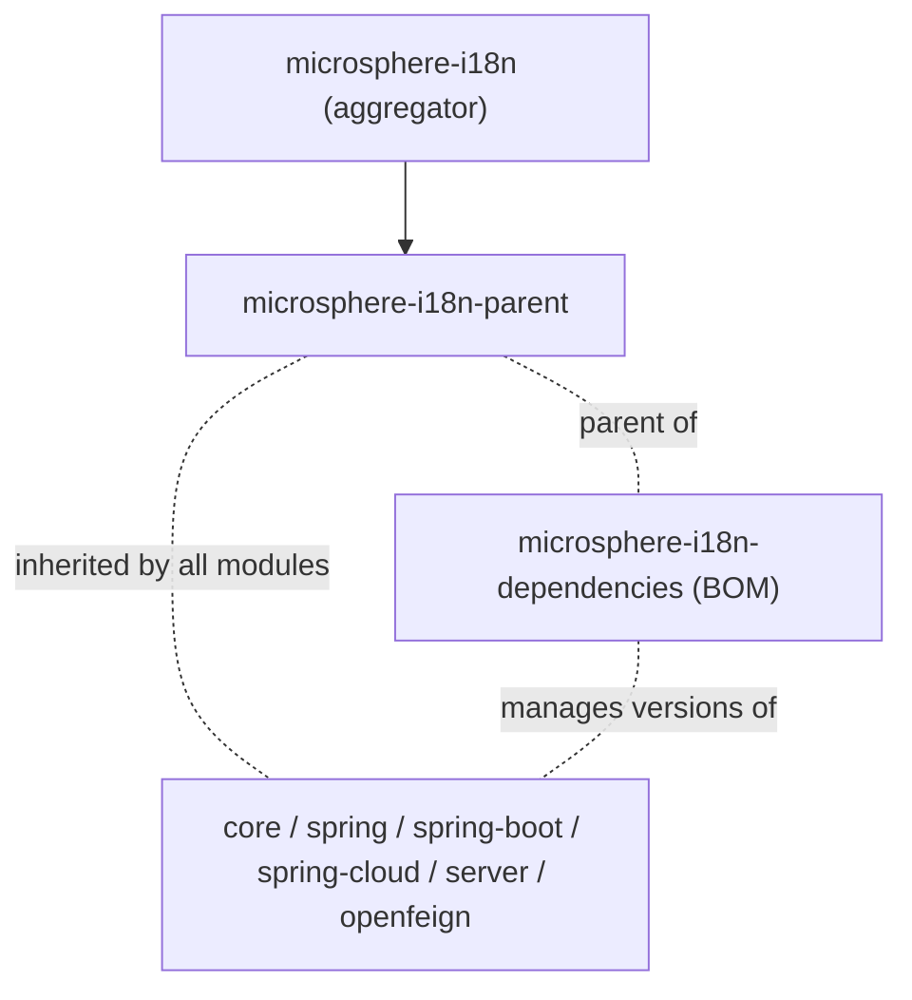

# Dependencies BOM（`microsphere-i18n-dependencies`）

`microsphere-i18n-dependencies` 是本项目的物料清单（Bill of Materials）。它是一个纯 POM 模块
（`<packaging>pom</packaging>`），内容只有一个 `<dependencyManagement>` 块，列出所有
`microsphere-i18n-*` 构件及其 Reactor 版本。应用方应当使用这个构件；[Parent POM](parent.md) 是用于
构建项目自身的。

## 目的

- 让所有 microsphere-i18n 模块保持同一版本，避免项目中出现
  `microsphere-i18n-core:0.2.20` 与 `microsphere-i18n-spring-boot:0.2.21` 混用的情况。
- 让你在每个 i18n 依赖上都可以省略 `<version>`。
- 只需改动一处坐标：升级 BOM 版本即可整体迁移 i18n 版本线。

该 POM 没有 `<dependencies>`、没有插件、也没有自己的属性。它的 parent 是
`microsphere-i18n-parent`，第三方 BOM 的导入就放在那里。

## 被管理的构件

见 `microsphere-i18n-dependencies/pom.xml`（全部使用 `${revision}`，构建时会被 flatten 为具体的发布
版本，例如 `0.2.21`）：

| 构件                                       | 打包方式 | 提供的能力                                                    |
|--------------------------------------------|----------|----------------------------------------------------------------|
| `microsphere-i18n-core`                    | jar      | `ServiceMessageSource` 抽象与 classpath 消息加载                |
| `microsphere-i18n-openfeign`               | jar      | Feign 调用使用的 `AcceptLanguageHeaderRequestInterceptor`       |
| `microsphere-i18n-spring`                  | jar      | Spring Framework 集成（`@EnableI18n`、各类适配器）              |
| `microsphere-i18n-spring-boot`             | jar      | Spring Boot 自动配置与 Actuator 端点                             |
| `microsphere-i18n-spring-cloud`            | jar      | 通过 Spring Cloud 配置实现消息动态刷新                           |
| `microsphere-i18n-spring-cloud-server`     | jar      | 集中式 i18n 服务端（`GET /messages`、`@EnableI18nServer`）       |

Reactor 中的两个纯 POM 模块（`microsphere-i18n-parent` 与 `microsphere-i18n-dependencies` 自身）
有意不出现在管理清单中——它们属于构建配置，不是库。

## 导入 BOM（推荐）

```xml

<properties>
    <microsphere-i18n.version>0.2.21</microsphere-i18n.version>
</properties>

<dependencyManagement>
    <dependencies>
        <dependency>
            <groupId>io.github.microsphere-projects</groupId>
            <artifactId>microsphere-i18n-dependencies</artifactId>
            <version>${microsphere-i18n.version}</version>
            <type>pom</type>
            <scope>import</scope>
        </dependency>
    </dependencies>
</dependencyManagement>

<dependencies>
    <dependency>
        <groupId>io.github.microsphere-projects</groupId>
        <artifactId>microsphere-i18n-spring-boot</artifactId>
    </dependency>
    <dependency>
        <groupId>io.github.microsphere-projects</groupId>
        <artifactId>microsphere-i18n-openfeign</artifactId>
    </dependency>
</dependencies>
```

导入顺序很重要：同一个 `<dependencyManagement>` 段内，**最先**匹配到 `groupId:artifactId` 的条目生效。
如果你同时还导入了 `spring-boot-dependencies` 或其他提及这些构件的 BOM，请把更权威的那个放在前面。

## 继承 BOM（可选方案）

把 BOM 声明为项目 parent，也能通过继承获得同样的版本管理，而无需 `import`：

```xml

<parent>
    <groupId>io.github.microsphere-projects</groupId>
    <artifactId>microsphere-i18n-dependencies</artifactId>
    <version>0.2.21</version>
    <relativePath/>
</parent>
```

这对于小型内部项目很方便，但它会把你的 POM 耦合到 Microsphere 的 parent 链上（该 BOM 自己的 parent
`microsphere-i18n-parent` 导入了 `microsphere-spring-cloud-dependencies:0.2.26`，后者又引入 Spring
Boot 与 Spring Cloud 的 BOM）。对于应用项目，更推荐 `import`，把 parent 留给公司自身的构建规范。

## 覆盖版本

由于发布出去的 BOM 中写的是**字面量**版本（构建会用 flatten 把 `${revision}` 替换掉），你无法通过
属性来改变某个 i18n 模块的版本。要覆盖，就在自己的 `<dependencyManagement>` 中先于导入重新声明该条目：

```xml

<dependencyManagement>
    <dependencies>
        <!-- 被固定的模块：因为它声明在最前面，所以优先于导入的 BOM -->
        <dependency>
            <groupId>io.github.microsphere-projects</groupId>
            <artifactId>microsphere-i18n-core</artifactId>
            <version>0.2.20</version>
        </dependency>
        <dependency>
            <groupId>io.github.microsphere-projects</groupId>
            <artifactId>microsphere-i18n-dependencies</artifactId>
            <version>0.2.21</version>
            <type>pom</type>
            <scope>import</scope>
        </dependency>
    </dependencies>
</dependencyManagement>
```

直接写在 `<dependency>` 上的 `<version>` 永远优先于版本管理。把单个模块固定到其他发布版本是可行的，
但通常并不明智：这些模块是一起编译的，并共享 `io.microsphere.i18n` 的 API，混用版本线可能破坏二进制
兼容性。

第三方构件的覆盖遵循标准 Maven 规则——在你自己的 `dependencyManagement` 中重新声明
`org.springframework:spring-webmvc`、`io.github.openfeign:feign-core`、
`jakarta.servlet:jakarta.servlet-api` 等；如果你直接导入了 `spring-boot-dependencies`，也可以使用它
导出的那些知名版本属性（`<spring-framework.version>`、`<feign.version>` 等）。

## 版本与兼容性

| 项目                     | 取值                                                          |
|--------------------------|----------------------------------------------------------------|
| 坐标                     | `io.github.microsphere-projects:microsphere-i18n-dependencies` |
| 类型                     | `pom`（BOM）                                                   |
| 当前版本线               | `0.2.x`，最新已发布 `0.2.21`                                  |
| Java                     | 17                                                             |
| 命名空间                 | `jakarta.*`                                                    |
| Spring Boot              | 3.x                                                            |
| Spring Cloud             | 2022.0.x – 2025.0.x                                            |
| `1.x` 版本线             | `0.1.x`（最新 `0.1.21`），Spring Boot 2.x / Spring Cloud Hoxton – 2021.0.x，见 1.x 文档 |

BOM 只管理 i18n 构件本身；你的应用通过该 BOM 的 parent 链解析到的 Spring Boot / Spring Cloud 版本，
是构建时烧入的 Spring Cloud 代际所决定的那组版本。如果你需要显式对齐第三方版本，请同时在自己的 POM 中
导入 `spring-boot-dependencies` 或 `spring-cloud-dependencies`。

## 常见问题

- **`'dependencies.dependency.version' ... is missing`** —— BOM 没有生效：检查
  `<type>pom</type>` 与 `<scope>import</scope>` 是否成对出现，并确认 artifactId 是
  `microsphere-i18n-dependencies`（不是 `microsphere-i18n`）。
- **运行期找不到 `javax.servlet` 类** —— `1.x` 的模块混进了 `0.2.x` 构建。`0.2.x` 版本线只使用
  `jakarta.*`。
- **各模块版本不一致** —— 你在某个模块上写了 `<version>`；删掉它，交给 BOM 决定。
- **模块能解析但拦截器 Bean 缺失** —— BOM 只管理构件版本，不会注册 Bean；必需的 `@Bean` 声明见
  [OpenFeign](openfeign.md)。

## 相关文档

- [Parent POM](parent.md) —— 构建侧的对应模块
- 开发者指南：[Dependencies BOM](../../../developer-guide/current/zh/dependencies.md)

## 模块依赖关系

POM 构建结构：


