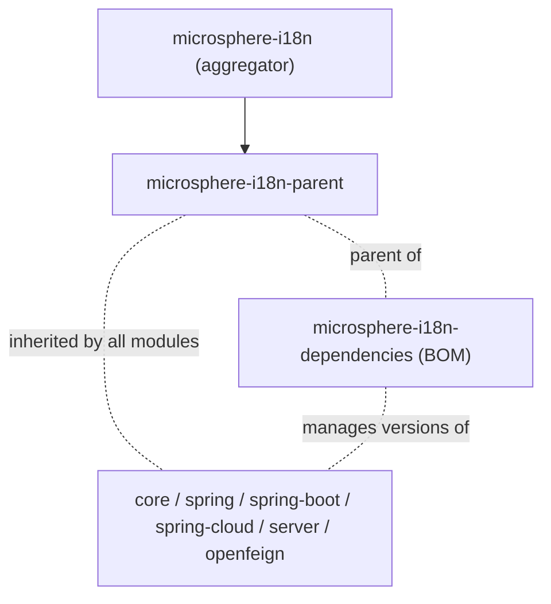

# Parent POM（`microsphere-i18n-parent`）

`microsphere-i18n-parent` 是一个纯 POM 模块（`<packaging>pom</packaging>`）。它不发布任何类，除
POM 之外没有产物；它的职责是让项目的其他所有模块共享同一套受管制的第三方版本。

## 目的

该 POM 只做三件事（见 `microsphere-i18n-parent/pom.xml`）：

1. 继承项目的根聚合 POM `microsphere-i18n`（`<relativePath>../pom.xml</relativePath>`），而根 POM
   自身又继承 `io.github.microsphere-projects:microsphere-spring-cloud-parent:0.2.26`。
2. 声明一个属性：

   ```xml
   <microsphere-spring-cloud.version>0.2.26</microsphere-spring-cloud.version>
   ```

3. 在 `dependencyManagement` 中导入一个 BOM：

   ```xml

   <dependency>
       <groupId>io.github.microsphere-projects</groupId>
       <artifactId>microsphere-spring-cloud-dependencies</artifactId>
       <version>${microsphere-spring-cloud.version}</version>
       <type>pom</type>
       <scope>import</scope>
   </dependency>
   ```

正是这一个导入把 Spring Boot、Spring Cloud、Spring Cloud Alibaba、JUnit、Testcontainers 以及
Microsphere Spring Boot 系列构件锁定为一组彼此协调的版本，作用于整个 Reactor。它自身不定义插件、
不定义 profile，也没有 `<dependencies>`。

## 何时使用

| 场景                                              | 应该使用                                                     |
|---------------------------------------------------|---------------------------------------------------------------|
| 应用消费 microsphere-i18n                        | 导入 [`microsphere-i18n-dependencies` BOM](dependencies.md)，而不是本 parent |
| 构建或贡献 microsphere-i18n                      | 该 parent 已经接入，你的 POM 不需要额外配置                  |
| 为 microsphere-i18n Reactor 新增模块             | 把 `microsphere-i18n-parent` 设为新模块的 `<parent>`         |
| 构建与之并列的私有扩展模块                       | 可以将其设为 `<parent>`，但必须同时对齐 `${revision}` 与源码仓库 |

框架各模块都遵循同一模式——`core`、`openfeign`、`spring`、`spring-boot`、`spring-cloud`、
`spring-cloud-server`，乃至 `dependencies` BOM 本身，都把 `microsphere-i18n-parent` 声明为
`<parent>`，版本写作 `<version>${revision}</version>`。

## 把它作为 parent 使用

```xml

<parent>
    <groupId>io.github.microsphere-projects</groupId>
    <artifactId>microsphere-i18n-parent</artifactId>
    <version>0.2.21</version>
    <relativePath/>
</parent>

<groupId>com.example</groupId>
<artifactId>my-i18n-extension</artifactId>
<version>1.0.0-SNAPSHOT</version>
```

空的 `<relativePath/>` 会强制从仓库而不是文件系统解析。此后，属于受管制集合的依赖可以不写版本，例如：

```xml

<dependency>
    <groupId>org.springframework</groupId>
    <artifactId>spring-webmvc</artifactId>
</dependency>
```

不要把它与面向使用方的 BOM 混淆：`microsphere-i18n-parent` **不**管理 `microsphere-i18n-*` 构件自身的
版本，那是 `microsphere-i18n-dependencies` 的职责。

## 管理了哪些内容

`microsphere-i18n-parent` 向 `dependencyManagement` 只贡献一条内容——对
`microsphere-spring-cloud-dependencies:0.2.26` 的导入。通过这条链，Reactor 中的以下构件可以获得版本：

| 被管理的分组                                                     | 来源                                                       |
|------------------------------------------------------------------|--------------------------------------------------------------|
| `org.springframework.boot:*`（以及 `spring-boot-dependencies` 管理的全部内容，包括 `spring-*`、`jakarta.servlet-api`、Logback、Tomcat） | `spring-boot-dependencies`，版本由激活的代际 profile 决定 |
| `org.springframework.cloud:*`                                    | `spring-cloud-dependencies`                                 |
| `com.alibaba.cloud:*`                                            | `spring-cloud-alibaba-dependencies`                          |
| `io.github.microsphere-projects:*`（Microsphere Spring Boot 线） | `microsphere-spring-boot-dependencies:0.2.34`                |
| `io.github.microsphere-projects:microsphere-spring-cloud-commons`、`microsphere-spring-cloud-openfeign` | `microsphere-spring-cloud-dependencies:0.2.26`             |
| `org.junit:*`、`org.junit.jupiter:*`                             | `junit-bom:6.1.3`                                            |
| `org.testcontainers:*`                                           | `testcontainers-bom:2.0.5`                                   |

来自构建产物的实证（模块 `microsphere-i18n-openfeign`）：`spring-webmvc:6.2.19`、
`spring-core:6.2.19`、`feign-core:13.6.1`、`jakarta.servlet-api:6.0.0`、`junit-jupiter:6.1.3`、
`microsphere-java-core:0.3.19` —— 这些版本都不写在模块 POM 里，全部来自这条 parent 链。

## 版本与兼容性

parent 与项目其余模块在同一发布列车中发布，因此始终携带 Reactor 的 `${revision}` 版本（例如
`0.2.21`）。

| microsphere-i18n 版本线 | Parent POM 版本        | 上游 `microsphere-spring-cloud` 版本 | Java | Spring Boot | Spring Cloud |
|-------------------------|------------------------|---------------------------------------|------|-------------|--------------|
| `0.2.x`（当前）         | `0.2.x`，例如 `0.2.21` | `0.2.26`                              | 17（Reactor POM 中的 `java.version` 属性） | 3.x | 2022.0.x – 2025.0.x |
| `1.x`                   | `0.1.x`，例如 `0.1.21` | `0.1.26`                              | Reactor POM 未声明 | 2.x | Hoxton – 2021.0.x |

在 `0.2.x` 版本线内部，某次构建实际使用的 Spring Boot / Spring Cloud 组合由继承自
`microsphere-spring-cloud-parent:0.2.26` 的 Maven profile 决定，profile 表以及 CI 的使用方式见
[开发者指南](../../../developer-guide/current/zh/parent.md)。

## 说明

- 因为它是不含代码的 POM，运行期没有可测试内容；这个模块的“测试”就是 Reactor 能解析、能编译。
- 升级 `microsphere-spring-cloud.version` 是拉动项目全部第三方依赖版本的唯一开关，也是新增 Spring
  Cloud 代际支持时应当修改的属性。
- 发布出去的 POM 是经过 flatten 处理的：`${revision}` 会被替换为具体发布版本，因此引用
  `microsphere-i18n-parent` 的使用方永远不需要自己声明 `${revision}`。

## 相关文档

- [Dependencies BOM](dependencies.md) —— 应用应当导入的那个
- [OpenFeign](openfeign.md) 及其他模块指南
- 开发者指南：[Parent POM](../../../developer-guide/current/zh/parent.md)

## 模块依赖关系

POM 构建结构：


