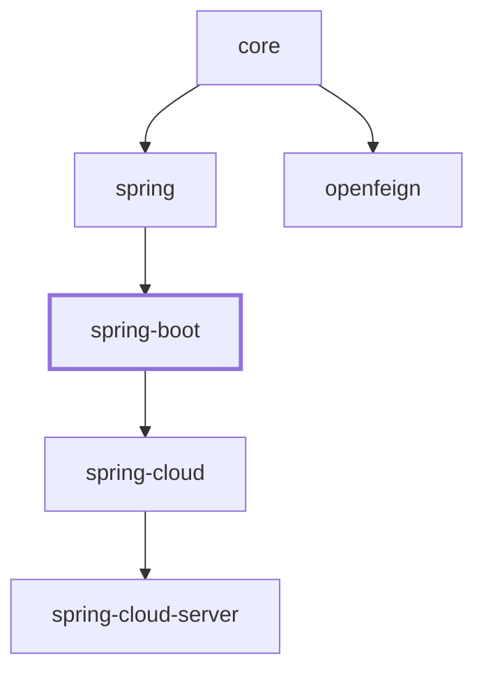

# Spring Boot 集成

`microsphere-i18n-spring-boot` 模块为 Microsphere 国际化框架提供 Spring Boot 自动配置。将其加入
Spring Boot 应用即可开启国际化支持，而无需任何 `@EnableI18n` 注解；它会把消息源注册为 Spring Bean，
并且在存在 Spring Boot Actuator 时暴露一个用于在运行时读取和写入消息的管理端点。

- [TOC]

## 概览

本模块位于纯 Spring 集成模块（`microsphere-i18n-spring`）与 Spring Cloud 各模块之间。它依赖
`microsphere-i18n-spring`，而后者又依赖 `microsphere-i18n-core`：

```
microsphere-i18n-spring-boot  ->  microsphere-i18n-spring  ->  microsphere-i18n-core
```

与需要你在配置类上标注 `@EnableI18n` 的 Spring 模块相比，Spring Boot 模块：

- 通过 `META-INF/spring/org.springframework.boot.autoconfigure.AutoConfiguration.imports`
  自动注册国际化基础设施，因此 `@EnableI18n` 会在内部替你应用。
- 可选地注册一个由 `spring.application.name` 派生的、应用专属的消息源。
- 提供一个 Actuator 端点（`/actuator/i18n`），用于在运行时查看和修改消息。
- 将所有行为都置于 `microsphere.i18n.enabled` 属性与类路径检查之后，因此当国际化被禁用或所需类缺失时，
  本模块完全不会生效。

## Maven 坐标

当前版本线为 `0.2.x` 系列（最新已发布版本 `0.2.21`），面向 **Java 17** 与 **Spring Boot 3.x**，
使用 `jakarta.*` 命名空间。

添加 starter 依赖（版本由 BOM 统一管理）：

```xml
<dependency>
    <groupId>io.github.microsphere-projects</groupId>
    <artifactId>microsphere-i18n-spring-boot</artifactId>
</dependency>
```

在你的 `dependencyManagement` 段落中导入 `microsphere-i18n-dependencies` BOM，以对齐所有
Microsphere 国际化构件的版本：

```xml
<dependencyManagement>
    <dependencies>
        <dependency>
            <groupId>io.github.microsphere-projects</groupId>
            <artifactId>microsphere-i18n-dependencies</artifactId>
            <version>0.2.21</version>
            <type>pom</type>
            <scope>import</scope>
        </dependency>
    </dependencies>
</dependencyManagement>
```

以下协作构件在本模块中被声明为 `optional`（可选），因此仅当使用相关特性时才需要你自己添加：

| 构件                                       | 用途                                                    |
|--------------------------------------------|---------------------------------------------------------|
| `microsphere-i18n-spring`                  | Spring 核心集成（传递性必需）                            |
| `spring-boot-starter`                      | Spring Boot 运行时                                       |
| `spring-boot-starter-web`                  | Web/MVC 应用                                             |
| `spring-boot-starter-actuator`             | `/actuator/i18n` 端点                                    |
| `microsphere-spring-boot-actuator`         | 端点存在性条件（`ConditionalOnActuatorEndpointPresent`）  |
| `jakarta.servlet-api`                      | 基于 Servlet 的 Locale 解析                              |
| `jakarta.validation-api`                   | Bean Validation 的 Locale 集成                           |

## 版本与兼容性

| 关注点                        | 当前（`0.2.x`）版本线的取值                                            |
|-------------------------------|------------------------------------------------------------------------|
| 库版本线                      | `0.2.x`（最新已发布版本 `0.2.21`）                                     |
| Java 基线                     | Java 17                                                                 |
| 命名空间                      | `jakarta.*`                                                             |
| Spring Boot                   | 3.x（基于 Spring Boot `3.5.x` 构建）                                   |
| Spring Cloud（同级模块）      | `2022.0.x` – `2025.0.x`（仅与 Spring Cloud 各模块相关）                 |
| Group ID                      | `io.github.microsphere-projects`                                        |
| 自动配置注册机制              | `AutoConfiguration.imports`（Spring Boot 3 风格）                       |
| 下游模块                      | 被 `microsphere-i18n-spring-cloud` 和 `microsphere-i18n-spring-cloud-server` 依赖 |

> `1.x` 版本线面向 Java 8，使用 `javax.*` 以及旧的 `spring.factories` 注册机制。相关文档位于指南的
> `1.x` 章节，本文不予覆盖。

## 自动配置行为

### `I18nAutoConfiguration` 何时生效

`I18nAutoConfiguration` 是主入口。它的类级注解为：

```java
@Configuration(proxyBeanMethods = false)
@ConditionalOnI18nAvailable
@EnableI18n
public class I18nAutoConfiguration { ... }
```

因此，只有在 `@ConditionalOnI18nAvailable` 复合条件被满足时它才会生效：

- **类存在性** —— `io.microsphere.i18n.ServiceMessageSource`（core 模块）与
  `io.microsphere.i18n.spring.annotation.EnableI18n`（spring 模块）都必须位于类路径上。只要缺少其中
  任意一个，整个自动配置就会完全退出。
- **属性条件** —— `microsphere.i18n.enabled` 不能为 `false`。该注解使用
  `@ConditionalOnProperty(name = "microsphere.i18n.enabled", matchIfMissing = true)`，意味着该特性
  **默认开启**，只有显式将其设置为 `false` 才会关闭。

当条件匹配时，该配置带有 `@EnableI18n` 注解，从而（通过 Spring 模块的
`I18nImportBeanDefinitionRegistrar`）注册标准的国际化 Bean 图：

| Bean 名称（默认）             | 类型                                       | 用途                                              |
|--------------------------------|--------------------------------------------|---------------------------------------------------|
| `commonServiceMessageSource`   | `ServiceMessageSourceFactoryBean`          | `common` 源的消息源                               |
| `serviceMessageSource`         | `DelegatingServiceMessageSource`（primary）| 聚合所有已注册的源                                |
| `messageSource`                | `MessageSourceAdapter`                     | 将国际化暴露为 Spring 的 `MessageSource`（`exposeMessageSource` 默认为 `true`） |
| `i18nApplicationListener`      | `I18nApplicationListener`                  | 生命周期 / 变更事件的装配                         |
| `serviceMessageSourceBeanLifecyclePostProcessor` | `ServiceMessageSourceBeanLifecyclePostProcessor` | 管理消息源 Bean 的生命周期           |
| `i18nLocalValidatorFactoryBeanPostProcessor` | `I18nLocalValidatorFactoryBeanPostProcessor` | 仅当存在 Bean Validation 的 `ValidatorFactory` 时才注册 |

### `spring.application.name` 如何与消息源交互

`I18nAutoConfiguration` 定义了一个额外的、以 `spring.application.name` 为条件的 Bean：

```java
@Bean
@ConditionalOnProperty(name = "spring.application.name")
public ServiceMessageSourceFactoryBean applicationServiceMessageSource(
        @Value("${spring.application.name}") String applicationName) {
    return new ServiceMessageSourceFactoryBean(applicationName);
}
```

带来的结果：

- 如果**未设置** `spring.application.name`，则只注册默认的 `common` 源。
- 如果**设置了** `spring.application.name`（例如 `myapp`），则会额外创建一个名为
  `applicationServiceMessageSource` 的 `ServiceMessageSourceFactoryBean`，其源名为应用名。于是放置在
  `META-INF/i18n/myapp/i18n_messages_<locale>.properties` 下的消息文件将被自动加载。
- 所有源 —— `common`、以应用命名的源，以及 `microsphere.i18n.sources` 中列出的源 —— 都会被组合进
  primary 的 `serviceMessageSource` Bean。

### 启用与禁用

```properties
# 默认开启；设置为 false 可关闭整个国际化自动配置
microsphere.i18n.enabled=true

# 设置应用名称会注册一个应用专属的消息源
spring.application.name=myapp
```

设置 `microsphere.i18n.enabled=false` 会阻止 `I18nAutoConfiguration`（以及因此的
`I18nEndpointAutoConfiguration`）被应用；上文列出的消息源 Bean 将不再注册。

## 配置属性

所有库属性都共享 `microsphere.i18n.` 前缀（常量 `I18nConstants.PROPERTY_NAME_PREFIX`）：

| 属性                             | 类型        | 默认值       | 说明                                                                    |
|----------------------------------|-------------|--------------|-------------------------------------------------------------------------|
| `microsphere.i18n.enabled`       | `boolean`   | `true`       | 国际化框架的总开关（`matchIfMissing = true`）。                          |
| `microsphere.i18n.sources`       | `String[]`  | —            | 除默认值之外需要注册的额外消息源名称。                                   |
| `microsphere.i18n.default-locale`| `Locale`    | JVM 默认值   | 当没有请求 Locale 时使用的 Locale。                                      |
| `microsphere.i18n.supported-locales` | `String[]` | —          | 每个源支持的、以逗号分隔的 Locale 列表（例如 `zh_CN,en`）。               |

本模块直接从代码读取的 Spring 应用属性：

| 属性                     | 使用位置                                                 | 效果                                                              |
|--------------------------|----------------------------------------------------------|------------------------------------------------------------------|
| `spring.application.name`| `I18nAutoConfiguration#applicationServiceMessageSource`  | 存在时注册一个以应用命名的消息源。                                 |

端点的 Actuator 管理属性（来自生成的 `spring-configuration-metadata.json`）：

| 属性                                          | 类型      | 默认值         | 备注                                                          |
|-----------------------------------------------|-----------|----------------|--------------------------------------------------------------|
| `management.endpoint.i18n.access`             | `Access`  | `unrestricted` | `i18n` 端点允许的访问级别。                                   |
| `management.endpoint.i18n.cache.time-to-live` | `Duration`| `0ms`          | 响应可缓存的最长时间。                                        |
| `management.endpoint.i18n.enabled`            | `Boolean` | `true`         | 自 Spring Boot `3.4.0` 起被废弃，由 `management.endpoint.i18n.access` 取代。 |

## API 参考

### `I18nAutoConfiguration`

`io.microsphere.i18n.spring.boot.autoconfigure.I18nAutoConfiguration`

- 带有 `@Configuration(proxyBeanMethods = false)`、`@ConditionalOnI18nAvailable`、`@EnableI18n` 注解。
- 声明 `applicationServiceMessageSource` Bean（以 `spring.application.name` 为条件）。
- 在 `AutoConfiguration.imports` 中以
  `io.microsphere.i18n.spring.boot.autoconfigure.I18nAutoConfiguration` 注册。

### `ConditionalOnI18nAvailable`

`io.microsphere.i18n.spring.boot.condition.ConditionalOnI18nAvailable`

一个可用于类型和方法上的复合 `@Conditional` 注解。它的元条件为：

- `@ConditionalOnClass(name = {"io.microsphere.i18n.ServiceMessageSource", "io.microsphere.i18n.spring.annotation.EnableI18n"})`
  —— 要求 core 与 spring 模块位于类路径上。
- `@ConditionalOnProperty(name = "microsphere.i18n.enabled", matchIfMissing = true)` —— 除非显式禁用，否则生效。

你可以在自己的配置类或 Bean 上复用该注解，使它们遵循相同的启用/禁用与类路径约定。

### `I18nEndpointAutoConfiguration`

`io.microsphere.i18n.spring.boot.actuate.autoconfigure.I18nEndpointAutoConfiguration`

```java
@Configuration(proxyBeanMethods = false)
@ConditionalOnI18nAvailable
@ConditionalOnActuatorEndpointPresent
@AutoConfigureAfter(I18nAutoConfiguration.class)
public class I18nEndpointAutoConfiguration {
    @Bean
    @ConditionalOnMissingBean
    @ConditionalOnAvailableEndpoint(endpoint = I18nEndpoint.class)
    public I18nEndpoint i18nEndpoint() {
        return new I18nEndpoint();
    }
}
```

仅当以下条件全部满足时，它才注册 `I18nEndpoint` Bean：

- 国际化特性可用（`@ConditionalOnI18nAvailable`），
- Spring Boot Actuator 的端点基础设施存在（`@ConditionalOnActuatorEndpointPresent`，来自
  `microsphere-spring-boot-actuator`），并且
- 端点本身按 Spring Boot 规则可用/已暴露（`@ConditionalOnAvailableEndpoint(endpoint = I18nEndpoint.class)`）。

`@AutoConfigureAfter(I18nAutoConfiguration.class)` 将其排在核心自动配置之后，从而在端点创建之前消息源已存在。
用户自定义的 `I18nEndpoint` Bean 会使这里的定义失效（`@ConditionalOnMissingBean`）。

### `I18nEndpoint` 的 HTTP 语义

`io.microsphere.i18n.spring.boot.actuate.I18nEndpoint` —— 使用 `@Endpoint(id = "i18n")` 声明，因此在默认
`/actuator` 前缀下，其 Web 基础路径为 `/actuator/i18n`。

各操作由 `@ReadOperation` / `@WriteOperation` / `@Selector` 注解推导而来：

| 操作                | HTTP   | 路径                           | 源方法                                                       |
|---------------------|--------|--------------------------------|--------------------------------------------------------------|
| 列出所有消息        | `GET`  | `/actuator/i18n`               | `invoke()`                                                   |
| 按 code 获取消息    | `GET`  | `/actuator/i18n/{code}`        | `getMessage(@Selector String code)`                          |
| 按 code+locale 获取 | `GET`  | `/actuator/i18n/{code}/{locale}` | `getMessage(@Selector String code, @Selector Locale locale)` |
| 新增/覆盖一条消息   | `POST` | `/actuator/i18n`               | `addMessage(String source, Locale locale, String code, String message)` |

**`GET /actuator/i18n`** 返回一个以资源文件为键的 Map，每个键下是其 `code -> message` 键值对，例如：

```json
{
  "META-INF/i18n/test/i18n_messages_en.properties": {
    "test.a": "test-a",
    "test.hello": "Hello,{}"
  },
  "META-INF/i18n/common/i18n_messages_zh_CN.properties": {
    "common.a": "啊"
  }
}
```

**`GET /actuator/i18n/{code}`** 对每个（资源、支持的 locale）组合返回一条记录。每条记录都是一个包含五个字段的对象：
`code`、`locale`、`source`、`resource`、`message`（当该 code 在对应资源/Locale 中不存在时 `message` 为 `null`）：

```json
[
  {
    "code": "a",
    "locale": "en",
    "source": "common",
    "resource": "META-INF/i18n/common/i18n_messages_en.properties",
    "message": "a"
  },
  {
    "code": "a",
    "locale": "zh_CN",
    "source": "common",
    "resource": "META-INF/i18n/common/i18n_messages_zh_CN.properties",
    "message": "啊"
  }
]
```

**`GET /actuator/i18n/{code}/{locale}`** 行为相同，但将结果限制为所请求的单个 `locale`（例如 `zh_CN`）。

**`POST /actuator/i18n`** 调用 `@WriteOperation`。在 Spring Boot 3.x 中，该操作的方法参数按名称从 JSON 请求体绑定
（`source`、`locale`、`code`、`message`）。请求体形如：

```json
{
  "source": "common",
  "locale": "fr",
  "code": "a",
  "message": "$a"
}
```

语义（来自 `addMessage`）：

- `source` 必须匹配某个已注册的 `PropertySourcesServiceMessageSource` 的 `getSource()`；若不存在这样的源，操作返回空对象 `{}`。
- `locale` 是一个 `java.util.Locale`（例如 `fr` 或 `zh_CN`）。
- 消息会被写入由环境支撑的属性源，并重新初始化目标源（`init()`），因此新值无需重启即可立即生效。
- 响应为发生变更的属性 Map（资源名 -> 序列化后的 `.properties` 内容）。

## Actuator 暴露配置

仅当 Actuator 可用时端点才会被注册，但它还必须在 Web 层被暴露。默认情况下，`i18n` 端点**并不**在已暴露的 Web
端点之列，因此需要显式添加：

```properties
# 通过 Web 暴露 i18n 端点（单个端点）
management.endpoints.web.exposure.include=i18n

# 或者暴露所有端点（开发环境使用）
management.endpoints.web.exposure.include=*

# 确保端点本身已启用（默认为 true）
management.endpoint.i18n.enabled=true
```

下面这两行出现在本模块自身的 `src/test/resources/application.properties` 中，也正是端点测试所依赖的配置：

```properties
management.endpoint.i18n.enabled=true
management.endpoints.web.exposure.include=*
```

在 Spring Boot `3.4.0` 及更新版本中，应优先使用 `management.endpoint.i18n.access`（取值如 `none`、`read-only`、
`unrestricted`），而不是被废弃的 `management.endpoint.i18n.enabled`。

## 代码示例

### 引导应用

改编自 `I18nEndpointAutoConfigurationBootstrap`，这是一个可运行的 Spring Boot 应用，开启完整自动配置并注册一个额外的
`test` 消息源：

```java
@EnableAutoConfiguration
public class I18nEndpointAutoConfigurationBootstrap {

    public static void main(String[] args) {
        new SpringApplicationBuilder(I18nEndpointAutoConfigurationBootstrap.class)
                .web(WebApplicationType.SERVLET)
                .properties("test.i18n_messages_en.properties=test.a = test-a-2024")
                .run(args);
    }

    @Bean
    public static ServiceMessageSourceFactoryBean testServiceMessageSource() {
        return new ServiceMessageSourceFactoryBean("test");
    }
}
```

其中 `.properties("test.i18n_messages_en.properties=test.a = test-a-2024")` 一行展示了运行时注入的约定：
**属性名即资源标识符**（`<source>.i18n_messages_<locale>.properties`），**属性值即 `.properties` 文件内容**。

### 最小配置

```properties
# application.properties
spring.application.name=myapp
microsphere.i18n.enabled=true
management.endpoints.web.exposure.include=i18n
```

### 使用消息源

```java
@Service
public class GreetingService {

    @Autowired
    private ServiceMessageSource messageSource;

    public String greet(String name) {
        // 针对当前 Locale 解析 "test.hello"，例如 "Hello,World"
        return messageSource.getMessage("test.hello", name);
    }
}
```

### 消息文件布局

消息文件从类路径下的 `META-INF/i18n/<source>/` 读取，遵循 `i18n_messages_<locale>.properties` 命名约定
（测试模块恰好内置了这些文件）：

```
src/test/resources/META-INF/i18n/
├── common/
│   ├── i18n_messages_en.properties        # common.a = a
│   └── i18n_messages_zh_CN.properties     # common.a = 啊
└── test/
    ├── i18n_messages_en.properties        # test.a = test-a / test.hello = Hello,{}
    └── i18n_messages_zh_CN.properties     # test.a = 测试-a / test.hello = 您好,{}
```

## 模块依赖关系

依赖 `spring`（→ `core`）；`spring-cloud` 构建于其上。


