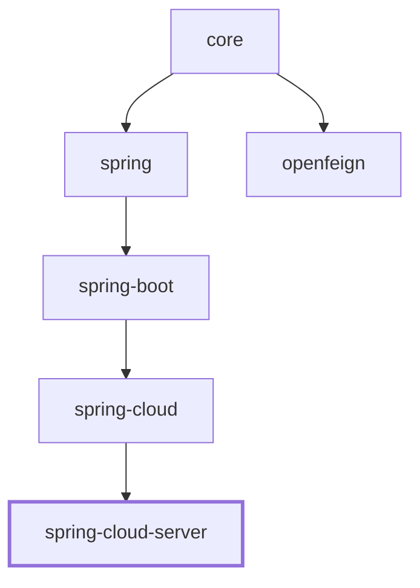

# Spring Cloud i18n 服务端

## 概述

`microsphere-i18n-spring-cloud-server` 把一个应用变成一个集中式 i18n 服务端。它通过 Spring Cloud 的
`DiscoveryClient` 发现所有已注册的服务，从 Spring `Environment` 为每个服务构建一个消息源，将它们聚合进同一个
`CompositeServiceMessageSource`，并通过 REST 暴露合并后的消息，使客户端（或网关）能够在单一位置读取所有服务的
翻译。

本模块恰好包含三个生产类：

- `@EnableI18nServer` —— 激活注解（导入一个内部 `Marker` 类）。
- `I18nServerAutoConfiguration` —— 负责发现与聚合的自动配置。
- `I18nServerController` —— 暴露聚合消息的 `@RestController`。

它还依赖 `I18nEndpoint`（来自 `microsphere-i18n-spring-boot` 的 Spring Boot Actuator 端点）作为 REST 响应的数据源。

> 类名说明：根级开发者文档历史上提到过一个名为 `I18nServerConfiguration` 的类。源码中真正的类是
> `I18nServerAutoConfiguration`（`io.microsphere.i18n.spring.cloud.server.autoconfigure.I18nServerAutoConfiguration`）。
> 并不存在 `I18nServerConfiguration`。

依赖链：

```
spring-cloud-server -> spring-cloud -> spring-boot -> spring -> core
```

## Maven 坐标

```xml
<dependency>
    <groupId>io.github.microsphere-projects</groupId>
    <artifactId>microsphere-i18n-spring-cloud-server</artifactId>
    <version>0.2.21</version>
</dependency>
```

`spring-cloud-commons`（用于 `DiscoveryClient`）与 `spring-cloud-context`，连同
`microsphere-spring-cloud-commons`、`microsphere-spring-boot-core`、`microsphere-spring-boot-actuator`，在 POM
中被声明为 optional。请通过你自己的 BOM 引入这些 Spring Cloud 制品。

## 版本与兼容性

| 组件                | 取值                                                              |
|---------------------|-------------------------------------------------------------------|
| microsphere-i18n 线 | `0.2.x`（最新发布版 `0.2.21`）                                    |
| groupId             | `io.github.microsphere-projects`                                  |
| Java                | 17                                                                |
| 命名空间            | `jakarta.*`                                                       |
| Spring Boot         | 3.x                                                               |
| Spring Cloud        | 2022.0.x - 2025.0.x                                               |
| 依赖                | classpath 上需要一个阻塞式 `DiscoveryClient` 与 Spring Boot Actuator |
| 自动配置注册        | `META-INF/spring/org.springframework.boot.autoconfigure.AutoConfiguration.imports` |

该自动配置通过 Spring Boot 3 的 imports 文件
`META-INF/spring/org.springframework.boot.autoconfigure.AutoConfiguration.imports` 注册，文件中的唯一条目是
`io.microsphere.i18n.spring.cloud.server.autoconfigure.I18nServerAutoConfiguration`。

## 启用服务端：`@EnableI18nServer`

`@EnableI18nServer` 就是开关。它带有 `@Target(TYPE)`、`@Inherited`，并 `@Import` 了嵌套的
`EnableI18nServer.Marker` 类。注册这个 marker Bean 正是 `I18nServerAutoConfiguration` 通过
`@ConditionalOnBean(Marker.class)` 所要求的条件，因此该注解既表明意图，又把自动配置挡在门后。

```java
@SpringBootApplication
@EnableDiscoveryClient
@EnableI18nServer
public class I18nServerApplication {
    public static void main(String[] args) {
        SpringApplication.run(I18nServerApplication.class, args);
    }
}
```

测试 bootstrap `I18nServerBootstrap` 使用的正是这一组合
（`@SpringBootApplication @EnableDiscoveryClient @EnableI18nServer`），并以 `SERVLET` 应用启动。

如果你不想用这个注解，只要存在一个 `Marker` Bean、一个阻塞式 `DiscoveryClient`、Actuator 以及一个 Web 应用，
自动配置同样会装配这些 Bean —— 但 `@EnableI18nServer` 才是受支持的、声明式入口。

## REST 端点

### `I18nServerController`

`I18nServerController` 是一个普通的 `@RestController`，它自动注入 `I18nEndpoint` 并只暴露一个方法：

| 方法 | 路径        | 返回                                   | 委托给 |
|------|-------------|----------------------------------------|--------|
| GET  | `/messages` | `Map<String, Map<String, String>>`     | `i18nEndpoint.invoke()` |

```java
@GetMapping("/messages")
public Map<String, Map<String, String>> getMessages() {
    return i18nEndpoint.invoke();
}
```

响应是一个以资源名为键的 map，每个值持有该资源跨所有已发现服务的 `code -> message` 键值对。

### `I18nEndpoint`（Actuator）

由于服务端模块同样依赖 Actuator 的 `I18nEndpoint`，在端点被暴露后，除 `/messages` 外还可使用标准操作：

| 方法   | 路径                       | 操作（注解） | 用途 |
|--------|----------------------------|--------------|------|
| GET    | `/actuator/i18n`           | `@ReadOperation invoke()` | 全部消息，与 `/messages` 载荷相同 |
| GET    | `/actuator/i18n/{code}`    | `@ReadOperation getMessage(@Selector code)` | 某个 code 在所有支持语言下的消息 |
| GET    | `/actuator/i18n/{code}/{locale}` | `@ReadOperation getMessage(code, @Selector locale)` | 某个 code 在单一语言下的消息 |
| POST   | `/actuator/i18n`           | `@WriteOperation addMessage(...)` | 在由 `Environment` 支撑的消息源中新增/更新一条消息 |

控制器的路径 `/messages` 有意不带 `/actuator` 前缀；端点路径位于 Actuator 的基础路径之下。

## 跨服务聚合消息

`I18nServerAutoConfiguration` 分两个阶段进行聚合。

阶段 1 —— 一个延迟的组合体 Bean。启动时，上下文中注册了一个空的 `CompositeServiceMessageSource`，Bean 名为
`lazyCompositeServiceMessageSource`（带 `@Lazy`）：

```java
@Lazy
@Bean(name = LAZY_COMPOSITE_SERVICEMESSAGE_SOURCE_BEAN_NAME)
public CompositeServiceMessageSource lazyCompositeServiceMessageSource() {
    return new CompositeServiceMessageSource();
}
```

阶段 2 —— 在 `ApplicationStartedEvent` 上填充。当 Spring Boot 发布 `ApplicationStartedEvent` 时，监听器取出这个
延迟组合体，向 `DiscoveryClient` 请求服务列表，为每个服务构建一个消息源，并把它们装入组合体：

```java
@EventListener(ApplicationStartedEvent.class)
public void onApplicationStartedEvent(ApplicationStartedEvent event) {
    ConfigurableApplicationContext context = event.getApplicationContext();
    CompositeServiceMessageSource composite =
            context.getBean(LAZY_COMPOSITE_SERVICEMESSAGE_SOURCE_BEAN_NAME, CompositeServiceMessageSource.class);
    List<String> services = discoveryClient.getServices();
    List<ServiceMessageSource> serviceMessageSources = services.stream()
            .map(this::buildServiceMessageSource)
            .collect(Collectors.toList());
    composite.setServiceMessageSources(serviceMessageSources);
}

private ServiceMessageSource buildServiceMessageSource(String service) {
    PropertySourcesServiceMessageSource serviceMessageSource = new PropertySourcesServiceMessageSource(service);
    serviceMessageSource.setEnvironment(environment);
    serviceMessageSource.setDefaultLocale(getDefault());
    serviceMessageSource.setSupportedLocales(ofList(getDefault(), ENGLISH));
    serviceMessageSource.init();
    return serviceMessageSource;
}
```

因此，注册为 `order-service` 的服务会产出一个 `PropertySourcesServiceMessageSource`，其消息从名为
`order-service.i18n_messages_en.properties`、`order-service.i18n_messages_zh_CN.properties` 等的 `Environment`
属性读取。`CompositeServiceMessageSource` 将它们合并，`I18nServerController` 返回合并后的视图。

simple-discovery 场景下的示例 `application.properties`（对应本模块测试配置）：

```properties
spring.application.name=i18n-server
management.endpoint.i18n.enabled=true
management.endpoints.web.exposure.include=*
management.endpoint.env.post.enabled=true

spring.cloud.discovery.client.simple.instances.test-application[0].instanceId=1
spring.cloud.discovery.client.simple.instances.test-application[0].serviceId=test-application
spring.cloud.discovery.client.simple.instances.test-application[0].host=127.0.0.1
spring.cloud.discovery.client.simple.instances.test-application[0].port=8080
```

在这个仅发现单个服务的配置下，`GET /messages` 会返回由 `test-application` 贡献的资源（外加服务端自身的 `common`
source），各自以其资源名为键。

## `DiscoveryClient` 如何使用

发现工作通过 Spring Cloud 的 `org.springframework.cloud.client.discovery.DiscoveryClient` 完成，它被自动注入到
`I18nServerAutoConfiguration`。唯一的调用是 `discoveryClient.getServices()`，每次 `ApplicationStartedEvent` 触发
时调用一次。每个返回的服务 id 都会变成一个 source 名，交给 `PropertySourcesServiceMessageSource`。

该自动配置受 `@ConditionalOnBlockingDiscoveryAvailable`（来自 `microsphere-spring-cloud-commons`）保护，因此只有在
阻塞式 discovery client 可用时才会激活；并且通过 `@AutoConfigureAfter`
（`COMMONS_CLIENT_AUTO_CONFIGURATION_CLASS_NAME`、`I18nAutoConfiguration`、`I18nEndpointAutoConfiguration`、
`I18nCloudAutoConfiguration`）排在 discovery/actuator/i18n 自动配置之后。这保证了在服务端构建其组合体之前，
`DiscoveryClient` 与 `I18nEndpoint` Bean 已经存在。

注意源码中的 locale 处理包含一个 `// FIXME Hardcode` 标记：每个服务的默认 locale 取 JVM 默认值，支持的语言被
硬编码为 `{default, ENGLISH}`。

## 模块依赖关系

依赖 `spring-cloud`（→ `spring-boot` → `spring` → `core`）。


