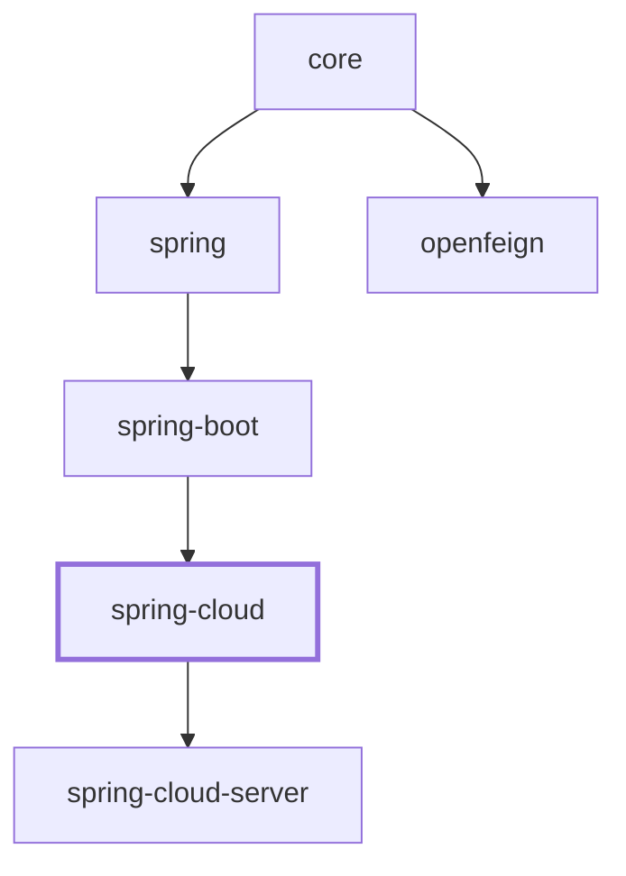

# Spring Cloud 集成

## 概述

`microsphere-i18n-spring-cloud` 将 i18n 框架与 Spring Cloud 连接起来，使国际化消息能够在 Spring Cloud
`Environment` 发生变化时于运行时重新加载。当发生配置刷新时（例如 `POST /actuator/refresh`、一次 Spring
Cloud Config 更新，或手动发布的 `EnvironmentChangeEvent`），框架会从当前 `Environment` 重新读取受影响的消息
资源，而无需重启应用。

本模块刻意保持精简，只提供一个自动配置类 `I18nCloudAutoConfiguration`，它注册一个 Bean：

- `ReloadableResourceServiceMessageSourceListener` —— 一个 `ApplicationListener<EnvironmentChangeEvent>`，
  用于触发那些由 Spring `PropertySources` 支撑的消息源重新加载。

它位于 `microsphere-i18n-spring-boot` 之上，并继承该模块已经完成的所有装配（`DelegatingServiceMessageSource`、
每个 source 对应的 `PropertySourcesServiceMessageSource` Bean，以及 `I18nEndpoint` 运维端点）。依赖链如下：

```
spring-cloud -> spring-boot -> spring -> core
```

## Maven 坐标

```xml
<dependency>
    <groupId>io.github.microsphere-projects</groupId>
    <artifactId>microsphere-i18n-spring-cloud</artifactId>
    <version>0.2.21</version>
</dependency>
```

如果你通过项目 BOM 统一管理版本，可引入 `microsphere-i18n-dependencies`（其父工程为 `microsphere-i18n-parent`），
并省略 `<version>` 元素：

```xml
<dependencyManagement>
    <dependencies>
        <dependency>
            <groupId>io.github.microsphere-projects</groupId>
            <artifactId>microsphere-i18n-dependencies</artifactId>
            <version>0.2.21</version>
            <type>pom</type>
            <scope>import</scope>
        </dependency>
    </dependencies>
</dependencyManagement>
```

`spring-cloud-context`（提供 `EnvironmentChangeEvent`）与 `spring-cloud-commons` 在模块 POM 中被声明为
optional，因此需要你通过自己的 Spring Cloud BOM 引入。若 classpath 上没有 `spring-cloud-context`，该自动配置
会静默退避。

## 版本与兼容性

| 组件                | 取值                                                              |
|---------------------|-------------------------------------------------------------------|
| microsphere-i18n 线 | `0.2.x`（最新发布版 `0.2.21`）                                    |
| groupId             | `io.github.microsphere-projects`                                  |
| Java                | 17                                                                |
| 命名空间            | `jakarta.*`                                                       |
| Spring Boot         | 3.x                                                               |
| Spring Cloud        | 2022.0.x - 2025.0.x                                               |
| 依赖                | classpath 上需要 `spring-cloud-context`（用于 `EnvironmentChangeEvent`） |
| 自动配置注册        | `META-INF/spring/org.springframework.boot.autoconfigure.AutoConfiguration.imports` |

本模块通过 Spring Boot 3 的 imports 文件
`META-INF/spring/org.springframework.boot.autoconfigure.AutoConfiguration.imports` 注册其自动配置，文件中的
唯一条目是 `io.microsphere.i18n.spring.cloud.autoconfigure.I18nCloudAutoConfiguration`。

## 动态重新加载行为

整个模块只响应一个事件：Spring Cloud 的
`org.springframework.cloud.context.environment.EnvironmentChangeEvent`。

`ReloadableResourceServiceMessageSourceListener` 同时实现了
`ApplicationListener<EnvironmentChangeEvent>` 与 `BeanFactoryAware`。它持有 `BeanFactory` 的引用，当收到
`EnvironmentChangeEvent` 时，把发生变化的属性键直接交给
`PropertySourcesServiceMessageSource.reloadAll(beanFactory, event.getKeys())`。

```java
@Override
public void onApplicationEvent(EnvironmentChangeEvent event) {
    Set<String> changedPropertyNames = event.getKeys();
    reloadAll(this.beanFactory, changedPropertyNames);
}
```

### 哪些消息源会被重新加载

`reloadAll` 不会遍历上下文中的所有 Bean。它从主 `serviceMessageSource` Bean
（`DelegatingServiceMessageSource`，一个组合体）出发遍历其消息源图，只保留
`PropertySourcesServiceMessageSource` 实例 —— 即内容从 Spring `PropertySources` 读取、因此可在运行时发生变化的
消息源。具体来说：

1. 收集所有可从主 `ServiceMessageSource` 抵达的 `PropertySourcesServiceMessageSource` Bean
   （`findAllPropertySourcesServiceMessageSources(beanFactory)`）。
2. 逐个检查其资源。一个资源标识符同时也是它所读取的 Spring 属性名，格式为
   `<source>.<locale-resource-file>` —— 例如 `common.i18n_messages_en.properties`
   （source 为 `common`，文件为 `i18n_messages_en.properties`）。
3. 只有当变化键集合包含该属性名（`changedPropertyNames.contains(propertyName)`）**并且** `Environment`
   确实能解析它（`canReload(...)` 会检查 `environment.containsProperty(...)`）时，该资源才会被重新加载。
4. 通过筛选的资源会被重新初始化：消息源重新读取属性值（该值以字符串形式保存 `.properties` 文件内容）并重新解析。

仅位于 classpath 的普通消息源不会被这条路径处理 —— 只有由 `Environment` 支撑的
`PropertySourcesServiceMessageSource` Bean 会参与其中。

### 从代码中读取的配置属性

监听器本身不读取任何配置属性；它只对事件作出响应。真正控制本模块的是自动配置条件以及周边基础设施所读取的属性：

| 属性                               | 读取方                                           | 作用 |
|------------------------------------|--------------------------------------------------|------|
| `microsphere.i18n.enabled`         | `@ConditionalOnI18nAvailable`（`@ConditionalOnProperty`，`matchIfMissing = true`） | 设为 `false` 可彻底禁用该自动配置。默认 `true`。 |
| `io.microsphere.i18n.ServiceMessageSource`、`io.microsphere.i18n.spring.annotation.EnableI18n` | `@ConditionalOnI18nAvailable` 的类检查 | 若 `core`/`spring` 类不存在，自动配置退避。 |
| `org.springframework.cloud.context.environment.EnvironmentChangeEvent` | `I18nCloudAutoConfiguration` 上的 `@ConditionalOnClass` | 没有 `spring-cloud-context` 时自动配置退避。 |
| `common.i18n_messages_en.properties`（以及任意 `<source>.<locale-resource-file>`） | `PropertySourcesServiceMessageSource.reloadAll` | 形如此样的变化键才是真正触发该资源重新加载的开关。 |

变化键来源于你所使用的任何 Spring Cloud 刷新机制，因此在 Config-server 场景下，重新加载是由你在服务端发布的
属性名驱动的。

### 完整可用示例

以下示例复刻了 `MessageSourceIntegrationTest` 与 `I18nBootstrap` 演示，并使用测试资源 `i18n-bootstrap.properties`。

classpath 上的消息资源（`META-INF/i18n/common/i18n_messages_en.properties`）：

```properties
common.a = a
```

Bootstrap 属性（`i18n-bootstrap.properties`），它启用运维端点以及会发布 `EnvironmentChangeEvent` 的环境写入端点：

```properties
spring.application.name=i18n-bootstrap
management.endpoint.i18n.enabled=true
management.endpoints.web.exposure.include=*
management.endpoint.env.post.enabled=true
```

Bootstrap 应用：

```java
@EnableAutoConfiguration
@PropertySource(value = "classpath:/i18n-bootstrap.properties")
public class I18nBootstrap {
    public static void main(String[] args) {
        new SpringApplicationBuilder(I18nBootstrap.class)
                .web(SERVLET)
                // 预置覆盖值，把 common.a 变成 "common-a-2024"
                .properties("common.i18n_messages_en.properties=common.a = common-a-2024")
                .run(args);
    }
}
```

在运行时，为属性 `common.i18n_messages_en.properties` 注入新值并发布该键的 `EnvironmentChangeEvent`，即可实时
切换消息。这正是集成测试所断言的：

```java
ServiceMessageSource serviceMessageSource =
        applicationContext.getBean("commonServiceMessageSource", ServiceMessageSource.class);

assertThat(serviceMessageSource.getMessage("common.a", ENGLISH)).isEqualTo("a");

// 放入一个新的 PropertySource，覆盖 common.i18n_messages_en.properties
environment.getPropertySources().addLast(
        new MapPropertySource("test", Maps.newHashMap(
                "common.i18n_messages_en.properties", "common.a=a.2024")));

// 发布监听器所订阅的 Spring Cloud 事件
applicationContext.publishEvent(
        new EnvironmentChangeEvent(ofSet("common.i18n_messages_en.properties")));

// 消息源已从 Environment 重新加载
assertThat(serviceMessageSource.getMessage("common.a", ENGLISH)).isEqualTo("a.2024");
```

同样的效果也能通过 HTTP 达到：用资源属性名与新内容 `POST /actuator/env` 会发布一个 `EnvironmentChangeEvent`，
此后 `GET /actuator/i18n` 就会反映更新后的消息 —— 无需重启。

## 模块依赖关系

依赖 `spring-boot`（→ `spring` → `core`）；`spring-cloud-server` 构建于其上。


