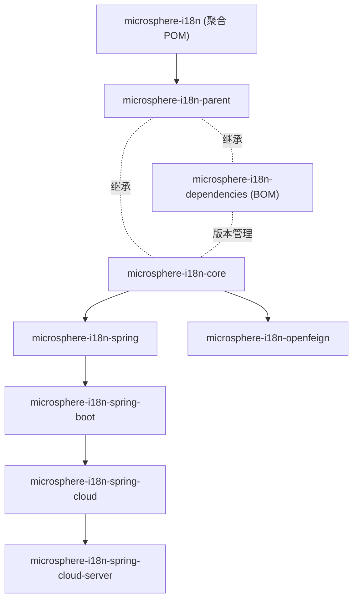

# Microsphere I18n 文档

[microsphere-i18n](https://github.com/microsphere-projects/microsphere-i18n)（面向 Java 与 Spring
生态的国际化框架）文档总入口。

- [English documentation](../README.md)

## 文档结构

文档按 **读者对象**、**发布线（分支）**、**Maven 模块** 三级组织。英文为默认语言，中文译文存放于
平行的 `zh/` 目录，文件名与英文版完全一致。

```
docs/
├── user-guide/          # 用户文档（API、配置、示例）
│   ├── current/         # 0.2.x 发布线（release 分支，Spring Boot 3）
│   │   └── zh/          # 中文译文
│   └── 1.x/             # 0.1.x 发布线（release-1.x 分支，Spring Boot 2）
│       └── zh/
└── developer-guide/     # 开发者文档（架构、源码分析、设计模式、流程）
    ├── current/
    │   └── zh/
    └── 1.x/
        └── zh/
```

## 从这里开始

| **文档** | **入口** | **读者对象** |
|----------|----------|--------------|
| 用户文档 | [中文](../user-guide/zh/README.md) / [English](../user-guide/README.md) | 使用本库的应用开发者 |
| 开发者文档 | [中文](../developer-guide/zh/README.md) / [English](../developer-guide/README.md) | 贡献者与框架集成开发者 |

## 发布线

| **分支** | **目录** | **版本线** | **最新发布版** | **命名空间** | **Spring Boot** | **Spring Cloud** | **Java** |
|----------|----------|------------|----------------|--------------|-----------------|------------------|----------|
| `release` | [`current/`](../user-guide/current/zh/README.md) | 0.2.x | `0.2.21` | `jakarta.*` | 3.x | 2022.0.x – 2025.0.x | 17+ |
| `release-1.x` | [`1.x/`](../user-guide/1.x/zh/README.md) | 0.1.x | `0.1.21` | `javax.*` | 2.3.x – 2.7.x | Hoxton.SR12 – 2021.0.x | 8+ |

## Maven 模块

每个模块在每份指南中都有独立文档：

| **模块** | **用户文档** | **开发者文档** | **用途** |
|----------|--------------|----------------|----------|
| `microsphere-i18n-parent` | [parent.md](../user-guide/current/zh/parent.md) | [parent.md](../developer-guide/current/zh/parent.md) | 父 POM，导入 microsphere-spring-cloud BOM |
| `microsphere-i18n-dependencies` | [dependencies.md](../user-guide/current/zh/dependencies.md) | [dependencies.md](../developer-guide/current/zh/dependencies.md) | 统一管理各模块版本的项目 BOM |
| `microsphere-i18n-core` | [core.md](../user-guide/current/zh/core.md) | [core.md](../developer-guide/current/zh/core.md) | `ServiceMessageSource` 抽象与 classpath 实现 |
| `microsphere-i18n-spring` | [spring.md](../user-guide/current/zh/spring.md) | [spring.md](../developer-guide/current/zh/spring.md) | Spring Framework 集成（`@EnableI18n`、适配器、事件） |
| `microsphere-i18n-spring-boot` | [spring-boot.md](../user-guide/current/zh/spring-boot.md) | [spring-boot.md](../developer-guide/current/zh/spring-boot.md) | 自动装配与 Actuator 端点 |
| `microsphere-i18n-spring-cloud` | [spring-cloud.md](../user-guide/current/zh/spring-cloud.md) | [spring-cloud.md](../developer-guide/current/zh/spring-cloud.md) | 配置变更时动态刷新消息 |
| `microsphere-i18n-spring-cloud-server` | [spring-cloud-server.md](../user-guide/current/zh/spring-cloud-server.md) | [spring-cloud-server.md](../developer-guide/current/zh/spring-cloud-server.md) | 基于 REST 的集中式 i18n 服务器 |
| `microsphere-i18n-openfeign` | [openfeign.md](../user-guide/current/zh/openfeign.md) | [openfeign.md](../developer-guide/current/zh/openfeign.md) | Feign 调用传播 `Accept-Language` |

将链接中的 `current/` 替换为 `1.x/` 即可阅读 0.1.x 发布线的对应文档。

## 模块依赖总览



实线表示编译期依赖，虚线表示 POM 继承 / BOM 管理。更详细的流程图见
[开发者文档](../developer-guide/zh/README.md)。
